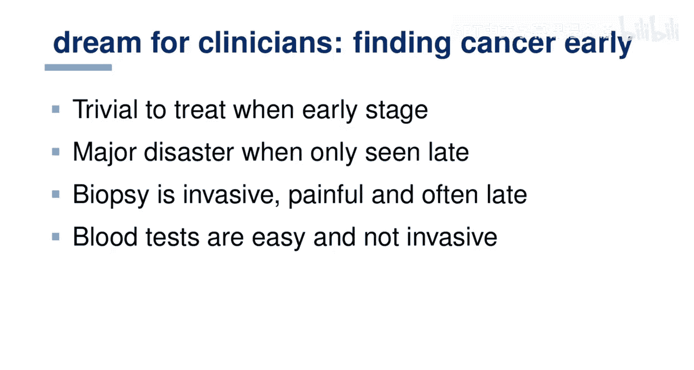
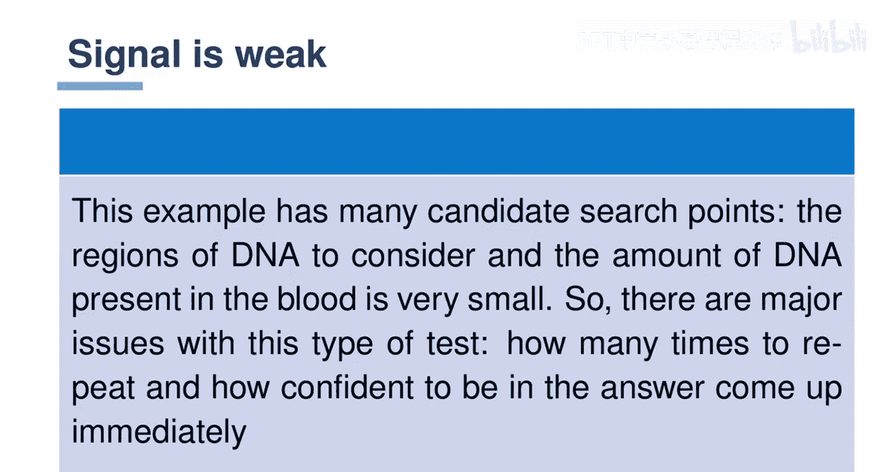
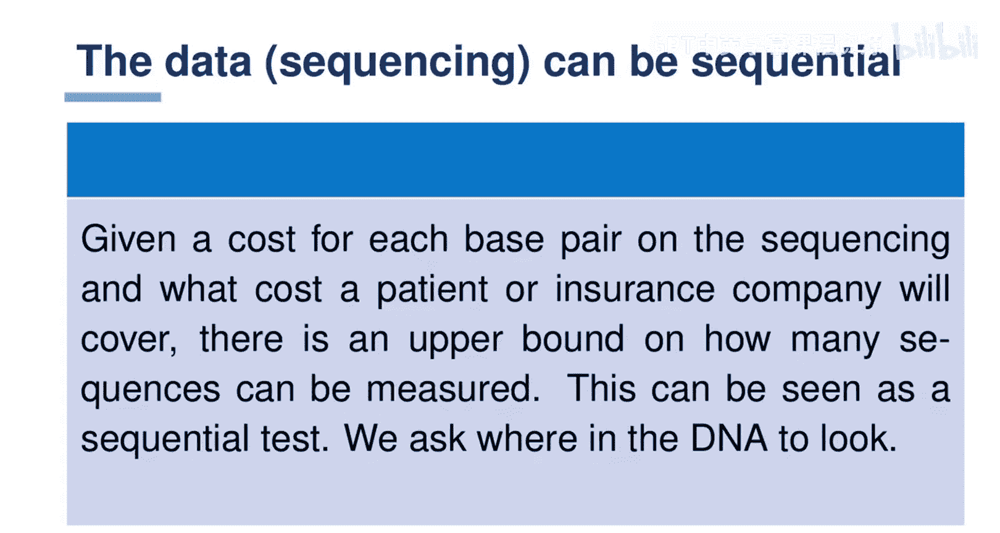
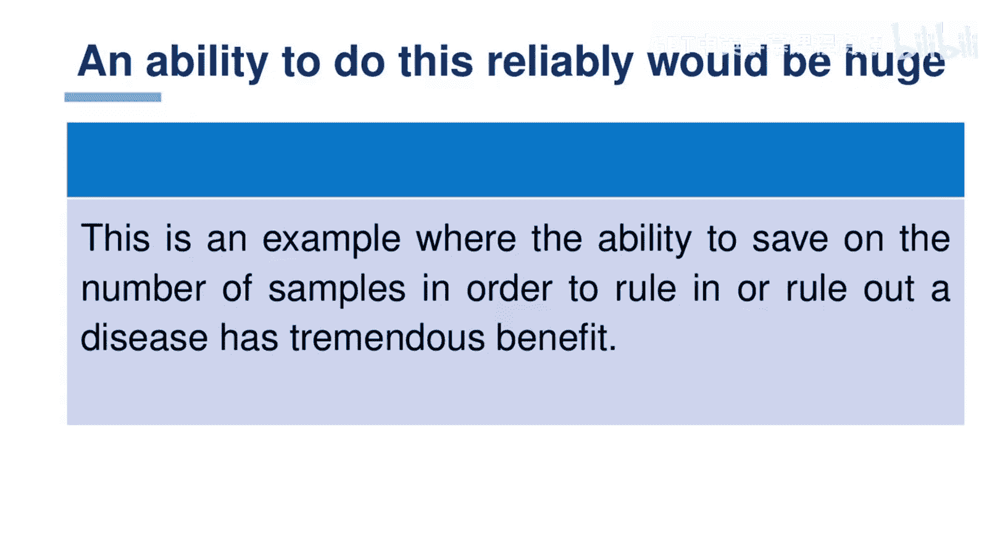
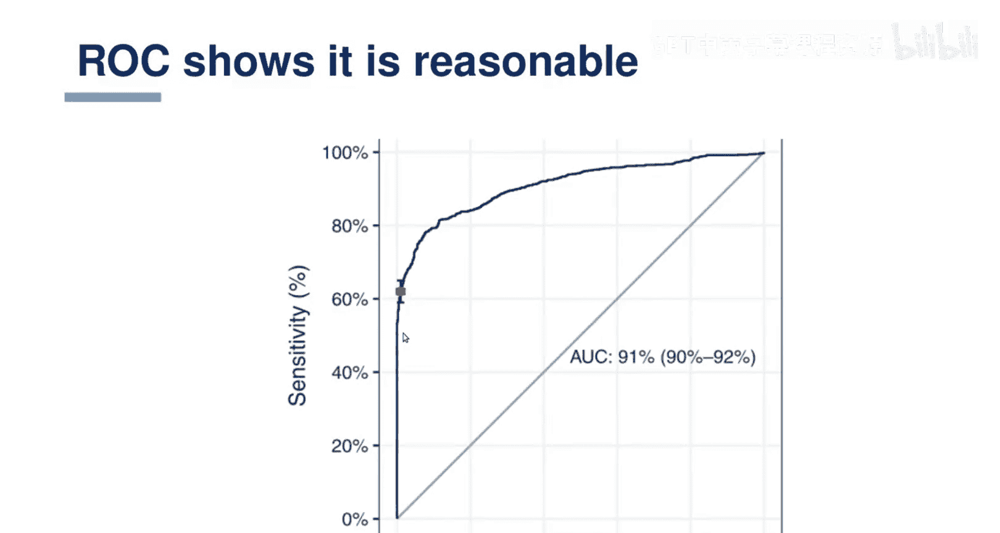
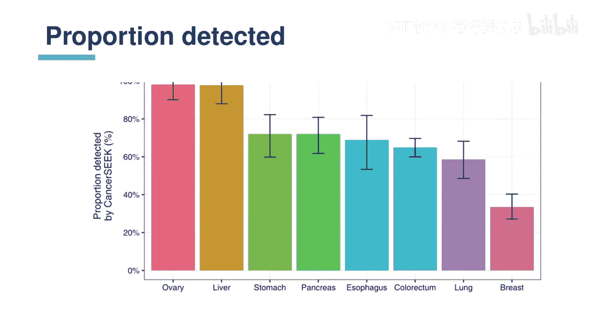
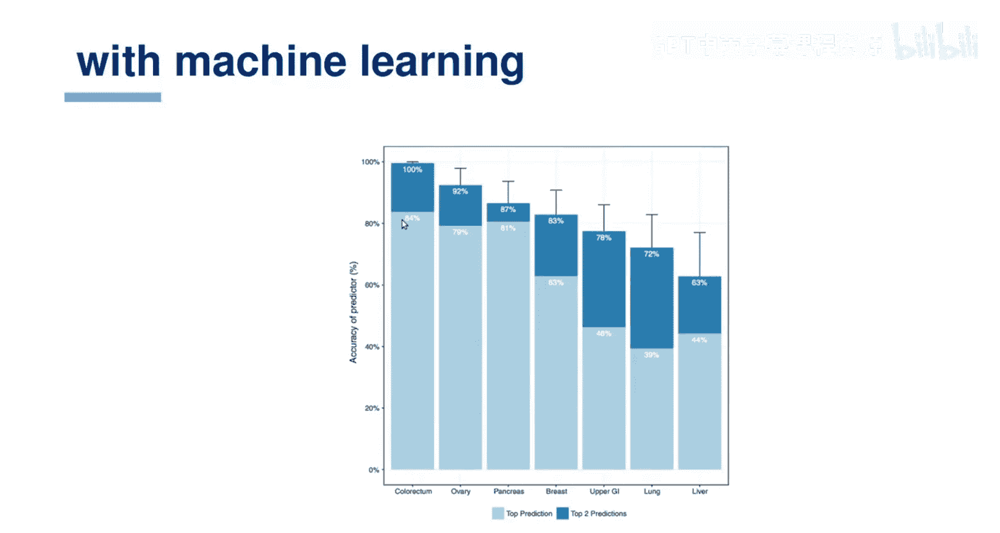
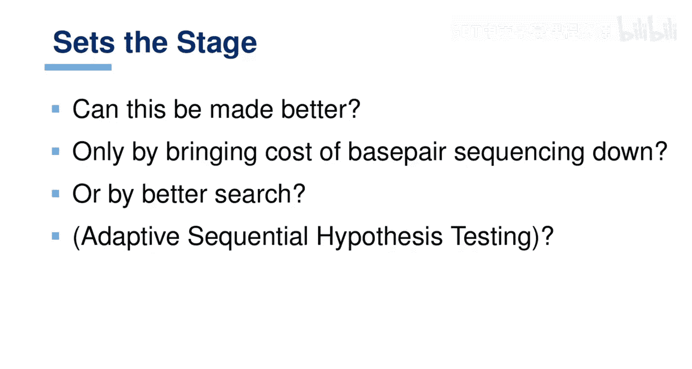

# 约翰霍普金斯大学《数据科学：时间中的决策｜Data Science Decisions in Time》中英字幕 p22 6_癌症液体活检的临床预检技术.zh_en -BV1NCuzzfEJa_p22-

We'll now talk about genomic testing for cancer。 This is a really interesting problem in a nice application of sequentialial hypothesis testing。

 The question we're addressing here is， can we reliably and quickly find early stage cancer。

 which would be a tremendous game changer if it's possible。

 So this is really a dream for many clinicians finding cancer early。

 it's really trivial to treat it when it's early stage。

 you can just remove the infected region and it isn't spread and thrive increases dramatically。

 But obviously it's a huge disaster if it's seen late if it's already metastsized。

 So what you want to do is avoid a biopsy if possible which can be painful， and it's often late。

 It's often just an indicator that there's a major problem。

 What you really like if you're a clinician and you're thinking about this in terms of treatment is to have a blood test that could detect cancer early。

 and that would be incredibly easy to administer and it would not be invasive。 But of course。

 it's major issues here。 you've got to be sure that it's reasonable in terms of its ability to detect。

What's going on。 You've also got to be reasonably precise about where it is。

 The blood test itself may indicate something systemic。

 but it may not indicate in which region there is a potential problem。

 So this is both a dream and up until fairly recently something that seemed more or less something that may possible。

 but only dis barely。 But in 2018， there was a paper that suggested this is entirely possible。

 So we're going over that paper in a moment。 But what I want to do right off is just emphasize a couple of things right from the beginning。

 One is that the signal is really very weak。 You've got DNA present in blood。

 but not at high volume number。 And it's spread out。 it's collected systemically。

 So it's spread out over many， many regions。 That means we've really got a lot of different search points。

In addition to DNA， obviously， you've also got protein and other biomarkers that you can imagine inside the blood。

 So ultimately what you're looking for is something that detects not only a problem。

 but something about where it is。 So the search space is very large。

 You've got to be thinking actively about which regions of DNA to consider and you've got to be thinking about whether you need to repeat this multiple times and clinically。

 you've also got to be thinking very strongly about how confident we have to be in the answer in terms of communicating for followup or thinking in terms of the impact on the patients in terms of things like false positives。

 So the sequencing that we're doing here， largely for DNA can be fairly expensive。 I mean。

 cost keeps going down， but you can't sequence the entire genome that might be present at low volume number in a blood test。

 So you can be thinking about this as a form of sequential testing right off and that's obviously why it's in our course。

 So if we've got a cost for each base pair on the sequencing。

 we've got some cost of the patient and in search company can cover。 There's really an upper。

On how many bits of information we can pull out。 it's a cost upper bound on how many sequences can be measured。

 so we can think of this as sequential hypothesis testing。

 we've got actions we can take hypothesis we're address we're asking now where in the DNA or where in the blood test should we optimally look And obviously if we could do this。

 and again， I'll be showing you in a minute that at least the conceptual side of this indicates we're getting closer to this kind of reality。

 but if we could really do this， the benefit would be just tremendous， really。

 really huge because we could save and then samples that are needed to out a particular disease and we could potentially save huge numbers of patients' lives by doing this by detecting something early。

 So there's a huge， huge benefit to being able to do this。

This the 2018 paper and what is found， at least for me is that largely this was Hopkins people。

 so Bert Wegelstein， for example， has been a tremendous leader in many areas of thinking about cancer treatment and cancer therapy and then this is a huge group largely built up around the Hopkins School of Medicine team that's been working quite hard to understand things like this better。

 and so this again it's a blood test and the idea is that ultimately you can show and again in some ways still conceptual as a paper from 2018 but there are companies actively now pursuing this to try and understand whether you could。

 in fact， make this available for patients so the starting point is to look over different amounts of bases that are being sequenced this is over all cancers and essentially the argument is that the signal does go up and there's some point where at Con of plateaus so you can argue that there's some reason to believe that you can take a finite。

mount of base pair sequences and if they're the right kinds sequences especially detect whether early stage cancer is present in a system and they took a series of different patients at different stages so they're already been diagnosed and then they knew something about where the cancer was in some of these patients and the argument again it's very similar to this all cancer one that for certain types of cancers that signals all tend to plateau and there was an ability then to take a subset of sequences and detect cancers from looking within those subsets and many of you may have seen these receiver operator curves essentially what you're looking at a sensitivity versus specificity and the argument is that if you've got something along the line that's not good but if it goes up like this high sensitivity in terms of the on the left here in terms a specificity you've got a test that's potentially quite quite good。

Any sort of similar noise sort of ROC type curve that looks like this is an indicator that you've got a detector that's quite reasonable。

 so looking at this purely from a ROC type curve perspective alone。

 you've also got an indicator that this is headed in very much the right direction so then looking over the different types of cancers that they were looking at the proportion detected from these tests they were able to show that for certain types of cancers。

 it did quite well so long for example would maybe not be so good or breast cancer not so good but over liver cancer proportion detected was really quite high so again。

 suggesting that doing these blood tests and knowing something about the think of this as like a Michigan learning type thing where we know some labeled sets we can show that we can detect and that's great。

You can also do it by stage， stage1， stage2， stage3。

 So you're obviously hoping again to detect this early。

 and the argument is that there's a reasonable chance that you can。

 in fact detect it early and in the very last part of their paper。

 they did this with machine learning。 So this is not our sequential hypothesis testing approach but what they were getting at here was that by augmenting by thinking in terms of the types of signals that are coming in and doing some training。

 the argument is that they can improve this even more， so again。

 over different types of cancers with things like lung cancer being the most challenging things like could call them rectum type cancer being the easiest in this kind of a test。

 the other reason for doing it this way is that you can imagine follow-up so you can imagine giving a blood test and then imagine other types of tests that could follow up from that to try and localize a little more what's going on。

 So for example， the call rectum type thing， you could think about relatively easy colonoscopy type procedures to follow up。

On the initial result。 So again， this was a paper from 2018， largely from Hopkins group。

Modest number of patients reasonable in terms of validating that it works also spread out to try and explore this in different cancer types and also think of that it as labeled。

 So there are issues in terms of scaling this up as a blood test to larger numbers of people。

 but I think as an idea paper especially very， very。

 very exciting and it suggests many possible roots ahead and again。

 there are companies already going after this， but the real question for us in terms of the course that we're in is hypothesis testing on the signal。

 Can we do active search on the base bears。 Can we put air bars on the answer that。

In terms algorithms are even better。 how variable is it depending on the cancer type。

 in other words can we adjust depending on z in on with an active search on what kind of cancer type it might be。

 So in other words， can we make it better know can we from having this stage be set can we make it better Can we do this only by imagining some sort of technology improvement the base pair sequence and cost coming down or could we think about it as a better search type problem and other words。

 through adaptive sequential hypothesis testing and you can tell by the way。

 I set this up and kind of introduce at this point I do think and there's a paper we'll be going over a little later in this week suggesting that there really are ways to do an adaptive sequential hypothesis testing type framework in this and in fact it make it better。

 And so I think this is really no longer a pipe during。

 this is really something that could potentially have major benefit for patients So with that I hope I've helped you to see into this our third week in the second Courra。

 I hopeve helped you to see further into where we're heading。

With this adoptive sequential hypothesis testing and how it can be useful in a clinical context。

