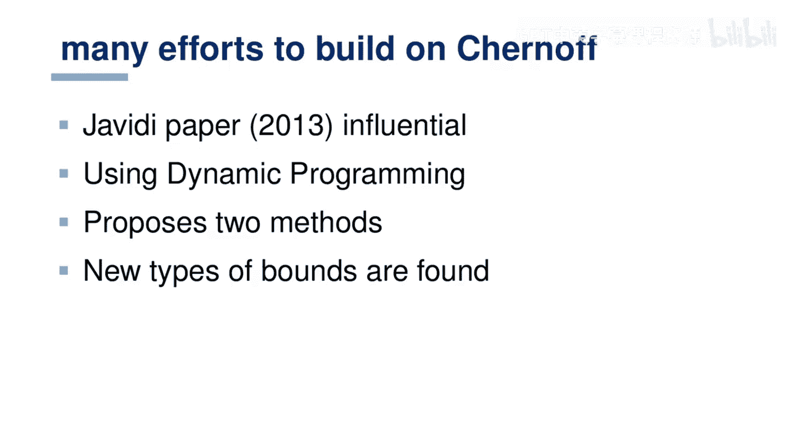
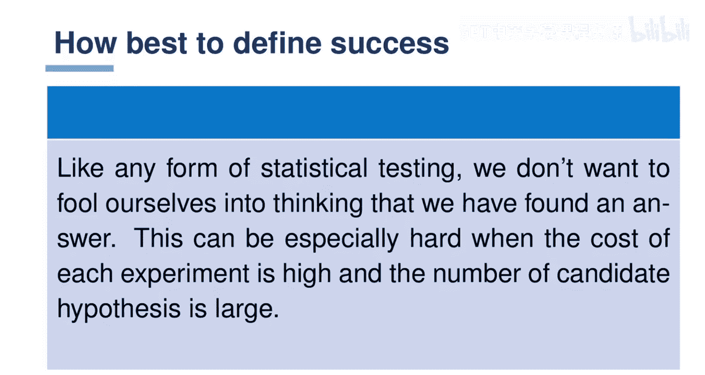
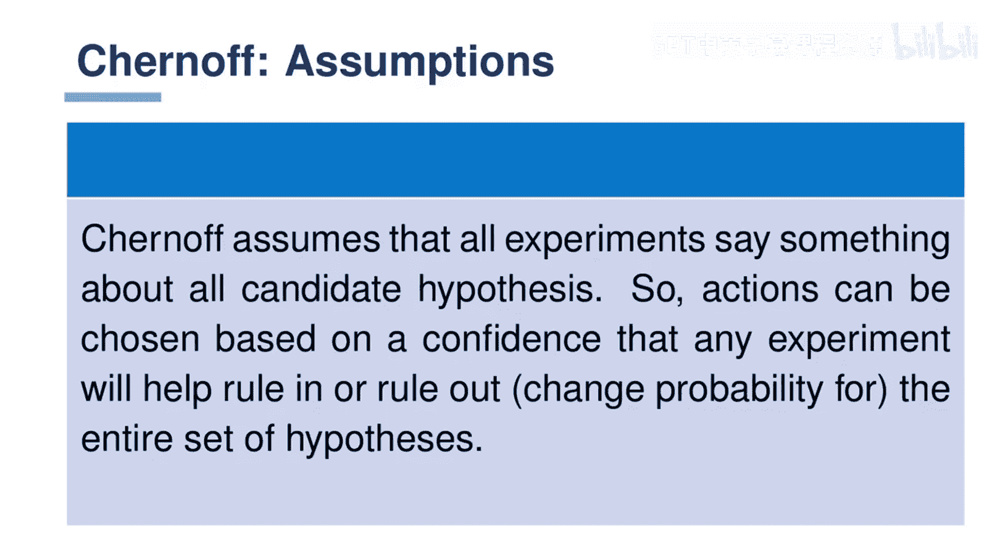
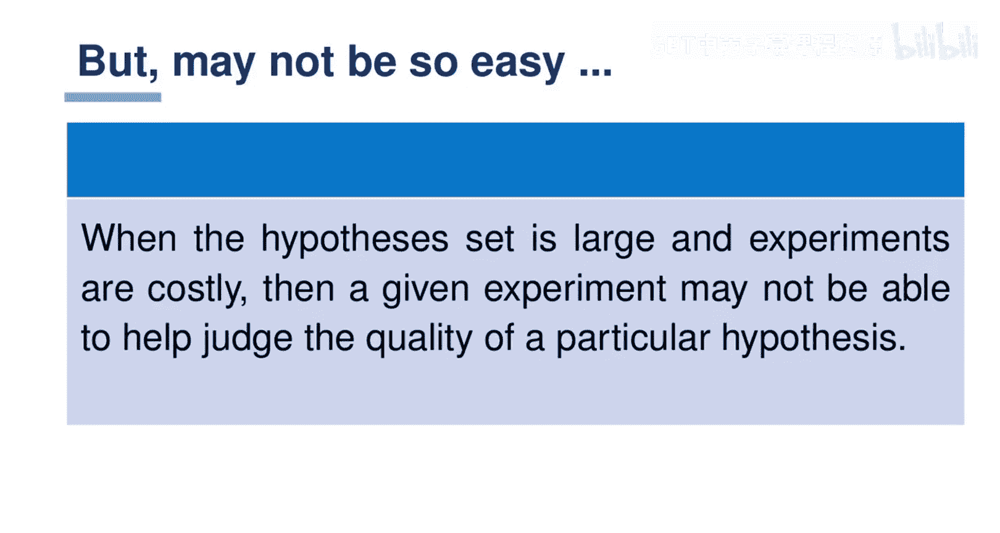
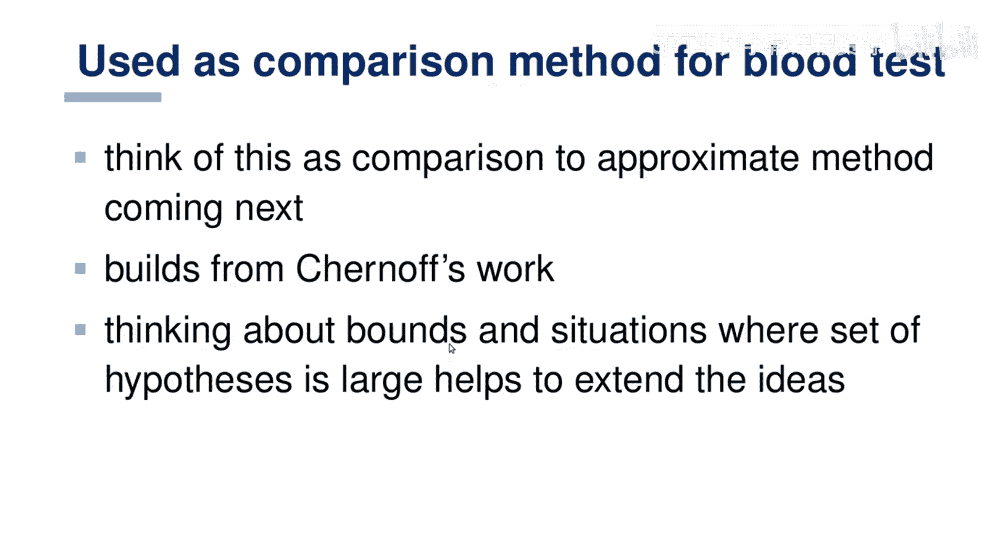

# 约翰霍普金斯大学《数据科学：时间中的决策｜Data Science Decisions in Time》中英字幕 p23 7_两阶段主动假设检验的优势分析.zh_en -BV1NCuzzfEJa_p23-

We'll now talk about how we modify the turnoff algorithm to deal with situations like our blood test that have a huge number of potential hypotheses。

 this would really been two steps this first one will introduce a really nice set of fairly formal mathematical manipulations that dates from 2013 that really set the stage for our approximate sequential hypothesis testing paper which will be the third paper we'll be going over so the question really is what happens if we really can't discriminate each hypothesis as a useful metric on the data and so let me try and depack that a little bit so in the D paper from 2013。

This is really a direct build on turnoffs ideas and extension in some really important ways and essentially what they did is they used dynamic programming。

 which means in particular those to be familiar with this you can think about this as working backwards from the solution and in that sense it can be very powerful approach towards thinking about the solution space and there's been many really important proposals that have been developing and have developed from dynamic programming so they propose two methods it's really the first of the two that will be focusing on and I'm going to try and give you a flavor for it if you're curious on this I would definitely suggest reading the paper it's a little more mathematical than I feel like can really fully get into in the confines of our coursera setting but I think you'll still find it accessible and and well worth reading so the essential ideas that they give new types of bounds thatre developed in their paper you can think of these now as bounds for confidence that' are not necessarily。

asymptootic in the same sense that turnoff did， but they got the same ability to bound the answer。

 both upper bound and a lower bound And really where this comes from is questions like you know how best do we define success？

 So any sort of physical testing we've really got to make sure that we've found an answer and not just simply fooled ourselves and if the cost or experiment is high I think there's a human tendency to overinterpret what's there。

 and it's even worse if we've got a large number of candidate hypotheses。

 So being firm in our thinking being clear in the thinking as we imagine collecting data and trying to ask how it bears on different hypotheses is really key to success in these sorts of areas。

 in particular in turnoff， there's some assumptions that he makes one of the key ones is that all the experiments really again all of them say something about all of the candidate hypotheses and that's not always going to be true。

 In other words， you you may have actions that may have only。

If any ability to give a judgment on other experiments and so how do you handle this when you've got a large number of hypotheses and some experiments that may not be quite as insightful for helping rulely and or rule out subsets of the hypothesistheses so in particular again and I'm thinking of the cancer screening through blood for example as we started this section when our hypothesis at is huge and the experiments are costly then we really have to be careful in the way these problems are phrased in order to not over interpretterpret and also to clearly stage it's again active checking what is the best thing to try next。

 you've got to be very careful in terms of how you pick that and and that's really what this paper was about and when our next paper will be out as well in the words how do we go best about picking our actions given our current understanding of what is the best hypothesis。

This paper again dates from 2013 and it builds very nicely from Turnoff's work。

 and essentially they start by resting the problem。 It's very similar to turnoff。

 but not exactly the same。 so bear with me as I bring out some andentnot。

 So imagine we've got H hypotheses in it set of size M so M hypotheses。

 these could be quite large and。In particular we're going to explore asymptotic limits in that in a different way than turn out turnoff was really thinking in terms of the cost of sampling going to zero or really controlling the error ultimately but the hypothesis set was modest Now we've got data that's the parameters for the distribution functions what you rather rather to be thinking about is that we've got some sort of a prior row you can think of these as weights so you can think of these as being distributed over all the m hypotheses and then we've got these cues which are the distribution functions that are specific to each of the actions our action space is also finite but convenient potentially quite quite large observation spaces where we're observing again。

 think of these as the each action as set of numbers that come back from it and we're using that to discriminate the hypotheses and Q sub I as I mentioned is dependent on the hypothesis and then it's。

Deped on the action。 So the a is the action I hypothesis。

 And that's a probability distribution function or Pdf for Z。 And again。

 that's parameterized by theta。 So you can think of this as being the glue that really holds it all together。

 Then similar to turnoff， but it's really one over C which is where the notation differs from turnoff capital L is written for the penalty of a wrong declaration having declared a particular hypothesis correct when it's not correct and P is the probability for that wrong declaration。

 So this really defines the equation then and Gp so 2013 work。

 we've got an expectation on tau that's our stopping time。

 We're going to try and minimize that and then our L。

 which is our cost of a associated with a wrong hypothesis and then our probability at the wrong hypothesis。

 and we're trying to minimize this equation。 So this is really the defining equation。

 wewritten slightly from turnoff， but essentially the same as turnoff's equation。

 And then essentially what we're doing is a ratio type test you can think of this Q。

subi a or  Q sub row a and the Q sub row A think about that as being over the full set Q1 to QM or over the hypothesis set。

 And so this is essentially a vector then a weighted vector row1 to row M of all the different hypotheses and the weights associated So we're starting at zero you can think of this as like a Bayesian method with row defining then a prior toart and then updating as we move through it。

 and part of that updating is the definition of this Markovvian function script t to the a where that's actions G on rh and you can think of this as just an updating function which is now integral over the D space times or density here So this is the definition and again this integral in principle given the data and given the distribution function you can always make that calculation that comes in in terms of a methods then in terms of v star which is min and this might be a little hardted de packac but just realize that this is an algorithm ultimately and that。

You can do all the calculations involved in the algorithm so we can define this min。

 we can define this min and then we can define the min on that set and by defining V star weve to find the optimal best gas at that point in time this might be easier to kind of parse a little bit by taking a look at the way this comes out in terms of binary testing so this goes back to well this goes back to the 1945 paper we've got row1 and row2 L again is the penalty row1 versus row2 these are the alternate weights on the different hypotheses do you here with the。

Vertical bars is the k divergence。 So we're comparing this distribution to this distribution Q1 to Q2 and here Q2 to Q1 again。

 remember it's asymmetric。 So this is max over our action set and note that we've got row1 and row2 weighting them plus over1。

 So this sort of expression should be something you're already at least a little bit comfortable with from our first course are our class。

 and then we've been plain with things related to this as well already。

 So hopefully it makes some sense。 again， these ratios here and the kdrgence。

 it makes sense that there should be something like that in there I hope to all of you So in one policy 1 of the two policies there's effectively an update。

 So we start with mu0。 we're updating mu sub I note that its this rather complicated looking expression with an argument on the max min and min note what it's over j equal to I I from our set capital omegas of M。

 that's the hypothesis set and lambda from our set of actions。

 and effectively note that we've got a k divergence in a lambda of a。This would be the start point。

 this would then be our updates， or iterations on that as we move forward in time。

 and then there's a way to update seeing think this is almost a way to again try to optimize。

Try to find the minimal tau that will eventually let you conclude a particular hypothesis So if Ro is in this realm or Ro is in this range。

 then you got the section and if Ro is less than this min then you've got this action so think of it as just like a branching structure to figure out the updates to Rosab I So essentially what they're doing is they're looking for actions that could discriminate among the hypotheses that's the first step and then they do the search similar to turnoff and it's this first step that lets them bound this in a different way than turnoff was able to do and these bounds give confidence for the ordering and for the ability to understand which hypo most likely and I would urge you to think about this as now a comparison method for the approximate methods that coming up in the next section and this is really these approximate methods is really what makes it possible to apply these ideas to something like the blood test all of this built from Chernoff's works from the 1959 paper and。

Think about these bounds and the situations where I've got a very large hypothesis set really helps to extend the ideas。

 It's really an important part of what we're after。 So okay。

 I hope I helped you see into that a little bit and more coming。 So please stay tuned。 Thank you。

