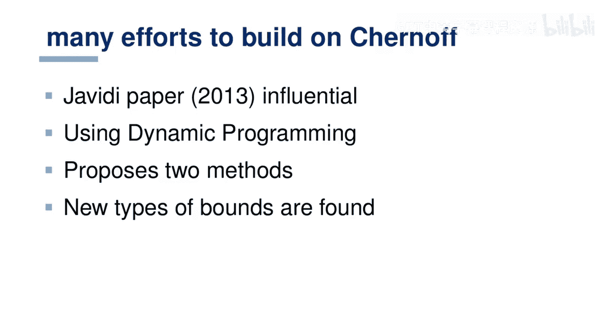
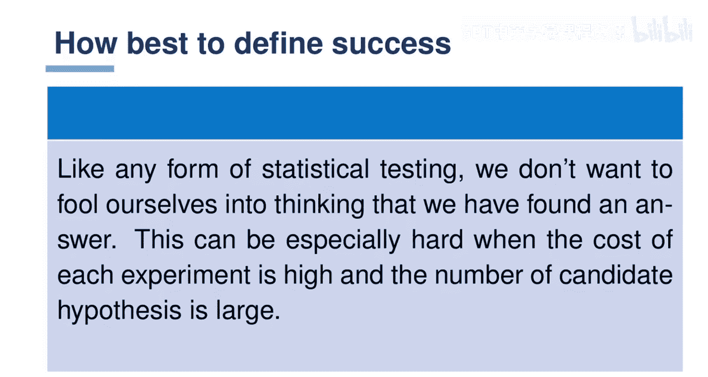
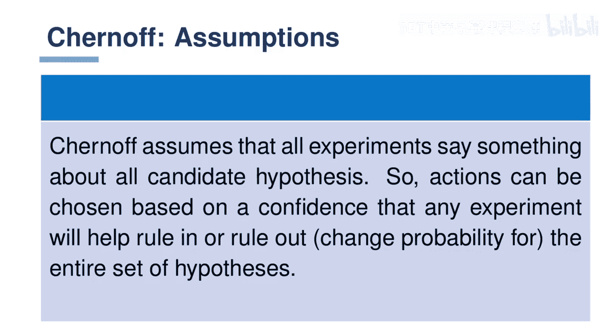
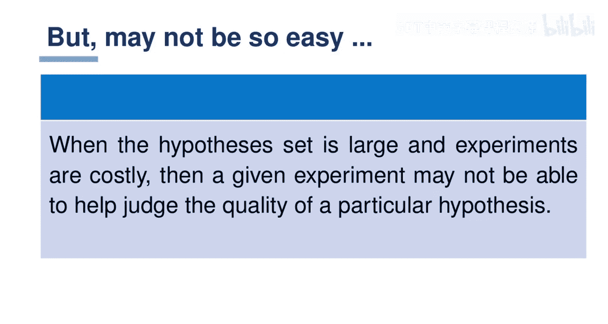
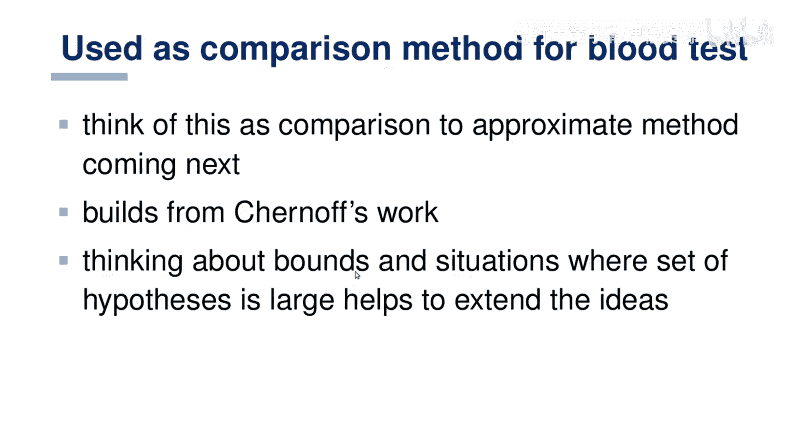

# 数据科学：时间中的决策｜7：两阶段主动假设检验的优势分析 🧠

在本节课中，我们将学习如何改进特诺夫算法，以应对像血液检测这样拥有海量潜在假设的场景。我们将重点介绍一篇2013年的重要论文，它通过一系列严谨的数学方法，为后续的近似序贯假设检验研究奠定了基础。

上一节我们介绍了特诺夫算法的基本思想，本节中我们来看看当假设数量巨大且实验成本高昂时，如何更有效地进行决策。

## 问题背景与挑战

特诺夫算法有一个关键假设：所有实验都能对所有候选假设提供信息。然而，实际情况并非总是如此。例如，某些实验可能只对一部分假设有判别力。

当假设集合巨大且实验成本高昂时，我们必须谨慎地构建问题，以避免过度解读数据，并清晰地规划“下一步尝试什么实验”。这正是2013年这篇论文以及我们下一篇论文要解决的核心问题：**如何根据当前对最佳假设的理解，最优地选择后续行动**。

## 2013年论文的模型框架

这篇论文建立在特诺夫的工作之上，并重新表述了问题。其模型框架如下：

*   **假设集合 (H)**：包含 M 个假设，M 可能非常大。
*   **先验分布 (ρ)**：可以看作是对所有 M 个假设赋予的权重。
*   **行动空间 (A)**：有限的行动集合，但规模也可能很大。
*   **观测空间 (Z)**：执行行动后得到的观测结果。
*   **分布函数 (Q)**：这是模型的核心。`Q_i(a, z)` 表示在假设 `i` 下，采取行动 `a` 时观测到结果 `z` 的概率分布（或概率密度函数）。它依赖于假设和行动。

目标函数与特诺夫类似，旨在最小化一个期望损失，该损失由停止时间 `τ` 和错误声明的惩罚 `L` 构成。其定义方程为：
`E[τ] + L * P(错误声明)`

## 核心方法：动态规划与比率检验

论文采用动态规划方法，即从最终解反向推导。其核心是一种比率检验。

我们从一个先验权重向量 `ρ`（类似于贝叶斯方法中的先验）开始。随着实验的进行，我们根据观测数据 `z` 和分布函数 `Q` 来更新这个权重。更新规则由一个马尔可夫函数 `T^a` 定义，本质上是一个积分计算：
`T^a(ρ) = ∫ (ρ_i * Q_i(a, z) / Σ_j ρ_j * Q_j(a, z)) dz`

通过定义值函数 `V*(ρ)` 为最小期望损失，我们可以推导出最优策略。这可以看作是一个算法：在每一步，计算当前状态 `ρ` 下的 `V*`，并选择能使未来期望损失最小的行动。

## 以二元检验为例

为了更好地理解，我们可以看二元假设检验（M=2）这个特例。此时，最优策略与一个由 **KL散度** 决定的阈值相关。

以下是关键公式，它决定了何时停止并做出决策：
`如果 ρ1 / ρ2 > exp( KL(Q2||Q1) )，则选择假设1；如果 ρ1 / ρ2 < exp( -KL(Q1||Q2) )，则选择假设2；否则继续实验。`

其中，`KL(Qi||Qj)` 是分布 `Qi` 和 `Qj` 之间的 KL 散度，它衡量了区分这两个假设的难易程度。这个形式与我们课程早期学过的似然比检验是相通的。

## 两阶段策略与优势

论文提出了两种策略，我们重点关注第一种。其核心思想分为两个阶段：

1.  **识别阶段**：寻找能有效区分不同假设的行动。这通过计算和比较不同行动下的 KL 散度来实现。
2.  **检验阶段**：在筛选出的有区分力的行动上，进行类似特诺夫的序贯概率比检验。

这种两阶段方法的优势在于，它提供了与特诺夫不同的**性能边界**。特诺夫的边界在某些渐近条件下成立，而2013年的方法提供了更一般、更紧致的上下界。这些边界为我们评估和比较不同假设的可靠性提供了坚实的数学保证。

## 总结与展望

本节课中我们一起学习了如何将特诺夫算法扩展至海量假设的场景。2013年的论文通过引入动态规划和两阶段策略（先识别区分性行动，再进行集中检验），并推导出新的性能边界，有效应对了实验成本高昂、假设数量庞大时的决策挑战。

这种方法的核心优势在于其严谨的边界，确保了结论的可靠性。理解这些精确方法，将为我们接下来学习更实用的**近似序贯假设检验方法**奠定重要基础。正是这些近似方法，使得将主动学习思想应用于像血液检测这样的现实复杂问题成为可能。所有这些工作都根植于 Chernoff 1959 年的开创性研究，并在处理大规模假设集时极大地扩展了原有理念。