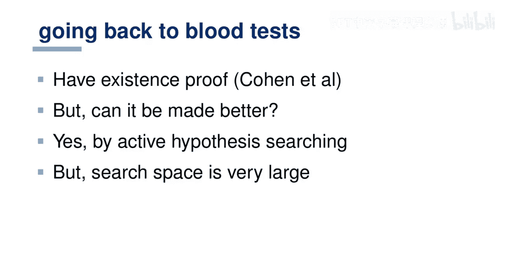
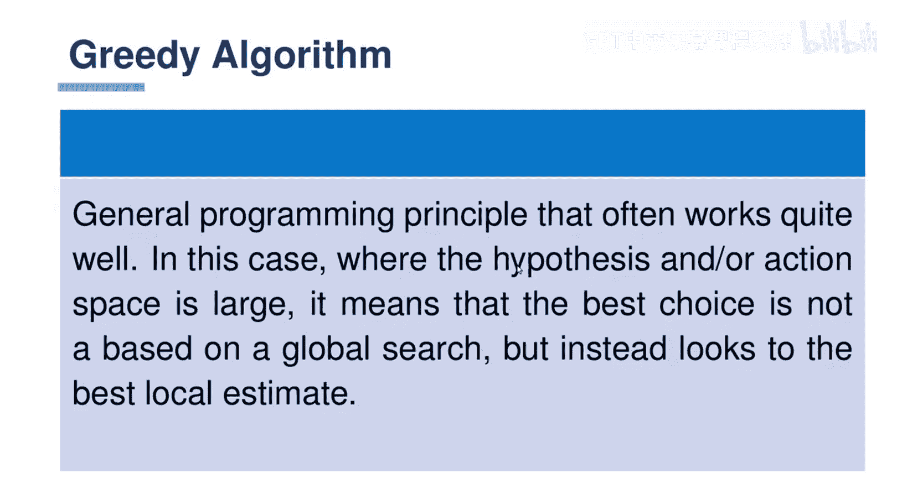
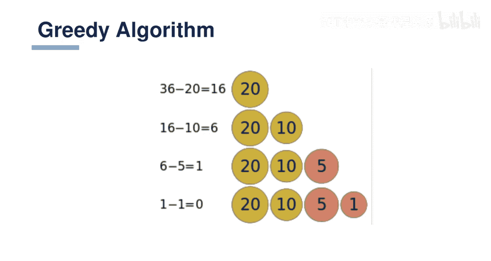
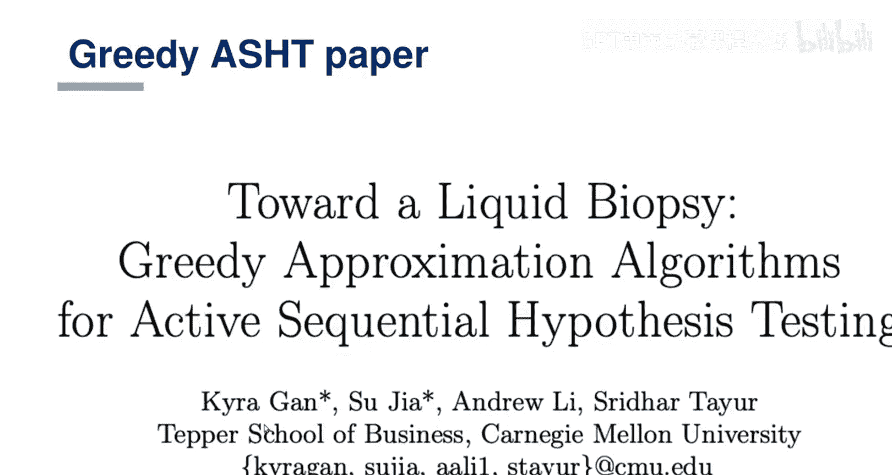
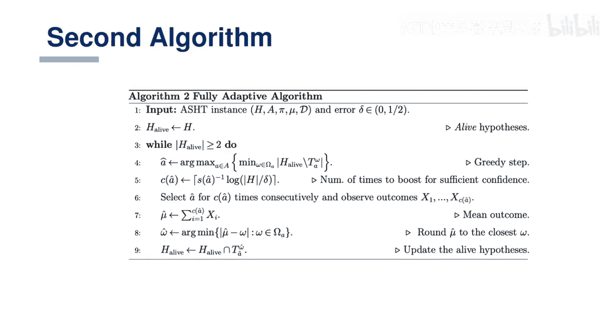
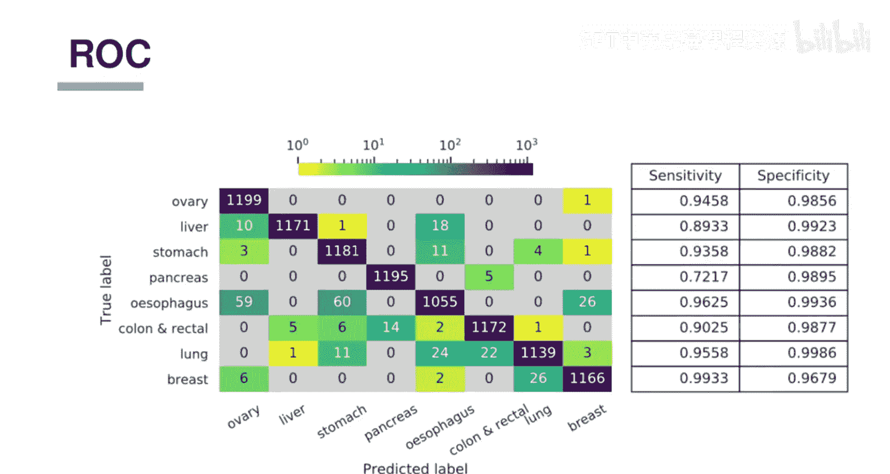
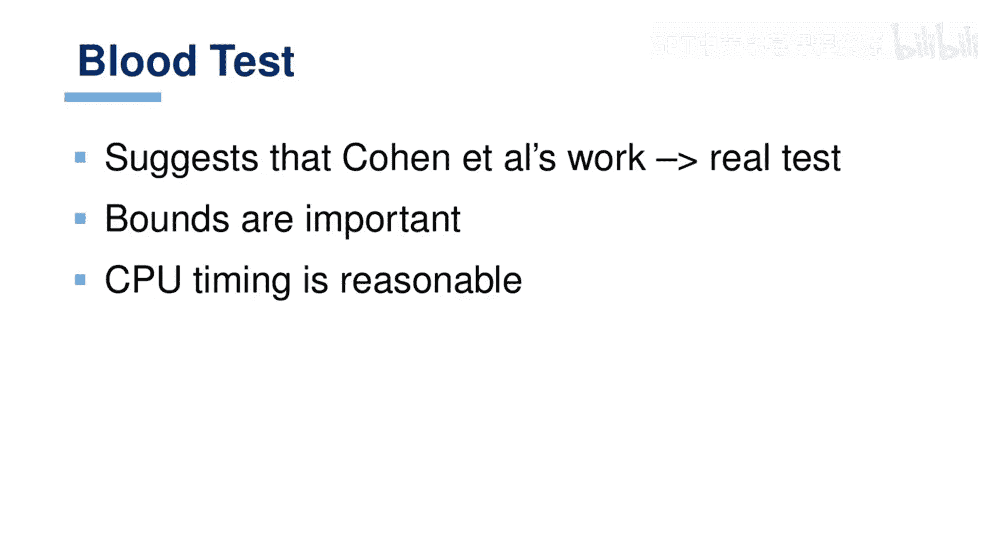

# 约翰霍普金斯大学《数据科学：时间中的决策｜Data Science Decisions in Time》中英字幕 p24 8_血液活检的贪心近似算法处理.zh_en -BV1NCuzzfEJa_p24-

We'll now talk about greedy approximation methods for active subral hypothesis testing。

 this is a very nice recent paper which really addresses an important issue which has how to deal with very large hypothesis and or action spaces。

 and I think it really extends in a significant way the ideas that started from turn off 1959 paper into some real worldorld settings in particular for this blood tests that we talked about so going back to blood tests we have the existence proof。

 this was the paper from Cohen at all it largely showed that you really can test for cancer by blood work but there's a lot of other things that need to flow from that in order to get things to work in particular the problem is that the way Cohen at all did it。

 it was not really an active search against the candidate set of DNAbased pairs or proteins。

It therefore could potentially be dramatically speeded up and so that's really the question that is being addressed right now through this paper we're going to be talking about。

 which is can it be made better and the idea is yes it can。

Active hypothesis searching is really the kind of rule for doing this， the tool for making it better。

 but again， the search space is very， very large and so deciding how to approximate that。

 how to come close dealing with it is really the nub of this paper and the idea is to use a greedy algorithm and greedy algorithms or something that many of you may be familiar with。

 if you've had much in the way of programming science classes you've probably seen these before。

 but essentially you're doing a local search as opposed to a global search so it's really as they say here a general programming principle often works quite well。

 it may give problems because it is a local search rather than a global search but it often speeds things up dramatically and in this case where we've got a very large hypothesis under action space it's not based on a global search but in the best local estimate and this example from Wikipedia may help a little bit to see into it if I'm making a set of coins I've got coins 20 cent coin 10cent kind5cent and onecent coin if I'm trying to imagine taking。

And making 36 from it， what I would do first is take the biggest one that fits and I would just work down from that and this is an algorithm that's locally as aistic optimized so 36 minus-20 I've got 16 left I fit in the 20 then minus-10 because the 20 will no longer fit then I've got6 left then the five and that brings one left and then I had the one so this would be a very quick way to think about making change and this kind of artificial problem where I've got a 25 as I mean 20 cent as opposed to a 25 a 10 5% and a penny coin so here's the paper the fairly long list of authors well I guess four is maybe not that long but these four authors anyway for this paper and the idea was to use this degreey approximation algorithm for active sequential hypothesis testing and my understanding is these two were grad students that worked on the paper and Andrew and Schridar were the senior authors that。

Sponsored the work。

嗯。So the comparison point was to Javiti's work， this was the paper that we covered in the last presentation and the other connection is to an optimal random search type approach and basically what we're looking at here is three different panels this was all cancers ovarian cancer liver cancer and essentially what you want to come away with from this is that their approach does very very well and all these cases again。

 the main thing is that we're moving along the right in terms of our search base and it eventually plateauus but you can see that we're more efficient with their method and that's emphasized even more in this full panel from their figure again number of addresses on the X axises and you can see that we're looking in another set of six cancers here so the idea again is to improve on the coenentol paper and you'll see again that's the lowest one in each of these and the argument is that in fact you can Now there's a couple assumptions here some of these I've mentioned before but I thought。

This was a good time to kind of remind you in terms of turn off and active hypothesis search methods a lot of these same assumptions come up This first one is that we've got our kL divergence that bounds our difference in theta values these are getting to the parameters that describe the distribution that the data is coming from so C1 andC2ward constants these are related to parameters kL again is the coc le divergence that's comparing these different distributions so we're saying that we can effectively bound that's our first assumption the second assumption is a validity assumption if we've got distinct hypotheses G andH then there's an action a such that we can discriminate between them and as you saw。

In immediate lecture， the middle lecture from Javiti at all。

 the question is you may sometimes have settings where this is violated and so then you've got to think about something like a two-t procedure to help evaluate and resolve settings where this may have been not necessarily met in the beginning but can potentially be met later along after enough data has been collected so in this instance again we're making the assumption that if we've got distinct hypothesistheses there's an action so that we can discriminate between them the other definition that's useful and the other two were assumptions and this is a definition。

 but the other item that's useful in terms of seeing into this approach。

 is idea of an S separated instance， so if we've got an adaptive search for alternate hypotheses or sequential hypothesis test I'm sorry adaptive sequential hypothesis test instance。

 it's said to be S separated， if for any a from our action space and G and H from hypothesis page are D。

On GH and is either zero or at least s。 so the argument being again that we've got an ability to discriminate cleanly and see what's going on in terms of our adaptive sequential hypothesis testing approach so I'm going to put up two algorithms the writing here is a bother is a little small for seeing and you're welcome to read the paper to get more into it but I just want to indicate that these algorithms are completely reasonable This is partially adaptive。

 This one here is fully adaptive。 these are the two algorithms we're going to try and give you some feeling for we've got our parameters input initialize one for loop another four loop and another for loop essentially we're doing ranking and then boosting and then you can think of this as selecting through this likelihood ratio test so essentially what we're doing here we've got our saturation and boosting intensity we've got our instance we're initializing then effectively we're just ranking。

 we've got our actions so far and we're generating a score then we're boosting and we're competing action for certain。

times and then in this last one where we can compute this timet for our H。

 then we're computing our likelihood ratio here in step 15。

 so you can see this is a form that you've seen before and so then we can return H in terms of a reasonable amount of time going to again turn off and jave at all as well algorithm2 this is fully adoptive same sort of idea。

 a little bit shorter algorithm maybe a bit bigger font so easier to see we've got our set of a live hypotheses once that we're considering while we're still within that set we can take a min and an orrc max on that then we can boost and then we can select and it gives this a mean outcome than we're can around and then we can update today the live hypotheses So essentially both of these are a little bit quick I realize maybe hard to pick up from just outlining them but they give you a sense in terms of how that math leads into two algorithms and then we。

Think in terms of our RC type curve along the diagonal is so to speak our happy path and then we've got the off diagonal terms。

 here's true label versus predicted label， we can also look at sensitivity versus specificity and I think you can tell you by just glancing at this that this really is making sense were really are able or they really are able to argue that you can see into the situations where there is so to speak cancer at an early stage through a blood work and they've improved I think dramatically on the non-adaptive search so really quite nice so anyway real progress I think there's some algorithms here that can significantly help it provides insights for very large hypothesis or action spaces these bounds that they suggest are proven so that means there's interpretable errors that can come back and it really suggests that cohenentol's work can go to a real test and again there are companies that are trying to commercialize or stage。

intoto a commercial product again， I want to emphasize that the bounds are important here because that lets you set a conference bar on how much to interpret this because again。

 false positives here are something that you really have to think about。

CPU timing is reasonable for this， so again it really is suggesting that something like this coming from really I think turnoff's 1959 paper is completely possible in the future so I hope I've given you some sense of the enthusiasm for how you can apply a G approximate method to adoptive sequential search for different hypotheses really really quite exciting work。

 so thank you。

