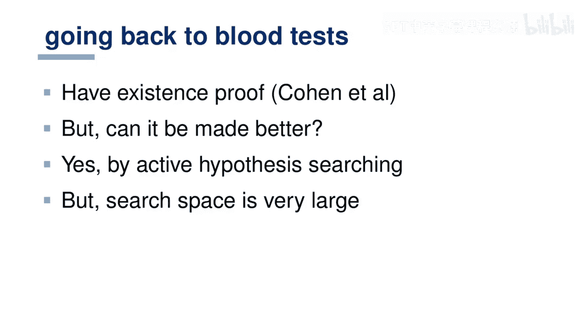
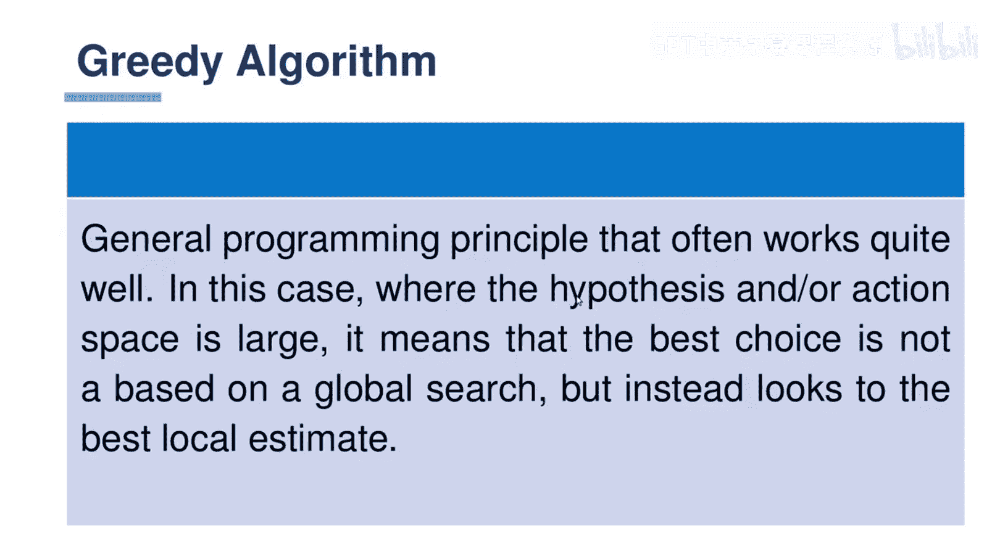
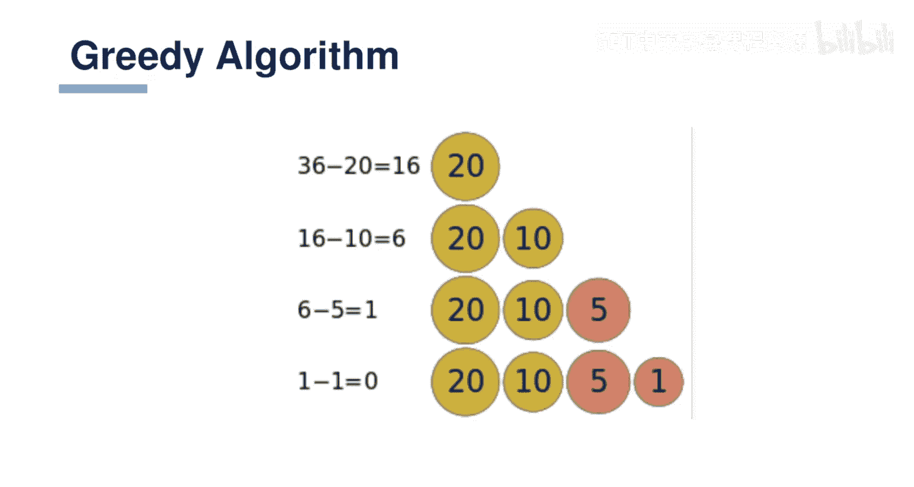
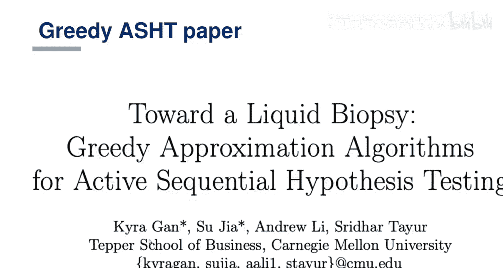
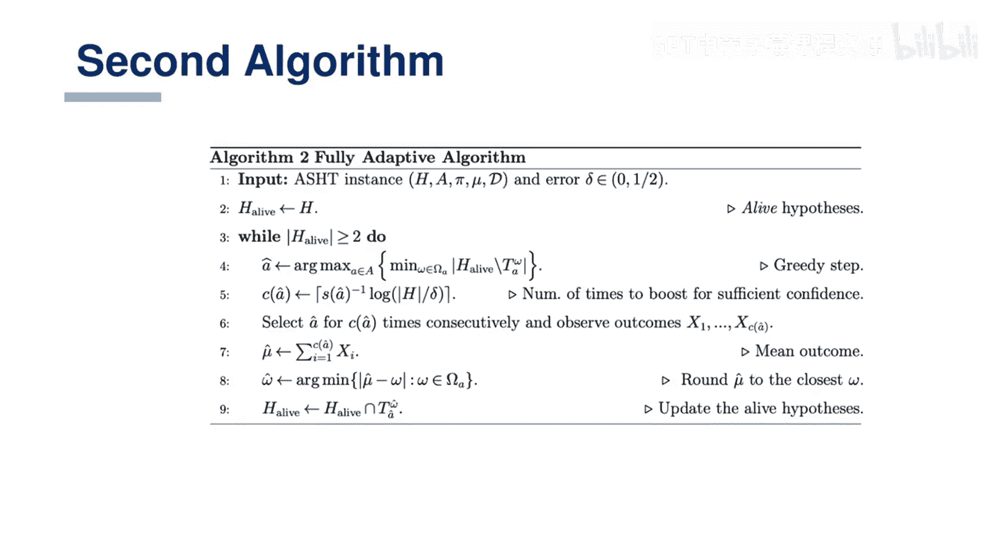
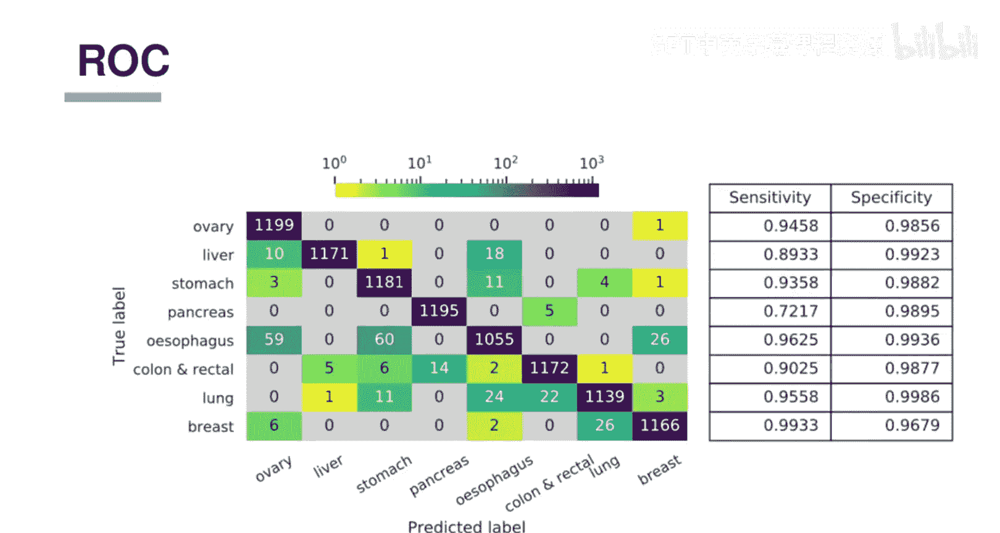
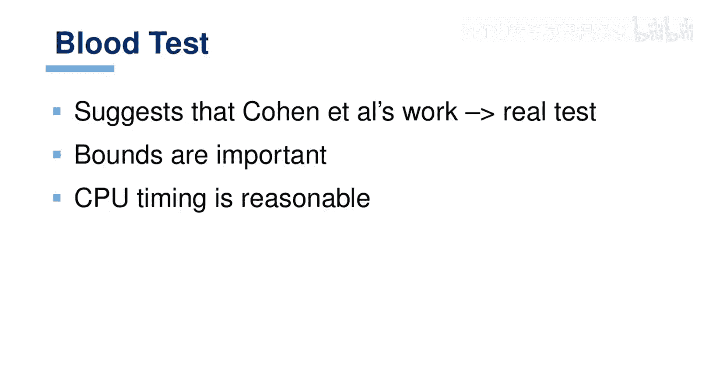

# 数据科学：时间中的决策｜8：血液活检的贪心近似算法处理 🧬

在本节课中，我们将学习如何利用贪心近似算法来处理主动序贯假设检验问题，特别是在血液活检这类具有庞大假设空间或行动空间的现实场景中。我们将探讨该算法的核心思想、关键假设、具体流程及其在医学检测中的显著优势。

上一节我们介绍了Javiti等人的工作，本节中我们来看看如何通过贪心算法进一步提升大规模假设检验的效率。

## 概述

Cohen等人的研究证明了通过血液检测癌症的可行性，但其方法并非针对候选DNA片段或蛋白质进行主动搜索，因此存在巨大的优化空间。当前的研究旨在通过主动假设搜索工具来改进这一过程。然而，搜索空间非常庞大，如何有效地近似处理成为关键。贪心算法作为一种局部搜索策略，在此类问题上通常能显著加速计算，尽管它可能无法保证全局最优解。

## 贪心算法原理





贪心算法是一种常见的编程原则，它通过每一步都做出当前看来最优的局部选择来逼近全局解。虽然它是局部搜索而非全局搜索，可能带来一些问题，但通常能极大提升速度。

以下是一个简单的例子，说明贪心算法的工作方式：



假设我们需要用面值为20、10、5和1的硬币凑出36。贪心算法会先选择最大面值且不超过剩余金额的硬币，逐步进行：
1.  36 - 20 = 16，选择20分硬币。
2.  16 - 10 = 6，选择10分硬币。
3.  6 - 5 = 1，选择5分硬币。
4.  1 - 1 = 0，选择1分硬币。



这种方法快速高效，但前提是硬币体系允许这种策略（例如，若有25分硬币，结果可能不同）。

## 算法性能对比

本课程讨论的论文将提出的贪心近似算法与Javiti的最优随机搜索方法进行了对比。在多种癌症（如卵巢癌、肝癌）的检测场景中，该算法表现非常出色。

核心结论是，新方法在搜索过程中更有效率，能更快地达到性能平台期。在包含六种癌症的完整面板数据中，新方法同样显著优于Cohen等人的基线方法，证明了其改进的有效性。

## 关键假设与定义

为了应用贪心近似算法进行主动序贯假设检验，需要满足几个关键假设：

1.  **KL散度有界**：假设存在常数C1和C2，使得描述数据分布的参数θ之间的KL散度（Kullback-Leibler divergence）有界。公式表示为：`D_KL(P_θ1 || P_θ2)` 可被参数相关的常数所界定。
2.  **可区分性假设**：对于任意两个不同的假设G和H，存在至少一个行动a，使得能够区分它们。即，存在行动能产生足以辨别假设的数据。

此外，一个有用的定义是 **S-分离实例**：
对于一个自适应序贯假设检验实例，如果对于行动空间中的任何行动a，以及假设空间中的任何一对假设G和H，其KL散度要么为0，要么至少为S，则该实例被称为S-分离的。这保证了检验过程具有清晰的区分能力。

## 算法流程

论文提出了两种算法：部分自适应算法和完全自适应算法。以下是它们的核心思路：

**算法1（部分自适应）**：
输入参数并初始化后，算法主要包含三个循环阶段：
1.  **排序**：根据当前信息对行动进行评分和排序。
2.  **提升**：基于排序结果，对某些行动进行重点探索（“提升”其探索强度）。
3.  **选择**：通过计算似然比进行假设检验，最终返回选定的假设H。
    ```python
    # 伪代码结构示意
    def partially_adaptive_algorithm(parameters):
        initialize()
        for ranking_round:
            rank_actions()
        for boosting_round:
            boost_selected_actions()
        for selection_round:
            compute_likelihood_ratio()
        return selected_hypothesis
    ```

**算法2（完全自适应）**：
该算法结构更简洁，持续维护一个“活跃假设”集合。
1.  当活跃假设集合不为空时，计算当前所需的最小样本量，并选择能最大化信息获取的行动。
2.  执行提升和选择步骤。
3.  根据观察结果更新活跃假设集合。
    ```python
    # 伪代码结构示意
    def fully_adaptive_algorithm(parameters):
        live_hypotheses = initialize_hypotheses()
        while live_hypotheses:
            n_min = compute_min_samples()
            a = select_optimal_action()
            boost_and_select(a)
            update_live_hypotheses()
        return result
    ```

这两种算法将理论数学框架转化为可执行的步骤，实现了高效的自适应搜索。



## 结果与意义

通过分析ROC曲线（接收者操作特征曲线）或敏感性-特异性图可以评估算法性能。结果显示，新方法能有效区分早期癌症与健康状态，相比非自适应搜索有显著改进。



这项研究取得了实质性进展：
*   **处理大规模空间**：为处理庞大假设或行动空间提供了有效见解和工具。
*   **可证明的误差界**：算法给出的误差边界是可证明的，这意味着结果具有可解释的误差范围，有助于设定置信标准。
*   **迈向实际应用**：它表明基于Turing 1959年论文思想的方法，在未来完全可行。已有公司试图将此类技术商业化。
*   **控制假阳性**：明确的误差界对于控制假阳性至关重要，这在医学检测中是需要重点考虑的问题。
*   **合理的计算成本**：算法的CPU运行时间是合理的，支持其实际部署。

## 总结



本节课我们一起学习了如何将贪心近似算法应用于主动序贯假设检验，特别是在血液活检这一重要领域。我们探讨了算法的基本原理、必要的假设条件、具体实现流程以及其相对于传统方法的性能提升。这项激动人心的工作展示了如何用高效的计算策略解决复杂的现实世界问题，为未来大规模医学筛查提供了强有力的工具。