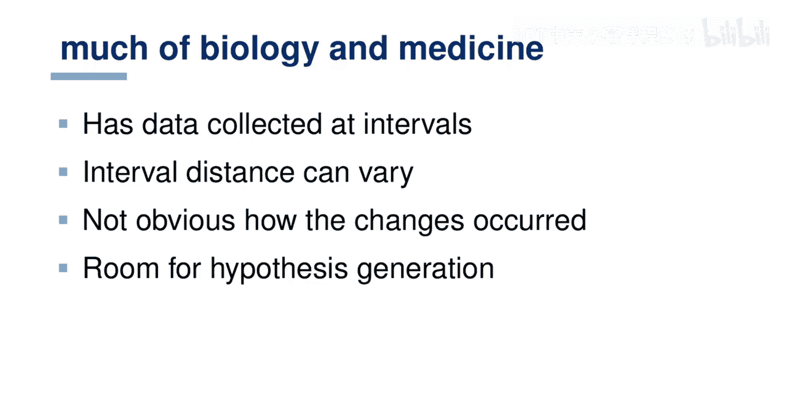
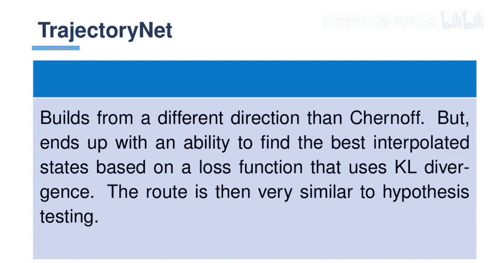
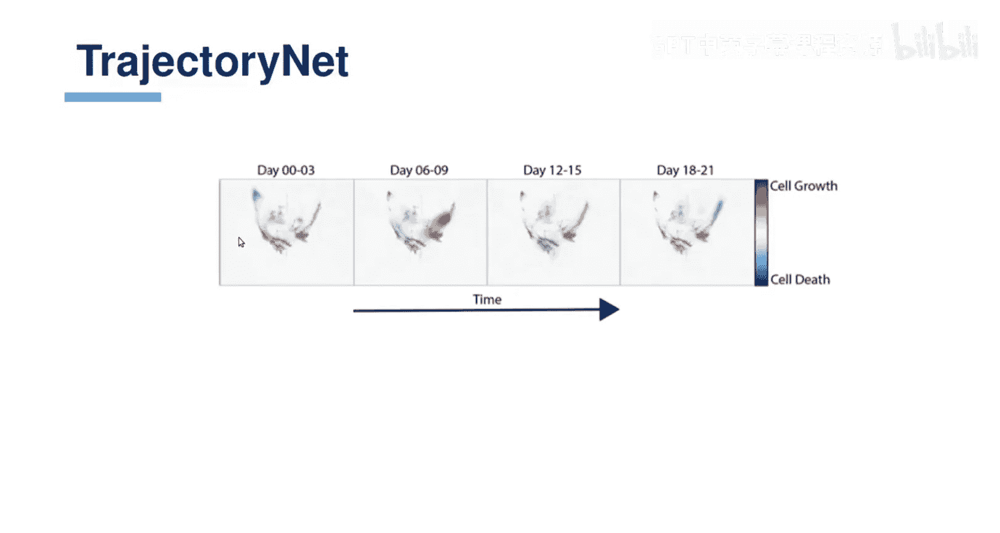
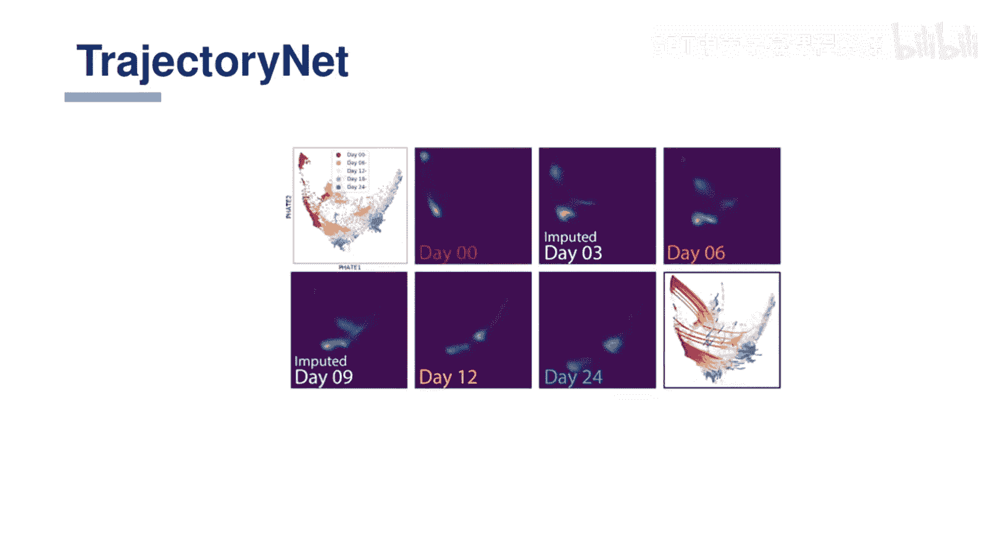

# 约翰霍普金斯大学《数据科学：时间中的决策｜Data Science Decisions in Time》中英字幕 p25 9_医疗数据点与临床案例的关联分析.zh_en -BV1NCuzzfEJa_p25-

We'll now talk about dynamic systems。 These are really quite fascinating。

 really much more challenging in some ways than a static set of hypotheses。

 The question being addressed here is whether we can figure out the missing pieces。

 Imagine you've got a disease progressing and you've got some ideas as to what happens at one point in time。

 maybe maybe a little bit at a later point in time， but a lot is missing。

 Can we understand something， Can we hypothesize and by hypothesis generation。

 understand that missing data。This is really something that's very true in much of biology and medicine。

 We've got data collected intervals， not even at regular intervals， but simply at intervals。

 sometimes widely spaced intervals， and we really want to understand something about what's going on and because that interval distance can vary。

 it makes it sometimes very hard to predict the time course of say a disease or the time course of development and thus it's really not obvious at all how the changes occurred or what's driving the changes and this really becomes important if we're thinking about interventions。

 let's say you want to come in and change something with a new therapy or adjust something in an environment。

 how is that going to change things， can you predict how that's going to change things。

 So this leaves a lot of room for hypothesis generation。

 our main topic in this coursera is how these different hypotheses on streaming data might be adjusted or changed or interpreted Another way of phrasing this is I've got some sort of dynamical system in this context and I want to understand how if I put something into that system。

 maybe a therapy。Or adjust some boundary condition。 How does that impact the dynamics。

 And that's another form of a Pro generation。 So we're talking now about a program called trajectoryy Nut。

I would argue this is great for people who might want to do projects as part of their courseurra。

 This is opensourced ptorch code and I think very robust but essentially in my trajectorynet builts from a different direction than our turnoff start here。

 but it's got in some ways a very similar endpoint because it gives us an ability to think about finding the best interpolate intermediate states using a loss function that uses kaledrgence and that kale divergence that is very similar to the loss functions that we've been using in for hypothesis generation。

 other words， we use kaledrgence， the ability to look at two different distributions and understand how similar or not they are and that's being used here to interpolate to try and figure out these intermediates。

 So it's really very similar to hypothesis generation very similar to a story built from turn off So again this is called trajectory now these are the five authors on this paper a group at Yale that's worked on this。

 and I think just really a very interesting paper。 So the idea is something like this I've got。

T0， I've got Tn， but I wanted to understand something about these intermediate points。

 I basically swarms of data moving along and the question is can I understand。

 say if I've given this beginning point and this endpoint。

 can I understand something about these intermediate points and maybe in other intermediate points along the way how could I interpolate how could I figure out these missing bits where I only have maybe sporadic bits of data or maybe no data whatsoever but I may have firm data at various points。

 how could I interpolate what's going on and that's the essence of trajectory that。

 here's an example for cell growth with different days and the question is again can you interpret what's going on so they've got markers for different types of proteins being expressed and the question is as a function of time in this dynamical system can we understand what's going on within that cell and there are many。

 many systems that are like this I'm really emphasizing biology and medicine but it really is true of many complicated systems。

They're actually dynamic， you've got a cross section in time and you want to understand something about how those different cross sections in time are connected and this trajectory。

Approach is potentially a way to do a form of hypothesis testing to understand what's going on between these states。

 So again， these are cell changes。 and can you understand what's going on。

 Here's another one with a development they've got a test here where they're trying to understand a missing day。

 they've got data there and they compare it So day zero， day6， day 12， day 24。 they've got day 3。

 but can they impute something that's similar same with day 9 and the answer is yes。

 it does come up very similar these will be again markers that they're looking at and again。

 I think it's really quite quite neat， that potentially you've got a method here that can interpolate dynamically between these states。

 Here's another one these are looking in terms of projections。

 These are now gene expression and it goes very much into the blood test that we were talking about earlier。

 The question being again， maybe you've got endpoints of expression you anything about the time course in between。

 Can you understand that Can you predict what's going on。

So the start point here is this distance while interesting distance， be a little bit mathematical。

 Some of you may find this a little bit less comfortable than the other parts， again。

 just try to absorb the sense of what's going on here if you' to understand all the details but I imagine I've got distributions mu and new two different distribution functions and I'm thinking about a distance between them I could define it and I've got a one over P here as this infinm on this integral I'm doing this integral over the x and Y which are the two states mu and nu that I' essentially integrating over。

 I've got a distance between them so'm thinking about all these points in this pair distribution function I'm pulling pi from this metric on mu and U so this is the integral that I'm doing I've got a distance to the P and then I'm doing a metric D pi on x and Y So this is a defined distance between these different distributions that I can use to compare them very similar to the kl divergence。

 so I can think about an estimator mu。new n versus mu and new and that essentially goes this n to the minus1 over D。

 So the n expectation on that。 So the question that's being raised here through these equations is a can I find a distribution similar distribution but essentially also can I compute it and in what sort of timeframe can I compute it and this sets up things like optimal transport which essentially means that I can take a partial with respect to time and then a spatial derivative Ll on Pf set it to0。

 and then I've got t0 and t1 that's this mu in this new here。

 t0 and t1 and I've got a boundary conditiond which is really set by this expression here。

 x is from the ris and I'm in D dimensions the essence of this dynamic now approach is that we've got a P like expression we've got our boundary points mu and nu and again we can think about distances between them so we can define now a new type of distance measure an infinm but now we've got time t1 and t0 so I'm integral to over space。

And grow over time I've got a function that is squared so you can think like。

 is this almost like a L squared metric for those of you that are thinking a little bit in terms of machine learning。

 it's like a regular type term， but essentially I've got my probability my distance I'm looking in time and in space and so I can effectively argue that I've got some sort of a minimizer that I'm going to try and understand。

 Another way of thinking about this is in terms of this transform。

 this is like an optimal transport in terms of probability I've got something in x。

 something in y and then I've got a function that I can control between x and y。

 so I can take the partial F with respect to y that determine on that the log on that and then these two functions now differ by this log determinant with this fraction So this gives me a way to consistently shift one type of density into another type of density and we can now connect that into the dynamics because we can think of x t1 relative x at t0 being。

O by this f sub theta。 Now this is a join and x of t and t。 x of t0 is defined。

 and then we can define R P at t1。 So again these would be like the endpoints。

 Think of this as almost like a path integral that we're describing in terms of moving between these two different states。

 So t0 and t1。 So then the t1 state is defined It's the log on this p T0 state here and then we've got this trace on this partial f sub theta with respect to x。

 So it gives a clean expression for moving between them。

 and then they've got a very nice theorem which essentially says that we can define this distance with Kl multiplied by lambda。

 So we're thinking about this probability at t1 relative to u again we're comparing mu and nu。

 and you can see that what's very much related to what we're just going through。

 It's about a time very field F of x and t So R d D dimensions by R that t is in the R space。

 and we've got a density P of x and t again Rd by R going to r plus our integral is defined。

 It's normalized to be of x and t d x is of1。T is between t0 and t1 so we're interppoolating between t0 and t1。

 We've got our continuity expressions that was just a minute ago that I was putting up。

 and then there's a lambda which is really a multiplier on the k divergence between our t1 and our new so that effectively we're constraining P with respect to mu and then we're computing this distance here t1 and minus t0 our infinm on an expectation with this integral with our f squared。

 So you can think of this as again almost like a regularization term with a k divergence So we've got a loss function effectively that we can define very cleanly and you can think of this ultimately as like hypothe。

 So we're generating a bunch of intermediates that we can argue our potentially interesting hypotheses for what happens。

 So essentially this trajectory at that enables our。

Approach to building pathways for intermediate states and this could potentially help us to understand things like disease changes so you can think something like a blood work up at different time points and in principle。

 this would allow you to interpolate between those time points to really think about disease progression and this really potentially could be used for a sort of comparative treatment visualization so it's a very interesting method because it opens up some interesting ideas for what might be possible in the future so what I'd like to suggest is that for many of you this might be a project point for those of you pursuing projects under the Cosra umbrella the Github here is open sourced's use ptorch so it's pretty easy to go in and modify it and the question can you think through how to enable this to work for hypothesis testing so I think it's just really a nice candidate for projects so okay I hope I've given you some feeling for trajectorynet and the way that this ties in what we've been talking about again the interesting thing here is the ability to。

Talk about dynamical systems and hypothes than intermediate states and potential hypothesis about different sorts of treatment outcomes with different intermediate states Okay。

 thank you。