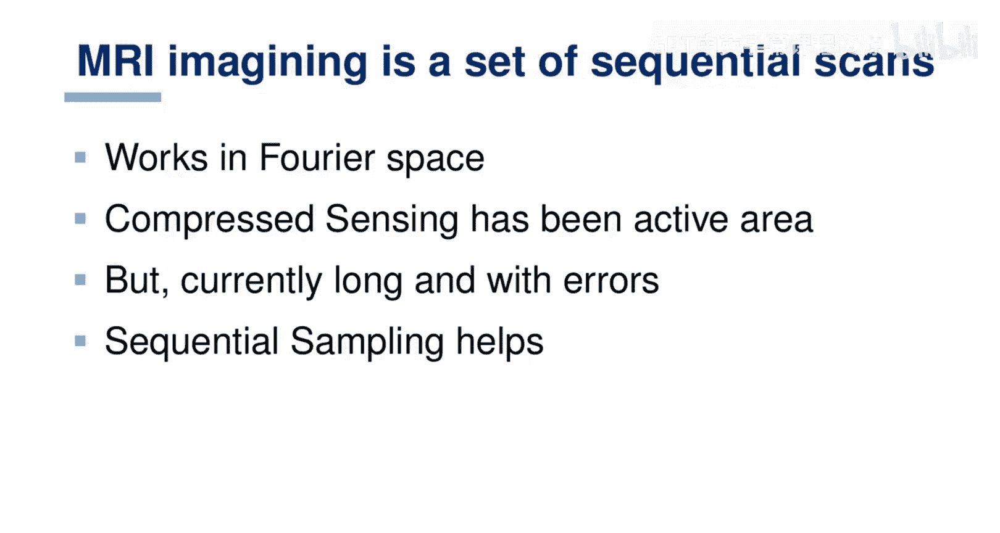
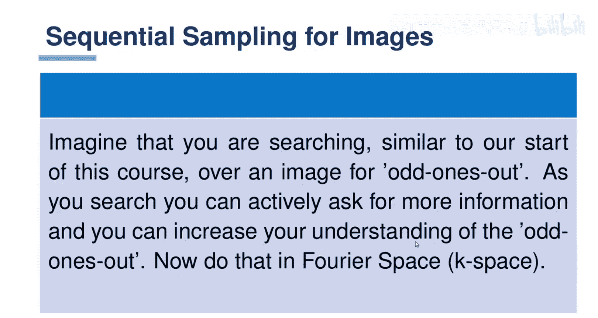
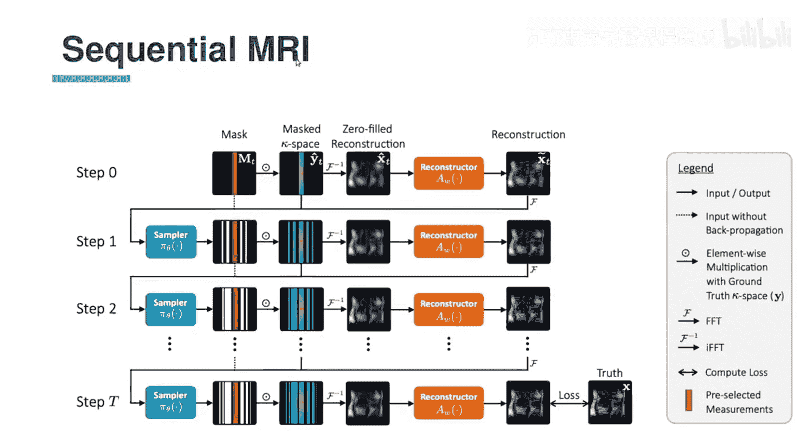
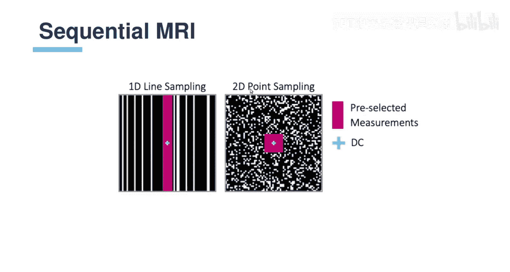
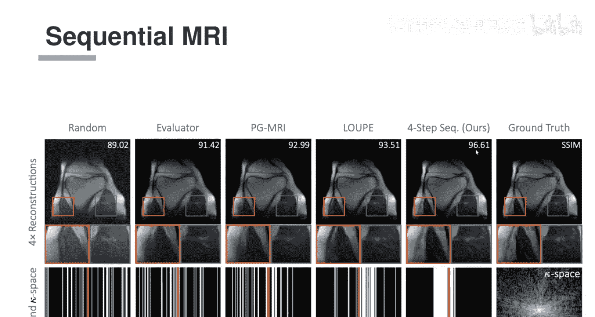
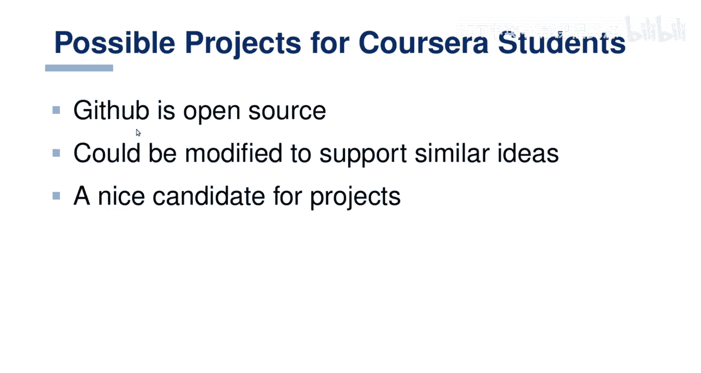

# 约翰霍普金斯大学《数据科学：时间中的决策｜Data Science Decisions in Time》中英字幕 p26 10_核磁共振成像加速技术.zh_en -BV1NCuzzfEJa_p26-

Well now I'll talk about magneticgracent imaging and using sequential sampling in order to really more intelligently speed up the total time for an MRI scan or understand a little bit better the images that you're seeing a subtitle might be how to avoid a patient with a half hour or more in an MRI scan so MRI scanning as many of you probably are well aware of works in foyer space this is reciprocal space it means that you have to be thinking carefully about the images you're collecting in foyer space for this sequential scanning approach some of you may be well aware there is a lot of success with compressed sensing in this area of still an active active research area with a lot of interesting math and computational algorithmic issues but MRI scanning can still be improved it takes a long time again for each patient there errors anything that can help here has major impact on healthcare and so sequential sampling I would argue is another interesting application。

To MRI and this is really fairly recent， this idea of using sequential sampling for images。

 but it goes back to the way we started this particular course。

 Imagine you're searching and you're looking very similar the way we started this course for an odd1 out image and how do you find out well you can do sequential sampling Now we're going to be looking for MRI in reciprocal space but it's the same sort of idea you can search actively。

 you can ask for more information and as you increase your understanding of that on one out you you can continue to get better now we're going to do that invoyer space。

 this is case space so。

Makes things a little bit different anyway， this is the paper that I want us to go over on and end sequentialial sampling and reconstruction for MRI this fairly large set of authors。

 so note that the six people involved and really shown again the power of collaboration that were're seeing different institutions here Harvard。

 Caltech and Texas at Austin so the。Approach is somewhat seen in this particular one。

 hopefully I'll give you a feeling for it。 if you've not seen much with MRI this may be a little bit confusing to look at these images。

 but just focus on the fact that you can make things better this is showing for right rotated versus left rotated images with the final reconstruction and ground tooth and showing that through steps where you're paying attention to what's in the image you can improve it and that's the whole idea Now MRI works again in foyer space So what you want to be thinking about is the foyer on x。

 this is this operator here is pairwise vector5 vector composition you're effectively thinking of it is we're taking all the elements under vector and multiplying them and that's what that operator is doing So why hat then is in the reciprocal space so to speak what I think of is the foyer space on the original image so we're working in that。

spaceAnd then we've got a pathway reconstructive pathway。

 this a subW on x of T and that's ultimately where we're trying to improve that we're trying to make our image be better on so think about it as more trying to find a policy in our estimation space such that as we update we had a better improved sequential image in terms of what's going on。

 and this is the central idea that we're playing with in these reconstruction。

 so effectively we're trying to find a theta star and a W star so we can find an R man on some sort of a it could be like a k divergence。

 but we're going to use SSIM in this structural similarity score but you want to be thinking about how this x of T squiggle compares with x and are try and optimize on that and you're doing that in this theta Nw space so that's the theta star Nw star So effectively what that means is for sequential MRI that we've got a series of steps and each steps we're trying to improve we've got our sampler or p there we've got our mask our mask。

Kspace， our zerofo reconstruction， our reconstruction。

 which is that capital A that I was pointing to a moment ago and then our reconstruction and effectively what we're doing is we're comparing all the way through so it's an algorithm that we're using our sequential ideas on but we're now applying it to magnetic resonance imaging our MRI we can see improvements in 1D or 2D sampling and when I say we I mean that's the work the paper that I'm referring to here but they are suggesting dramatic improvements from 1D line sampling or 2D point sampling and the improvements are really quite dramatic。

 so this is showing random versus their fourstep sequential versus ground truth these here are to show you boneup regions so maybe compare this one or this evaluator with theirs you can see the numbers here improving that's ordered all the way up SSIM again is the a the structural similarity score search and again we're in the foyer space。

 the casespace here。

So what I want you to focus on is just relative to loop。

 which is kind of a state of the art method they're seeinging significant improvements。

 Here's another way of looking at that nonsequential over loop one step over loop two step over loop and then their fourstep sequential over loop and so you can see that there's a significant improvement again using this SIM improvement again that's being the think what it is like Cal divergence。

 the similarity score between these methods so significant improvement in the sequential MRI and this is true as well。

 SSIM loop versus nonsequent and then one two and four step sequential and you can see in each case an improvement in their score so again the idea being that even though these might seem somewhat modest to some people these are significant improvement that across the board can help improve MRI so here's fourstep sequential or one step four step over two step and again you can see that we're they're very clearly seen。

Improvements in this sequential MRI， which is really very very exciting that you can show these kinds of improvements now what I want to also suggest is the code is open source。

 this is the first author and you can imagine I think for Coursera projects working with this code it's in the form of notebooks right now。

Very easy to imagine going in and seeing if you can come up with a better algorithm using sequential ideas to further improve from their initial entry points into this。

 So again， what this is doing is using sequential ideas but in casespace for MRI So it's using ideas from sequential sampling I think an excellent use case for many things we've been exploring in this course。

 improves on the current best MRI methods as I tried to give a feeling for。

 I think the argument there is very strong that these ideas as sequential sampling can help to improve imaging and image search and that is very much true in this Fourier space。

 So it really shows the power of these ideas the ability to。

Really reach in and improve the algorithms。 So as again， as I mentioned。

 there's some possible projects here for course students。 the Gitthub is open source。

 It could be modified to support similar ideas， And so therefore it's a really nice candidate for projects。

 So with this， I hope I've given you some feeling for how our ideas of sequential sampling could be applied for MRI again。

 really attribute to the six authors on the paper， but also indicative of I hope anyway for all of you。

 how sequential sampling could be applied in real time。

 not something over long time spans like in a clinical sampling context。

 but in relatively short time window of an MRI scan。 Okay Thank you。

