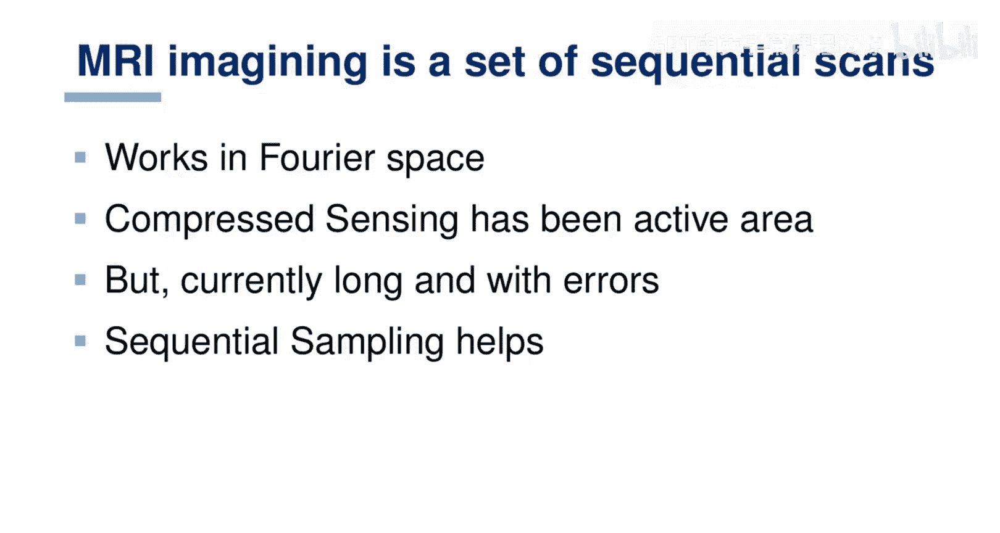
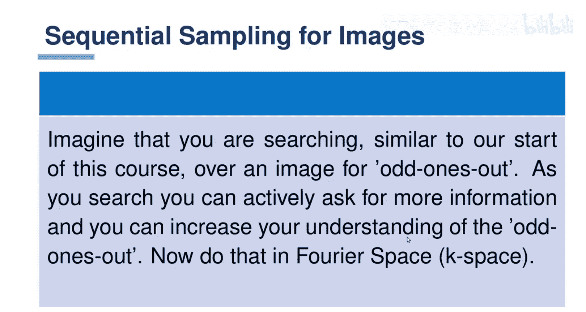
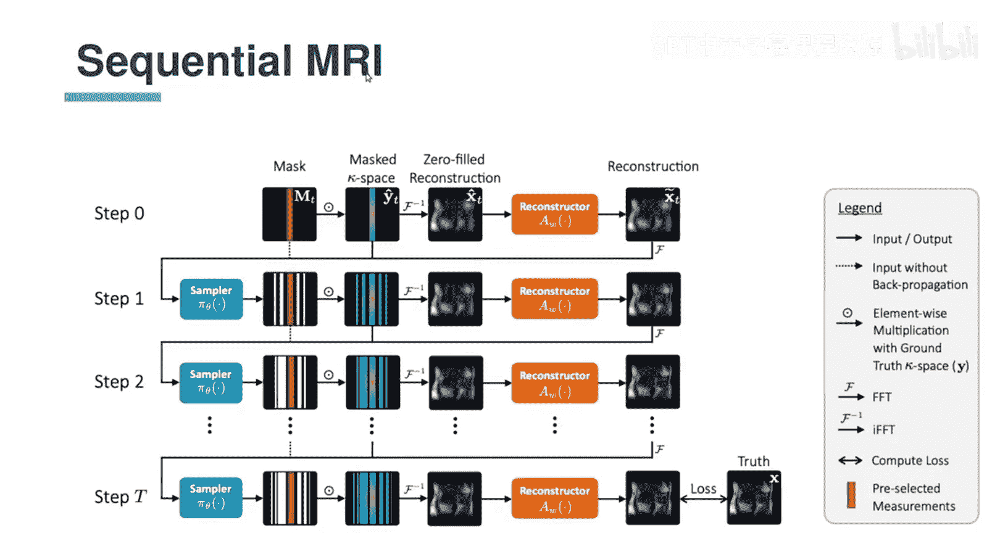
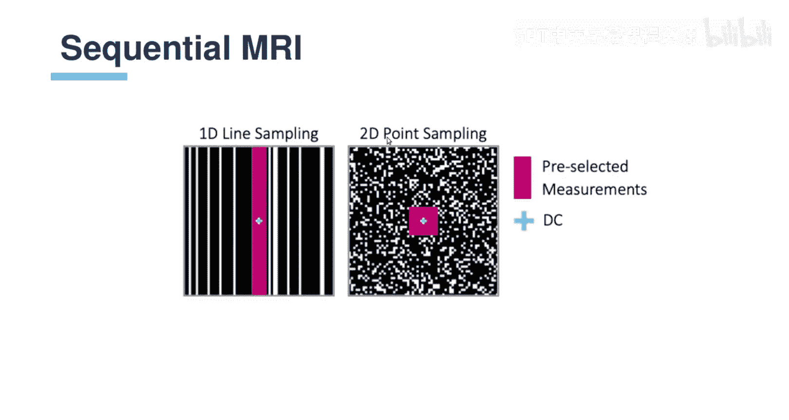
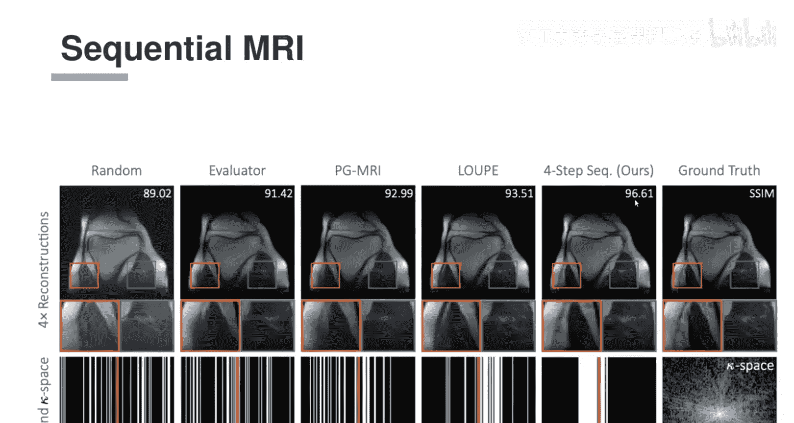
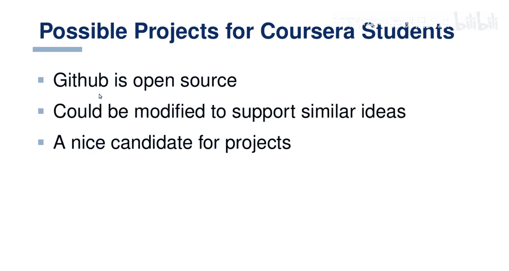

# 数据科学：时间中的决策｜10：核磁共振成像加速技术 🧠⚡

在本节课中，我们将学习如何将序贯采样技术应用于核磁共振成像，以更智能地加速扫描过程并提升图像质量。我们将探讨其核心思想、数学框架以及实际应用效果。

## 概述

核磁共振成像扫描通常耗时较长。通过引入序贯采样思想，我们可以在傅里叶空间（或称K空间）中更智能地采集数据，从而在保证图像质量的前提下显著缩短扫描时间。本节内容基于一篇由多机构合作完成的研究论文，展示了该方法如何改进现有的MRI技术。

## 核磁共振成像与傅里叶空间

核磁共振成像工作在傅里叶空间，即所谓的“倒数空间”或K空间。这意味着我们需要仔细考虑在该空间中采集的图像数据。传统的压缩感知技术在此领域已取得一定成功，但MRI扫描仍有改进空间。每次扫描耗时较长，任何能加速扫描或提升图像质量的技术都对医疗健康具有重大影响。

因此，序贯采样被认为是另一个有趣且较新的应用方向。其核心思想可追溯至本课程开始时讨论的“寻找异常图像”问题：通过主动、序贯地查询更多信息，随着对目标的了解加深，搜索效率会不断提高。

## 序贯采样在MRI中的核心框架

现在，我们将同样的序贯思想应用于MRI的傅里叶空间。这涉及到在K空间中进行主动搜索。

以下是该方法的数学框架核心。我们最终的目标是重建出高质量的图像。设原始图像为 **x**，其在傅里叶空间（K空间）的表示为 **ŷ**。关系可表示为：

**ŷ = F(x)**

其中 **F** 代表傅里叶变换算子。

在序贯采样过程中，我们在每个步骤 **t** 都会采集一部分K空间数据，并基于已有数据更新对图像 **x** 的估计，记为 **x̃(t)**。重建过程通过一个参数化的重建函数 **A** 完成，该函数依赖于参数 **θ** 和 **W**：

**x̃(t) = A( ŷ_sampled; θ, W )**

我们的目标是找到最优的参数 **θ*** 和 **W***，使得重建图像 **x̃** 与真实图像 **x** 之间的差异最小化。这个差异通常用结构相似性指数（SSIM）等指标来衡量。优化目标可以表述为：

**(θ*, W*) = argmin_{θ, W} [ D( x, x̃(t) ) ]**

其中 **D** 是衡量差异的函数（如SSIM的倒数）。

## 序贯MRI算法流程

以下是序贯MRI采样的基本步骤流程：

1.  **初始化**：从零或随机状态开始。
2.  **循环（每一步t）**：
    *   **采样**：根据当前对图像的理解，通过策略 **π** 选择下一个K空间中最有价值的点或线进行采样。
    *   **掩码**：更新K空间采样掩码 **M(t)**。
    *   **零填充重建**：对已采样的K空间数据进行逆傅里叶变换，并进行零填充处理，得到一个初步重建图像。
    *   **优化重建**：使用重建函数 **A**（通常是一个深度学习网络）对初步重建图像进行优化，得到当前步骤的最终重建图像 **x̃(t)**。
    *   **评估与更新**：计算当前重建图像的质量（如SSIM），并更新采样策略 **π**，以指导下一步的采样。

## 方法效果与改进

该方法在1D线采样和2D点采样中均显示出显著改进。与当前先进的“LOOP”等方法相比，序贯采样方法在多个评估指标上都有提升。

例如，在结构相似性指数（SSIM）上，可以看到明确的改进趋势：非序贯方法 < LOOP方法 < 一步序贯 < 两步序贯 < 四步序贯。这些改进虽然数值上可能看似不大，但在医学图像质量的整体提升和扫描时间的缩短方面具有重要实际意义。

## 开源代码与项目潜力

这项研究的代码是开源的，以Jupyter Notebook的形式提供。这为课程学员提供了极佳的项目机会。学生可以尝试修改或扩展此代码，例如设计更好的序贯采样策略、尝试不同的重建网络架构，或将此框架应用于其他类型的医学成像，以进一步推动该领域的发展。

## 总结

本节课我们一起学习了如何将序贯采样思想应用于核磁共振成像。我们了解到，通过在傅里叶空间（K空间）中智能地、序贯地选择采样点，可以显著提升图像重建质量或加速扫描过程。该方法的核心在于动态地结合**采样策略**和**图像重建模型**，并持续优化。这项研究不仅展示了序贯采样在实时、短时间窗口决策问题中的强大应用潜力，也为医学影像分析提供了新的改进方向。