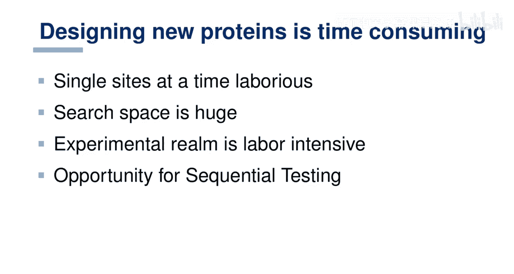
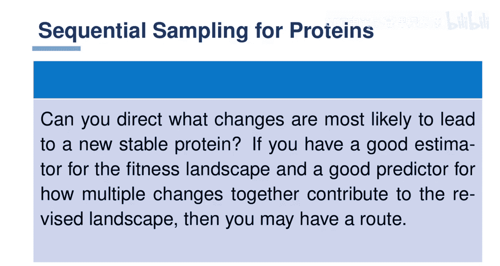
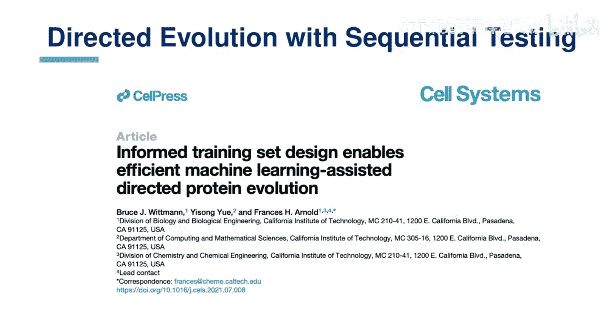
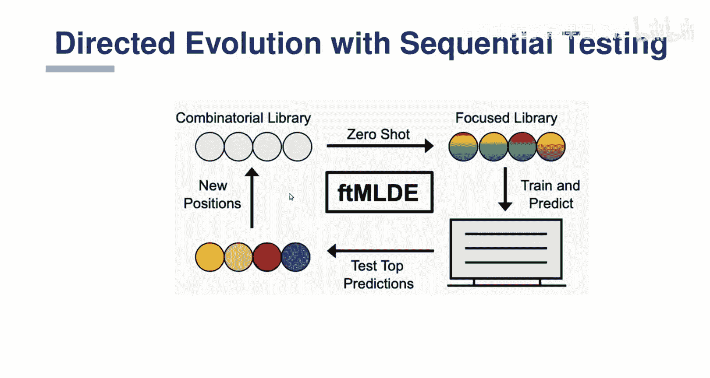
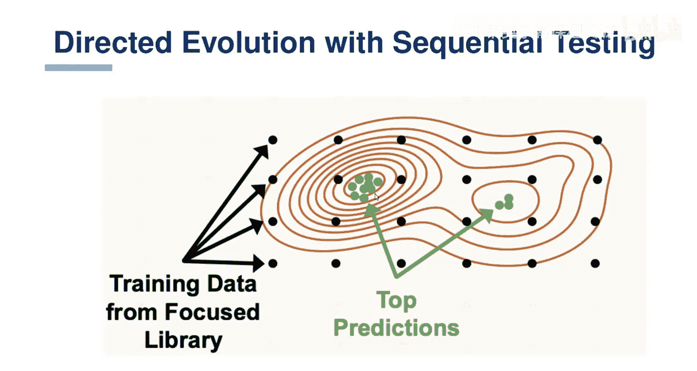
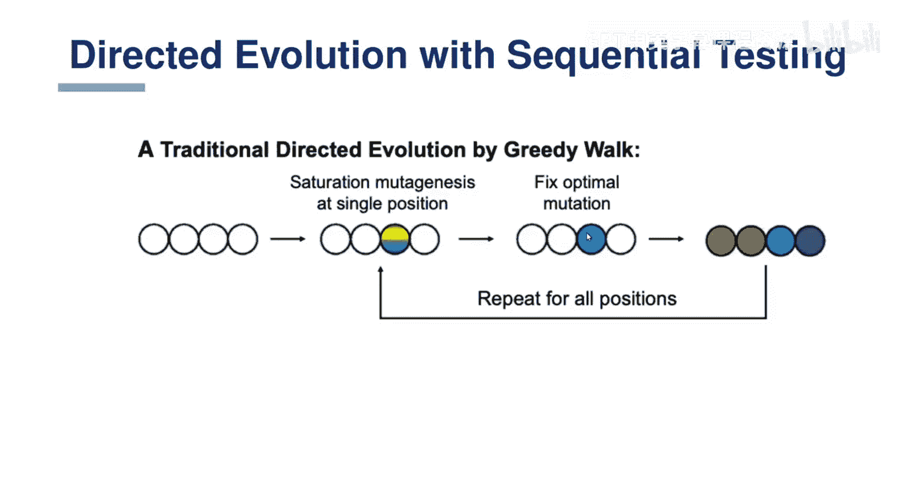
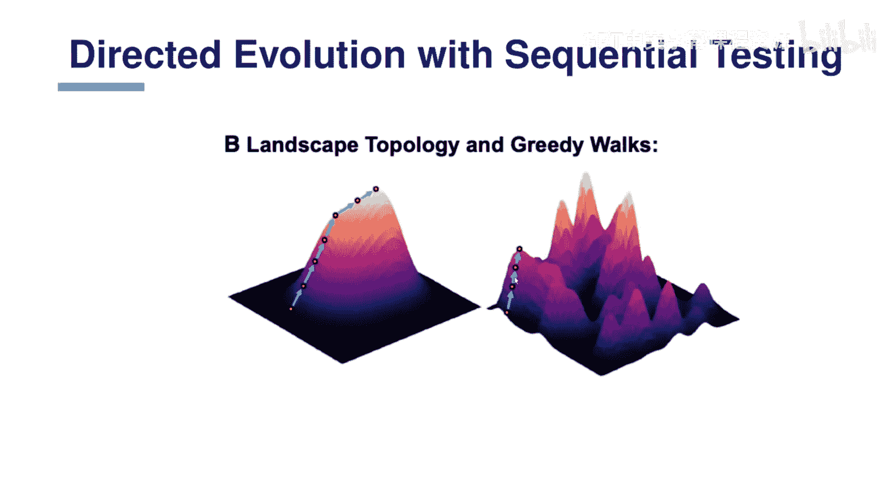
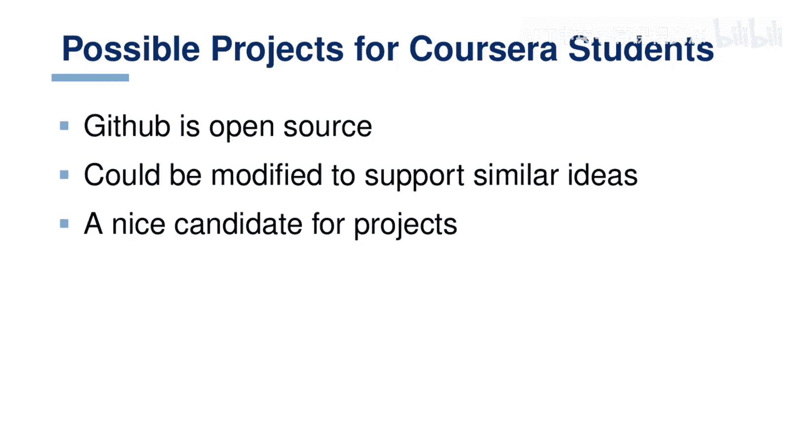

# 约翰霍普金斯大学《数据科学：时间中的决策｜Data Science Decisions in Time》中英字幕 p27 11_定向进化的假设驱动方法.zh_en -BV1NCuzzfEJa_p27-

We'll now talk about how you can use sequential hypothesis testing to help with designing new proteins。

 This is an example of a directed mutational walk ultimately。

 and the question is how can we explore a fitness landscape？

 This is a really challenging problem and I think another area ripe for sequential testing So designing new proteins is very time consuming very awkward。

 Francis Arnold grew at Caltech has done a lot of work in this area。

 many of you may recognize the name she's a Nobel Prize winner and really phenomenal work that she's been involved with The problem though for an average person working at this is that looking at this in terms of single sites to try and do new protein design is very time laborious and very。

 very awkward and that's simply because search base is tremendous。

 It's just so huge that if you do it single site at a time you'll never really be able to converge and especially if you're doing in the experimental realm。

 this is an extremely labor intensive and difficult problem so。

I would like you to imagine because I think it's true that this is really an opportunity for sequential testing。

And for proteins and then protein design， the question is whether you can find the changes that are most likely to lead to a new stable protein。

 So really if you've got a good estimator for the fitness landscape and a good predictor for how multiple changes come together then within that revised landscape after you've made the changes you could have a root。

 the hard part is while it's easy to say this， it's not so easy to imagine how to design that landscape in such a way that you can make changes and understand what those changes are。

 it's hard enough to see the landscape just in terms of predicting for a few small changes let alone for a large number of changes。

 So the paper we're talking about now is from Franciss ourold group， as I said。

 you saw you who's in computer science in that area of collaboration between those two groups。

The argument is that if you're thinking in terms of a library that you're going to make changes to。

 let's say an enzyme， this is something Francis Arnold has worked quite a lot with。

 you can imagine doing something that will speed things up dramatically and the idea is that you've got a commentatorial library and a focus library this focus library is coming from this modified machine learningbased directed evolution and essentially what we're doing is taking out those locations that are really potentially poor so it's almost like an inverse hypothesis selection you're using the top test predictions and developing new positions and effectively using this and the focusing to make it even better so another way of saying this is that you've got training data from the focus library and you could make the top predictions you can make them land more directly in the fitness landscape at the best spots and you want to contrast that with kind of a traditional directed evolution。

Sort of root you've mentioned I've mentioned before the greedy algorithm and greedy walks。

 The idea there is you pick the best local estimate。

 so you've got a region and you look in that one area for protein evolution design。

 this is much more difficult。 you really didn't think in terms of how the whole protein is going to fold and therefore how or work So if you're doing it from single ones at a time trying to pick the initial one and then repeat more than likely is going to be a very long and laborious process。

 The issue is really again trying to predict how the landscape changes with the mutations So doing one at a time it's a very challenging problem to understand that landscape ofology So prior to the paper that I just put up there was work largely from within Prince Arnold's group for machine learning assisted directed evolution where they were really trying to think how to use computers to help they're use different types of machine learning models effectively then we're thinking in terms of larger sets of mutations。

Then you were trying to sample and characterize them and coding those combinations in order to represent them on some sort of a computer model。

 some sort of regression， say or classifier something in machine learning that could then be used to make things still better what they realized in this work which I think is very very insightful is that they could use ideas from directed learning or sequential hypothesis testing to essentially eliminate some combinations as being so low on the hypothesis realm。

 meaning so unlikely to contribute to a happy solution that they could be eliminated from the search space。

 and that speeds things up dramatically compared to the greedy algorithms， so they've looked at GB1。

 this is a particular protein that has a structure and that people have looked at before。

 including Francis hormone group， and then what they did is look in terms of a repetitive cycle of iterate refine but again with a form of sequential。

testing so you've got your search space and then you sample and you can take different sizes for training and then there's an encoding this could be in one of many different ways the encoding seem to matter much less than the change and the understanding of the fitness landscape a form of hypothesis testing brought about ultimately by looking for holes looking for regions where they just did not contribute and therefore it should be excluded so then you can value the predictions and use a scoring function which we'll see is a little bit like a sequential hypothesis testing type scoring function and just iterate and repeat So here's this NDcG which I just pointed to and you can see this is a ratio of two different terms So this is just like a likelihood function so we' got f subi f subi prime you can think of these as two different density estimators or where this log to2 in the number from one to n the number of amino acids that we're looking at the number mutations that we're looking at so effectively this NDcG then acts as a way to guide the directed evolution。

And from this likelihood racial test， you basically eliminated those that were low scorings were like the holes down that were not contributing。

 So one way of thinking about this is you got your parent， you got mutn。

 you're screening and if you just do this randomly without thinking about the landscape。

 you're going to just kind wander around， you're not going to converge but if you've got sequential testing then you've got a way to think about this screen with respect to the fitness landscape。

 you're much more likely to end up in the right spots where you contribute to a new stable protein with altered enzyme function。

 which is really what this is all about so。The idea then。

 is that sequential sampling or directed learning， different manner of speaking for essentially what came from Turnoff's influential work。

 that these sequential sampling ideas can help prune the search space。

 and they estimated roughly an80 time improvement compared to the greedy algorithm。

 So a dramatic speed up relative to what they were getting before。

 And one could argue maybe even more so than speed up。

 It was in terms of efficiency in terms of getting to a stable new design structure。

 protein engineered structure。 So these ideas helped them dramatically。

 And it really shows them the power of these ideas to apply towards protein design。

So similar to what I said for some of the other lectures this week， I think this is open。

Environment for Courra students to potentially do projects。

 though Gitthub again code is open source and available。

 it could be modified to support similar ideas。 There's really interesting questions that could be explored from this code。

 So again， I think it's a really nice candidate for projects。

So I hope you enjoyed this， it gives some sense again of the really amazing possibilities in code with algorithms for sequential sampling。

Thank you。