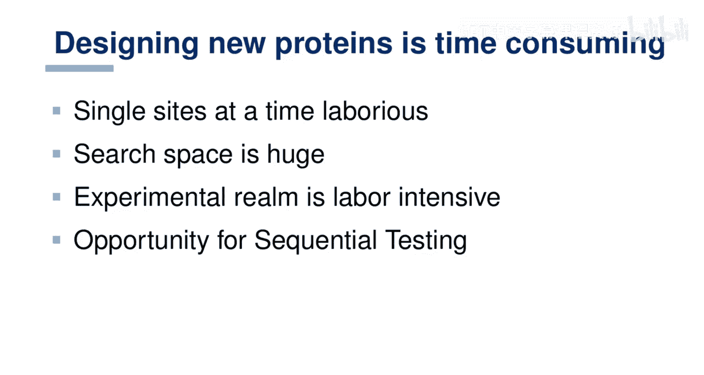
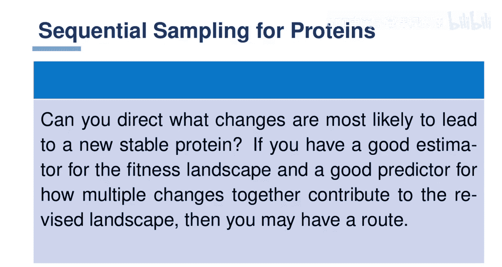
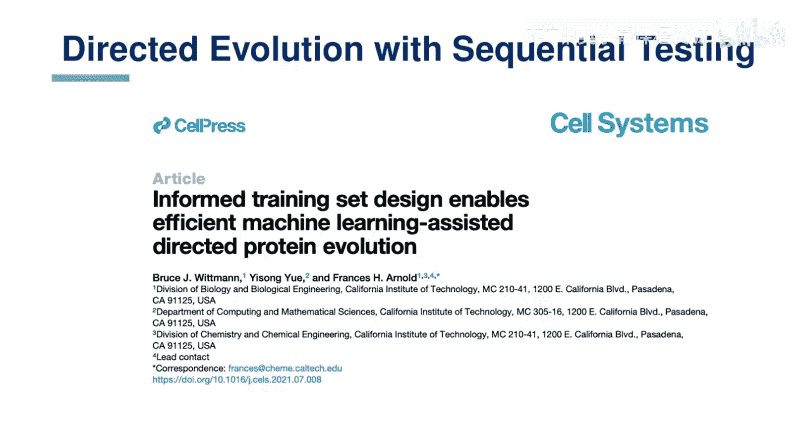
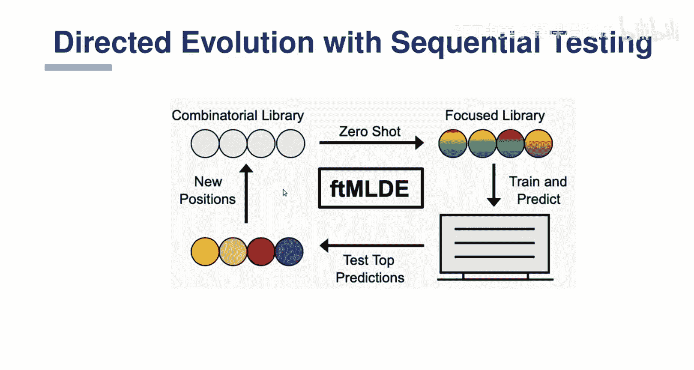
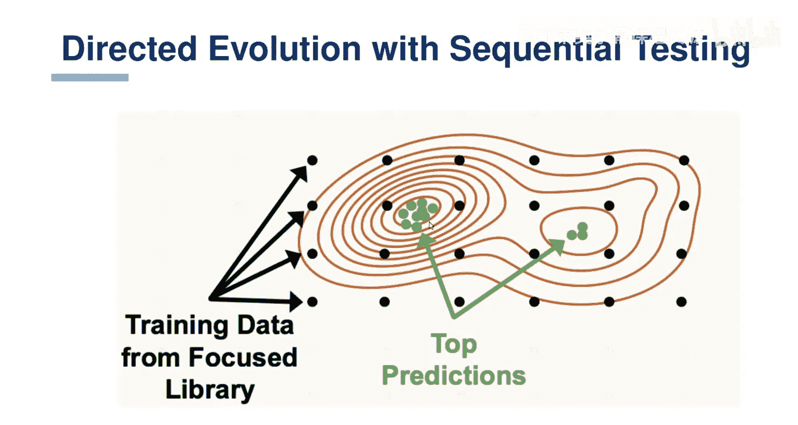
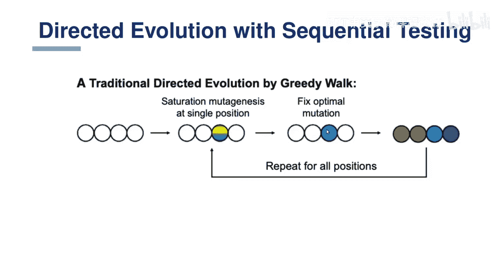
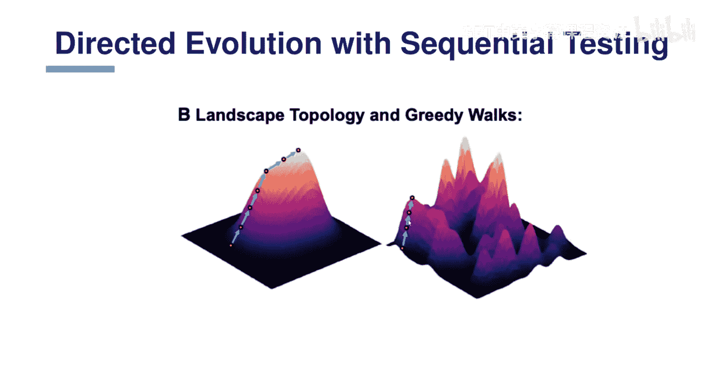
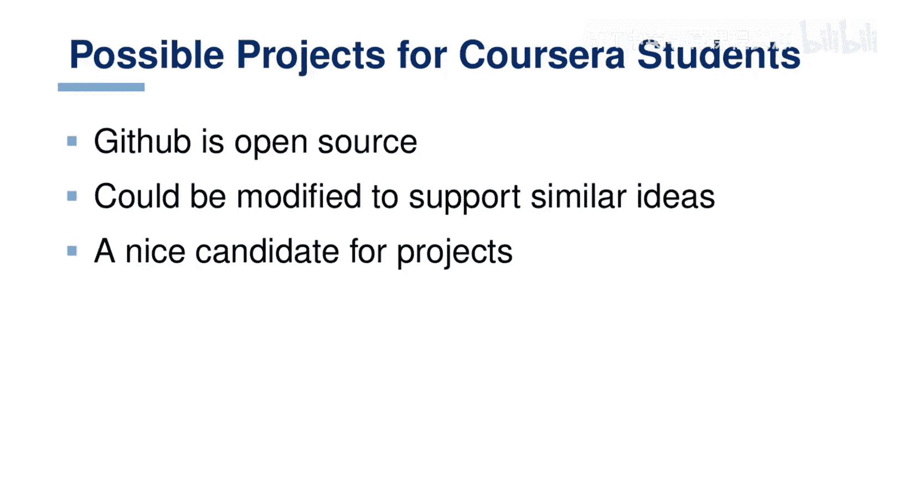

# 数据科学：时间中的决策｜Data Science Decisions in Time：11：定向进化的假设驱动方法 🧬

在本节课中，我们将学习如何利用序贯假设检验来辅助设计新蛋白质。这是一个关于如何在巨大的可能性空间中，更高效地探索蛋白质“适应度景观”的挑战性课题。

## 蛋白质设计的挑战

上一节我们讨论了序贯检验的基本思想，本节中我们来看看如何将其应用于一个具体且复杂的领域：蛋白质设计。设计新蛋白质是一个非常耗时且困难的过程。弗朗西斯·阿诺德（诺贝尔奖得主）在该领域做了大量开创性工作。然而，对于普通研究者而言，传统的单点突变方法搜索空间巨大，实验过程极其繁琐，很难收敛到理想结果。

因此，这为序贯检验方法的应用提供了绝佳机会。

## 核心思路：从组合库到聚焦库

蛋白质设计的核心问题是，能否找到最有可能产生新稳定蛋白质的突变组合。关键在于，如果你有一个好的适应度景观预测模型，就能在突变后的新景观中找到最优路径。

但难点在于，准确预测少数几个突变的影响已属不易，更不用说预测大量突变组合后的景观变化了。

我们讨论的这篇论文来自弗朗西斯·阿诺德的研究组。他们的论点是，通过构建两种库可以显著加速这一过程：

*   **组合库**：包含所有可能的突变组合。
*   **聚焦库**：通过基于机器学习的定向进化方法筛选得到，它剔除了那些可能表现很差的突变位置。

这类似于一种逆向假设选择：利用模型预测的**最优**结果来指导新位置的开发，并通过聚焦进一步优化。换句话说，你可以利用聚焦库的数据进行训练，做出最有可能落在适应度景观最佳区域的预测，这与传统的定向进化方法形成对比。

## 与传统贪婪算法的对比

之前我们提到过贪婪算法和贪婪路径，其思想是在局部选择最优估计。但在蛋白质进化设计中，这要困难得多，因为你必须考虑整个蛋白质的折叠和功能。一次只做一个突变，然后重复此过程，很可能导致漫长而低效的探索。

问题的核心再次回到如何预测突变带来的景观变化。一次只做一个突变，很难理解整个突变学景观。

在刚才提到的论文之前，阿诺德研究组已经在进行机器学习辅助的定向进化研究，尝试利用计算机模型来处理更大的突变组合集。他们意识到，可以借鉴定向学习或序贯假设检验的思想，来剔除那些在假设层面上贡献极低（即几乎不可能产生理想结果）的组合，从而大幅缩减搜索空间。

与贪婪算法相比，这能带来巨大的速度提升。

## 方法流程：迭代、编码与评分

他们以GB1蛋白为例进行研究，采用了一个包含序贯检验思想的迭代优化循环。

以下是该流程的关键步骤：

1.  **定义搜索空间**：确定要探索的突变范围。
2.  **采样**：从搜索空间中抽取样本。
3.  **编码**：将突变组合以某种方式编码（例如回归或分类器），编码方式的具体选择不如理解景观变化重要。
4.  **假设检验与剔除**：通过寻找“空洞”（即那些不贡献积极结果的区域）来进行一种形式的假设检验，并将其从搜索空间中排除。
5.  **评估与评分**：使用一个评分函数来评估预测结果，该函数类似于序贯假设检验中的评分函数。
6.  **迭代重复**：不断重复上述过程。

他们使用了一个称为NDCG的指标来指导定向进化，其公式类似于似然比：

`NDCG = (∑_{i=1}^{n} (f_i / f‘_i)) / log_2(n+1)`

其中，`f_i` 和 `f‘_i` 可以看作是两种不同的密度估计量，`n` 是我们关注的氨基酸或突变数量。通过这个似然比检验，可以剔除那些低分项（即不贡献的“空洞”）。

## 方法优势与总结

我们可以这样理解：从亲本蛋白出发，引入突变并进行筛选。如果只是随机进行而不考虑景观，就会漫无目的地游荡，无法收敛。但如果引入了序贯检验，你就能根据适应度景观来指导筛选过程，从而更有可能到达能贡献新稳定蛋白质（并改变酶功能）的正确位置。

总之，序贯抽样或定向学习的思想（本质上源于特诺夫的 influential work）可以帮助修剪搜索空间。据估计，与贪婪算法相比，这种方法带来了大约80倍的效率提升。这种提升不仅是速度上的，更体现在获得稳定新蛋白质设计结构的效率上。这些思想极大地帮助了研究者，并展示了将其应用于蛋白质设计的强大潜力。

与本周其他课程内容类似，我认为这是一个对Coursera学生来说潜在的项目方向。相关代码在GitHub上是开源的，可以被修改以支持类似的想法，其中有许多有趣的问题值得探索。

本节课中，我们一起学习了如何将序贯假设检验应用于蛋白质定向进化设计。通过构建聚焦库、利用机器学习模型预测适应度景观，并采用序贯检验思想剔除低潜力组合，研究者能够大幅提升蛋白质设计的效率和成功率。这再次展示了序贯抽样算法在代码实现中令人惊叹的可能性。