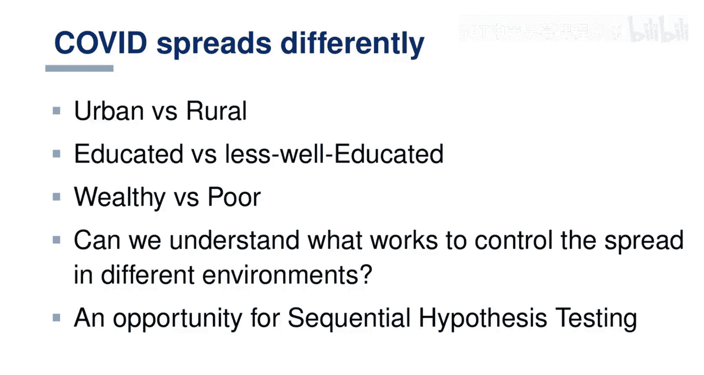
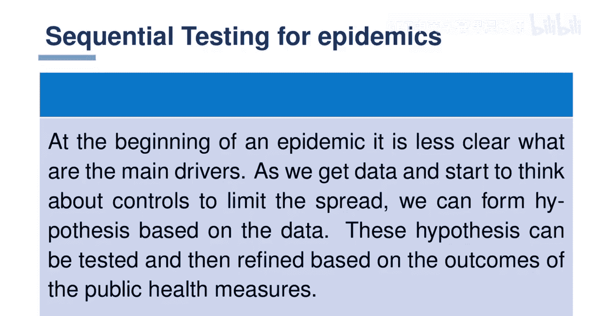
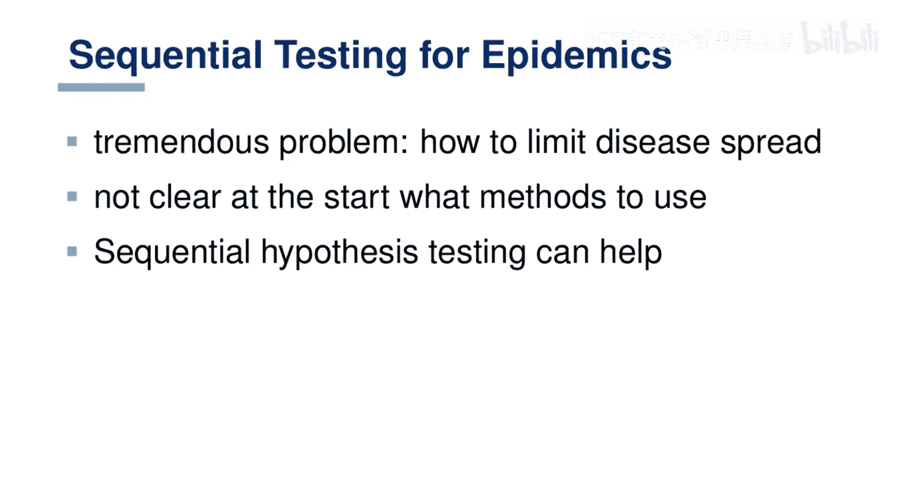

# 约翰霍普金斯大学《数据科学：时间中的决策｜Data Science Decisions in Time》中英字幕 p28 12_以COVID为例.zh_en -BV1NCuzzfEJa_p28-

Well， nothing about COVID and how it can spread， really the factors and all the reactions that come to those factors。

 really the question here is can we think about hypothesis tests that help us to control disease spread。

 and once we've got hypothesis tests once we've got a way to do this sequentially。

 then we've got a way to do our sequential hypothesis testing。

 so I'm going to stage this more as a hypothetical。

 think about what you could do within COVID when I'll be presenting are really models for factors affecting COVID not a direct application at this point of statistical hypothesis testing。

 but a place where I would argue these methods really can apply。

So COVId definitely spreads differently， urban versus rural， educated versus less well educated。

 wealthy versus poor。 It makes a difference where COVD is found and the public health resources that are available in different locations。

 varies dramatically willingness of people in different locations to react to it varies and this is going to be true of any epidemic But the question will be。

 can we understand what works to control the spread in different environments。

 and therefore can we help ultimately to control what's going on And I would argue that this is really an opportunity for sequential hypothesis testing ideas we've been exploring in our second coursera。

 there really is room here， I believe for a lot of these ideas to be applied directly to this kind of a problem。

 So if we think about sequential hypothesis testing for epidemics。

 we really want to be thinking in different stages。 So for example， at the beginning of an epidemic。

 it's not so clear what are the main drivers behind it and therefore harder to know how to control it as we start to get data and we start to think about how we have to control and understand what's going on to limit the spread we can。

start to make interesting hypotheses about what's going on and about what might especially help to control future spread and once we've got these hypotheses。

 we can start to test them， refine them and really really potentially control the spread of the epidemic through these ideas of sequential hypothesis testing so I'm going to pull from this paper this is from Chris Holmes and team you can see its international collaboration including some people from Hopkins and the question they're getting out is really what are the main drivers for。

COVID or other types of epidemics in principle， they're looking at things like rapidit tests。

 tracing， distancing， lowin countries versus other income countries and can you fund abnormal policies is what they're asking that address this and again I'm rephrasing this at least in part is an idea a suggestion that sequential hypothesis test can potentially help very much in this as well so again these are figures from their paper what we're looking at here are daily contacts and simulating the transmission so obviously for something like COVId it's very much driven by the contact networks。

 the people the once around because it's driven directly as a respiratory disease by the contacts so depending upon how many daily contacts you have you can simulate the transmission you can simulate how many days so this would be the first step one would need in making an hypothesis about how to control the spread of an epidemic is to ask what's involved and then you can start asking things like physical distancing roles of testing roles of contact。

And the question that's been addressed in the second stage is。

 does it make a difference to physical distance， Does it make a difference to test。

 Does it make a difference to contact trace。 Obviously。

 contact tracing has another level because that's how you act on it testing has another level because it's how you act on those tests and how quickly they come back physical distancing is some ways up to the individual but you could argue that needs to be set to a particular value in the words governments need to say this is the appropriate physical distance in inside versus outside。

 So these are all factors that definitely have an impact on the spread of the epidemic。

 but we need to nuance them and we think about hypotheses that address both the communication of these modalities and the way that they can be used in different settings。

 So if we think about this spreads in different days of an epidemic again。

 something like COviId it varies and it'll vary in different populations and it'll vary in different ways。

 We can do this through simulation we can compare the simulations get surveyed。

To make sure the estimated density based on the number of contacts makes sense。

 and that's what Holme and team did here is to show that in fact it is possible dis simulating it make sense。

 which means it's also then possible to think about making cyclical models for hypotheses about what could help to control the spread。

 So then they compared it as well against the from the literature versus the simulation again suggesting that making a model was reasonable that they could get good results。

 This was looking at UK versus China days from the first importing case again。

 questions about isolation， Que about quarantine come up with these sorts of figures Can you think about effective policies that would have an impact on preventing the spread so now we're looking at an SR type model So we've got infected covered infected under isolation healthy under quarantine these are different categories just like susceptible infected and recovered standard SR type model so you can look。

In a particular window of population look at the nodes at different days and evaluate how they spread。

 this is the advantage of an agent-based model， which means again you're starting to get the potential to do hypothesis testing because you can start to think about even further subsets of this and how they could be adjusted in terms of different behaviors and how that would have an impact on the outcome so again。

 a form of statistical hypothesis testing。So this is a somewhat similar thing we're now looking where comparing different factors involved in the spread of COVID so based quarantine。

 PCR testing， antibody testing， testing and we've got different success rates of isolation with each of these the question being again can you set values for behavior based on these outcomes from the tests and depending upon where you put those thresholds can you predict the impact back on the population So again very much hypothesis testing very much again trying to think about the relative trade-offs between different types of behaviors and which one is going to give the optimal and best policy here's another way of thinking about another factor in this social distancing these are with different tests that have been detected social distancing by itself again in terms of setting policy and in terms of ultimately comparing different hypotheses these are really important because with this idea of social distancing into these different conditions you've got the ability。

To make a more nuanced understanding of what kinds of behaviors are most likely to be effective then we can compare different kinds of settings we can think ultimately about maybe a low income country versus a highin country an educated population versus a non so not so well educateduc country and we can think about distancing no physical distancing versus physical distancing in terms of its spread obviously if you're not doing physical distancing you're gonna to have a greater spread so once you've got a model for how these diseases might spread。

 you can again start to think about policies， hypothesis tests that help you pick out which is the most likely best route for managing the disease spread so as I mentioned you can think in terms of rural non-s urban alum region in an urban and you can have different rules。

 different approaches that potentially be in these different settings this is comparing no physical dis versus model physical distance in each of these settings and again you can see it makes a difference makes。

it would make a difference。 The question again， in terms of sequential hypothesis testing is how we could fold this kind of a model in to making predictions。

 This is now contact structure in rural and our non slum， urban and in our slum again。

Diffences in these different environments， not all surprisingurpri the sort of thing you would expect。

 The question ultimately， again， is can you set an optimal policy， you know。

 in terms of a public health type measures that will control the spread。 And again。

 that sequential testing in terms of hypotheses。 Here's again。

 no NPI and our context structure and again， comparing where these things are。 So again。

 there's a tremendous problem here， You know， how do we limit the disease spread。

 How do we set optimal policy， It's not clear at the start what methods to use and sequential hypothesis testing really can help。

 And so I'm presenting this again， mainly is an idea at this stage。

 this sort of work I would argue for controlling coviId is still at the beginning。

 even though we've been at it now while at the time of recording。

 But there's still more work they can be done。 partly because， again。

The policy may depend upon the context， the rather education of a population where over versus urban amount of public health funds。

 et cetera。 So you're not necessarily aiming for perfect。

 You're aiming for the best that can be attained under a given set of conditions。 So anyway。

 I hope I helped you see into public health and how sequential hypothesis testing could potentially be helpful in that context。

Thank you。