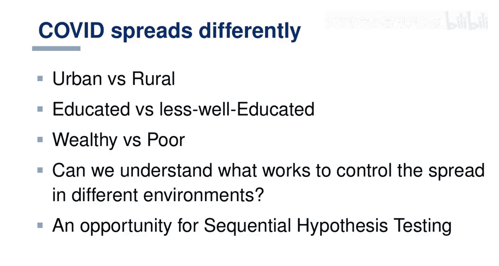
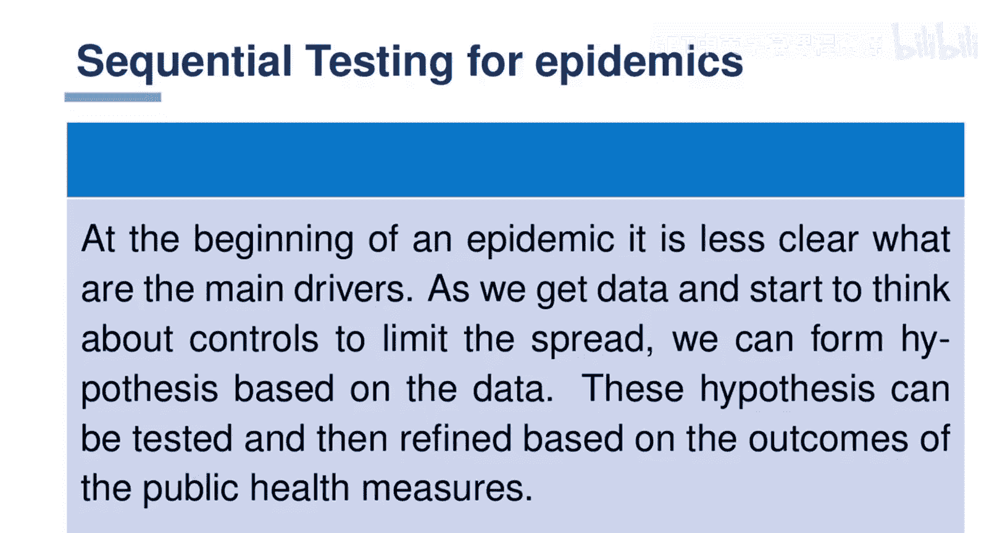
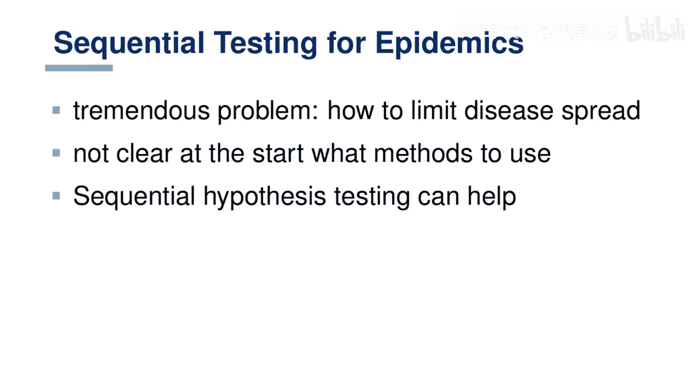

# 数据科学：时间中的决策｜Data Science Decisions in Time：12：以COVID为例的序贯假设检验 🦠

在本节课中，我们将探讨如何将序贯假设检验的思想应用于流行病学领域，特别是以COVID-19为例，分析如何通过数据驱动的方法来理解和控制疾病的传播。

上一节我们介绍了序贯假设检验的基本概念，本节中我们来看看如何将其应用于一个现实世界的复杂问题——流行病控制。

## 概述：流行病控制中的挑战

COVID-19的传播方式因环境而异。城市与农村、教育水平高低、贫富差距等因素都会影响其传播路径和速度。不同地区的公共卫生资源、民众对防疫措施的接受度也存在巨大差异。任何流行病都存在类似情况。核心问题是：我们能否理解在不同环境下，哪些措施能有效控制传播？进而，我们能否帮助控制疫情的发展？我认为，这正是我们第二门Coursera课程中探讨的序贯假设检验思想大显身手的机会。这些方法可以直接应用于此类问题。

## 构建序贯假设检验的框架

若为流行病构建序贯假设检验，我们确实需要分阶段思考。例如，在疫情初期，其主要驱动因素尚不明确，因此更难知道如何控制。随着我们开始获取数据，并思考如何控制和理解传播过程以限制其扩散，我们就可以开始提出有趣的假设。

以下是构建分析框架的关键步骤：

1.  **识别主要驱动因素**：研究如快速检测、接触者追踪、社交距离等措施，以及高收入与低收入国家之间的差异。
2.  **建立传播模型**：通过模拟日常接触网络来理解传播动力学，因为像COVID-19这样的呼吸道疾病传播直接受接触网络驱动。
3.  **形成可检验的假设**：基于模型，提出关于物理距离、检测、接触者追踪等措施效果的假设。

## 模拟与模型验证

控制流行病传播假设的第一步，是探究涉及哪些因素。然后可以开始询问诸如物理距离的作用、检测的作用、接触者追踪的作用等问题。

第二阶段探讨的问题是：保持物理距离是否有影响？进行检测是否有影响？进行接触者追踪是否有影响？显然，接触者追踪涉及另一层面，因为这是你根据检测结果采取行动的方式；检测也涉及另一层面，因为这关乎你如何根据检测结果采取行动以及结果返回的速度；物理距离在某种程度上取决于个人，但也可以认为需要设定一个特定值，即政府需要规定室内与室外的适当物理距离。这些都是肯定会影响流行病传播的因素，但我们需要细化它们，并思考那些既能涵盖这些模式的传播方式，又能考虑它们在不同环境中应用方式的假设。

如果我们考虑流行病在不同天数内的传播，像COVID-19这样的疾病，其传播情况会变化，在不同人群中也会以不同方式变化。我们可以通过模拟来进行，可以比较模拟结果与调查数据，以确保基于接触人数估计的密度是合理的。这正是Holmes及其团队在此展示的内容，表明事实上通过模拟是可行的、有意义的。这也意味着，接下来有可能为“哪些措施有助于控制传播”的假设构建循环模型。

然后，他们还将模拟结果与文献数据进行了比较，再次表明构建模型是合理的，他们可以获得良好的结果。这是观察英国与中国自首例输入病例后的天数，同样，关于隔离、检疫的问题也随着这类图表出现。你能思考那些会对阻止传播产生影响的有效的政策吗？现在我们来看一个SIR类型的模型。我们有了“已感染”、“已隔离的感染者”、“检疫中的健康者”等不同类别，就像标准的SIR（易感-感染-恢复）模型一样。因此，你可以在特定的人群窗口中，观察不同天数的节点并评估它们如何传播。这是基于智能体模型的优势，这意味着你再次获得了进行假设检验的潜力，因为你可以开始思考更细分的子集，以及如何根据不同的行为调整它们，以及这将对结果产生何种影响。所以，这同样是一种统计假设检验的形式。

## 比较不同控制因素

我们现在看的是比较涉及COVID传播的不同因素：基于症状的检疫、PCR检测、抗体检测、以及检测。对于每一种，我们都有不同的隔离成功率。问题再次是：你能否根据这些检测结果来设定行为值？并且，根据你设定的阈值，能否预测其对人群的反向影响？这同样是十足的假设检验，同样是试图思考不同类型行为之间的相对权衡，以及哪一种将给出最优的最佳政策。

这是思考其中另一个因素——社交距离——的另一种方式。这些是针对已检测出的不同测试的图表。社交距离本身，无论是在政策制定方面，还是在最终比较不同假设方面，都非常重要。因为有了社交距离结合这些不同条件的概念，你就有能力更细致地理解哪些类型的行为最可能有效。然后，我们可以比较不同类型的设置，我们最终可以思考也许是低收入国家与高收入国家，受教育人群与教育程度不高的人群。我们可以思考保持距离与不保持物理距离对其传播的影响。显然，如果不保持物理距离，传播会更广。

因此，一旦你有了这些疾病可能如何传播的模型，你就可以再次开始思考政策、假设检验，以帮助你找出最有可能管理疾病传播的最佳途径。正如我所提到的，你可以从农村、非贫民窟城市、贫民窟城市等角度思考。在这些不同的环境中，你可以有不同的规则、不同的方法。这是在比较每种环境下“无物理距离”与“模拟物理距离”的情况。再次，你可以看到它有影响，它会产生影响。同样，在序贯假设检验方面，问题是我们如何将这种模型纳入到预测中。

## 环境差异与政策优化

这是农村、非贫民窟城市和贫民窟城市中的接触结构。同样，这些不同环境中的差异，并不完全出人意料，是你预期的那种情况。最终的问题再次是：你能否设定一个最优政策，你知道，在公共卫生措施方面，能够控制传播。这同样涉及假设的序贯检验。这里再次展示了“无非药物干预”和我们的接触结构，并再次比较了这些因素所在的位置。

因此，这里存在一个巨大的问题。我们如何限制疾病传播？我们如何设定最优政策？一开始并不清楚该使用什么方法，而序贯假设检验确实可以提供帮助。所以我再次呈现这个内容，目前主要还是一种构想。我认为，这类用于控制COVID的工作仍处于起步阶段，尽管在录制时我们已经进行了一段时间。但仍有更多工作可以做。部分原因再次是，政策可能取决于具体环境、人群的教育水平、农村与城市、公共卫生资金数量等等。因此，你的目标不一定是完美，而是在给定条件下可以达到的最佳效果。

## 总结

本节课中，我们一起学习了如何将序贯假设检验的框架应用于像COVID-19这样的流行病控制。我们探讨了从识别驱动因素、建立传播模型、形成假设，到比较不同干预措施（如检测、追踪、社交距离）效果的全过程。关键在于，通过分阶段的数据收集和假设检验，我们可以在疫情发展的不同时期，动态地评估和优化控制策略，从而更有效地利用资源，制定适应不同社会环境的最优公共卫生政策。序贯假设检验为此提供了一种强大的、数据驱动的决策支持工具。

感谢。