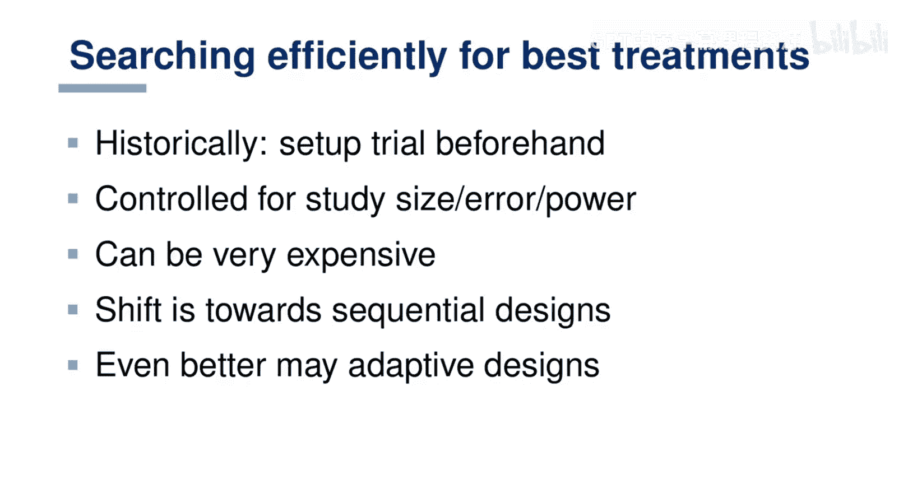
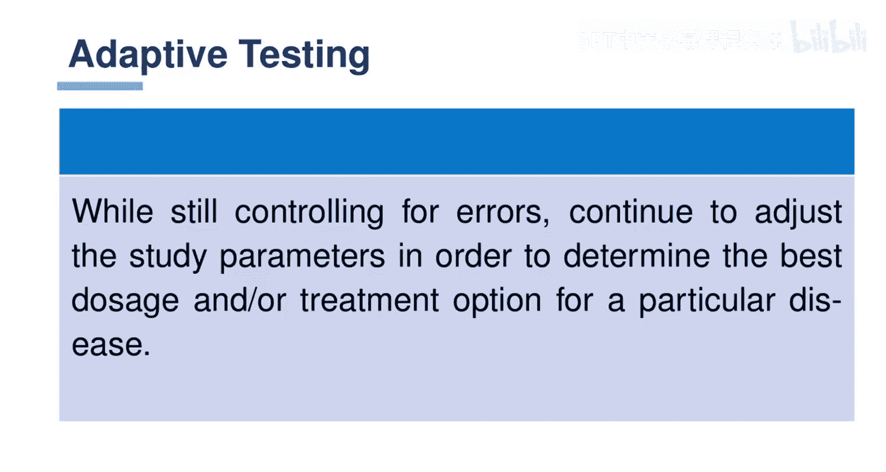
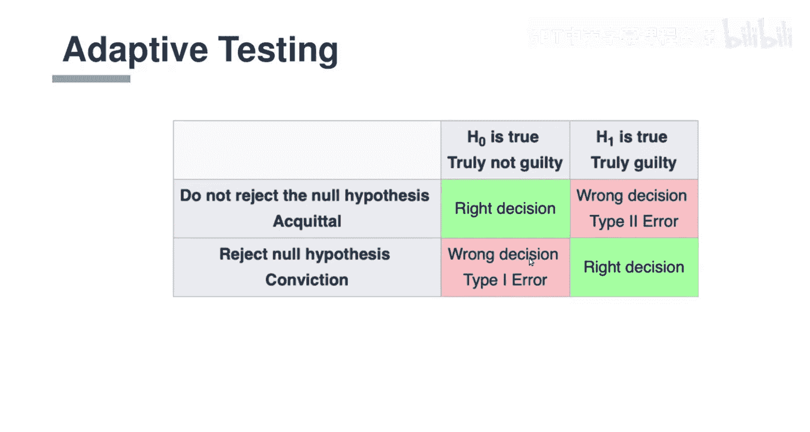

# 约翰霍普金斯大学《数据科学：时间中的决策｜Data Science Decisions in Time》中英字幕 p29 13_自适应假设检验（上）.zh_en -BV1NCuzzfEJa_p29-

We'll not talk about hypothesis testing in time this is really another way of saying we're trying to control the errors in our hypothesis testing as we explore for the best drug or the best treatment。

 we're doing this in a form of sequential testing very similar to what we started off really thinking about in Turnoff's paper from 1959 really essentially though we've got a test that we're conduct over time in order to try and control type 1 and type2 error all the way through so let me try and give you a little bit more background on that a little bit more context some of you may know this already。

 but if you don't please be a little bit more if you do take this as a reminder but。

Really experimental design is a whole industry and there's really a huge debate still going on in terms of the best way to do this it also goes into many regulatory issues。

 it's very politically complicated as well as logically complicated so just kind of be aware as you step into if you've not seen it before that thinking about for clinical trial the best way to stage it the best way to set it up there's kind of a royal road that's been historically staged but there's a lot of alternate ways to do it that really may be more cost effective but are not yet considered the mainstream or really the gold standard way of doing it so generally what happens is and this is again thinking historically。

 you define your clinical trial beforehand so if you're trying to find the best dosage for a drug or the best treatment for disease you set up this trial beforehand that means in particular you're trying to understand your type 1 and type2 error how many subjects to enroll exactly what confidence level you need to rule or ruling out your null hypothesis and it's really got a huge。

mount of formulaic work behind it。 So you again， you're then controlling for the study size。

 your type 1 and type2 error， which essentially leads to your power analysis。

 which goes to how many people you need to enroll within the study design。

 doing this can be very expensive。 you've got no easy way to stop if it's not working out well or if it is working out exceptionally well。

 increasingly ways to adjust this this part that goes to the walled work that we were talking about before in terms of being able to adjust but even this kind of approach even with a little bit of ability to adjust is not quite as strong as the adaptive types of things that we're talking about。

 So essentially what I'm arguing is there's a first shift towards more sequential designs。

 what we're talking now are adaptive designs that means you're actually adjusting your hypothesis testing as you're moving through your testing as you're moving through your stages。

 and essentially this is an argument that is still ongoing。

 but maybe the most efficient way to do it because it lets you continue to collect data and continue to evolve your understanding as to what that。

MeIn principle， that means you've really got a way almost towards an individualized type setting。

 small group settings， maybe you want to be thinking about it as a way to group for different individuals but regards to how you think about it。

 it's very interesting mathematically and it's very interesting as an approach potentially towards experimental design or towards adaptive hypothesis testing it's also I would argue a very nice extension of everything we've been talking about in our second course here with turnoff from the 1959 paper So adaptive testing then in a nutshell。

 I would argue is a way to still control for errors so think about it as type 1 and type2 error is still being controlled but you're adjusting the study parameters trying to find the best dosage or the best treatment option for a particular disease。

 So adaptive testing exactly what it sounds like as time goes on as you're enrolling even more patients as you're adjusting exactly what you're asking particular patients doing you're updating what you're doing in order to try to optimize but you need to do this in a particular way and you need to do it a very control。

So that your errors are understood so that you at the endpoint can say with a certain amount of confidence that a particular approach really does work so it's very similar to turn off again we're controlling for errors but we're also analyzing different hypotheses at any point in time we could argue we've got a best hypothesis that we're trying to deal with so I'm going to enter this by presenting some work from the Bs atal group this is on graphical approaches。

This may be a little beyond where some of you are right now that are listening。

 but bear with me a little bit see how much you can absorb。

 I think it's really quite nice because it provides a graphical way of thinking about these kind of adaptive testing approaches and I think it has some no power So I'm going to start with adaptive testing as almost again nutshell by presenting something from Wikipedia So this in the next slide or from Wiikkipedia。

 you're welcome refer to it is really coming from the argument about statistical testing and just want to remind you that the usual way of doing this is to think that I've got some sort of test statistic T that I'm doing from my observations and then depending on that I will ultimately accept to reject the null。

 So I define my test statistic I collect a certain number of observations then a computer P value and that is essentially the probability that these observations given this test statistic occur with a particular probability So that P value is always defined It's always defined from your test staistic and your observation and what you can say is that from the null hypothesis or particular parameterized distribution that you're comparing against you've got that test statistic。

You're again computing the probability that it will be observed， in other words。

 you're looking to see whether this is a likely event to your null hypothesis or not a very likely event。

 if it's not a likely event， meaning again that it's in the extremes and you start to ask can I reject the null which might be a good thing again rejecting the null means that potentially your new treatment or your new therapy may be strong enough you can effectively say it's better than the current standard so usually the current standard is taken as the null。

 your alternate hypothesis or one that you're comparing the null against is usually the treatment that you're considering so if you reject the null that's actually often a good thing the languages are again messes people up quite commonly so we' got a null。

 we're trying to ultimately to see whether we can reject it。

 but we want to do it in a fair and principled way so again we' got our observations under our test statistic we compute a P value then if we can reject the null we're asking if this P value and if and only if on the P value is less than equal to some threshold alpha for example 。

05 or 。01 and again this is kind of the royal standard， the royal road for doing。

And you would set this up in advance， you define your value of alpha。

 you' define your test statistic and how you're going to do your testing and ultimately for adoptive or testing。

 you're basically arguing that some of these things can be adjusted as you're bringing in patients in all cases you're trying to control your errors。

 your type 1 error and your type 2 error type1 error is when you've rejected the null but it's actually something you should not have rejected。

 so that would be a type 1 error， type 2 error would be the opposite of that so the alternate hypothesis is true。

 but you again did not see it， did not go that direction so what you're trying to do is control from this grid and you can think of this is a ROC type curve ultimately your right decision in each case you want to emphasize your wrong decisions。

 you want to control with some type of error so the approach that we're talking about with adaptive testing。

