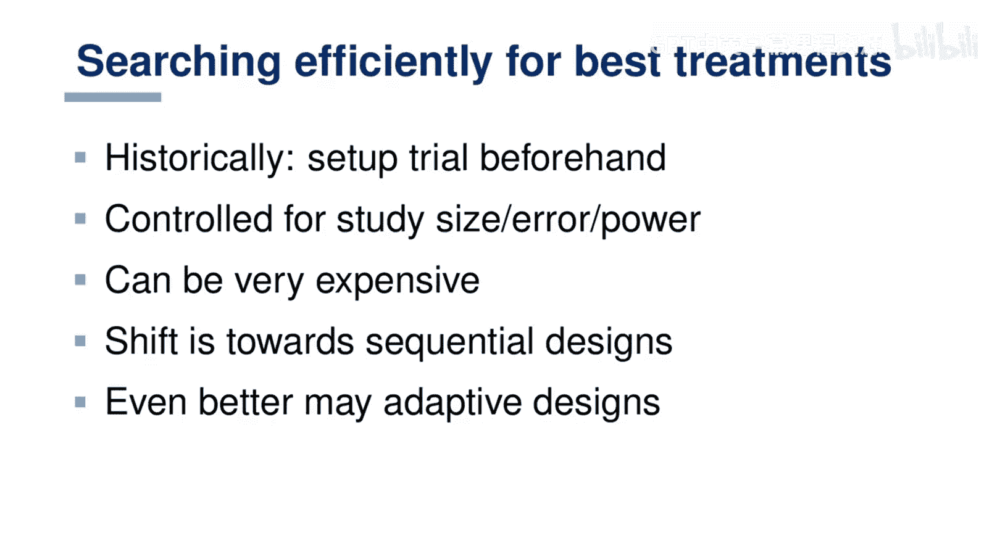
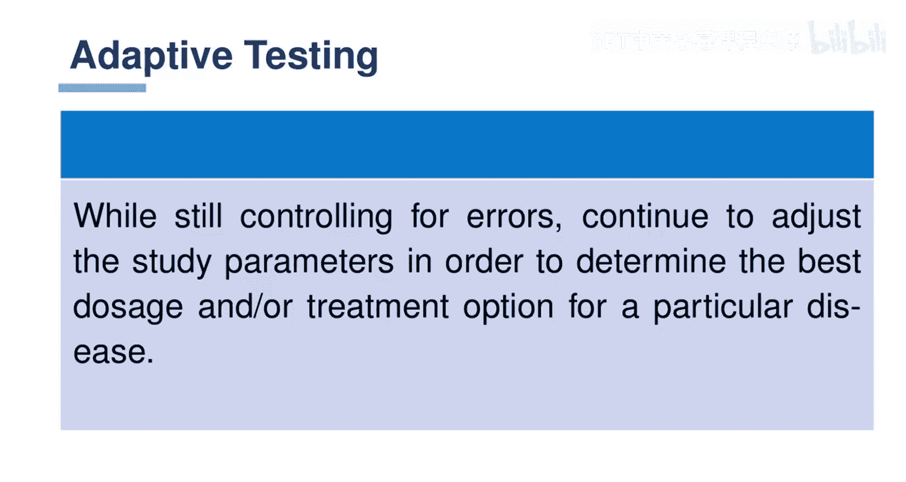
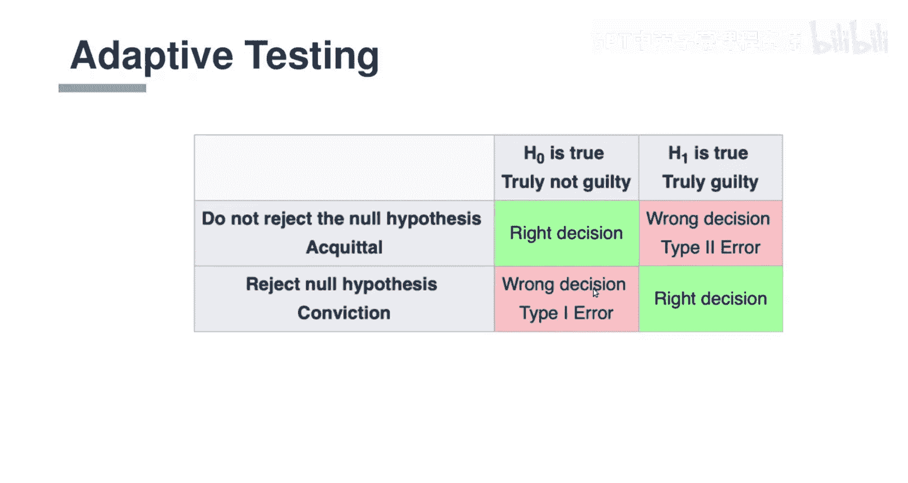

# 数据科学：时间中的决策｜13：自适应假设检验（上）🔬

在本节课中，我们将学习自适应假设检验。这是一种在探索最佳药物或治疗方案时，控制假设检验错误的方法。我们将了解其与传统固定设计试验的区别，并初步探索其核心思想与图形化表示方法。

## 概述

本节不讨论时间序列中的假设检验，而是探讨另一种方法：在寻找最佳药物或治疗方案的过程中，控制假设检验的错误。我们以序贯测试的形式进行，这与1959年特诺夫论文中的思想非常相似。本质上，我们进行一个随时间推移的测试，以全程控制第一类错误和第二类错误。

## 背景与行业现状

首先，让我们了解一些背景和行业现状。实验设计本身是一个庞大的领域，关于最佳实践方式的争论至今仍在持续。这还涉及许多监管问题，在政治和逻辑层面都非常复杂。如果你之前没有接触过，请注意，对于临床试验的最佳阶段划分和设置方式，历史上存在一条“皇家道路”，但也有许多替代方法可能更具成本效益，只是尚未成为主流或黄金标准。

传统上，一般流程如下：你在试验开始前就定义好整个临床试验。这意味着，你需要预先理解你的第一类错误和第二类错误、需要招募多少受试者、需要多高的置信水平来拒绝零假设。这背后有大量的公式化工作。因此，你控制了研究规模、第一类和第二类错误，这本质上引出了功效分析，决定了你在研究设计中需要招募多少人。这种做法可能非常昂贵。如果试验进展不顺利或异常顺利，你很难轻易停止。尽管现在有越来越多方法可以调整这部分（即我们之前讨论过的“围墙工作”），但即使这种具有一定调整能力的方法，也不如我们将要讨论的自适应设计强大。

## 从序贯设计到自适应设计

因此，我认为存在一个向更多序贯设计的转变。我们现在讨论的是自适应设计，这意味着你在测试过程中、在各个阶段中，实际在调整你的假设检验。本质上，这仍然是一个持续进行的争论，但这可能是最高效的方式，因为它允许你持续收集数据，并持续深化你对最佳方案的理解。

原则上，这意味着你几乎拥有了一种趋向于个体化设置的方法，可以视为针对不同个体进行分组的一种方式。无论你如何看待它，它在数学上非常有趣，作为一种潜在的实验设计或自适应假设检验方法也很有趣。我认为，这也是我们第二门课程中从1959年特诺夫论文开始讨论的所有内容的一个非常好的延伸。

## 自适应测试的核心

那么，简而言之，自适应测试我认为是一种仍然控制错误的方法。可以将其视为仍在控制第一类错误和第二类错误，但同时你在调整研究参数，试图为特定疾病找到最佳剂量或最佳治疗方案。

自适应测试正如其名：随着时间的推移，在你招募更多患者、调整你向特定患者提出的具体问题、调整你所做的事情时，你不断更新你的做法以尝试优化。但你需要以特定的、高度受控的方式进行。

这样你的错误是可以理解的，从而你可以在终点时以一定的置信度断言某种方法确实有效。这又与特诺夫的方法非常相似：我们控制错误，但同时我们在任何时间点分析不同的假设。我们可以认为，我们有一个正在处理的最佳假设。

## 图形化方法介绍

我将通过介绍Bretzetal小组的一些工作来展开这部分内容，这是关于图形化方法的。

这对一些听众来说可能有点超前，但请稍安勿躁，看看你能理解多少。我认为它非常好，因为它为这类自适应测试方法提供了一种图形化的思考方式，并且我认为它具有一定的解释力。

我将从几乎再次概括自适应测试开始，通过展示维基百科上的一些内容。下一张幻灯片或来自维基百科的内容，欢迎你参考，它确实来自关于统计检验的论述。我只想提醒你，通常的做法是认为我有某种从观测中得出的检验统计量 **T**，然后根据它，我最终决定接受或拒绝零假设。

因此，我定义我的检验统计量，收集一定数量的观测值，然后计算 **P 值**。这本质上是给定这个检验统计量，这些观测值以特定概率出现的概率。所以 **P 值** 总是被定义的。它总是根据你的检验统计量和观测值定义。你可以说，相对于你正在比较的零假设或特定的参数化分布，你得到了那个检验统计量。

你再次计算它将被观测到的概率。换句话说，你正在观察这对于你的零假设是一个可能的事件，还是一个不太可能的事件。如果它是一个不太可能的事件，意味着它处于极端情况，你开始问：我能否拒绝零假设？这可能是一件好事。拒绝零假设意味着你的新疗法或新治疗方案可能足够强大，你可以有效地说它优于当前标准。通常，当前标准被视为零假设。你的备择假设或你用来与零假设进行比较的假设，通常是你正在考虑的治疗方案。因此，如果你拒绝了零假设，这实际上通常是件好事。语言再次常常把人搞糊涂。

所以我们有一个零假设，我们最终试图看看是否能拒绝它，但我们希望以一种公平且有原则的方式进行。所以我们再次根据检验统计量得到观测值，计算 **P 值**，然后如果我们能拒绝零假设，我们会问这个 **P 值** 是否且仅当 **P 值** 小于等于某个阈值 **α**，例如 0.05 或 0.01。这算是做这件事的“皇家标准”或“皇家道路”。

## 错误控制与自适应思路

你会提前设置好，定义你的 **α** 值，定义你的检验统计量以及你将如何进行测试。而对于自适应测试，你基本上认为其中一些事情可以在你引入患者时进行调整。在所有情况下，你都在试图控制你的错误：你的第一类错误和第二类错误。

*   **第一类错误**：当你拒绝了零假设，但实际上你不应该拒绝它。
*   **第二类错误**：与之相反，即备择假设为真，但你没有发现，没有朝那个方向做出判断。

所以你试图从这个网格中进行控制，你可以将其视为一种 ROC 类型的曲线。最终，你在每种情况下都希望强调正确的决策，并希望以某种错误率来控制错误的决策。我们讨论的自适应测试方法就是关于这个。

## 总结

本节课中，我们一起学习了自适应假设检验的基本概念。我们了解到，这是一种在临床试验等序贯过程中，动态调整研究参数（如假设、样本量）以优化寻找最佳方案，同时仍需严格控制第一类和第二类错误的方法。我们回顾了传统固定设计试验的局限性，引入了自适应设计更灵活、更高效的理念，并通过图形化方法和假设检验的基本框架（检验统计量 **T**、**P 值**、显著性水平 **α**）为其奠定了基础。下一节，我们将深入探讨自适应测试的具体策略与算法实现。