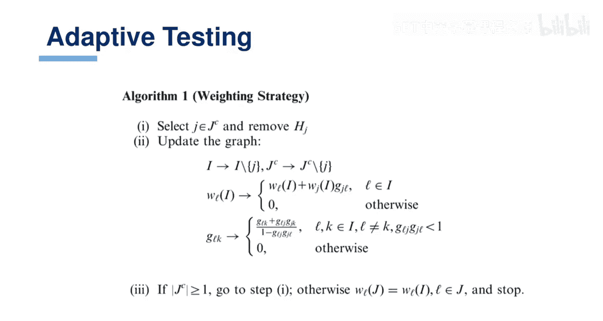
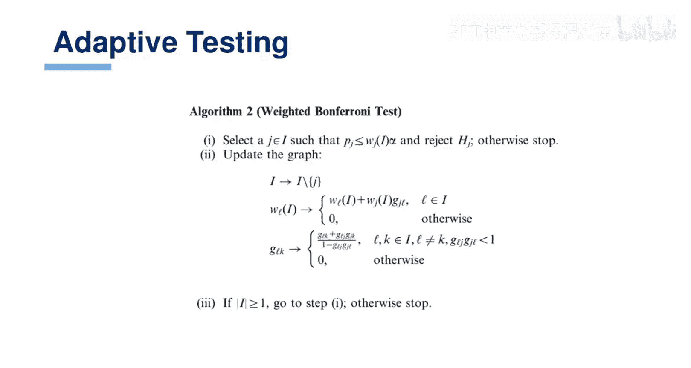
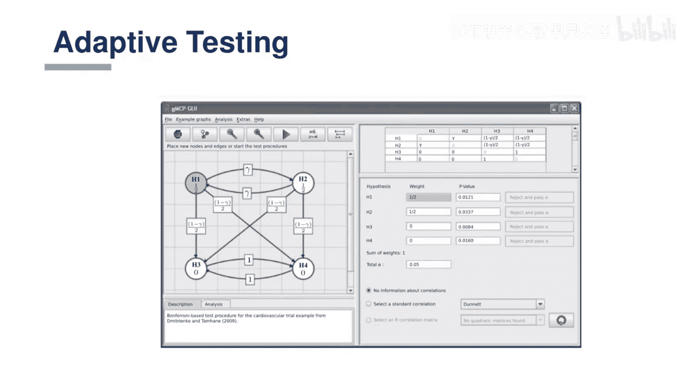
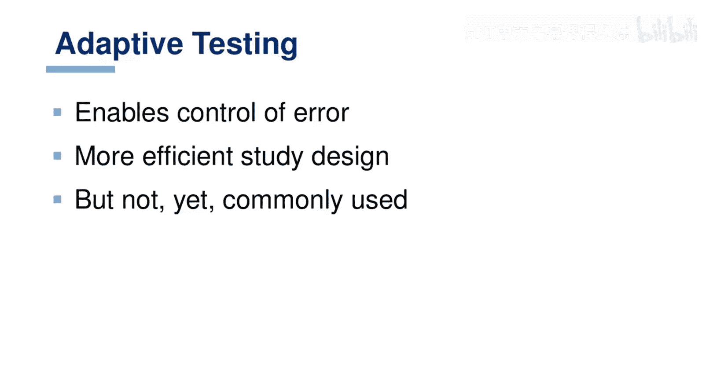

# 约翰霍普金斯大学《数据科学：时间中的决策｜Data Science Decisions in Time》中英字幕 p30 14_自适应假设检验（下）.zh_en -BV1NCuzzfEJa_p30-

Is a way to try and do that in a principled way with data that's coming in。

 So one way of thinking about it is that I've got a graphical model like this where H1 H2 H3 and H4 are different hypotheses and we're doing it in families So H1 and H2 or one family H3 and H4 you can think of it as an alternate family and another set of hypotheses that you only really consider if you reject H1 and H2 and then you draw this in a particular way so maybe a little confused and you're putting weights you can think of these as alpha weights。

 how much error you're willing to accept and you'll see that at the start at the get- go H3 and H4 are only considered if H1 and H2 are reject it so if I'm willing to accept my half of alpha on H1 half of alpha on H2 and and I'm going to test until I'm deciding to reject or accept or to continue testing on H1 and H2 only after I've rejected H1 and H2 do I consider H3 and H4 you can think of these as like secondary hypotheses and these as primary hypotheses and essentially what you've got are these。

s and you can see right now they're just labeled with the number one on them。

 These are related to the transition matrices and you can think about these as how these particular hypotheses are connected。

 and I would like to suggest that you think about this in terms of a Markov type model for those of that are comfortable with a Markov process essentially you can think of these as almost like hypothesis states and effectively then what we're thinking about is transitions between these states because essentially what we're going argue in terms of these lines is these are possible connections and you can think about like for example。

 H1 being connected H3。 there's only one way out so I speak from H1。

 So it's got a transition matrix value of1。 So you're going to see in the model here。

 these are referred to as the G sub J from a matrix and these are the weights and these are part of the error tolerance that we're allowing within the model So this is the conceptual framework and probably the biggest takeaway from what we're talking about now is to think about this in terms of primary and secondary hypotheses Think about transition。

And think about alpha spending， think about how much I can spend or afford to make an error on each of these hypotheses as I continue to test。

 And so again， you're going to test until you see a problem until you either say。

 okay I'm rejecting the null or I'm going to accept the null and in a nutshell。

 this is this algorithm So it's a weighting strategy the notation here might be a little awkward for some of you but just realize I've defined the weights here。

 I define the transition matrix there's an update rule for updating the graph and you're essentially then providing a way to continually keep the error under control but also keep sampling So essentially're proposing in something like this is that you are going to do a form of adaptive testing where you're going to continue to sample until you've understood what's going on。

 And that sense again it's like wall it's like turn off youre continuing to adjust your samples and to understand enough about what's in the system about what your results are telling you that you can update the graph。

Another way of thinking about it， which may help some of you is you can enumerate all the possible combinations。

 These are thought of as intersections between these different hypotheses and then you can put your spending weights out on each of them So initially H1 and H2 we're not even considering H3 and H4。

 so you see we have our alpha span on H1 and H2 and nothing on H3 and H4 if I get down to the point where I have single hypotheses I would have all of my weight just on that So the dashes here are to indicate we're not considering that hypothesis so you can make an intersection hypothesis like this and you can construct this and then update this but essentially what you're doing is describing I must think of this as like a truth table you're actually just describing how all these different candidate hypothesistheses intersect with one another and what the weights are what the alpha span is on each of those and so it's easy to see fairly easy although terms require some understanding of this idea of alpha and alpha spending in terms of controlling the error but it's fairly easy to describe to most people which is why they're proposing this。

Easier than other alternate ways to try and describe what's going on So here in terms of our adaptive testing is situations ABC and D where I've rejected in each case one particular hypothesistheses and to show you how the graph changes so in a we left out H1 in B we left out H2 and C we left at H3 and D we left out H4 and so you can see in each case we're leaving a budgets in the numbers relative to each node here that's going to sum to1 so in each case it sums to one and in each case as well we only have one candidate transition now again you can imagine this being more complicated with more involved transitions but right now you're just simply arguing how these are connected together these particular hypotheses and how the error is going to be controlled consistently in each case so for example a little bit of an example to try and help you see into it how this might happen dynamically again you've got family1 family2 so this could be this H1 H2 with our initial alpha spend only on F1 and no alpha span。

On H2 because again alpha alpha over 2 in each case sums to alpha。

 that's the maximum error that we're allowing our to take。

 So we have to decide what's going on with this family H1 H2 to begin with now as we take samples in we reach a point where we say okay H2 is rejected so that means we can evolve our graph so now it's H1 and then you note that we spend over2 on these two we're still not spending anything on this one so we're not really concerned about that hypothesis now in this second stage we're comparing this one and this one we're trying to evaluate H1 and H4 means in particular again。

 we've got one from family1 and one from family2 and note how our edges just stayed but the graph adjusted because we've got this one node this H2 rejected Now if H1 and H2 rejected。

 So now this one is rejected。 then we're now down in this case we've got alpha over2 or alpha spend on fully our second family and we've got our transition matrix again just reflecting back and forth between those。

again these transition mates could in principle be more involved than that。

 but this is to give you a flavor for what's involved so then here's another example。

 you can adjust this slightly again I'm just trying to give you a flavor for this you can read through the paper to get more details if you're at all curious but you can adjust the weights。

 you can adjust your transition matrix and this is a form of a weighted than testing and there are different variations on this and when we get into our next block on this last week of our second course our course will get more into how some of these flavors of these tests might be adjusted and updated but the other big thing that I wanted to make sure everyone saw this point is that we also have our code that's available for dealing with us and again this would be something that people might want to pick up potentially as projects within our coursework so this is the GuI for this particular R code set up by the authors of this particular paper and so you can see we've set up a graph we set up our weights this again means that we're thinking about particular P values that could be associated with the current set of experiments。

Our alphapan， which is again controlling our error。

 so as information comes in we can update these graphs and so this provides a very principled way for thinking about how an experiment could be run a clinical trial。

 really type experiment maybe our adjusting drug doses or comparing different types of drugs at different dosages across the set of patients this gives you a way potentially very quickly especially compared to a traditional clinical trial to find this out so again it's a type of design and for the most part people would think of these as going beyond a sequential design into an adaptive design for improving the type of testing like go on in a clinical trial so again adaptive testing。

 we're enabling the control of error that principle makes for more efficient study design it's not yet commonly used I would suggest that it may at some point in the future depending on places like FDA become more common but at the moment there's some real questions in terms of whether this is the right way to go one potential wrinkle for many of you。

You might think about a little bit is whether these studies should be blinded or not in other words。

 how much information even as you're collecting it goes out and to which people does to go out because you don't want to have a placeable type of effect So in principle the way that most people thinking about this now is that you would do some sort of a doubleblind type adaptive testing root for doing this but it is interesting and if you're curious about this one and read a little bit more so I hope I've given you some feeling now for adaptive testing how this might be useful especially how it goes out from the turn of 1959 paper I think it's really fascinating because it's basically going at the same idea how do I think about the rank ordering between a set of hypotheses in this context though you're trying to structure that set of hypotheses and trying to control the error through your testing of that set of hypotheses in order to get out something very very significant because when we started off again at the very beginning with paper were just thinking in terms of visuals know can you find the odd one out in a picture by this stage we're really thinking in terms of can we understand in a clinical trial。

whichhich drug is best and especially which dosage is best。

 so potentially the impact is significantly greater， but it's essentially the same starting point。

 so okay， I hope that helped you。 Thank you。