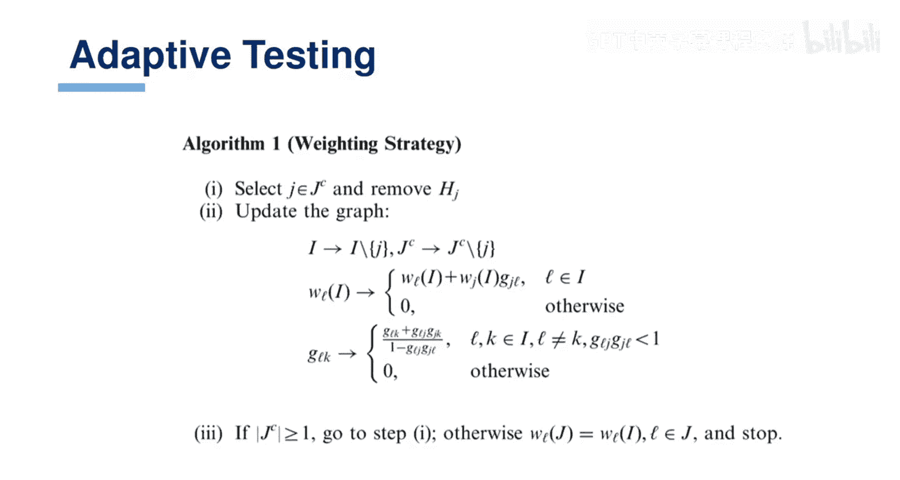
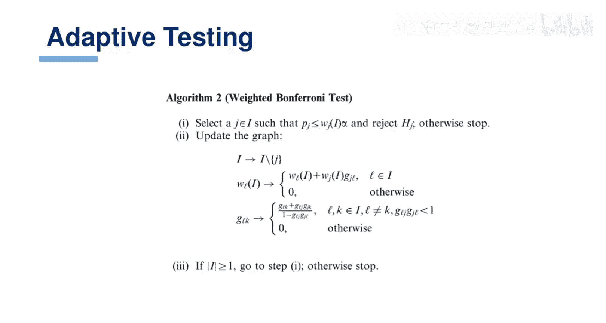
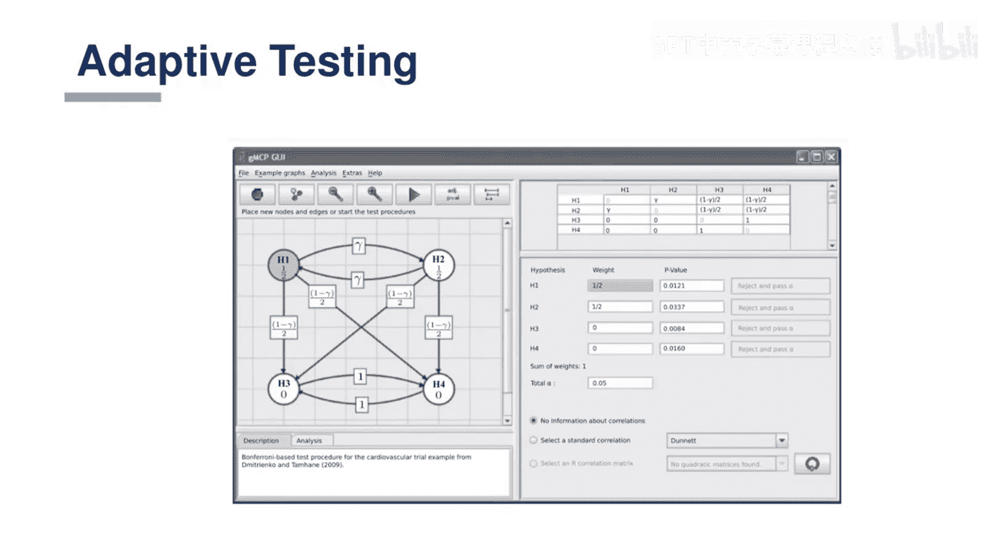
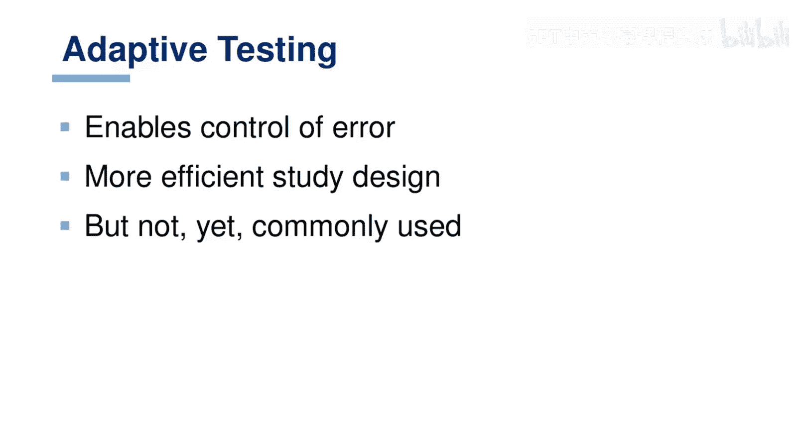

# 数据科学：时间中的决策｜14：自适应假设检验（下）🔬

在本节课中，我们将深入探讨自适应假设检验的核心机制，特别是如何通过图形化模型和权重分配策略，在数据持续流入的过程中，以结构化的方式控制错误率。我们将学习如何将假设视为“状态”，并通过类似马尔可夫过程的模型来管理它们之间的转换与错误预算。

---

## 概述

自适应假设检验是一种在数据持续收集过程中，以原则性方式控制错误率的方法。其核心思想是将假设组织成“家族”，并通过一个图形化模型来管理测试流程和错误预算（即 alpha 花费）。这种方法允许研究者在获得新数据后动态调整测试策略，从而更高效地得出结论，尤其适用于像临床试验这样复杂且成本高昂的研究。

## 核心概念：图形化模型与假设家族

上一节我们介绍了自适应检验的基本理念，本节中我们来看看其具体的实现框架。一种有效的思考方式是使用一个**图形化模型**。

在这个模型中，H1、H2、H3、H4 代表不同的假设，它们被组织成家族。例如，H1 和 H2 属于一个家族（主假设），H3 和 H4 属于另一个家族（次假设）。模型通过特定的方式连接这些假设，并为其分配权重。

*   **节点**：代表各个假设。
*   **边/连接**：代表假设之间的关系和测试顺序。例如，只有拒绝了 H1 和 H2 后，才会开始考虑 H3 和 H4。
*   **权重**：分配给每个假设或连接的 alpha 权重，代表你愿意在该假设上承担多少错误风险。初始时，所有 alpha 预算可能只分配给主假设家族。

这个模型可以类比为一个**马尔可夫过程**。每个假设就像一个“状态”，而连接则代表了状态之间可能的“转移”。转移矩阵（在模型中常记为 **G** 矩阵）定义了这些转移的规则。

**核心要点**是理解以下三个概念：
1.  **主假设与次假设**：区分测试的优先级。
2.  **转移**：假设之间测试顺序的逻辑关系。
3.  **Alpha 花费**：如何为每个假设分配并管理错误预算。

## 算法流程：持续测试与更新

以下是该算法运作的基本逻辑：

本质上，这是一种**加权策略**。算法定义了初始权重和转移矩阵，并包含一个更新规则，用于在获得新数据后更新图形。这样，系统就能在持续采样的同时，始终将整体错误率控制在可接受的水平。

算法会持续进行测试，直到做出决定：要么拒绝零假设，要么接受零假设，或者根据更新后的图形继续测试。这实现了一种**自适应测试**，即根据当前结果不断调整抽样策略和理解深度，从而更新图形模型。

## 另一种视角：假设交集与权重分配

为了帮助理解，还可以从另一个角度思考：枚举所有可能的假设组合。

这些组合被视为不同假设的**交集**。然后，你可以将 alpha 花费权重分配到每一个交集上。

*   **初始状态**：只考虑主假设（如 H1 和 H2），因此所有 alpha 预算都分配在与 H1 和 H2 相关的交集上，而 H3 和 H4 相关的交集权重为0（用短横线“-”表示）。
*   **动态更新**：当某个假设被拒绝后，图形和权重分配会相应调整。例如，如果 H2 被拒绝，那么包含 H2 的组合将被移除，预算会重新分配到剩余的有效假设组合上。

这类似于构建一个**真值表**，描述所有候选假设如何相互交集，以及每个交集上分配了多少 alpha 预算。虽然需要理解 alpha 控制的概念，但这种方法相对直观，易于向他人描述。

## 动态示例：图形如何演变

让我们通过几个具体情境来看看图形如何动态变化。以下是四种拒绝某个假设后的情况：

以下是不同拒绝情况下图形的变化示例：
*   **情况 A**：拒绝了 H1。
*   **情况 B**：拒绝了 H2。
*   **情况 C**：拒绝了 H3。
*   **情况 D**：拒绝了 H4。

在每种情况下，图形都会调整，节点上的数字（权重）会重新分配，但始终满足总和为 1 的约束。同时，转移路径也会简化，通常只剩下一个候选转移方向。这展示了错误率是如何在各种情况下被一致控制的。

### 分步示例

1.  **初始**：有两个家族。家族1（H1, H2）拥有全部 alpha 预算（例如，各分配 alpha/2）。家族2（H3, H4）预算为0。
2.  **阶段一**：收集数据后，假设 H2 被拒绝。图形随之演变，现在只包含 H1（来自家族1），并且我们开始考虑 H4（来自家族2）。边保持不变，但图形因 H2 节点被移除而调整。
3.  **阶段二**：如果接下来 H1 也被拒绝，那么图形将只剩下家族2的假设（H3, H4），所有 alpha 预算也随之转移到这个家族上。转移矩阵则反映这两个剩余假设之间的关系。

这些转移矩阵原则上可以比示例更复杂，但这展示了其基本运作原理。

## 灵活性与实际工具

你可以调整这个框架以适应不同需求。

*   **调整权重和转移矩阵**：这是**加权检验**的一种形式，存在多种变体。在后续课程中，我们会深入探讨如何调整和更新这些检验方法。
*   **可用代码工具**：重要的是，存在现成的代码工具来实现这些方法。例如，相关论文作者提供了 **R 语言代码**及其**图形用户界面**。

在 GUI 中，你可以：
*   设置图形结构。
*   定义权重。
*   输入与当前实验相关的 **P 值**。
*   设定 **alpha 花费**计划以控制错误。

随着信息不断流入，你可以利用这个工具更新图形，这为如何运行实验（尤其是像临床试验这类复杂实验）提供了一个非常原则化的方法。

## 应用、优势与考量

这种方法在**临床试验**中潜力巨大，例如用于调整药物剂量或比较不同药物的不同剂量方案。

*   **优势**：与传统临床试验相比，它能更快地得出结论。它是一种**研究设计**，超越了序贯设计，进入了**自适应设计**的范畴，从而提高了测试效率。
*   **现状与考量**：尽管能更有效地控制错误并提升研究设计效率，但自适应测试尚未被广泛使用。监管机构（如 FDA）未来可能会更多地接受它，但目前对其是否是最佳途径仍存在一些实际问题。
*   **一个重要考量**：研究是否应该**设盲**？换言之，在数据收集过程中，有多少信息、向哪些人公开？为了避免产生安慰剂效应或偏倚，目前的主流观点是应采用某种形式的**双盲自适应测试**路径。

## 总结

本节课我们一起学习了自适应假设检验的深入实现机制。我们从其图形化模型和假设家族的概念出发，探讨了如何通过权重分配和类似马尔可夫的转移过程来动态管理测试流程与错误预算。我们看到了算法如何持续更新，以及如何通过枚举假设交集来理解权重分配。通过动态示例和实际工具介绍，我们了解到这种方法在像临床试验这样的复杂场景中具有显著优势，能实现更高效、更灵活的研究设计，尽管在实际推广中仍需考虑如设盲等关键问题。本质上，这与我们课程开始时“找出图片中不同之处”的直观思想一脉相承，但在此已发展为解决“哪种药物及剂量最佳”的重大决策问题的强大框架。