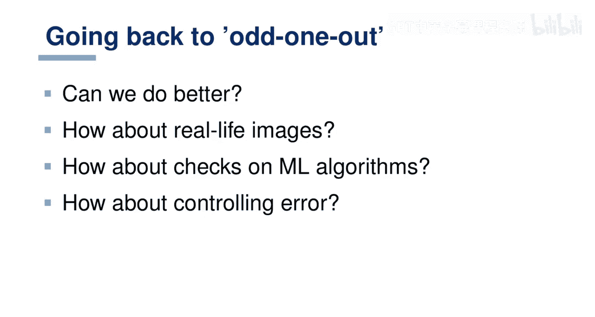
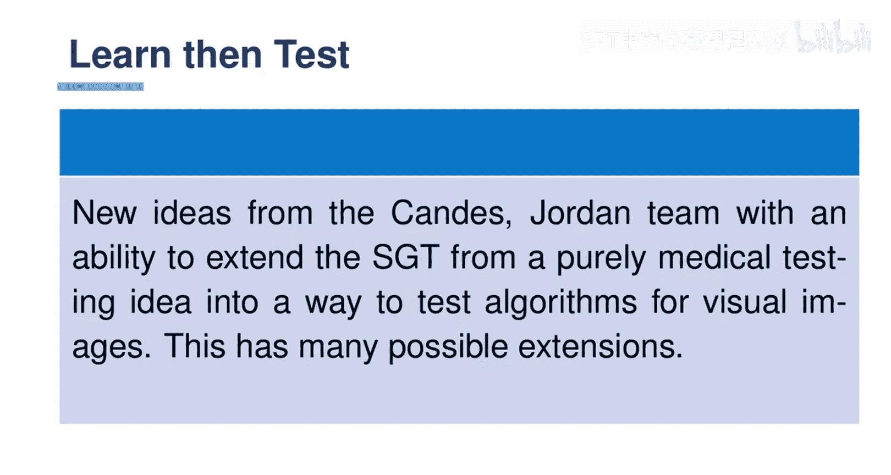
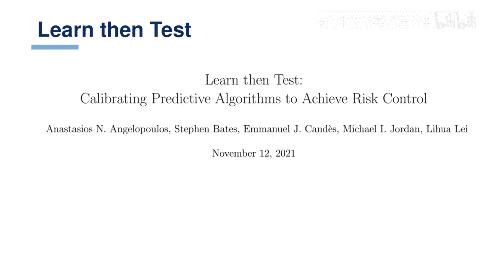
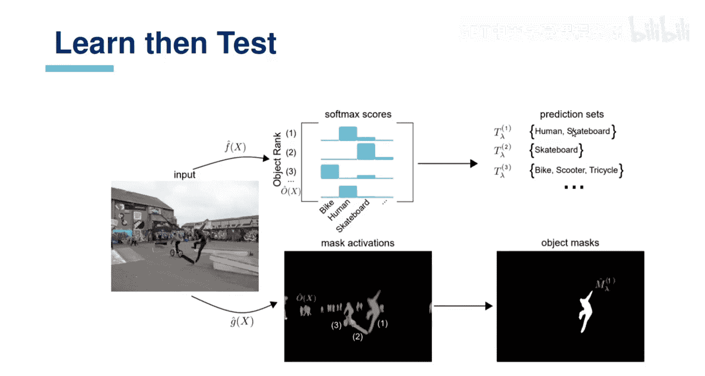
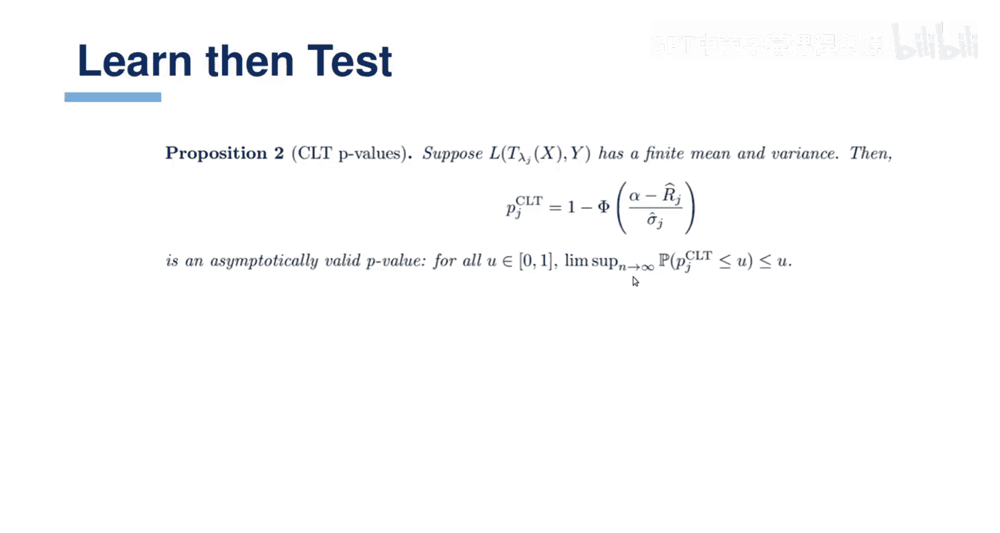

# 约翰霍普金斯大学《数据科学：时间中的决策｜Data Science Decisions in Time》中英字幕 p31 15_学习后测试（上）.zh_en -BV1NCuzzfEJa_p31-

Well now come full circle in a sense。 We'll think about hypothesis tests for visual images。

 but these will be real visual images。 So when we started this section。

 we were thinking really in terms of can we find the odd one out。

 But now what we're going to try and do is think about really much more complicated real images。

 And the question we're going to be addressing here is can we do better？ And you can tell。

 by the way， I'm starting this， that the answer is， yes， we can do better？

 How about if we really do think about real life images。

 Can we identify the particular images and the sense of labels， say a car， a boat， a bike。

 a person These are。Really reality type questions for many machine learning algorithms and again。

 as you can tell I think the answer is yes， and it really builds from the things that we've been talking about and thinking about and the real question that we bring in at this point really courtesy of some excellent work done by many talented researchers is how do we go about controlling error。

 how do we go about in the context of thinking about these images making sure that we have an understanding of the typepe 1 and type 2 error。

 very similar again what we started with in the context of turnoff So the example we're going to be working through is idea and some code related to this idea of learn then test and you can think of this as really adaptive testing and it's really from the set of people around Candice and Jordan so Stanford and Berkeley teams really excellent research teams as I already mentioned and the idea is to extend an idea that really grew out from clinical trials and that I talked about。

Just in the last presentation about this really effort to think in terms of sequential graphical testing as a way to really expand adaptive testing into clinical trials so they're really extending this SDT ID that we talked about recently from really the medical setting into a way to test algorithmial images and there's some really powerful extensions that are made possible by this way of thinking about things and this way of analyzing the problem so let me try and give you some feeling for this assius is the first author and Stephen Bates is a I believe a postdoc with Candace group and Michael Jones at Berkeley。

 Candace is at Stanford and I believe the last author was going to be a new faculty member of the School of Business at Stanford so a very interesting set of people the question is in this learned then test you've got a complicated street image。

Like this on the left here and and no really you're not just odd one out。

 you've got a lot going on in this kind of an image。 you've got cars， you've got the bus。

 you've got the signs， you've got the traffic lights。

 how many of these things can be cleanly labeled in the stream image and you can see here's an attempt now to segment this and to attach labels and what they're really addressing is almost really holy grail of machine learning images is to clearly identified。

 clearly put labels on all of these items with confidence so you could say how confident am I as to what this is or as to what this is know what are the bounds so to speak in my confidence on each of the potential labels and that starts to be incredibly useful partly because while there's a lot of algorithms that segment and provide these sorts of labels almost all of them are really empirically tested they'll give you a sense from a test trial type run how well they did on one test set versus another but they don't really。

Conl for type 1 and type 2 error。 So the approach that we're going to be talking about here is really an attempt to go beyond that to really think in terms of type 1 and type 2 error。

 Here's another way of thinking about it。 I mean， look how complicated this real life've seen is skateboard bike。

 you know， off off the back of the skateboard。human can parse this but even for a human I mean parsing this is not all that trivial。

 so you can put in the masks， you can put in aic masks and then you can try and make scores and you can really view these as different hypotheses that are being tested and this C sub lambda is really key into their notation and I'll try and give this a little bit more as we get further into it but the takeaway the sense I want you to come away with is that you can think of lambda as the control variable that is a tuning parameter for each of the base set of algorithms that are being controlled for things like this masking and object masking in the visual identification and so then you can have a set of different hypotheses that are being tested very similar again to turn off in 1959 and then we can assign scores to each of those and so then we can assign effectively confidence intervals ultimately think of these as alphas in terms of controlling。

Type1 and type 2 error alpha and Dlta giving us an ability to really look at these T sub lambs and get some sense as to which is the most likely for a particular scene So again。

 a very challenging scene， people crossing a street here body posture in some ways you know。

Two people leaning forward， One person stood up and down with luggage less in terms of luggage。

 right， and street signs， cars， you know， can you label and understand everything in that sort of a scene。

 So this is the idea that they're trying to get out， You know， Can you do that。

So there are three components in terms of the learn then test and really I should argue。

 or they would argue as well， part of any machine learning algorithm for doing these kinds of identifications。

 one is a multilevel classification， then then one is segmentation。

 then then one is instant segmentation。Essentially， what they're looking for are functions of hat。

That really can be controlled through a parameter Lada that Ts of Lada that I was pointing to before and that control value Lada is then being used to set out these sequential graphical testing sorts of ideas to help explore and ultimately control the amount of error that we've got。

 So this goes into ideas like false discovery rate and it ties into very much multiple testing ideas that really again grew out and are connected in to the 1959 shirtoff paper you also see ideas here that we've not touched on so much these intersection overunion risks for those you that have had more statistics or probably recognize that term but you can think about this as a way to break out a more complicated hypotheses and a set of hypotheses and really think about what's going on within that set。

 So essentially what we're trying to do and really again what they're trying to do is to enable these different kinds of algorithms。

To be dealt with in a similar way in a common language that ultimately controls the air。

So a couple of definitions that might help you to see into where they're coming from。

 The first is this idea of a risk controlling prediction or RCP。

 The idea is that we can define an alpha and delta。

 Alpha is exactly the sort of thing we were talking about earlier and that you may have seen in statistics。

 you can think about this as this probability on the risk score， you know the T sub lambda here。

 So think of this as being。All the different ways that we could generate hypotheses and score them。

 And it mean less than alpha effectively means that we're accepting the risk And in the words that we're viewing it as relative to say an nu hypothesis that the probability on that set is reasonable。

 And then we're going to say that probability itself is greater than one minus delta。

 So if delta was say01， you would say this probability is say greater than 90%。

 So you can see then that we're trying to as I say risk control we're thinking to put this lambda hat as taking values in some capital lambda and that's the parameter set for the algorithms。

 So then this t sub lambda hat or script t sub lambda hat is essentially the function or on t sub lambda hat that's controlling the risk。

 So effectively what we're doing is by varying lambda and varying then the set of predictors we're looking for ones where we've got then control over this alpha and this delta。

 So this is again， a risk controlling。Prediction。 and this goes to a family wise error rate or FWR that's in the second definition。

 So we've got an algorithm。 call it script A。 We've got our set of probabilities from J1 to N this is a family this right here Family riskconrolling algorithms where what we've got as a family where we can control the rejections is an algorithm at level delta and you can see that take delta again of 0。

1s。 and this would be greater than 90%。 You got think algorithm is being a subset of J1 where effectively what we're doing is saying that we've got a probabilist to control through that algorithm where we're controlling the family wise error rate。

 So effectively what we've got then as an ability to say for this piece of J that dominates this distribution So this is each of these piece in here。

 we can think of the J1 we can think of these as being a subset of J1 and J is no than to J0 here。

 So effectively what we're doing is we're saying this probability is greater。equal to1 minus say。

1 or greater than 90%。 So essentially what we're doing is we're saying from this familywise error rate that we've got an algorithm that controls the level of error。

 So again this is controlling think of this as like one and have two error but now in the context of image recognition。

 So our first theorem and you'll note already we've got a supre and an r of lambda our first theorem is getting how we can suggest that these algorithms in fact do that。

 So we've got some piece of J some distribution。 it's stochically dominating。

 So think about it is probabilistically dominating this uniform distribution for all J under h sub j that's1 our hypotheses and we've got R script a that's a particular instance of a family where we're controlling the error rate on this algorithm at level delta。

 So instance from that。 then this lambda hat， capital lambda hat， which describes this algorithm。

Has the apre on the set or of lambda。 And that again， goes to the context of controlling lambda。

 controlling the the parameters in the testing algorithms。 So this is prim。

Less than or equal to alpha， you can see the connector where we were before greater than or equal to1 minus delta。

 So this is again， a controlling of the error， the ability to argue that we've got a set of hypothesis that we are comfortable with and the ones that we can reject because we've got a clear way of describing or discriminating between different alpha and delta values so we can select lambda。

 little lambda from this capital lambda hat and then t sub lambda is again our control our error controlling root control to an alpha and a delta so we can dial in if you want to phrase it this way。

 particular values of alpha and delta we can think about then choosing lambda that gives guarantees on that。

 So the theorem is essentially saying that。These functions exist that we've got a way to define this。

 that we can evaluate this correctly。So the first proposition is really going to p values and you can see how as an entry to it to this argument and its way of thinking we do need p values in a reminder probably obviously to some of you listening that I need the P value in order to understand where it is relative to alpha if I'm thinking in terms of regular hypothesis testing so I needed it to say here's my distribution this maybe say null or if I'm thinking null。

 I've got a P value to say on that for the data up to that point that I've collected and that's evaluating ultimately whether I'm above or below my alpha and there was whether I can accept or reject a null hypothesis that's kind of the frame and the concept so we're collecting p values we're computing them。

 the idea here is that we've got a finite sample and in a moment we'll talk about the extension into large asymptototic sample for the P values but essentially the frame that they're coming from is we need to be able to compute these p values for all the data。

Again all the different hypothesis that we're looking at and and again that goes back to things likeoff as well the notation is slightly different。

 but the concepts the same。 So this oftenting men， you can think of this as an inequality。

 we're going to call an Hb on j we can define a min on that so note we're going to take either of these and you're going take which one is the min you're going define h1 in terms of these different log functions。

 And then essentially this now is a valid p value for h sub j for all U in this01 interval and all p sub j less than equal to u that probability less than or equal to U So effectively again we've defined a p value in this setting。

 we can also think about it in terms of central limit theorem in some ways this is probably even cleaner menu if you've probably seen this you can think about this as we go into the large limits we can say that we've got to finite it mean and variance and then our central limit theorem is a1 minus v or standard norm on alpha minus r sub j hat over Signess of j hat so this is。

Asymptotic value for our P value。 it's again on 01。 We've got to limit supre on that。

 And so we've got a cleanly defined central limit there on our。

