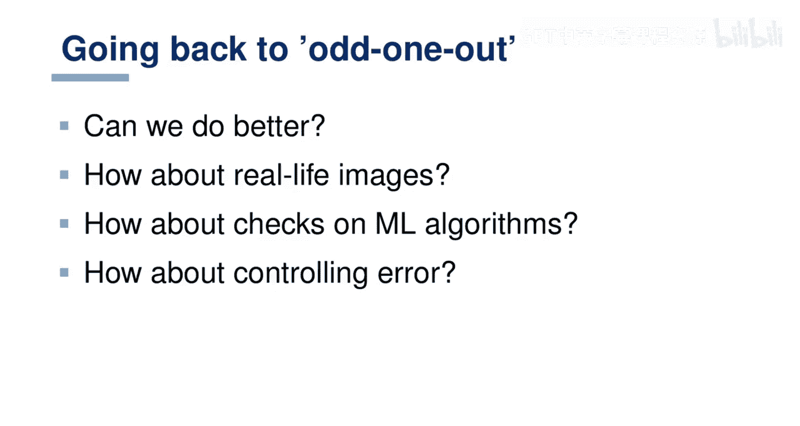
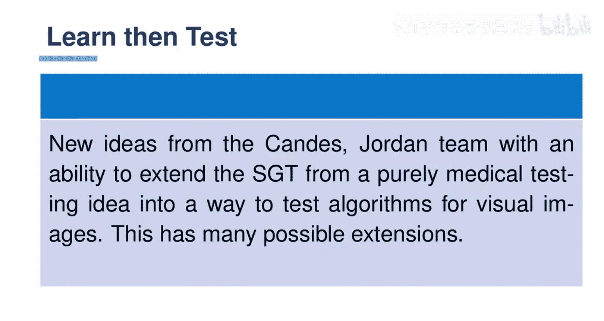
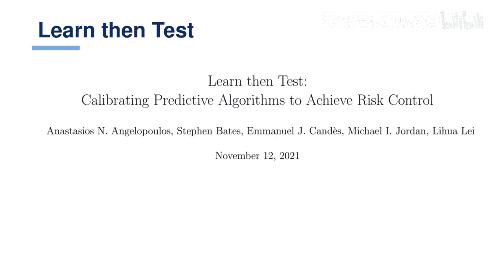
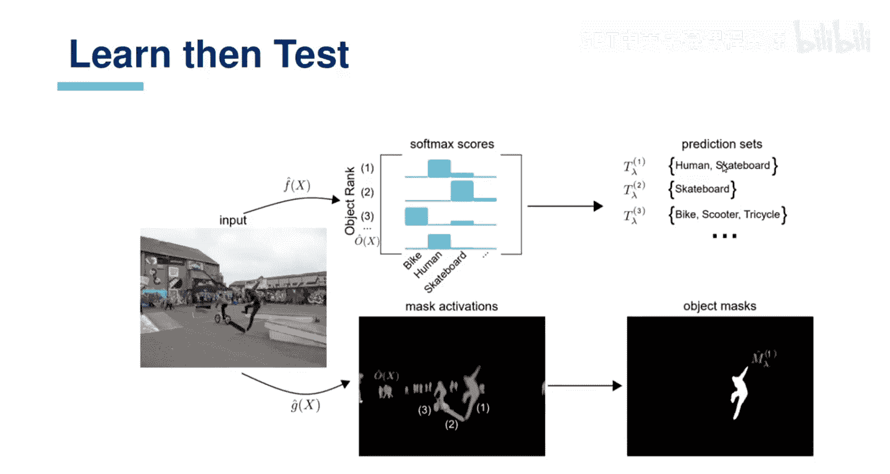
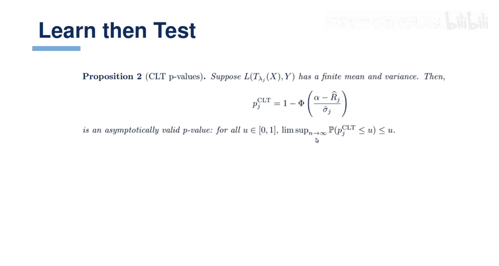

# 数据科学：时间中的决策：15：学习后测试（上）🚀

在本节课中，我们将探讨如何将假设检验的思想应用于复杂的真实视觉图像识别问题。我们将学习一种名为“学习后测试”的框架，它旨在为机器学习算法的预测结果提供统计意义上的误差控制，特别是控制第一类错误（误报）和第二类错误（漏报）。

---

上一节我们讨论了如何从一组简单图像中找出“异类”。本节中，我们将看看如何将类似的假设检验思想应用于更复杂的真实世界图像。

以下是“学习后测试”方法要解决的核心问题：给定一张包含多种物体（如汽车、行人、交通标志）的复杂街景图像，我们能否不仅识别出每个物体，还能为每个识别出的标签提供一个**置信度**，并控制整体识别过程的错误率？

这种方法的思想源于临床试验中的序贯图检验，现被扩展用于评估图像识别算法。其核心是引入一个控制参数 **λ**，通过调整它来生成不同的假设（例如，不同的物体分割和分类结果），并为每个假设打分。

## 核心概念与定义

为了理解该方法，我们需要先明确几个关键定义。

### 1. 风险控制预测

风险控制预测的核心思想是，我们可以通过参数 **λ** 来定义一个预测器族，并确保其风险（即错误率）被控制在预设水平内。

其定义基于两个参数：
*   **α**：可接受的风险水平（例如，误报率）。
*   **δ**：置信水平参数（例如，0.1表示90%的置信度）。

一个风险控制预测算法 **Â** 需要满足以下条件：
对于选定的 **λ̂**，其风险 **R(λ̂)** 以高概率（≥ 1 - δ）不超过 α。
用公式表示为：
**P( R(λ̂) ≤ α ) ≥ 1 - δ**

### 2. 族错误率控制

在多重假设检验中，我们需要控制所有被检验假设的整体错误率。一个族错误率控制算法 **A** 需要保证，其犯任何第一类错误的概率被控制在 δ 水平内。
用公式表示为：
**P( 至少犯一个第一类错误 | A ) ≤ δ**

## 理论基础：定理与命题

“学习后测试”框架建立在坚实的统计定理之上，确保其误差控制是有效的。

### 主要定理

该框架的主要定理表明，存在一个算法 **A**，它能够从参数空间 **Λ** 中选择出一个子集 **Λ̂**。对于从这个子集中选出的任何参数 **λ**，其对应的预测器 **T_λ** 都能以高概率将其风险控制在 α 以下。
这可以形式化地表示为：
**P( sup_{λ∈Λ̂} R(λ) ≤ α ) ≥ 1 - δ**

该定理保证了我们可以通过算法找到一组“安全”的参数，使用这些参数对应的模型进行预测时，其错误率是有统计保障的。

### 计算P值

为了进行假设检验，我们需要为每个假设（例如，“图像中这个区域是汽车”）计算P值。

在有限样本下，我们可以通过以下不等式构造有效的P值：
**p_j = min( 1, 2 * min( U_j, 1 - U_j ) )**
其中 **U_j** 是基于检验统计量计算的一个中间值。

当样本量很大时，我们可以借助中心极限定理来计算渐近P值：
**p_j ≈ 1 - Φ( (α - R̂_j) / σ̂_j )**
其中 **Φ** 是标准正态分布的累积分布函数，**R̂_j** 是估计的风险，**σ̂_j** 是其标准误。

---

本节课中，我们一起学习了“学习后测试”框架的基本思想。我们了解到，通过引入一个可调参数 **λ** 和严格的统计误差控制（α 和 δ），我们可以为复杂的图像识别算法的预测结果提供置信度保证。这超越了传统机器学习仅依靠测试集准确率进行评估的方式，为关键应用场景提供了更可靠的决策依据。下一节，我们将继续深入探讨该框架的具体算法实现和更多细节。