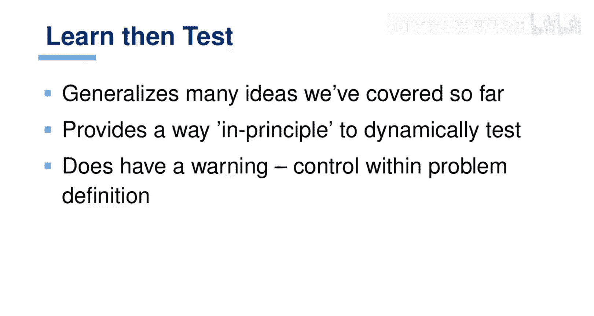

# 约翰霍普金斯大学《数据科学：时间中的决策｜Data Science Decisions in Time》中英字幕 p32 16_学习后测试（下）.zh_en -BV1NCuzzfEJa_p32-

被告。Then our third proposition， which is related to our family wide error rate， we can set for this。

Scrip A for our set of controls， P1 to PN。 we've got a function that returns from this set a capital lambda on that and then this script A on our Bf is a controlling algorithm and again these are three propositions that we need in order to get things set。

 you can compute P values as they point out and many different ways their algorithm is not only standing on those particular ways to compute P values。

 but essentially these three propositions are arguing that we've got a way to set these controls and ultimately that means that this algorithm and a few other algorithms that they present。

 which again are really very similar in spirit to the 19159 turnoff。

 but again in a much more modern setting because we're thinking in terms of really discriminating with hypothesis testing against these images that are coming in。

 the argument is now that we can take algorithms like this and we've got a clean way to control the error So again we've got an error level or delta or parameter grid think of this as the controls that we're working from our P values we need。

to compute those against the different hypotheses， our initializations and that's a core equal based grid and then we're just iterating from J equal to J。

 we're going to avoid repeating values of little J while our piece of J is less than this value delta over the size of script J then we updating lambda hat and J and ultimately what we want that what're looking for is our rejection set so think about this again as a one of hypothesis testing。

 the rejection means good things because it means that the status quo meaning the thing that we're trying to see if we can improve on is better with the alternate and so we can reject the null so effectively what we're doing is rejecting certain parts of our grid space part of our control space。

 these Lada values as part of this algorithm and effectively that means we're winnoing out we're understanding more about what's inside。

That system。 and then we can go into our sequentialtro graphical testing。

 again this was the algorithm I presented just in the last talk and essentially they've improved that and elaborated on that in this paper。

 they're using some of the main concepts。 50 here is that paper we went over。

 but essentially extending beyond that。 So again we've got an error level。

 we've got our parameter grid， we've got our P values we've got our graph。

 and again that's similar very similar to what we're talking about before。

 we've got our initial error budget delta sub I so you can think of this as just like the alpha spending that we were talking about before。

 So we initialized to zero。 then while they're exist in I such that our p sub I is less than a delta sub I。

 we're going to do these steps。 we're going to choose our I piece sub I less than equal to delta sub I。

 so we need to be able to compute our piece of I we're going to update our lambda hat。

 and we're going update our error levels in the graph。 and this is exactly what we had before。

 So these are going to be related to the edges， these are going to be related to our alpha spending。

 we're effectively updating within the graph。 and what we're looking for again。

 yes our rejection set so。Hopefully I've getting you some sense these algorithms are very much in the spirit of the things that we've been talking about。

 So here's another example in their learn then test approach and again。

 their code is available and potentially good for projects within our framework So here they're looking at this multilevel prediction set So effectively again you can see these different images these are cleaner right in the sense that there's just one particular item you know like you look at this face yet pot a plant dining table face you know you want to be able to put probabilities on that train and clock person horse and carrot right because you've got a hand with a carrot and then you know with the really。

Could that be a horse or could it be something else， I mean。

 you know that's what you're trying to evaluate。 Maybe that's a llama or some other animal right giraffe face again。

 So you're looking at these and you're trying to understand Can you pick out the correct label for each of these。

 And again， this is very similar to finding the up one out in an image but much more complicated images much more challenging problem and again。

 the really interesting thing here this ability to put conference bars on it to put error bars on it to understand at the level of a hypothesis test。

 which ones are correct。 So they're comparing these three which are which are elaborations。

 the sort of algorithms we're getting at against a uniform。

 which is in some ways kind of a satisfying way of thinking about it because you've got a continuous。

 these would all be discrete but the uniform was consistently performing less well relative to these others。

 the fixed sequence is really getting at the best of the set。 So looking to the right here。

 this false discovery rate， this is the best。Of the set and the violin plots again is over a set of images that they were comparing against here。

 they were taking Microsoft images and from their image library and comparing over that full set。

 So again， the fixed sequence does better uniform in some ways you can think of as like a comparison point or control these then are just different algorithms for trying to pick from amongst the hypothesis that to determine the best fit。

 This goes to the SGd type idea this is where the fallback versus a hamming distance looking within Lada 1 Lada 2 and the main thing I want you to get feeling for here is that you can do an error span budget and you can think about these things is being connected in different ways。

 So you see how this is almost like chained on the fallback versus is aming and you really want to start in the bottom right here。

 and then you can see how the alpha span is tied in here。

 right now you've got things that add up and effectively what you've got is an ability again to cycle through this depending upon。

Graph with the arrows and depending on the alpha band and adjust dynamically so when you do that with the pan or the fallback or the2D fixed sequence of the panfroni。

 you've got an ability to compare things like coverage the OD from this and the mis coverage and what I think is especially exciting again is that you're able to put these error bars on it you can think in terms of coverage you can think about seeing OD it's really really quite nice so here's another way of being this in terms of these parameters you can think in terms of the algorithms that we've got different things going on at different points in these algorithms so we can locate distant objects we can find the precise set of pixels for each object we're going sign the right class to each object these are things that we're controlling the recall the things related to the intersection union the coverage these parameters then Lada1 lambda 2 lambda3 are the control parameters within the algorithms for each of those different tests so if we go。

Back now to this sort of an image with this skateboard。

 this is essentially what it's leadinging up to is the ability to learn then test on something like this where we've got again different prediction sets。

 different scores， and we can argue that we're understanding or parsing that image。 So again。

 if we've got complicated images like this with the terrain that people waiting can we put the right labels on can we understand what's going on within these images。

 So if we think in terms of recall immune IO and immune coverage we can compare again。

 different algorithms and the argument that they're putting forward。

 which I think is a very compelling one is as much to the details as it is to the bigger picture。

 it is to the sense that this approach of using a graph theory in a discrete set enables them to attach real meaningful confidence bars。

 real meaning error controls onto these systems。 So I've got again an image like this don't know whether we agree that he's correct。

To be feeding the draft， maybe it's allowed in the setting， maybe it's not。

 you can see it looks like he was。Taking pictures even before this。

 but it's an unusual image account。 right So how well can you imagine the computer parsing this out into the different regions that are involved。

So in sum， I hope I' give you some feeling that this really generalizes many of ideas we've covered so far in a really。

 really nice way， providess a way to in principle dynamically test， meaning again。

 we've got the ability to put control of type 1 and type 2 error into our machine learning algorithms for parsing these images but there is a warning and they make it I think nice and clear。

 the idea is that the control that we're talking about here it's within the problem definition。

 So it's like any other learning algorithm， if something in the image or the set is not being captured。

 meaning you kind of gone outside of the realm of where these things were set up。

 then the warning labels or really the control of the error may not be so good and so one has to be a little bit。

Careful to work within the bounds of how this is defined。 And that's an appropriate warning。

 But again， I think what's really quite fun is this ability to imagine a series of hypothesis tests that are being dynamically adjusted and controlled in order at the end point to really put a clean label on it。

 And it really comes nicely back again into where we started with the journal paper from 1959。

 In that context， again， we were using it to look at things like oddud went out the rare vent in an image。

 And while you can see some real applications for that。

 I think you can also see that this last closing point for this。Part of the course。Really。

 really does have a much deeper reach。 In other words。

 you can see how these sorts of ideas applied to many machine learning algorithms and then you can see how this could generalize into many。

 many types of machine learning algorithms and potentially provide them a way to really test deeply and then control type 1 and type 2 errors within those settings in a way that was not really outlined in the original paper from turnoff in 1959 So even though I say these grew out from turnoff。

 I don't think you could have seen this without all the really strong work that was contributed by many。

 many people leading up to this point。 So I hope I've helped you to see into this area。

 I think it's really quite a fascinating area and obviously there's still more coming up so please continue to stay with me as we go through more things related to our making decisions in time thank you。

