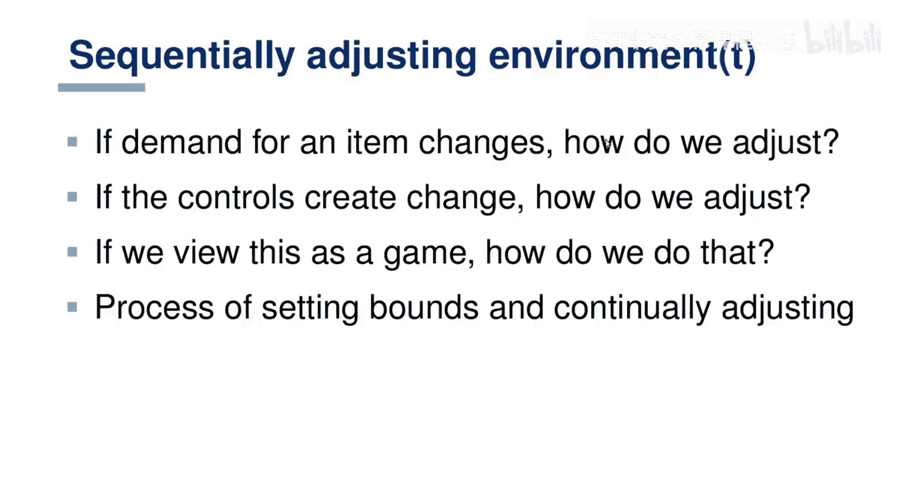
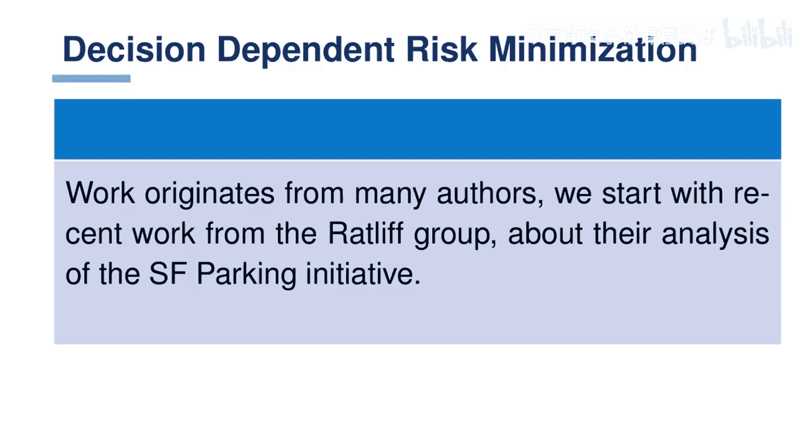
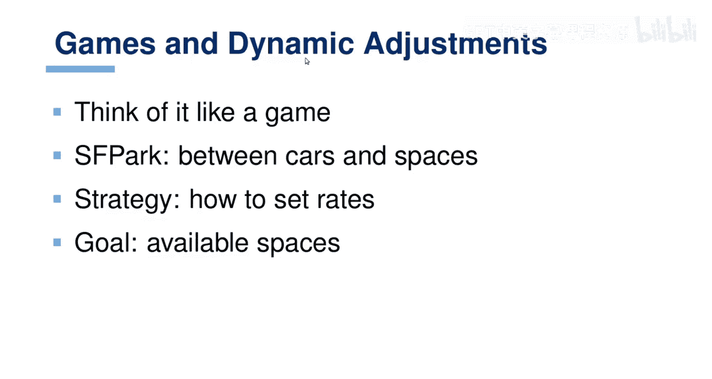

# 约翰霍普金斯大学《数据科学：时间中的决策｜Data Science Decisions in Time》中英字幕 p33 0_动态博弈案例：SFPark智能停车系统.zh_en -BV1NCuzzfEJa_p33-

We'll not talk about SF Park， which is an interesting application of ideas around dynamically adjusting demand for an item。

 so imagine you've got sequential setting again， this is really going back to a very beginning and exactly what we're all after here we've got a sequential setting where now the environment is a function of time So this is exactly what I mean by environment with the parenthe AC So if you've got demand for an item and it changes how do we adjust So think back to our beginning with Wald and our sequential racial hypothesis testing ideas in that setting we still were sequential。

 we had items say coming off some sort of a factory and we were asking about whether we needed to adjust except to reject an hypothesis as our sequential set went on but what happens if we're sequentially observing and the environment is changing as a function of time So Sf Park is an example of this and I'll try and explain how we got from our beginning into this。

 but I hope you'll agree with me that it makes a lot of sense。So in particular。

 if our controls now can create change， how do we adjust。

 And this is what I mean by the environment changing a function of time。

 So imagine that we can adjust something and it's going to create some change。 How do we adjust that。

 So if we view this as a game， which is really what we're after in this part of our course。

 How do we do that。 How do we adjust。 How do we think about that？

 It's simply a process of setting bounds and then continually adjusting。

 So it's really very similar to well， It goes to turn off as well。

 But it's more elaborate because the environment is changing。 It's a function of time。

 We no longer have something that's static。 We no longer have a distribution。

That is potentially stable Instead we've got something where you can think of it as like a game。

 like a dialogue where things are moving as a function of time。 So in particular。

 while this work originates for many， many authors。

 we're going to really start with work from the Racliff group because I think this is really quite interesting work that they've done on the SF parking initiative。

 I think it's a great example for seeing into these ideas。

 So that's why we'll start with that and will also introduce some ideas of games that also come from work within the Ratcl group。

 So Sf Park is a real thing。 I mean， it's not made up。

 It's not something that I'm just creating for the class。

 it it really is a dynamic algorithm that San Frisco is set up to try and control their parking。

 And the problem they're addressing is that if they make the rates too low。

 that'll never be a space for anyone to park。 So this started in April 2011。

 you can read about it in Wikipedia， which is up here。

 And the argument is they wanted to keep 15% of their spaces vacant on any given block。

 You can see why that would be important。 I mean the。

Problem for a merchant or even a consumer moving around is if it's really the case that you don't have some amount of empty spaces。

 as a consumer say in a car， you're always circing for a space。 if you're a merchant。

 people don't have any ability to come into your store because they can't find a parking space。

 So this has now been turned into a real item And the question is can you optimize the rates。

 So the rates are being dynamically adjusted。 it really is a game。

 it's a game now between the consumer and the city。 the game is how do you game it。

 so to speak in order to guarantee as much as possible that's the outcome。

 that you've got 50% of space is vacant on any given block。

 It's not immediately obvious the best way to play this game。

 And that again is what we're all about in this section in our third section here。

 So imagine before noon and noon to 3 pm。 you've got something that can vary maybe under through Friday and weekends is going to vary。

 but also obviously before noon and noon to 3 pm。 And again later in the day。

 So they adjust their rates。 if you look。Example here。

 a quarter versus $2 right or this 1250 versus4 and a quarter。 So it's adjusting the rates。

 and again this is now set by the city。 The question ultimately is are the rates that they're picking and the time period for when they're adjusting them appropriate to get the right demand。

 In other words to get that 50% goal。 Here's another way of looking at this。

 this is the 600 block on fishermen's worth， this is the 200 block on Dr Street downtown so to different locations effectively what they're doing is adjusting the morning rate or the midday rate and they're looking for an occupancy。

 they're comparing what's going on in terms of occupancy relative to the rate and ultimately again。

 it's a different times of the day。And so that's why we've got things like a morning rate versus a midday rate。

 And there are apps that will help you to try and address this。 if you are from San Francisco。

 you've probably already used this。 I think it's an algorithm and an approach that's going to become fairly common because it's not unusual to imagine that you would want to have a certain vacancy rate so that people were not always cruising。

 And the way of thinking about that is historically the share of traffic that's cruising and looking for a parking rate。

 this goes back as you can see in this table， 1927， 1960，1977， 1985，1993， 2005，2007，2011。

 So we're moving up in years，  different cities， Detroit， New Haven， Freeburg， Cambridge， New York。

 Los Angeles， to from New York， Barcelona， Spain， so international， So Germany and Spain。

 everything else in the US but the percent of traffic cruising look at this Freeburg。

 Germany 74 Los Angeles，68% right New York， New York in 2007 and this particular aspect of traffic cruising 45% So a big percentage。

Potentially of traffic is simply looking for a parking space。

 that's what they mean by traffic cruising they're looking for a space where they can park maybe to go and have a meal or to do some shopping if they can't find a space。

 the businesses lose out because they lose that revenue the customers get frustrated because they're spending a lot of time looking for a space so you want a win- win。

 you want the customers to have a space obviously once people found a space。

I'm always going to give it up easily， But the idea would be that you design the price per hour in such a way that people decide economically that they can't afford to stay there too long。

 and so they free up the space。 But where is that number。

 What is the price that should be set in order to solve this kind of a cruising type problem。

 So this gets at the concept of price elasticity， which I won' mention twice。

 I'll put the same slight up more than once。 So try to emphasize this This price elasticity of demand measures how these price changes affect the occupancy rates。

 And this is really the key concept because you're trying to understand how to adjust the price in order to adjust the demand for these spaces。

 So we can define this price elasticity， and it's what it sounds like it's going to be a ratio。

 So it's the percent change in the occupancy rate， The quantity， the parking demanded divided。

 That's what we mean by ratio divided by the percent change in the meter price as an example。

 and hopefully this will help you if a 10% price increase。It's to 5% fall in occupancy。

 Then we've got price elasticity demand as being defined in this way。

5% divided by 10% because a 10% price increase leads to a 5% fall in occupancy minus-5% divided by 10%。

 So it's defined as the percent change in occupancy。

 That's this 5% divided it by the percent change in the meter price。

 this was 10% So this is telling us how much we can change the price and see a change in the occupancy rates and obviously that's important if you can define the elasticity then you can understand how to play this game because you can drive the prices。

 this is part of the game， the game played by San Francisco。

 you can drive the prices in order to get a particular outcome。

 and so you're influencing the behavior of the consumer。 you're inluencing the parking demand。

 so you can think of this in this kind of a cartoon for S F Park maybe in the central business district。

 no open spots nearby location through open spots。After S F Park， if everything went well。

 you have at least one open spot in the central business district。

 It's not completely blocked like this。 So the goal， again。

 is to have a certain amount of open spaces。 And you're going always argue socially what that number should be。

 What's the best place to think about it。 So I mentioned there's an app for it。

 I just wanted to point this out if anyone wants to download it。 This was from a while back。

 So and I've not double checkedck how active this app is。

 I'm sure there's other apps if this one is no longer available。 I believe it is， though。

 because I think Ive been double check credits at least on the Apple store。

 So S F Park here is this iPhone app And you can use it as a consumer to figure out where the open spouse are for what you're willing to pay。

 So you could basically put in something like I want to pay a dollar or want to pay $4 or whatever。

 where the open spots。 And it'll tell you。 So that's a great app And you can see how this kind of call in response and kind of a game like setting for defining who's going to park where and for how much。

 you can see that these。Apps help to create the openness and the transparency and have an impact then on the rapidity of the consumer to realize that there's a parking rate change。

 and then they can optimize for that。So the paper that will be spent some time on again from the ratleft group and the co-authors from Rale groups reach。

 so to speak， including some other faculty， but this was a recent paper called decision dependent risk minimization in geometrically decayed dynamic environments essentially although the title might not immediately make you think that this is about how to make decisions on these price elasticity kind of curves in order to define forsf Park the best way in a changing environment and dynamic environment。

 the best way to play this game the best way to set the prices and so again the key concept here is this idea of price elasticity that you've got some sort of a ratio and again's this ratio of the change in the occupancy rate by% change in the meter price。

 and so this price elasticity is really setting by its。Telling you something about the demand。

 it's telling you something really key for the game， the game， again。

 between the San Francisco City and their ability to control and set prices and their desired goal along with the desired goals of the consumer to get presumably a cheap parking space that's near to where they want to go。

 So we' are asking is for the consumer。 How much do I change the price in order to change the occupancy。

 And so you can see why that's important。 And again。

 that's central to what we're going to be talking about。 So the idea， again， would be here。

 we've got different blocks。 This is Long Beach Street in San Francisco。 This is Garraelli Square。

 Many of you may know this area。Can we adjust it And the argument is that they can adjust it better than what's currently being done within the city。

 So here's price elasticity for different areas。 you can see the color code here and these are these different values for the price elasticity。

 And so if you know something about the price elasticity for these different areas。

 and again it's a function of time of day as well。 then you can adjust that。 That's the central idea。

 So in this introduction。 what I hope I've given you a feeling for is you can think of this as like a game as a park or other things that are very similar to this。

 it really has a lot of applications。 So it's a game then between the cars or the consumers and the spaces or the city and the strategy is how to set rates how to define the optimal rate to change the behavior。

 And the goal was fairly simple。 It's win- win for everyone。 It's available spaces。

 don't no longer have consumers cruiseisingising for parking spaces the city wins it optimizes their pricing so they actually get more。

Space， but they also win because the stores get more customers。

 so it makes a more viable strategy win-win strategy for both if the rates can be set in such a way that there is always a space and so I hopefully can see that this really flows from where we started。

 I mean it flows from how we think about say factory production and we're trying to control sequentially in a wildlife setting the quality of the production coming out it flows also from churnoff what we talked about in our second course and so here in this third course we really are thinking about games but we're thinking about a dynamic environment and how we adjust and so you can think about it as a game that we're adjusting。

Okay， so I hope this helps to start to see where we'll be headed in this third course。

