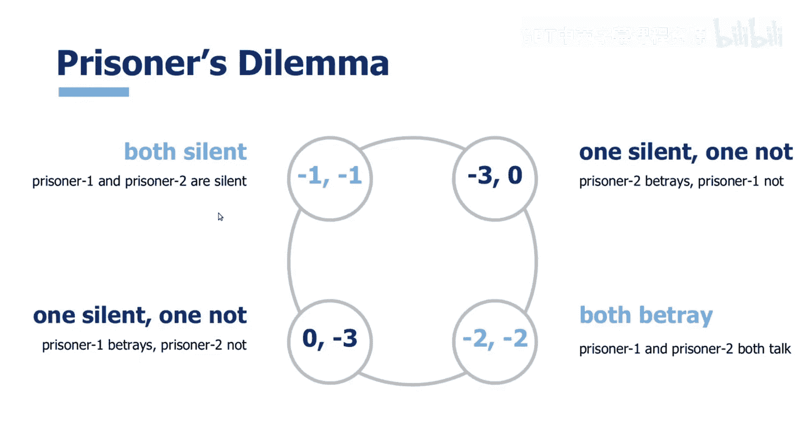
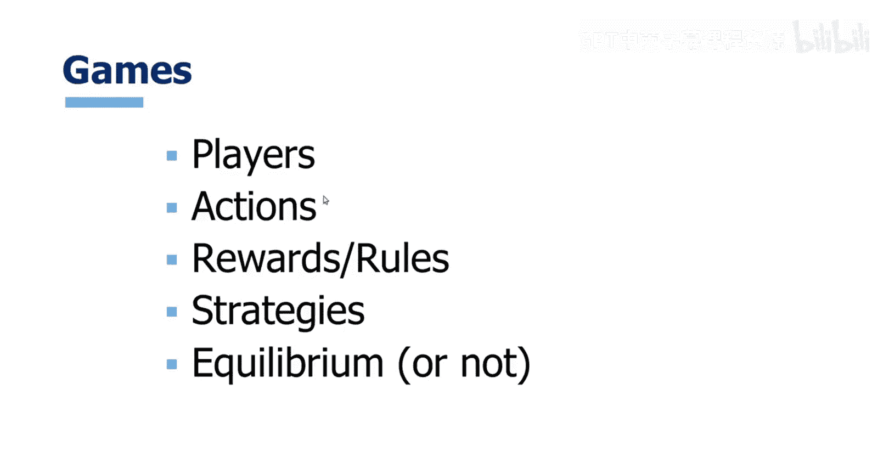
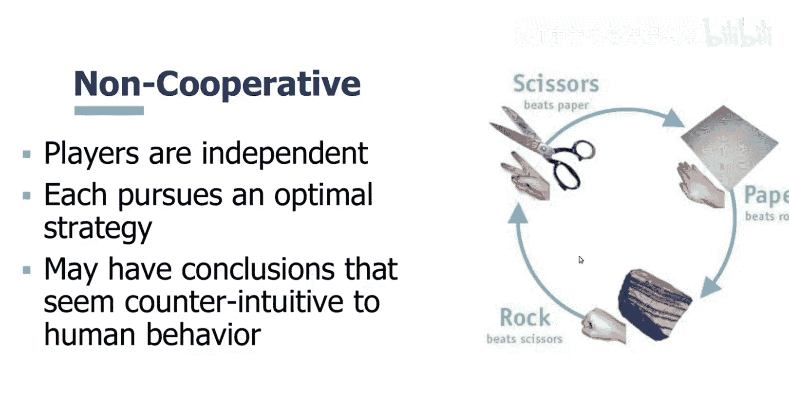
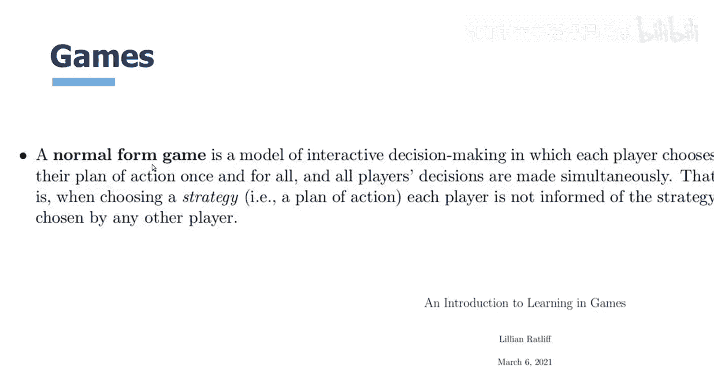
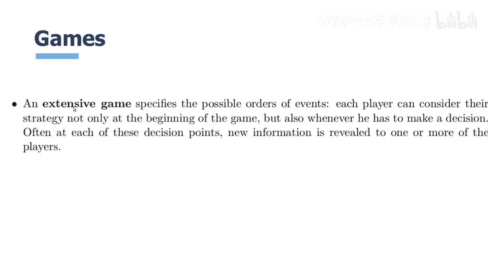
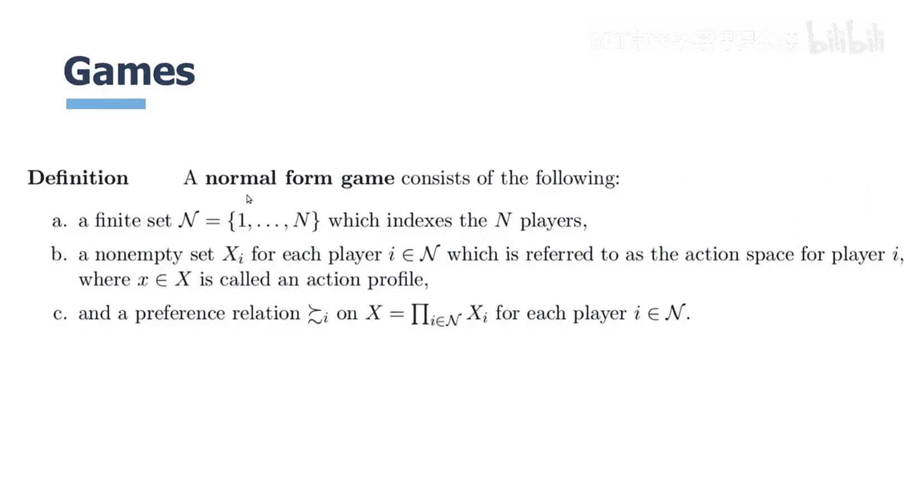
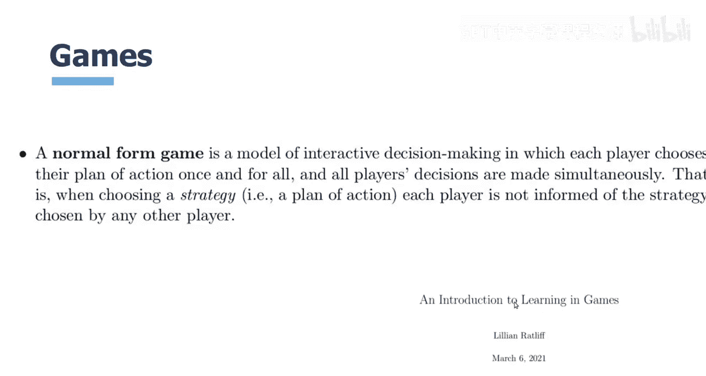
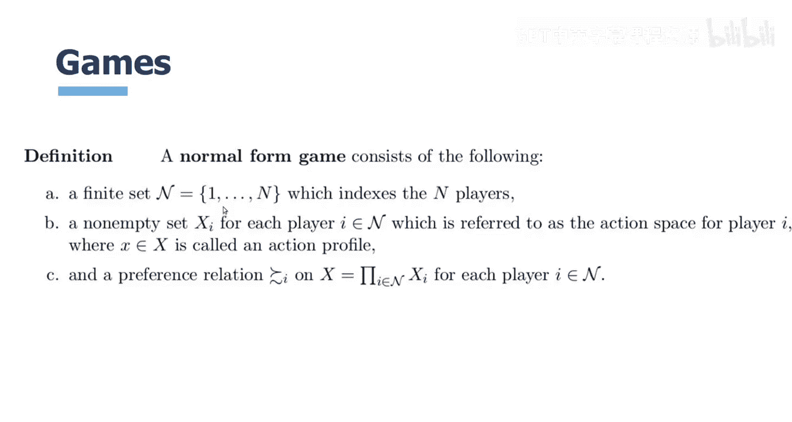
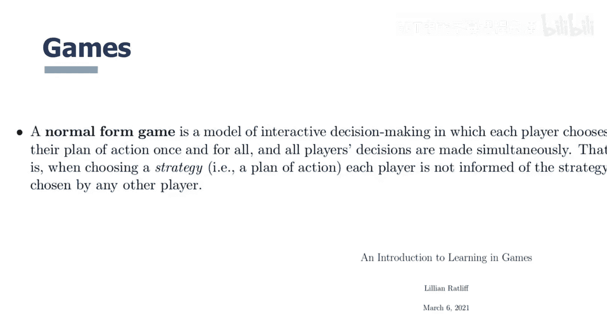
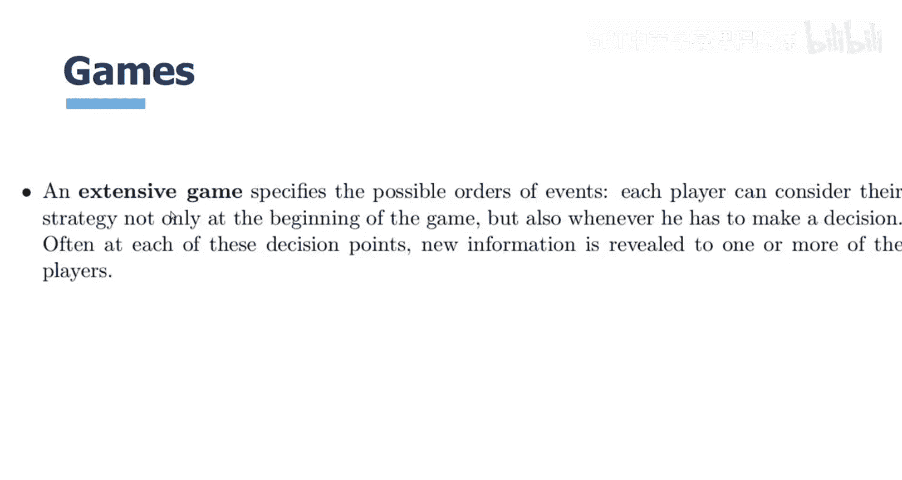

# 约翰霍普金斯大学《数据科学：时间中的决策｜Data Science Decisions in Time》中英字幕 p34 1_非合作博弈论入门.zh_en -BV1NCuzzfEJa_p34-

We'll now go a little bit deeper into games and game theory。

 There'll be more of this as we go through this particular course on information theory and games。

 we'll start with non-cooperative case on games。 I think it's the easiest one to see into and this one is really as much about vocabulary and understanding what people mean by some of the game theory concepts which I hope will hope really motivate a lot of what we'll be talking about。

 So we'll start with a classic game this is the prisonerss dilemma imagine you've got two prisoners potentially knowing each other and having cooperated in a crime and knowing a great deal about each other's role in that crime they've been jailed separately so they cannot communicate and the question is and this is classic prisoners dilemma。

 The question is are they both going to be silent are they both going to be t or towel on each other is one going to be silent and one not and there's obviously two ways that that could be done and in the classic prisoners dilemma。

 it's a question of the optimal strategy and it's a lot of game theory。 So in game theory in general。

 you've got actions。You know they can be there silent or they can betray you've got players in this case it's two and you've got some sort of optimal policy and you can think of these games as occurring all at the same time。

 meaning both players playing at once or sequentially and obviously we're mainly going to focus long term in this on sequential games but the entry point for a lot of game theory is games that occur in what's called a non-cooperative fashion meaning that these two prisoners cannot talk to each other and in addition to it being noncooperative or simultaneous so they're both making their decisions at once not seeing what the other one is doing and then they're staying with it now there are variations on prisoners' dilemma where these initial rules are relaxed but what happens is you get different point values depending upon what happens and in this kind of notation and this is very common in game theory the first number here is always the first prisoner or player one however want to praise it prisoner one player one the second number here is prisoner two or the second player and so these negative value。

or what you don't want the zero means no jail time So effectively if you wanted no jail time。

 you've got to be the one that betrays while the other one stays silent so this is a situation where player two or prisoner two is better off this is one where prisoner one betrays it is better off because the other one stayed silent unfortunately obviously mostly doesn't happen it's not in the best interest that may happen but it is more common and this goes to what will be called national equilibrium there'll be more on this coming up in another lecture but essentially what you can realize is that if you know something about what the other prisoner might do。

 you're less likely to do something so this is almost like again because it's simultaneous it's almost like two of them initially said they were both going to be silent which would mean they'd made some sort of packed prior to being arrested and they had said okay we'll take the lighter lighter sentence together。

would have been one way to do it。 but what often happens is both of them betray。 in other words。

 both prisoner one and prisoner two both talk and that's because neither of them wants to serve the stronger sentence and be the one that told directly on the other。

 So if they both talk they're avoiding this sort of situation in these sides obviously the best if they could communicate would be that they're both silent。

 but the dilemma is they again cannot communicate in this particular game。

 So this is a two player game noncooperative， meaning that they're both trying to make the best decisions individually for themselves。

 So in games in general， you have to define the players the actions those players can take the rewards along with the rules for the game。

 and then what that leads to is really thinking through strategy and ultimately what you're looking for is whether there's some strategy that dominates is there some reason to believe that one particular way of doing things is better than another。

 in other words， you have a dominant strategy and another way of phrasising this is is there an equilibrium I there some。

ASe of actions for one player or maybe if we're thinking simultaneous games with single actions is there one action that dominates that's always going to be the one that you're going to choose in which case you can think of this as a form of equilibrium meaning the other two player you and the other player if it's like a two player game are both going to play in one kind well call it role and not change Now those are not quite as interesting we'll be talking about sequential games and just like S F Park from a few minutes ago if youre listening the argument you're leaning towards is how can you have some sort of call and response especially maybe where more information is in one player than the other player and having can you influence one player in such a way that the outcome is beneficial say for you is trying to influence and still maybe roughly beneficial for the player or the other player that's that position those are really interesting those kind of sequential games where you're trying to influence and again you can think about it almost like S F Park San Francisco is trying to influence people to leave spaces open so that there's always some place。

For someone to park， they're also obviously maybe trying to gain some income from doing that。

 but that's secondary relative to the nuance of trying to encourage a certain amount of spaces to be available。

 So there's an advantage to the community by setting up the rules in a particular way。

 So that's a sequential game obviously where the people looking for parking spaces are playing so to speak in time the people adjust in the ratess on the parking spaces are also adjusting in time。

 but the easiest kind of game in the place where we are right now is simultaneous games and they're no communication in a noncooperative So that's the easiest one to see into So in a non-cooperative game another example。

 something many of you have probably played rock paper scissors essentially what happens in Rock paper scissors is you're better off just going randomly picking any one of these three actions So in classic rock paper series scissors the players are independent is going to pursue its optimal strategy which in this case would be equally likely you pick any one of these three in at random So the other player doesn't know and in general。

These kind of noncooperative games， you can often have conclusions that almost seem counterintuitive human behavior because in many。

 many human situations， we actually play cooperative games rather than playing non-cooperative games but again many of you played these sorts of games again like scissors can cut up paper paper can cover rock rock can break the scissors So you've got an ordering in terms of which one wins but there's no clear strategy so equally likely again they will play any particular one。

 So in general for games and this is coming from Lillian Ratcliffes slice notes on an induction to learning in games from 2021。

 in general in games we can define a normal form game and that's a model of interactive decision making in which each player chooses their plan of action once and for all so it's done right at the beginning once and for all and all players decisions are made simultaneously so again this is like rock paper scissors prisoner's dilemma on their classic one so that is in other words when you're choosing a strategy each players not informed。

St chosen by any other player and this goes back Nash again a lot of work very well known。

 a lot of work on normal form games。 So there's a lot of interest in this because mathematically they're easier to deal with they're not exactly the kind of sequential games that we're going to be mainly focusing on。

 but if you understand normal form games that will make it easier to understand the sequential games。

 the games that will be largely thinking about in this part and that's really called an extensive game。

 in other words we've got orders events each player considers the strategy not at the beginning of the game but also whenever he has to make a decision So often at each of these decision points。

 new information is revealed to one of the more players。

 See you think of this as a call and response type of game strategy type game another way of thinking about it but essentially what we're going to be exploring is when we've got information that's partially withheld from one player relative to the other in other words almost like SF park。

 you're going think about it as the city in this case knows more than the individual who's trying to look for。

So they only are looking locally。 they're not seeing the whole games so to speak at once。

 These are interesting games， these kind of information asym type games。

 and they're variant on these kind of extensive games。 again， call and response。

 that's something is happening something is responding。 So a normal form game。

 So again going back to this sort of example here。 And again all this is pulled from Liians notes a normal form game really consists of the following。

 And this is exactly what I was saying a few minutes ago。

 we've got a fontnett set n of players one to N again。

 the first example we're just two players then a noned set x sub I for each player I。

 which is the action space。 So X of I is just the math notation for saying you've got a particular actions。

 So each player I from our set of players has an action space。 again， do you park net。

 you can think of that is your action if you're playing a game SFpar of whether you take a particular parking space。

 So that's the action space for player I little X again is a particular value in our capital X。

 this common notation of the。

We mentioned this before heard other the people mention it little x is the actual value of the random variable capital x。

 So this is the action profile。 We're taking a particular value a particular action from our set of candidate actions。

 Now the big thing for games and this is notation many of you may not have seen before many taking this class is that we define a preference relation and this is with this kind of notation I think it' like a little squinched less than an equal type with an equivalentvalence type I underneath but essentially the big thing is this preference relation in this notation essentially what we're going to say is that we've got some actions that are preferred relative to other actions。

 So on our x we can think of these as independent actions for each player so we can take a product over all of them and we've got a preference relation we're going to prefer one particular action over another and so we can define a payoff or utility function that is referring to that preference So x is preferred relative to x sub in our function U sub I which is our payoff or utility function we can say that that utility for x is greater than or equal to。

Uility from all other actions X sub I。 so again， under many circumstances we've got this preference relation on player I and our normalifying game again。

 our normalifying games are these that we've defined here where its the two players you playing at once and not a sequential game。

 but it's the easiest one to see in first again。 So we've got a payoff utility function and again because we've got a preference relation we can say that our payoff utility function favors one action over another。

 And this is a little bit like our Markov decision processes from earlier in our coursework where effectively we're arguing that one particular action in our Markov decision like setting is preferred relative to another very similar to these kind of games another term that comes up quite frequently is a cost function。

 So you can think of this as just the inverse of the utilities。 instead of。

I something that's increasing like in a payoff utility， you have something you're trying to minimize。

 so you can think of this as the loss experienced player I under this action profile。

 So in other words we've got a preference for x over x sub i that means our f sub i on x is less than or equal to f of x sub I So you just have to pay attention to whether in a game3 type paper whether thinking about a cost function F or whether're thinking about a payoff utility function。

 U sub that's really the only thing to pay attention to。 And again， these relations。

 you know the arrows we're going both directions。 so we can think of a preference on x being reflected in a cost I'm sorry in a payoff utility function or we can think about it in terms of this preference function in terms of this cost function of sub in other words a loss that we're trying to avoid。

 So we're trying to keep our losses as low as possible。

 So then we can more mathematically define then a game we're gonna to call it scripty a set of players and a set of actions x and then f sub i which could be u sub I doesn't really matter f sub i so that with that triple of numbers and again。

kind of a mathematical way of describing it we're going to describe different kinds of games So in particular if our sum of reps sub I for all players is constant that's a constant sum game if that C was actually zero。

 it'd be a zero sum game so for all x in X meaning all actions and all I and N if that sum is either zero or C either constant sum game if it's C or a zero sum game if it's zero so I hope this has helped you to get a sense as to the starting point for games again this is really reflecting largely normal form games to get you started and there'll be more coming up on extensive form games as we get a little further in here but the important thing here is to feel comfortable with these definitions so okay thank you。

