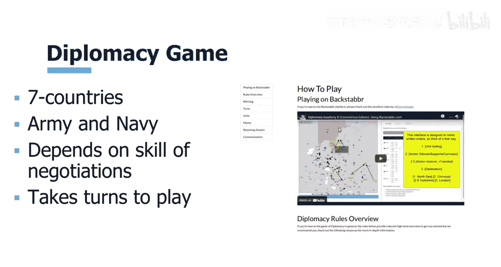
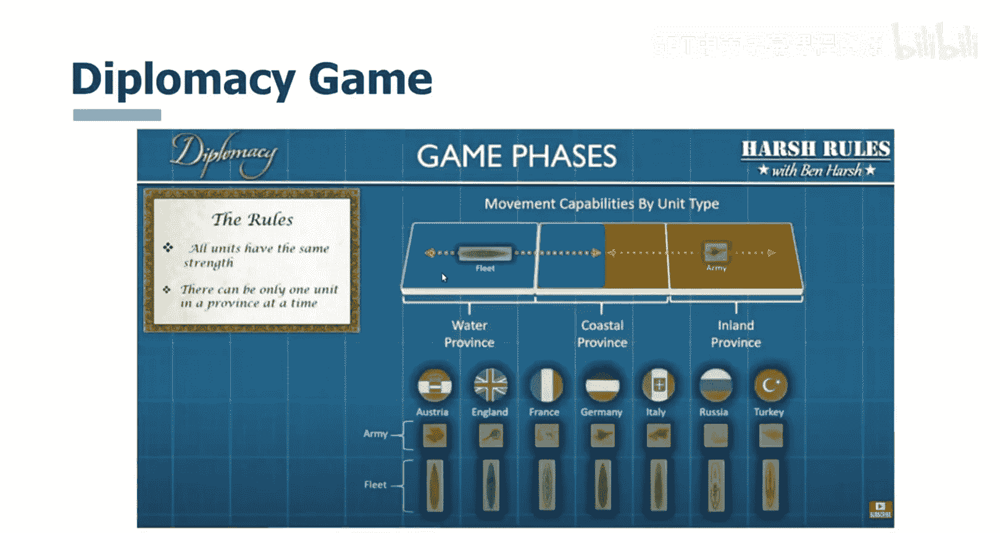
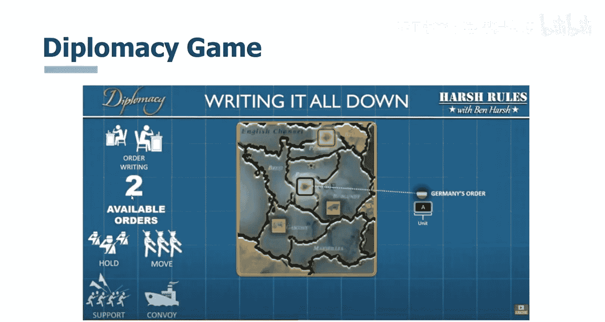
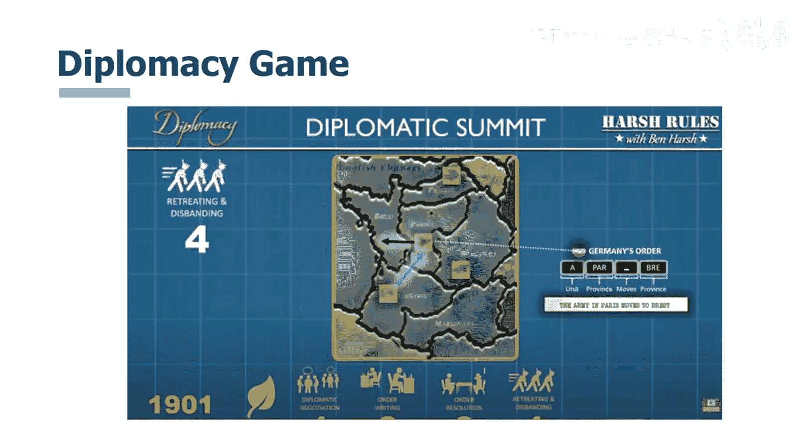
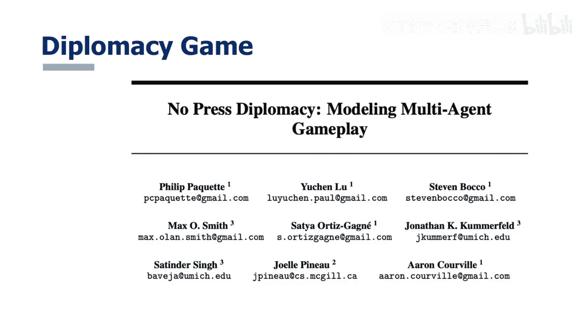

# 约翰霍普金斯大学《数据科学：时间中的决策｜Data Science Decisions in Time》中英字幕 p35 2_外交博弈：非对称信息的序贯模型.zh_en -BV1NCuzzfEJa_p35-

We'll not talk about what I think is a really interesting game called the Dicy Game。

 It's really also a great model for information asymmetry and a good one for you to be thinking about as we go through this course。

 One way to start thinking about it is what would happen if we did have something like rock paper scissors with countries interacting。

 obviously， our system is much more complicated in the real game， you'll see in a moment。

 there's seven countries and there's sequential stages and a lot of strategy and diplomacy that goes on。

 But if it was like rock paper scissors， you could imagine maybe just two strategies neutral and invading。

 And if both stay neutral or both fight。 you've got one scoring system and it's symmetric。

 and you've got one in and the other one not， you've got an asymmetry in the scoring。 And again。

 the first number would be the。Amount of points so to speak that would be won by the first country and the second number would be similar scoring。

 but the amount of points won by the second， but you can imagine something like a rock paper says there's with countries interacting My main point here is to say this is not the way real diplomacy happens it happens in time it happens with a huge amount of conversation between the two countries posturing between the two countries and and potentially an actual warfare so you've got armies。

 you've got navies， you've got diplomacy and that's this game and it's an interesting game。

 this diplomacy game it's an old game that came out in 1959 it's got an online version which I'll go over in a moment。

 but it essentially starts in 1901 it's really leading up the First World War and you've got two turnplays in each year so spring and fall and you've got diplomatic negotiations going on and then you've got order writing and then you've got order resolution and then you've got basically resolution what happens because of those actions。

And on。This game is interesting because it's really combinatorically very。

 very complex and I think it's a great model again to keep in mind for the sort of sequential games that we really want to be thinking about in our course here So we've got seven countries you can think of them as having an Army Navy a lot of this depends on the skill of negotiations so it depends on one country making alliances with other countries maybe posturing and dis of other countries and it does take a lot of time to play。

 this is not a completely trivial game to play you can play it online the specst if you're curious to play it。

 you can sign up and get an account。 there's other ones as well。 this is not the only one。

 but it's a reasonable one to play it on so you can play it over time。

 you don't have to play it all in one setting or you can get together with friends and play it it's a game that's been around for while you can also just ordered on Amazon you can actually get a copy if you want So the game。

 as I said started in 1959。 there's a 20085 edition two to7 players the originator。

Wasll probably mispronounce his name at Alan， I'm going to say callhammer。

 I think that's to Mc close。 You know at the playing time。 I mean this is a long game。

 I think many people wouldn't have the patience for it these days to play all at once。 but again。

 you can play it in stages and always remember these sorts of things of games。

 I mean you hear stories about people getting emotionally caught up in the game and taking them any countries and it's a game。

 I mean it's just that but it's very， very interesting game again， so you've got seven countries。

 So Austria， England， France， Germany， Italy， Russia， Turkey， you've got armies you've got fleets。

 I'm going to call them fleets or nas kind of interchangeably 12 each you've got a game board。

 you' got obviously a blue book and you've got updates in terms of what happens within the game。

 So you're writing orders to hold or to move or support a convoy and you're moving within these countries。

 So it's complicated because you've got these seven countries with all these different sorts of things that each could do you're writing moves。

 you're trying to decide what happens So again sequential。 you're doing this in stages inter turnsn。

 So here you can think about these。Countries they've got different geographic zones that they can hold or potentially invade into if you want and when you play this game。

 you've got to be thinking about all of these different squares you know obviously not color as squares but all these different geographic regions and how you're going to define them so each of these countries has abilities to write orders and negotiate with other countries and it's that negotiation that diplomacy that I think makes this game actually quite fascinating okay so again England France。

 Italy， Austria， Turkey， Russia all with army and Navy and they're going to be in these different zones and you can have little rules。

 not little rules， rubber rules just like any game in terms of how these can update， for example。

 a fleet can't move over land the army can't just go floating down into the water so and you've got to pay attention to what the neighbors are and how many。

You've got in one's own and how they can move and so when you write orders again think of pre World War1 you're paying attention to what's available in that time period so you're starting with all units having the same strength。

 there's only one unit in province at a time which was what I was just starting to allude to you've got again fleets so a water province。

 you've got coastal provinces where water comes up against land and you've got in provinces where the Army could go so the Army can go part way out here。

 the fleet go part way in here so you can think of this is one where there's a ability for those pieces to be on those locations again。

 each of these has army， each of these has fleet and by the way。

 I'm pulling this a lot of this from harsh rules this was a video and you could take a listen to you can see that there's a subscribe button here I think you did a good job of summarizing the rules for the game and so that's why it's up So again the interesting thing is this is a sequential game negotiations that are open saying the first installment you've got diplomatic negotiations think。

1901 again， two points in time where things are happening and you're allowing time for this。

 which is why they say six hours again， you could play this online and you could play it over stages。

 you don't need to play it all than one giant sitting or you could change the amount of time in these if you ever do want to play it but the interesting thing again to my mind and the reason bringing up in this context in the class is a game with diplomacy。

 a game where there's some set offu where it's not always clear one country is really a friend you can have backstabbing and as a gameplay is an interesting action。

 it's moves set so when you're writing orders it's being influenced by the diplomatic negotiations and so what happens if these negotiations are not completely clear well it's get reflected in the orders and therefore in the order resolution and therefore in the outcomes and so each country is trying to influence the other companies and the other countries and that's again part of these negotiations so as you go through the stages。

 you know you're writing。You're making your available orders， your hold。

 move or support or convoy that has an impact。 And again， that's influenced by the diplomacy。

 So then the resolution happens all the orders that come in and you're updating your pieces。

 you've got Austria's order in Germany's order and these can bebbreviated So you'll see on computer versions of these games that you can write these almost like chess。

 you can play this email it was one of the first games in fact。

 second to chess that was played via via email and it's because you you can abbreviate all the things that are going on。

 but again， what's interesting to me and the reason I'm bringing up is this idea gave sequential and of information asymmetry that things's not completely open。

 you've got a finite set of actions again， so it's a game and you've got actions that can be influenced by the post in other countries。

 So it's really a fascinating game Here's the fourth one retweeting or disbanding again。

 it's still 1901 it's played sequentially over time Here's the fifth one。

You know， losing gaining units， you've got resolution of what happened due to the order writing so it's a fairly straightforward game in terms of the rules。

 I think the diplomacy is what makes it especially interesting again so it's not just a game of chance there's no dip rolling in this particular game So there was another nice YouTube at least I thought nice in terms of trying to say well。

 maybe there's roughly eight different types of players， you can think of these as strategies。

 So again in our classic game theory theory type frame for for this course。

 you can think of different types of approaches that different players might take to trying to succeed in this particular game you can have an architect or diplomat or a gunboat tactician or rookie or a calculator。

 a loyalist a equivoator a shapeshifter and each of these has pros and cons。

 So here's the architect lots of knowledge some overarching strategy。

 some mastermind and sandboxing it's got an upside in an downside it's dedicated observant guides。

Gameplay downside paranoid， get frustrated too much communication。

 So this would be one personality or one strategy in the game。 Here's another one。

 the diplomat right with upsides and downsides， half， strong communication， likable intangibles。

 alliances of the diplomat。 This is kind of what you might think as the people please you upside So gets stabbed quite as much It's a game of know your sabotaging in your opponents if you're a diplomat。

 maybe it doesn't happen so much。 Manipulator can read people well， Downside can be push over。

 dependent on humans。 So again， I think it's how I mean because of these nuances。

 these different strategies， these different types of approaches。

 The tactician quiet type minimal communication succinct board drivenven forthright。

 different ways to try and win at the game， avoid conflict， avoid lies。

 neutral downside can be fooled miss in human side people suspicious。

 that's the third personality fourth one。 the rookie， probably almost anyone who has not played。

Right into the game， pretends to be new， makes mistakes， not aware of strategy， you know。

 not tactical errors， odd decisions， but maybe can be skilled， underestimated and not threatening。

 So this would be someone who is distorting right a calculator ruthless sta right you're trying to manipulate the other players can be fairly clinical on their approach。

 tactical， well read， sort of a stabbing type approach downside。

 they're not so good at the human element。 they can miscalculate。

 they can have vengeance against them upside they could be patient or honest， good ally。

 So this is the calculator again， a different strategy for succeeding in the game。 The loyalist。

 fast ally， fullfront line for strong bonds， reputation based downside， their vulnerable。

 blind deception， victory elusive， upside， popular ally respecting when it works。 You know again。

 I'm not suggesting you should memorize these types。 I hope that doesn't go across that way。

 I just find it fascinating that you can think of different strategies for this game and fascinating that。

 again， they're very human， like strategies。 And again， it's because it's a game。

Where information is not symmetric， it's not completely open。Aquivoator， irresolute。

 misdirected opponents and decisive noncommittal neutral downside frustration upside under the radar Don't pick fights hard to predict。

 So again， that's the seventh type8。 the Shashifter。

 kind of the wild card reads other players adopts， mirrors unexpected plays again。

 a different strategy Downside hard to trust determining how to mirror flexible creative good actor again。

 you know a very different strategy。 So as you've probably guessed by now one reason I trying this fast is because now we're seeing computer codes。

 So this is coming from an Europes conference。 We'll be going through this in another video coming up。

 it's modeling no press diplomacy。 that's essentially the game that we were just going over and they're trying to model multi agent gameplay。

 there's other papers doing this too this is the one that we' probably start with。

 But essentially what they're arguing is that they can make a computer model this game。

 And essentially what we're trying to do and again， that's the whole point of this class。

 is to think about sequential games。 what you're trying to almost like。

The very start of our four course sequence， you're trying to set bounds on the outcomes。

 you're trying to influence what could happen。 So I think something like SF Park again。

 where you're trying to influence the parking policy， this is really very similar diplomacy。

 you're trying to influence your other countries。 that's a game and again。

 this is a model of a game as well， but it's interesting because again you've got rules you've got seven players being in the seven countries and you're trying to ideally win at this game and and force the other ones to not win but it only happens by diplomacy it only happens by paying attention to the other countries and forming alliances。

 you can't you can't do this as a non-cooperative game it's a different game than what we' were talking about in the previous video where we did the non-cooperative simultaneous games。

 This is a sequential game where it's very dependent on the interplay between each of the players。

 again I think quite fascinating as a game and if anyone's curious。

 I think it's a fun game know give it a try I think worth giving a try to。

So okay， with that， we'll pause on this one and hope you enjoying this。 Thank you very much。

