# 约翰霍普金斯大学《数据科学：时间中的决策｜Data Science Decisions in Time》中英字幕 p36 3_水资源分配的博弈谈判.zh_en -BV1NCuzzfEJa_p36-

As we enter our second week， I'd like to give you an interesting example。

 really a continuation of where we started， so we started with SF Park and really trying to influence people's sparking behavior。

 a bigger political problem similar to the game that we described where you're trying to diplomatically get people to agree with you or side with you and that was pre-world War I and again we're coming up on that but I'd like to give you an example of game therapy riverflow and really how you might imagine trying to play with others to optimize the amount of water that's flowing into different regions and this is just an example to keep in mind not necessarily an easy one to solve typical of many problems where we're making decisions in time there's a lot of different views of what would be optimal and a lot of different views and disagreements over how best to adjust so as a reminder last week we could talked about prisoners' dilemma to prisoners who committed a crime potentially。

But they were put into separate cellsels and so they're not allowed to cooperate so non-cooperative both could be silent。

 both could betray， one could be silent and one not and we end up with different points and again the thing keep in mind when you look at something like this is that the first one is for the first prisoner the second point is for the second prisoner if they're both silent。

 they both get modest jail senses， if they both betray。

 youve got intermediate senses if one is silent and the one not then the one that betrays it does better than the one that did not so prisoner two betrays here。

 they will not get time but the other one will and the same on the other side so this is a classic prisoner them or non-cooperative game and as a reminder again。

 all games， you've got players， you've got actions， you've got rewards of rules。

 you've got strategies and you're looking for equilibrium of a place where no matter what action is taken it doesn't improve the outcome so it's effectively an equilibrium state where everyone is already kind of locked in to their actions in the words。

Their strategy has become simplified if you want because there's an equilibrium and there's no other best actions to take。

 And so in these non-cooperative games， the players are independent。

 each player pursues their optimal strategy and you could have conclusions that are counterintuitive of human paper we talked about rock paper scissors as an example So now what I want to talk about are two papers which are looking in terms of things like cooperative and noncooperative games for thinking about rivers and allocation of the water over that。

 So these are fairly recent publications， I don't think they come to a final conclusion but they're thoughtful in terms of how you might imagine finding an optimum。

 So this first one is a river that flows over three countries。

 I should remind you of the diplomacy game that we were talking about last week and then I mentioned just a few minutes ago torkmenist。

 Afghanistan you got water that's flowing through you can see it in a world bigger picture of the world and this basin which is the a rooted basin if I said correctly is defined by this。

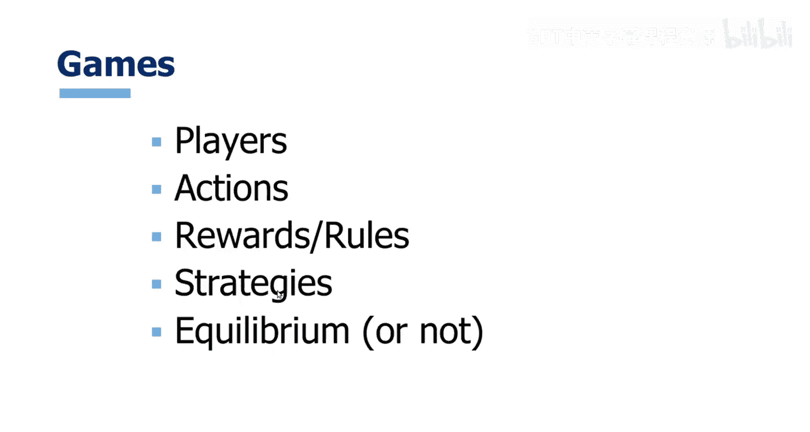

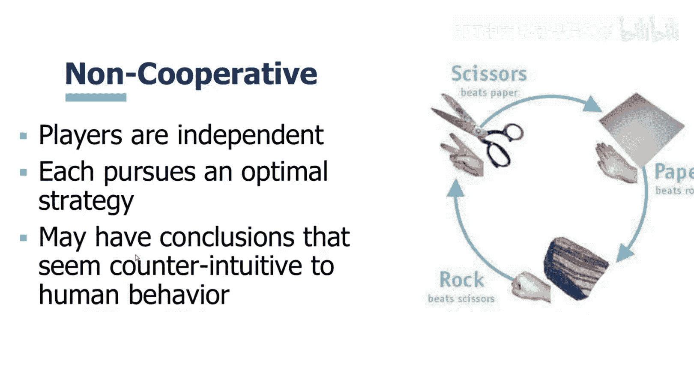

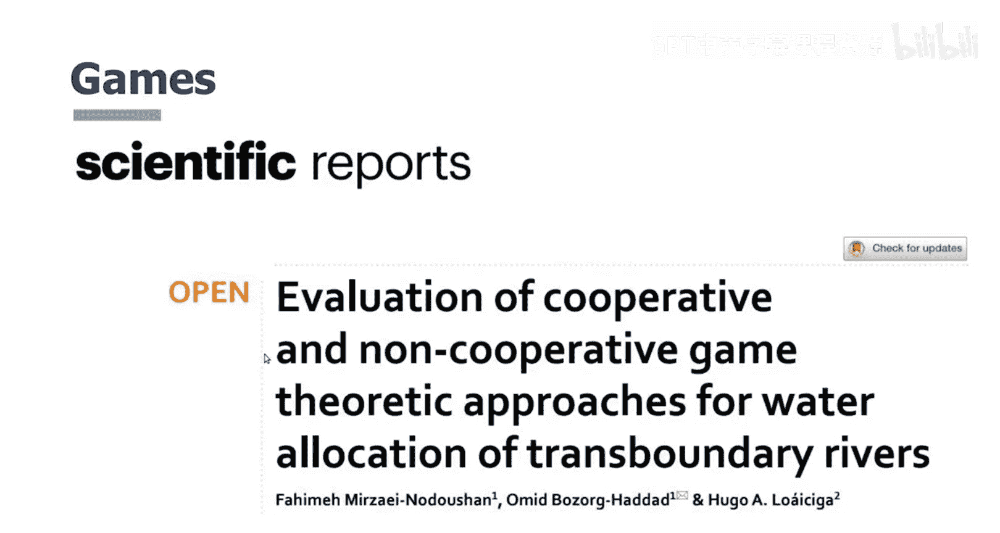

And all of these countries need to work together， at least in principle。

 to optimize the amount of water they're taking out and this is actually a sort of problem that comes up all over the place。

 some of you in the US may be aware that the Colorado River which flows through multiple states so you've got Colorado and Arizona。

 California all very much dependent on it and it's not so easy to understand how to allocate the amount of water。

 there's agricultural need， there's city-ne population growth balancing this is a genuinely hard problem but you can set it up in the same way you can think of it as a game with a payoff matrix。

 you've got three because there's three countries so you've got Afghanistan around Turkmenistan they can work together。

 they can all compromise， you can have one of them in opposition。

 say connect might be Iran and opposition or Turkmenistan in opposition and in each of these countries。

 Afghanistan in opposition each of these countries you've got a payoff scheme and so you want to think about which row so to speak in here in。

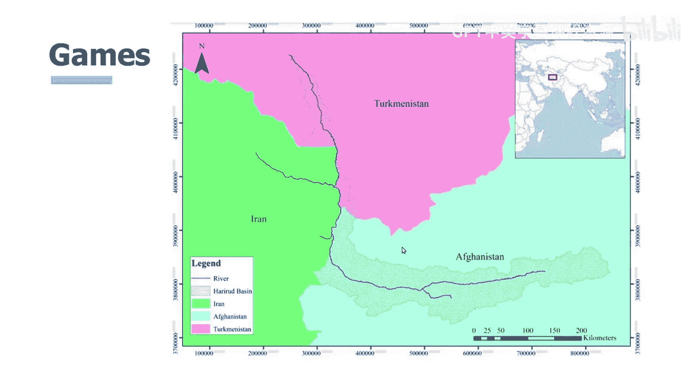

Compromise or which rowing here in opposition is optimal and they're not necessarily saying in this paper that you absolutely should follow a game theoretic outcome。

 but you can try and optimize based on strategies in a game theoretic setting and you would end up saying something like this in their figure5 they would end up with a particular water flow a supply and demand to the three countries baseding on that so this is a non-cooperative allocation approach。

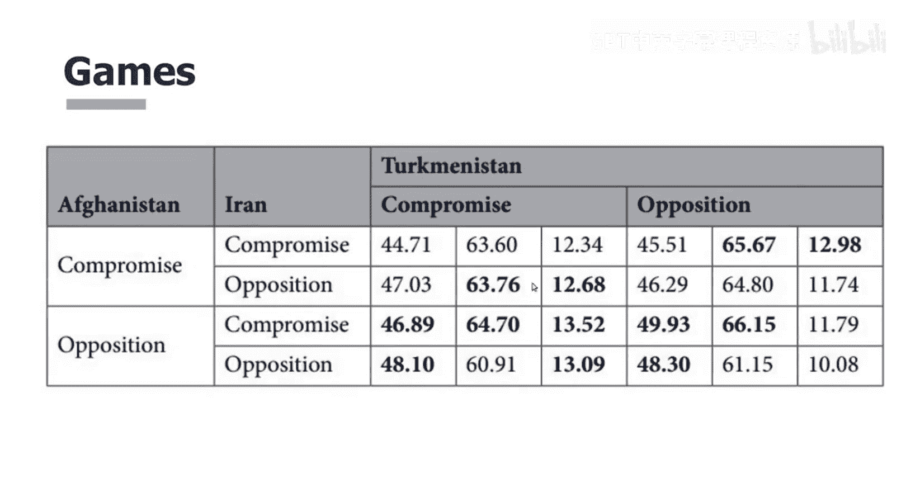

Again， I just think it's interesting。 It's something to think about it's not necessarily saying that from the outside that we can reach in know enforce these countries to follow any particular strategy。

 but it is interesting to think about what the strategy would be if you were doing a noncooperative or even cooperative game for allocating the water Here's another one this is from Malaysia So it's thinking about water in a dynamic water setting where effectively you would be adjusting say hourly depending upon the water flow and depending upon what's going on and so they're thinking of something with these two dams I'm we're probably going to mispronounce the names if I say them alo so we'll just say this dam and this dam in this kind of geography and it's flowing and the question is ultimately how do we adjust the intake and the outtake。

 how do we adjust the water flow So this is very similar again to many problems in many settings So we've got inflow to the longgo dam。

 which is how I pronounce that one the inflow to the semiia dam。

 which is how pronounce this one and both of these are coming in， you've got a total amount of water。

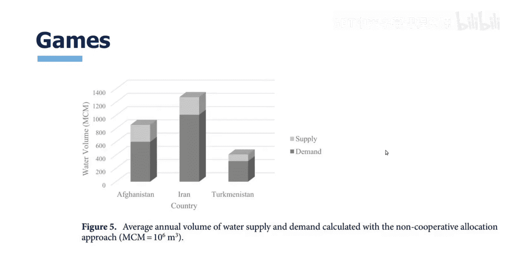

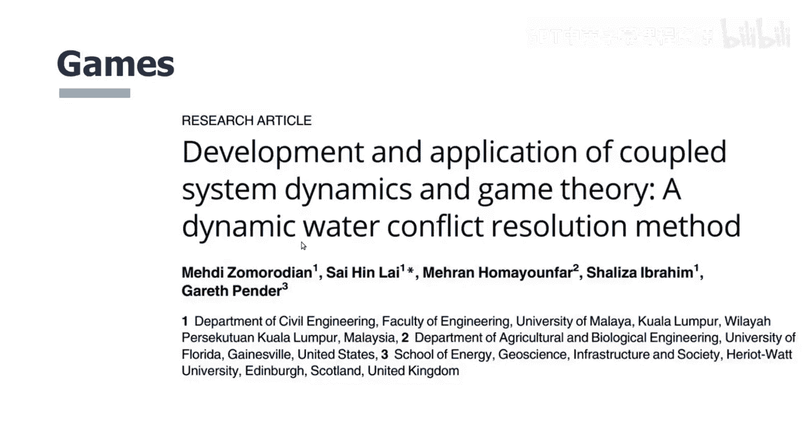

Available and then you can imagine some sort of a game like allocation optimizer that's adjusting between supply and demand。

 you've got some internal catchment and outside catchment for the water flow。

 but how do you optimize within these settings again it's like a game It's important I think real- worldorld setting where these ideas come down and where you've got potentially different people with different strategies that they might want to optimize on and no necessarily perfect answer and again。

 politics comes out very much in this So I hope I've given through both these two papers the second one and this first one some sets for two different real worldorld problems that are similar to diplomacy game。

 where you can imagine different countries needing to negotiate or you can imagine different regions need to negotiate and when you've got really a lot of politics you've got urban and farm rural type settings you've got population growth not anything with an obvious or easy answer。

 but something where the ideas we're talking about that game through。

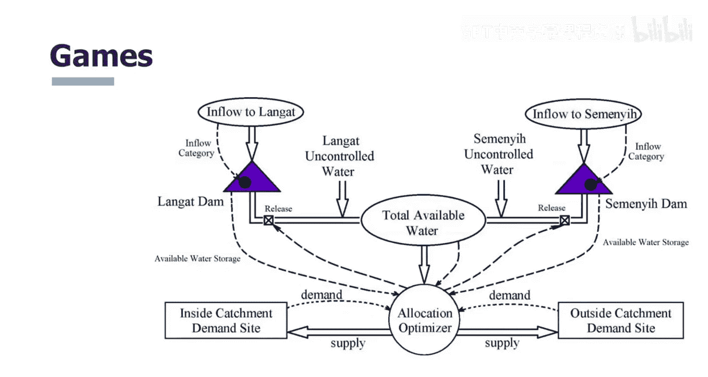

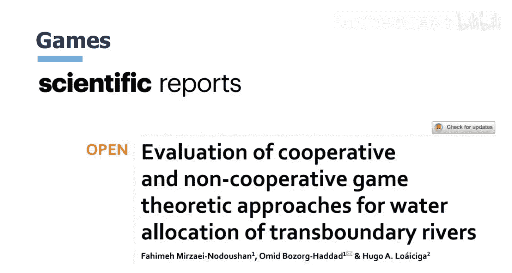

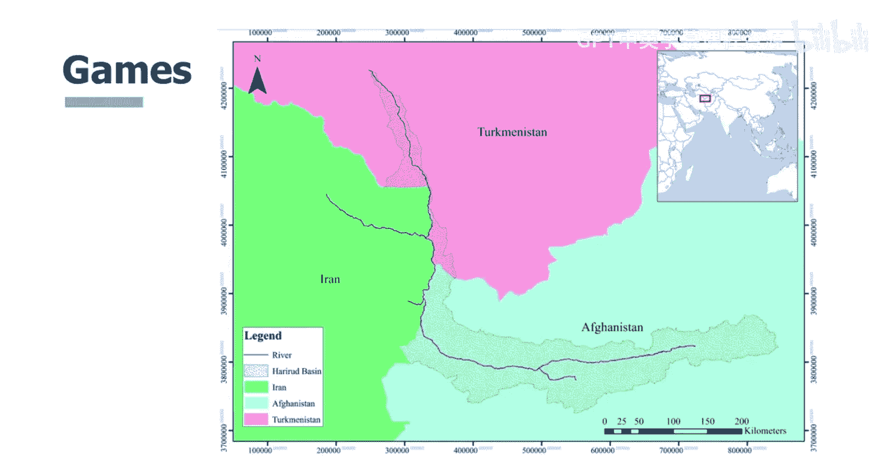

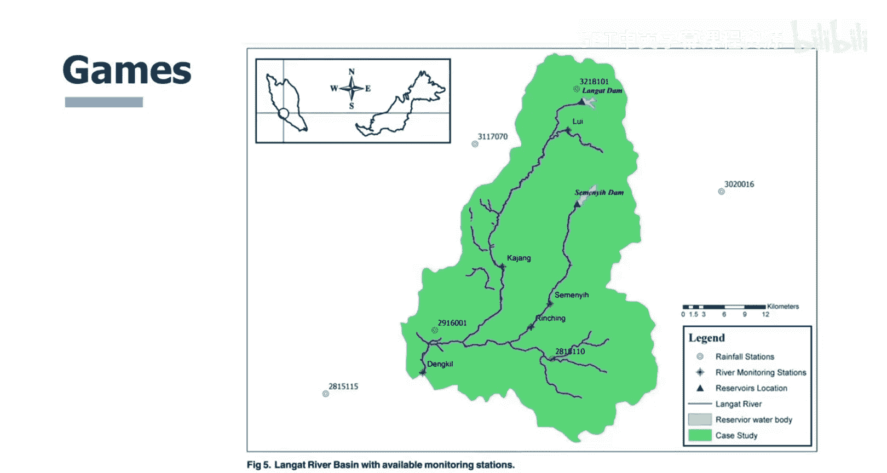

And information type ideas canly come in to really help us understand what's going on。 So okay。

 I hope that helps you。