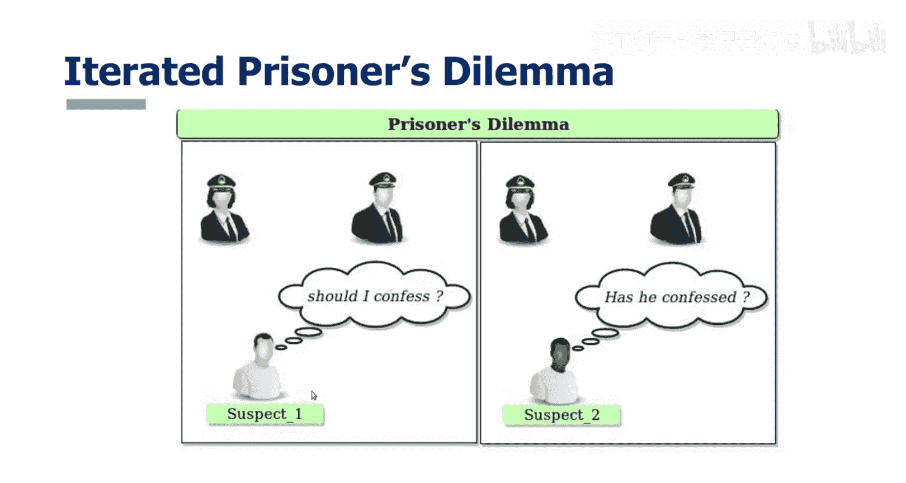
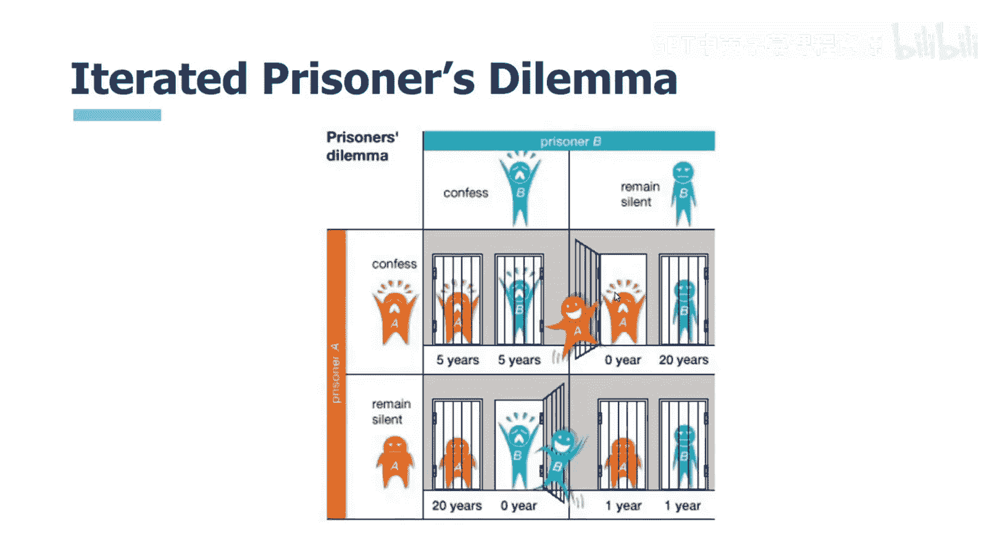
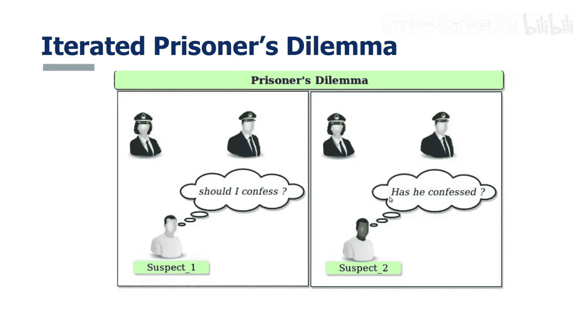
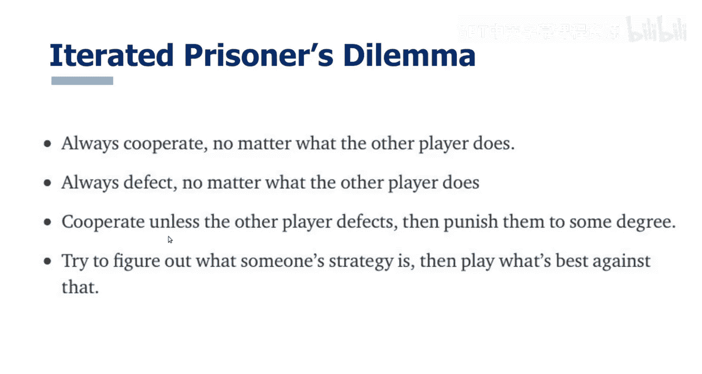
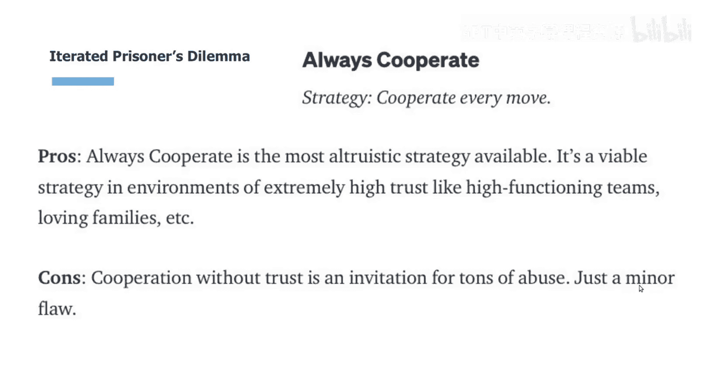
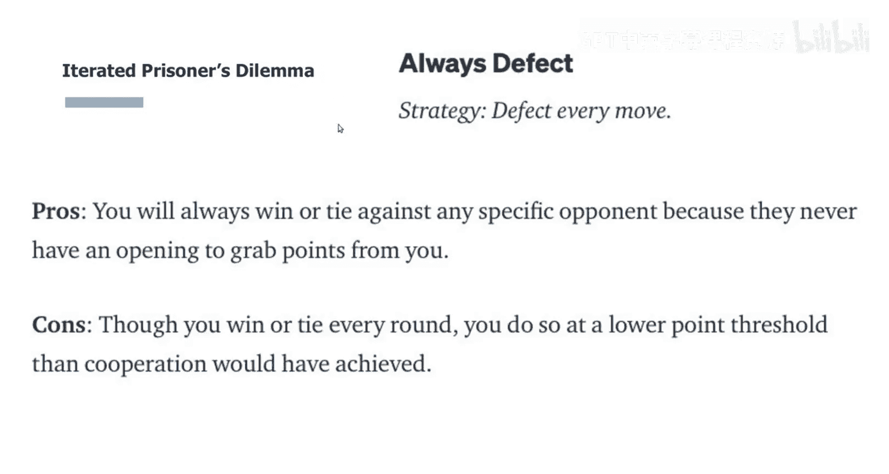
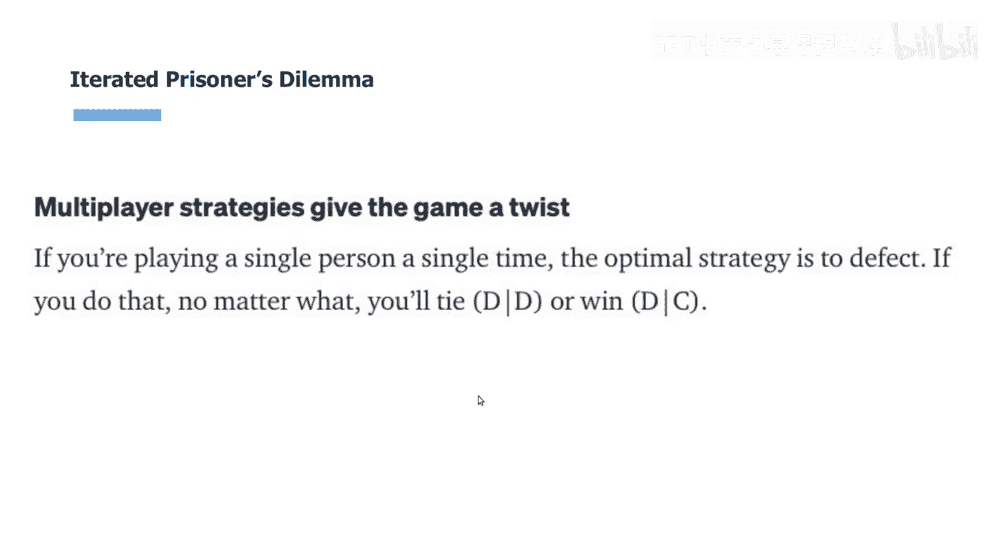
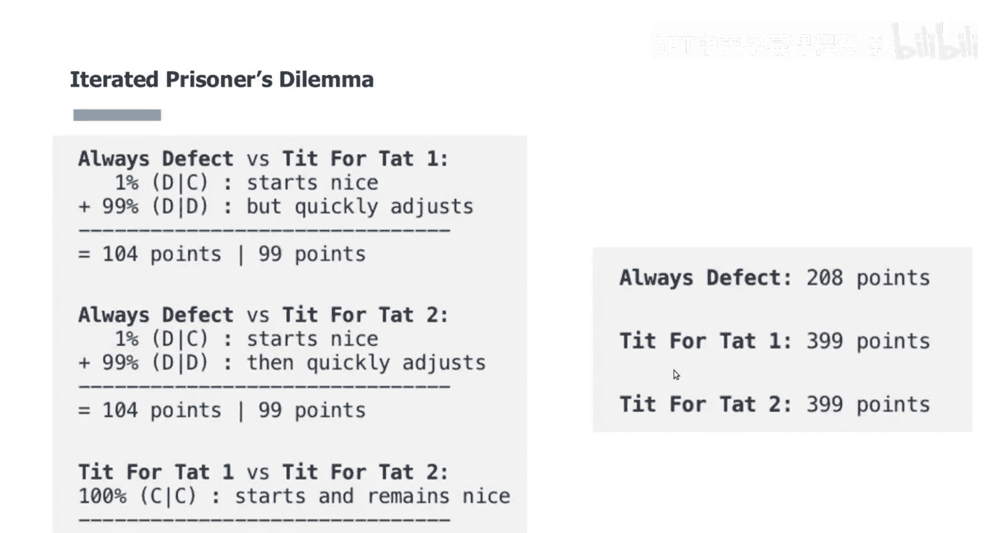
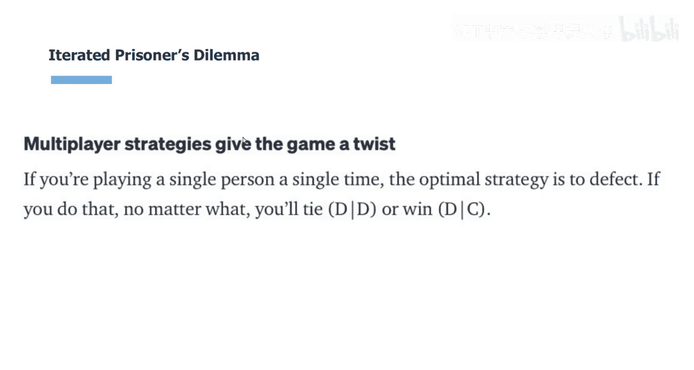
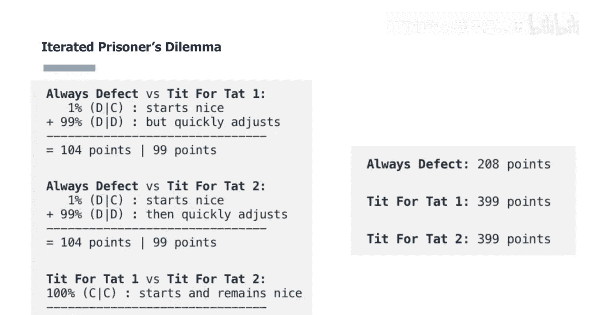

# 约翰霍普金斯大学《数据科学：时间中的决策｜Data Science Decisions in Time》中英字幕 p37 4_迭代囚徒困境（上）.zh_en -BV1NCuzzfEJa_p37-

Well now talk about a nice connection back to diplomacy back to prisoners's dilemma。

 but now it's iterated prisoners's dilemma， so this means you are in principle paying attention to what the other player or players are doing it's like diplomacy it's really like SF Park again you're trying to understand and compensate for information that's growing over time So remember in prisoners's dilemma you've got two suspects one and two are're isolated。

 they're not talking to each other in the original prisoners's dilemma， The question is both asking。

 should I confess or has the other person confessed the police are obviously hoping to optimize。

 you could say that's one side of the equation， The suspects are obviously trying to optimize。

 you could say that's the other aspect of the equation and strategies are ultimately you know do they confess or they to betray know so which way do they go and you can make a table another version of what I had up earlier both can confess in which case they get five years both can be。

Yan。Remaining silent in which case they get one year they're not able to prove anything One can remain silent while the other one betrays confesses and so that one gets to go free。

 the other one obviously stays in jail for an even longer time and then it flips if A remain silent and B confesses then B gets to go free so these are different strategies and normally for prisoner's dilemma you would just play this once so the players don't know you know if we go back to this one。

 the players don't know and they only have that one iteration in order to try and decide what to do but it's a very interesting game if you modify this slightly and say what happens if you can play this many many times maybe even hundreds or an infinite amount of time you can play indefinitely how does a strategy evolve and it also starts to become a little bit like the diplomacy game if you start to have multiplayers and and then you can come up with some very interesting differences in strategies when you allow it to become iterate。

So when it iterated position to of some obvious examples are things like always cooperate no matter what the other player does。

 you're always going to cooperate or always defect no matter what the other player does。

 or almost like what's going to become for ta cooperate unless the other player defects and then punish them to some degree or try to figure out what some one strategy is and then play what's what's best against that these later two are the interesting ones because you can imagine these strategies are potential obviously strategies but they're not all that one level interesting。

 they've started off in one domain and then they've stayed there。

 these other ones where you're trying to optimize your strategy or trusting whether you're cooperating or defecting or C are really very interesting So for example if you always cooperate that means you're cooperating you move you've got some pros and some cons So the pro is that if you always cooperate it's the most altruistic strategy it's a viable strategy in environments where you've got extremely high trust maybe like a high functioning team or loving families etc。

 So if you know the other player。

If you know the other players， again， if it's like a multiplayer version of this iterated prisoner's dilemma。

 then always coop is going to work just fine， but if you're playing against others that are going to violate that trust then this is not a good strategy so if youve got cooperation without trust you just get tons of use and it's in kind of sugargr sense just a minor flaw well obviously if it's a prisoner type thing you're going to be the one that's 20 years and so you don't want that the other strategy is to always defect so you've have to every move the pro is you're going always win against or tie against any specific component because they never have an opening to grab points from you so if you always defect you may not in a high trust environment do as well but you always come out reasonably but the con is even though you win or tie around you're going to have a lower point threshold then if you had cooperation if you had a trusting opponent so always defect is not always going to be in the long。

for an iterated person's dilemma the best way to go so what has been over the years evaluated as a winning strategy。

 but only in a situation where you've got mixtures of candidates coming on your side and only in a situation as well where not everyone is playing the same strategy。

 which is interesting is this one called Ttford Ta。

Did for that， you start by cooperating and then you copy whatever the other player did on the last move exactly what it sounds like you're copying what they did if they've been a D。

 then you do a D if they've been a C then you've been a C so cooperate or defect for C and D so it's an interesting strategy and when we add in multiplayer again think like the diplomacy game you get a whole bunch of other interesting things going on so again D is defect C is cooperate if you're saying in a single person a single time optimal strategy may well be D defect。

 although as we said it may depend on what you know about that other person but if you think about that for single person a single time given condition on remember the vertical line means condition on So if you play D condition on D or you play D condition on C you'll always either end up within an a tie or end up moving ahead depending upon whether they are cooperating in your defecting or not so。

is at least reasonable， but a multiplayer gets more involved， so you always defect versus Tt for tat。

 always defect versus tit for Tat if you're playing and that's our environment or tit for tat versus Tt for tat。

 if you're an environment again， multiplayer type environment where you've got say three players and the other two are doing Tit for tat then you can show that you're going to do better if youre doing if you're understanding something about the other strategy so again in a multiplayer game。

 things get a lot more complicated， you've got to be thinking about what the other players are doing and if they're always defecting if you're playing always defecting versus T for tat。

 you're not going to do well but if you do tit for tat versus T for tat。

 you're going to be reasonable so what this is saying is that understanding something about the other player' strategy again think diplomacy。

 you think SF Park you're trying to figure out a stable point you're trying to figure out what the best strategy is and in this context。

Multipplay game， it can depend very much about what the other players are doing。

