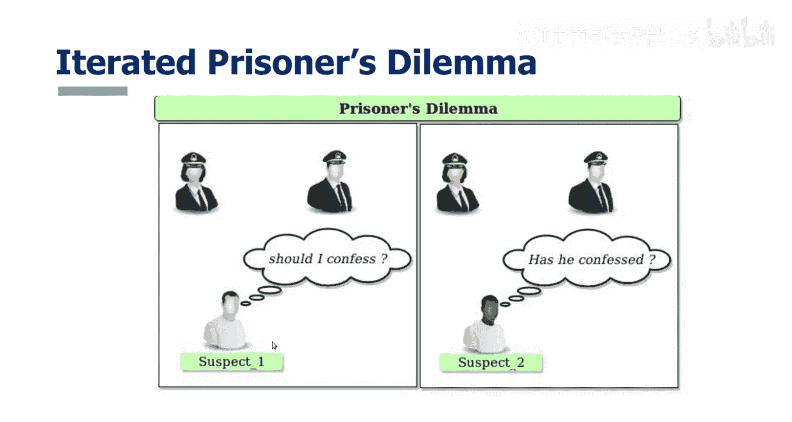
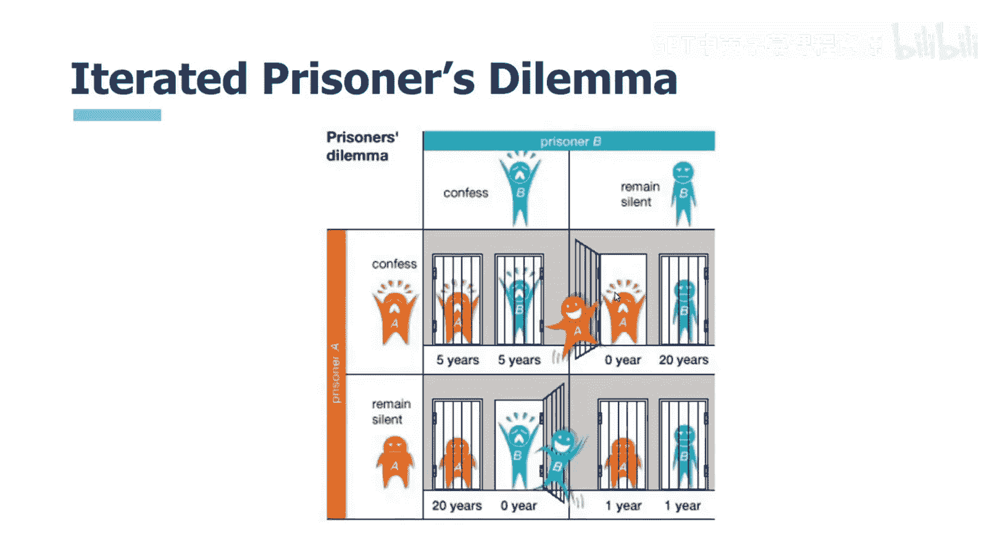
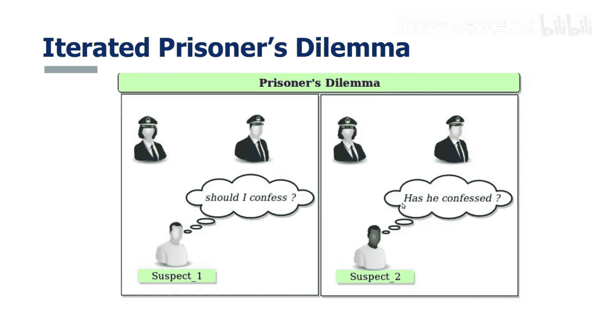
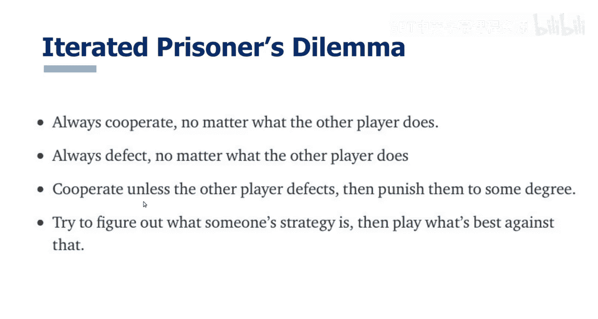
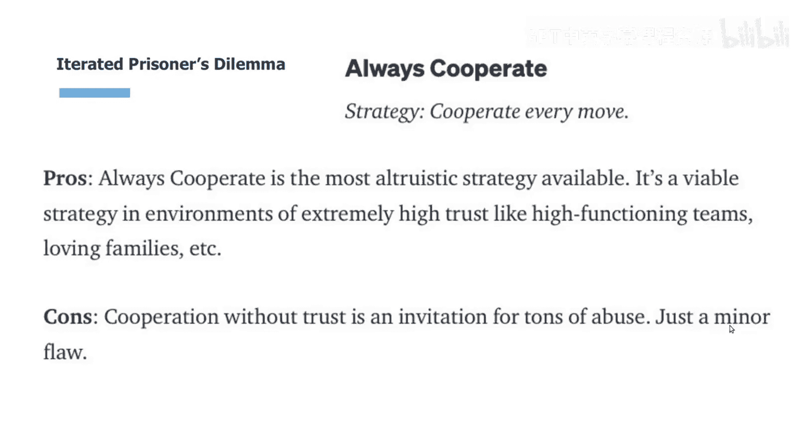
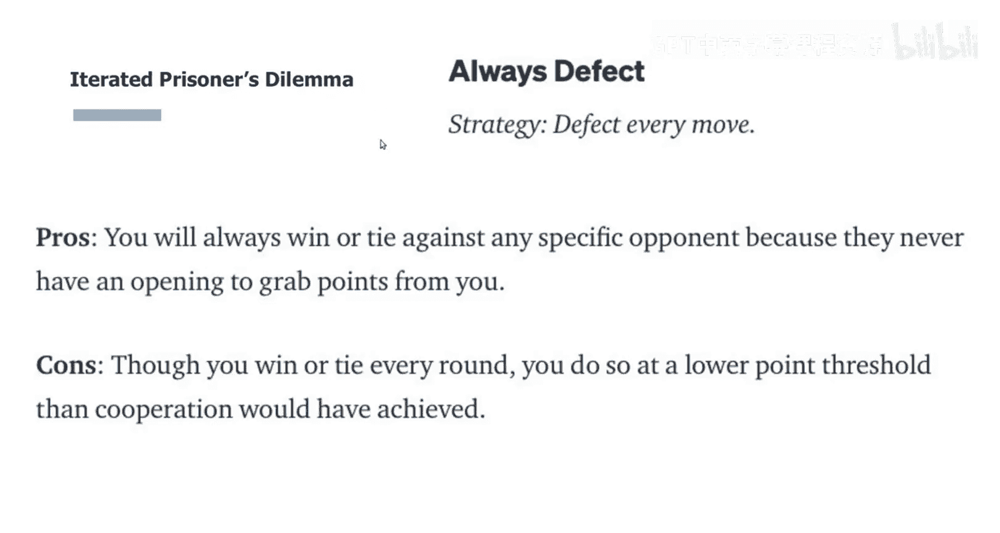
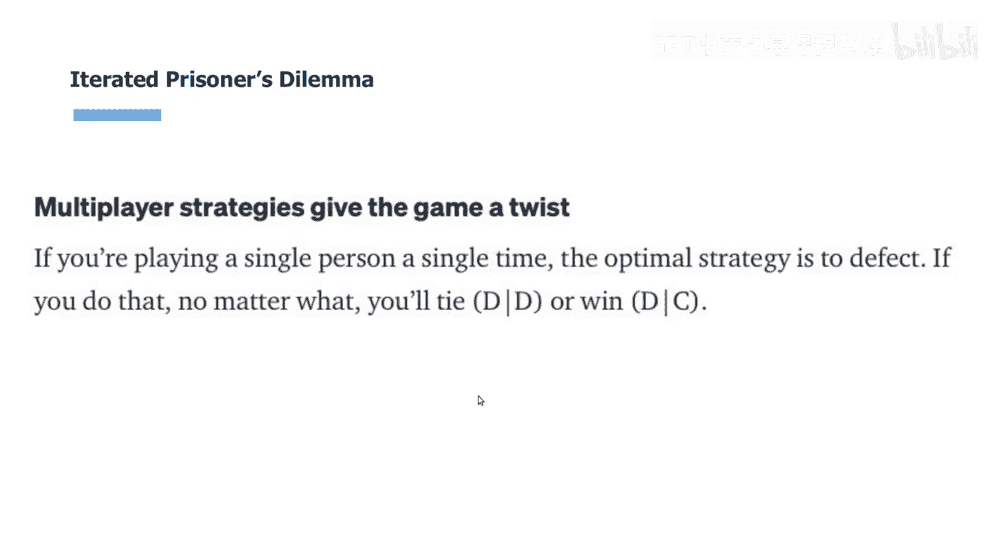
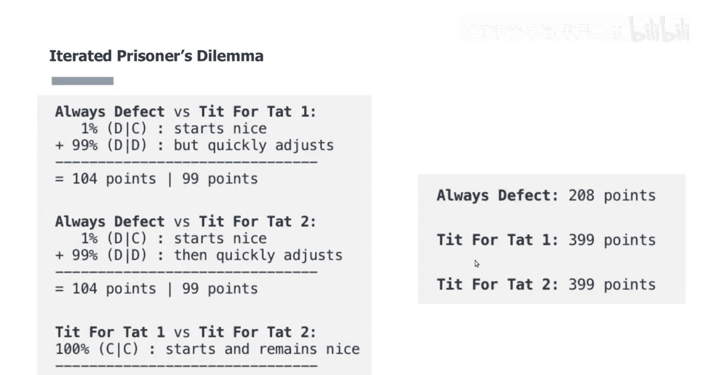
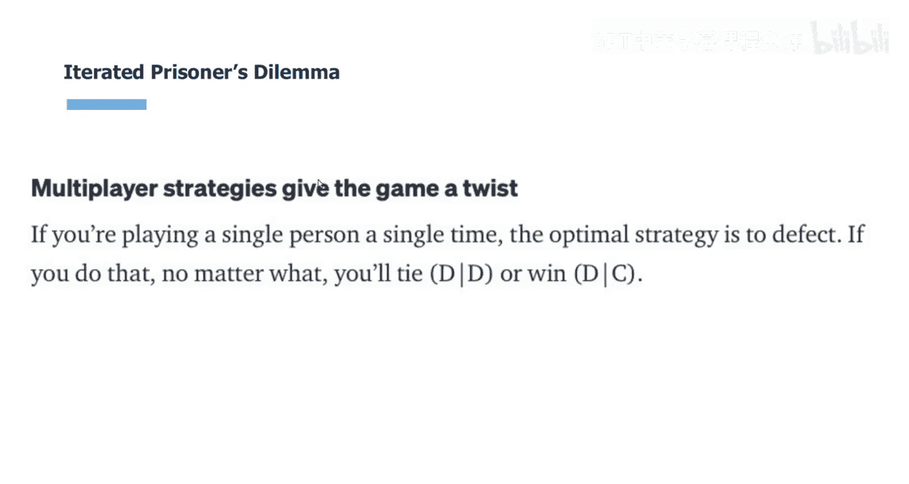
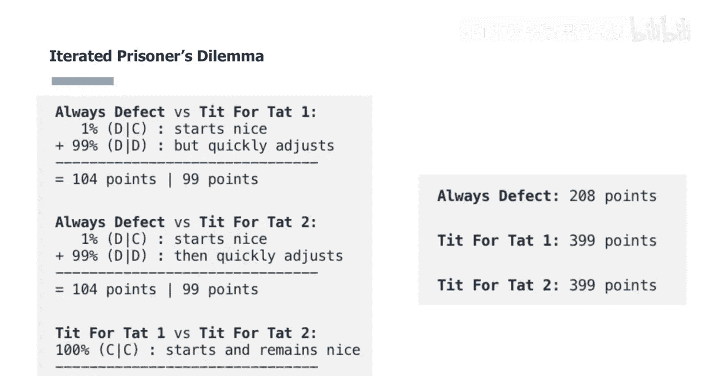

# 数据科学：时间中的决策：4：迭代囚徒困境（上）🔁

在本节课中，我们将要学习经典博弈论模型“囚徒困境”的迭代版本。我们将探讨当博弈可以重复进行多次时，策略如何演变，并理解这与多玩家环境（如外交博弈或SF Park停车定价问题）的相似之处。

---

## 从单次博弈到迭代博弈



上一节我们介绍了单次囚徒困境的基本概念。本节中，我们来看看当这个博弈可以重复进行多次，甚至无限次时，情况会发生怎样的变化。

在经典的囚徒困境中，两名嫌疑人被隔离审讯。他们面临的选择是：**招供（背叛）** 或 **保持沉默（合作）**。警方和嫌疑人各自试图优化自己的结果。策略最终归结为选择合作（C）还是背叛（D）。

我们可以用一个收益矩阵来总结不同选择组合的结果：

*   **双方都招供（D, D）**：各判5年。
*   **双方都保持沉默（C, C）**：各判1年。
*   **一方沉默，一方招供（C, D 或 D, C）**：招供者获释（0年），沉默者被判20年。

在单次博弈中，玩家只有一次决策机会，且不知道对方的选择。然而，如果允许这个博弈重复进行很多次，策略的演变就会变得非常有趣，并且开始类似于需要考虑其他玩家动态的多玩家博弈（如外交游戏）。






---

## 迭代博弈中的基础策略

在迭代囚徒困境中，玩家可以根据对手过去的行为来调整自己的策略。以下是几种显而易见的基础策略示例：

*   **总是合作**：无论对手做什么，每次都选择合作。
*   **总是背叛**：无论对手做什么，每次都选择背叛。
*   **以牙还牙**：首先选择合作，之后每一轮都模仿对手上一轮的行为。
*   **优化策略**：试图找出对手的策略模式，并据此采取最佳应对。

前两种策略（总是合作/总是背叛）虽然简单，但缺乏动态变化。后两种策略，尤其是涉及根据对手行为进行调整的策略，则更为有趣。

---



## 策略分析：总是合作 vs. 总是背叛

现在，我们来具体分析“总是合作”和“总是背叛”这两种策略的优缺点。

**总是合作策略**
*   **优点**：这是最利他的策略。在信任度极高的环境中（如高效团队、亲密家庭），这是一个可行的策略。在多玩家版本中，如果所有玩家都合作，效果会很好。
*   **缺点**：如果对手不遵守信任，此策略将非常不利。在缺乏信任的合作中，你只会被不断利用。在囚徒困境的语境下，这意味着你可能会被判长期监禁。

**总是背叛策略**
*   **优点**：针对任何特定对手，你至少能保证不输或打平，因为对方永远没有机会从你这里得分。
*   **缺点**：尽管能保证不输，但在长期博弈中，如果你的对手是合作的，你获得的总体收益（或积分）将低于相互合作的情况。因此，**总是背叛**并不总是迭代囚徒困境中的最佳长期策略。



---


## 制胜策略：以牙还牙



经过多年研究，在混合了不同策略玩家的环境中，一个被评估为表现优异的策略是 **以牙还牙**。

**以牙还牙** 的策略规则很简单：
1.  **第一轮选择合作**。
2.  **之后每一轮，都模仿对手上一轮的选择**。
    *   如果对手上一轮合作（C），你本轮也合作（C）。
    *   如果对手上一轮背叛（D），你本轮也背叛（D）。

用伪代码可以表示为：
```python
if current_round == 1:
    my_choice = Cooperate
else:
    my_choice = opponent_previous_choice
```

当引入多玩家环境时（再次联想到外交游戏），情况变得更加复杂和有趣。

---



## 多玩家环境下的策略互动

在单次、单对手的囚徒困境中，给定条件 `P(D|D)` 或 `P(D|C)`（即在对方背叛时选择背叛，或在对方合作时选择背叛），背叛（D）可能是合理甚至最优的选择。

但在多玩家迭代博弈中，你必须考虑其他所有玩家的行为。例如：
*   **总是背叛** 对阵 **以牙还牙**：总是背叛者可能占不到便宜。
*   **以牙还牙** 对阵 **以牙还牙**：双方能建立稳定的合作，获得较高收益。
*   在一个有三名玩家的游戏中，如果另外两人都采用 **以牙还牙**，那么理解这一点并采取相应策略（比如也采用 **以牙还牙**）对你更有利。

这说明了在多玩家博弈中，理解其他玩家的策略至关重要。就像在外交或SF Park定价问题中一样，你试图找到一个稳定点，找出最佳策略。你的最优策略在很大程度上取决于其他玩家在做什么。



---





本节课中，我们一起学习了迭代囚徒困境的基本概念，分析了“总是合作”和“总是背叛”两种简单策略的局限性，并介绍了在多玩家环境中表现优异的“以牙还牙”策略。我们看到了博弈从单次到迭代、从双人到多人演变时，策略思考复杂性的增加，这为我们理解现实世界中动态的、多参与者的决策问题提供了基础框架。