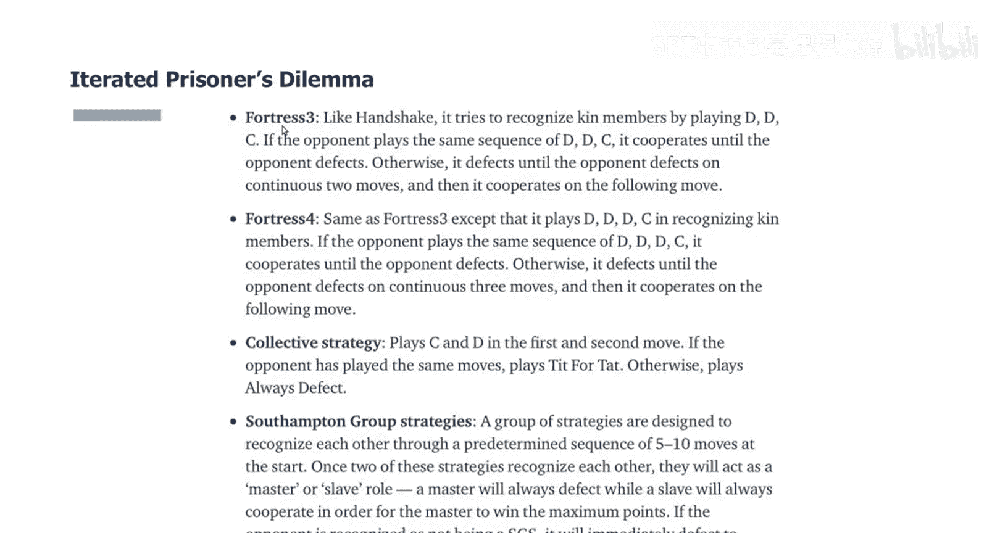
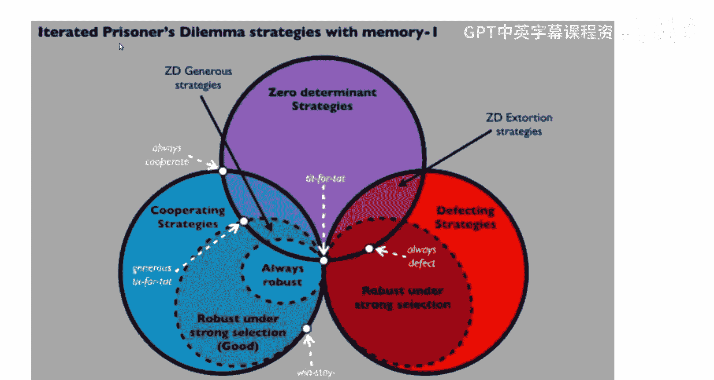

# 约翰霍普金斯大学《数据科学：时间中的决策｜Data Science Decisions in Time》中英字幕 p38 5_迭代囚徒困境（下）.zh_en -BV1NCuzzfEJa_p38-

So there's a bunch of other types of strategies Here's four I'm going to put up some others and probably I hope overwhelm a little bit with a number of strategies。

 but also I hope convince you that it's not trivial to figure out what the best strategy is and that you may have to think about this in a particular setting for what the best strategy is so for example you could do tit for two tats or firm but fair or generous ti for tat or soft majority so tit for two tats you cooperate on the first move you defect only when the opponent defects two times a row so two negatives then you'll copy it's not directly a ti for tat or firm but fair you coerate in the first move and then you continue to cooperate until the other side defects and then。

And then try to cooperate again after you got a defect conditional on defect generous tit for tat。

 same as tip for tat， except you cooperate with 10% probability when the opponent defects。 So again。

 these are three different strategies of the fourth one。

 So majority cooperate in the first move cooperate as long as the number times your opponent is cooperator is greater than or equal than over times it is defected else defect。

 So again， softma。 those are four strategies Here's some other five hardt for tat two tits for tat。

 gradual soft graual Gr trigger。 So again， iterated prisoners' dilemma。

 we're thinking about multiplayer games， not necessarily knowing the strategies of the others in the multiplayer game。

 obviously， if you do know or if you can figure out that the player strategies or other approaches。

 you can try and optimize。 And that ultimately is what all of these are trying to do is to understand something about how to respond to what the other players are doing。

 You're trying to optimize the outcome。 And again， that's the gameplay for all of the games that we're talking about know how do you optimize。

Individual reward， potentially how do you collectively optimize and how do you get an optimal say community return again。

 think Sf Park where you're trying to leave some spaces open。

 how do you get an optimal return in a game where potentially there's individuals that are playing and are trying to optimize their own rewards and you're also trying to say optimize collectively optimize over the up So ultimately what you want to be thinking about with something like this and even in it business dilemma is how do I optimize the game rules in such a way that there's as much individual winning and it's much collective winning as possible that's the sort of almost a role for what we're thinking for something that iterate business dilemma So hard fit ti for tat we cooperate in the first move and defect the opponents defect any of the previous three moves。

 otherwise cooperate two tits for tat same as fit for tat except defect two times whenever the opponent defects and gradual cooperate in the first move cooperates as long as the opponent cooperates then after the first defection of their player you defect one times and cooperate twice after the an defection。

With end consecutive defections and then calm down after the opponent with two corporations in order to reset them if they're also forgetgivinging。

Soft creditick。Cooperate until the opponent defects and then punish so you've got fourDs here and then two Cs and Gr trigger cooperate until your opponent defects and then after defect。

 So again these are different strategies。 Here's another one another three suspicious tip for tat our majority reversed it for tat same as it for tat except your defect on the first move for suspicious hard majority these are almost like a handshake right you're paying attention to what the others are doing defect on the first move defect if the number of defection of the opponent is greater than or equal to the number of times says cooperate cooperate。

 reverse it for tat， just the reverse of ti for tat defect on the first move and then the reverse of the opponent's last move。

 So it's a little bit like when we talked about diplomacy， some of the different strategies。

 you're trying to understand what the other players are doing and adjust your move for that。

 So here's one that has fairly recently been shown to be fairly strong strategy in many。

 many rate prisoners dilemma games。 So's contests there've been a lot of online versions of it。

Appear in dilemma Proer is a strategy that seems to work。 Start with defect， then cooperate。

 then cooperate， then defect with the other players cooperate in the second and third move。

 meaning they may always be cooperative another otherwise play tip for ta。

 So you're starting it's almost like chess with an opening。

 You're starting with a particular set and you're seeing what sort of responses you're getting to these opening moves and then you completely define your moves depending upon what kind of responses you get to those opening moves。

 So that's why it's called the pro。 So here's Pro versus always cooperated Prober versus always defect and Pro versus ti or ta。

 And so you can see with the exception of this one。 we always defect。

 but especially can say always cooperate or against sit for ta it does very well。 So again。

 it's paying attention to what the other players are doing and a multiplayer game it can get quite complicated but it's quite fun to be thinking about。

 So again vertical bar means conditioning on So Proer versus always cooperate。

 So they're always doing C So you're always going。To play defect against this one This one against always defect。

 so again note the conditional it's always playing against defect。

 you play your first moves again in this way of thinking， you're doing defect， coop。

 cooperate right so defect， cooperate， cooperate， defect， cooperate， cooperate， defect。

 coerate cooperate for your move， say as a pro against C's always cooperate against D's always defect against it for tabs。

 you can see that here it was C right， and then D and then C because what they're doing is there。

Aping what you did in the previous mood so this you played your D C。

 they played Ttford T they started with C， but you did D so they go D。

 you did C so they do C right so this is titford T。So again。

 you can score all these and think about which one would be best。 So this is called the proer。

 and then there's various ones based on what I mentioned a minute ago about handshake type things effectively you're trying to understand what the other players are doing。

 it's a little bit like the prober。 So effect on the first move。

 coerate in the second move if the place the same move always cooperate or a naive prober like occasionally defect with a small probability and then the probing is to test from over forgiving strategy or remotemorse for prober。

 it's called a little bit like naive probeber where you're trying to break the series of mutual defections after defecting there's a probing for forgiveness or adaptive。

 you start with again， a can sequence and then figure out what's the best score afterwards。

 So these sorts of adaptive or prober things potentially are a good one for an iterated type game where you're playing it for a large number of moves and where you're assuming that there's a fixed strategy on the other side。

 but it's very interesting to think about these kind of games where say you've got a multiplayer game where everyone's trying to optimize their strategy。

Another interesting one that's come up is this Pavlov。Gameplay Plo strategy。

 So you play tip for tat in the first six moves。 you identify the opponent by this rule-based mechanism。

 and then you've got a strategy for the opponents into four groups based on your padavlo strategy。

 tip for tat always defect suspicious tip for tat and random。

 So you're putting them into these four groups。 if the other player doesn't start to defecting you call it cooperative and then you're going to behave as tip for tat。

 If the other player affects more than four times in six consecutive moves。

 you say it's always defect type and will always defect。

 If the opponent just affects three times in six moves。

 you think of it as suspicious tip for tat and you adopt tip for tat tip for two tats in order to recover your mutual cooperation。

 And so any strategy that does not belong to these last three categories。

 you're going to call it a random type。 And in that situation。

 your Paavlo strategy is going to play always defect。

 And so that means in order to deal with situations where the opponents change their actions。

 your average payoff is computed every six rounds。 you've got to effectively like a sliding window that you're moving in to compute your rounds。

 if it's lower than the threshold。Then this identification can we start So this is another strategy that's been proven to be a successful strategy for these kind of iterated games。

 So again， what's interesting， I don't want you to memorize or feel you need to memorize all these different strategies。

 but just realize how complicated this can get you know how many different strategies there are and how involved I a really simple sounding game can be when you move into this iterated prisoners dilemma。

 So it's not the ones based on this Fortress3 Fortress 4 collective strategy。

 Southampton Group strategy I'm not going to go through all the arrangements here。

 but essentially they're all variations on these same ideas they're trying to understand how best to create a strategy that will optimize a reward and and again。

 this is what I want you to be thinking about in this。Second week of our third class。

 how could we imagine designing rope play and returns and rewards in such a way that we've got something like a collective win again something like SF Park as well as an individual win so again for SF Park it's pretty easy we're trying to think about how do we design things so that we've got parking spaces a certain number always available so that when people are looking for parking space they can find something also that helps the stores that helps the city so。

Find a way so that the individuals get the win of a parking space。

 the city gets the win of a little income from adjusting the parking rate。

 but especially the businesses in the area， get the win of the customers coming in so it's very similar to an iterated prison dilemma you've got a bunch of people looking for parking spaces they could adopt different strategies and in the context of a game like this they may be looking for parking space say multiple times during the day or during the week how do you optimize on that so iterated prison dilemmas again almost like a microcosmo of though know how do you adopt a particular strategy that's most likely via wean need strategy。

So we've been talking about things like coerating strategies or defecting strategies。

 there's another interesting category called a zero deterterminant strategy which I think was very interesting paper that Freeman and Dyson came out with in PNS and especially Titford Tt ends up being kind of at the intersection of these three you can read more about this in Wikipedia zero determinant strategies is a particular type of solution to this very prisoners dilemma it's fascinating again that there are so many different strategies that come out for this so we talked about generous tit for Tt。

 always cooperate always defect when lose shift， these are different strategies in terms of this Zen diagram。

 this way of thinking about for very prisoners dilemma what's the best way to do it again what I want you to keep in mind is that we're thinking about how in the context almost going back to Walt we're thinking about how we could adopt some sort of a game rules and。

for game strategies within those game rules to effectively look for stable points that are going to effectively be winning for the overall environment。

 say again something like SF Park but also generous and recording the individual so if you think about things like water rights when we're talking about in the last video you're trying to find a way that both say the urban dwellers and the rural developers are both happy so that the farmers have enough agriculture the urban dwellers have enough for their needs and the water resources are not stressed not so easy to define rules and to define policies then for an optimal strategy for everyone that works and it's partly because again。

 there's so many different ways to play even something as simple as in prisoners dilemma where it almost sounds superviscially easy but again there's a lot going on in these games。

Okay， so thanks for bearing with me。 I hope you enjoyed hearing about iterated prisoner' dilemma。

 Thank you。