# 约翰霍普金斯大学《数据科学：时间中的决策｜Data Science Decisions in Time》中英字幕 p39 6_囚徒困境的计算建模.zh_en -BV1NCuzzfEJa_p39-

We'll now on to another aspect of the iterated prisoners dilemma This is an interesting one and we'll cover it through two papers that I think are really quite interesting looking at aspects of the real question about different strategies in different conditions So in this first paper they actually took real people and divided them into into different paired interactions and asked over the long run what kind of strategy did they tend to follow so these were long and that means like about 100 or so iterations of playing this iterated prisoners dilemma that's much longer than usual one that's because one of the things they discovered is that if they didn't play long enough the players didn't settle into a single strategy so the idea was that they had either fixed partners or shuffle partners and they had a precondition of basically looking back just two plays and again cooperate versus CD is defect and effectively what they were asking is in。

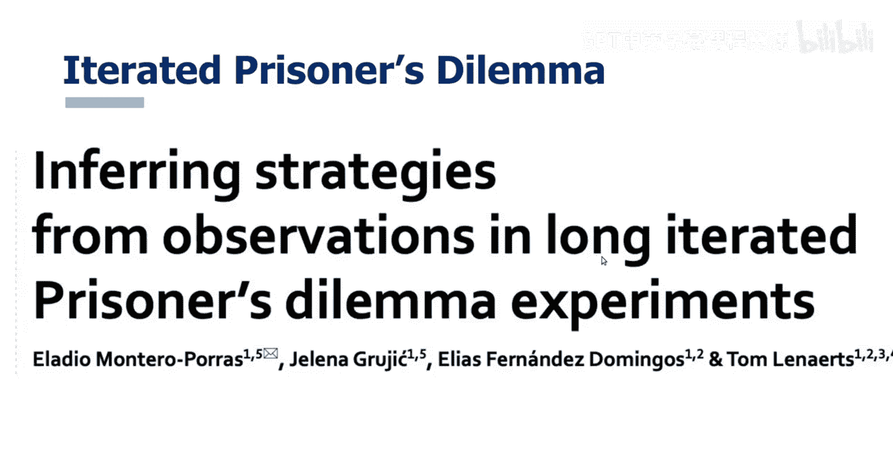

Fixed partners versus shuffle partners and for very long play。

 what sorts of again strategies did they see So your probability。

 if you had a fixed partner and you're tending to see people cooperating。

 you're going to cooperate make sense if they defected even just once in the last two your probability of cooperating went down and if the previous actions were high。

 then you're going to see a disparity between the percent cooperation in the next round relative to the D signal going a little further back in times in terms of probability Now if you shuffle the partners meaning again that they could no longer assume that the strategy was fixed was going to stay stable if you shuffled them then their probability of cooperating after a pair of double operations was reduced So I think this is already interesting again comparing these two to these two again these are previous actions based again just on this list two and percent cooperative next round in the words they're looking in a longer history sets with this second。

note in this case now it's a little bit higher in this mixed strategy so here they became very suspicious very quickly here if they cooperated。

 they tended to stay cooperating here if they were betraying you can see that in this case way up their probability so the idea is that the aspect of whether they were dealing with a fixed partner or software partner in these long plays made a very big difference in their strategy I think that's completely fascinating and these were real people playing long series of games。

What they also did was to then look in terms of clusters so this is cluster A， B， C， D。

 E and F you can think of these as experimental based again on real people and real play behavioral strategies。

 these clusters so were by the analysis that they did ways of saying that these people tended to all stay in a particular behavior pattern。

 different behavior pattern here， different behavior pattern here now note and heres a little bit modest these were students in Brussels that were playing these games so you have to realize that maybe a little bit limited by the numbers of events they had but again these are the precursors so cooperate yes that's first one and just notice how different each of these clusters are I mean maybe contrast these two with this one this one quite different along with these two really again compared to something like this one so the main takeaway from this and the main thing that I just want to hopefully help all of you to see is that you had very different kinds of。

You had different clusters of behavior amongst those people playing you had a difference in terms of whether like in this previous one here。

 whether we had fixed partners or shuffle partners。

 it made a really big difference and I think that's completely fascinating Here's another way of looking at this this is this stochastic network embedding very common way of exploring kind of dimensionality reduction to look at where these clusters embed and to separate them and again just showing that for both the the fixed and the varying partners shuffle were fixed that we had differences in the different clusters again I think really really fascinating Here's another way of looking at it in terms of like a conditional type distribution for these different clusters this is the probability that they cooperate in each of these different settings and again we've got subcls now011 in cluster A in B we had three subcls in C we've got three subcls again。

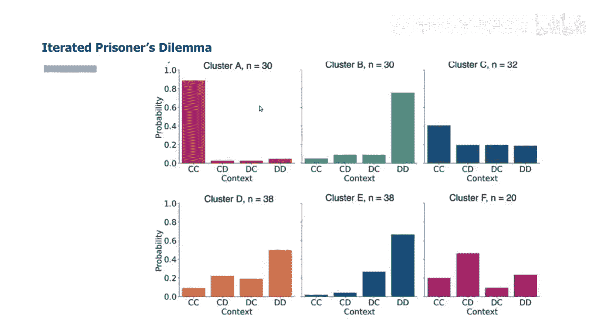

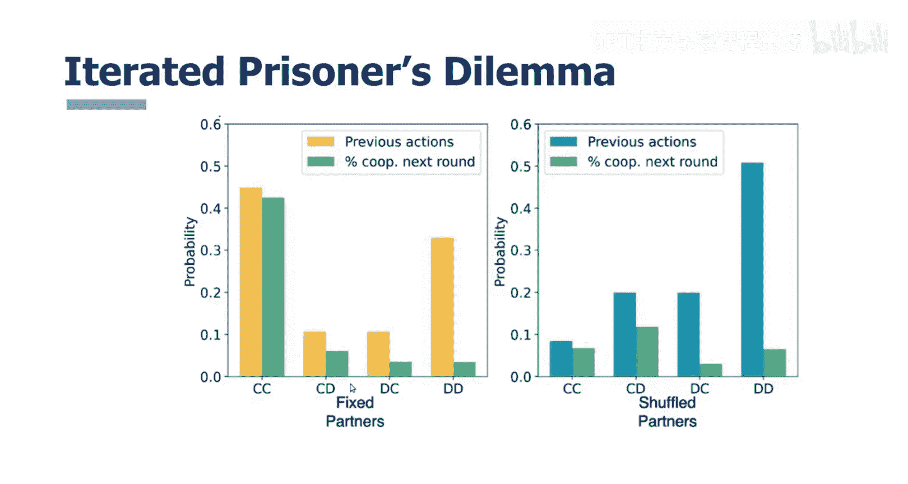

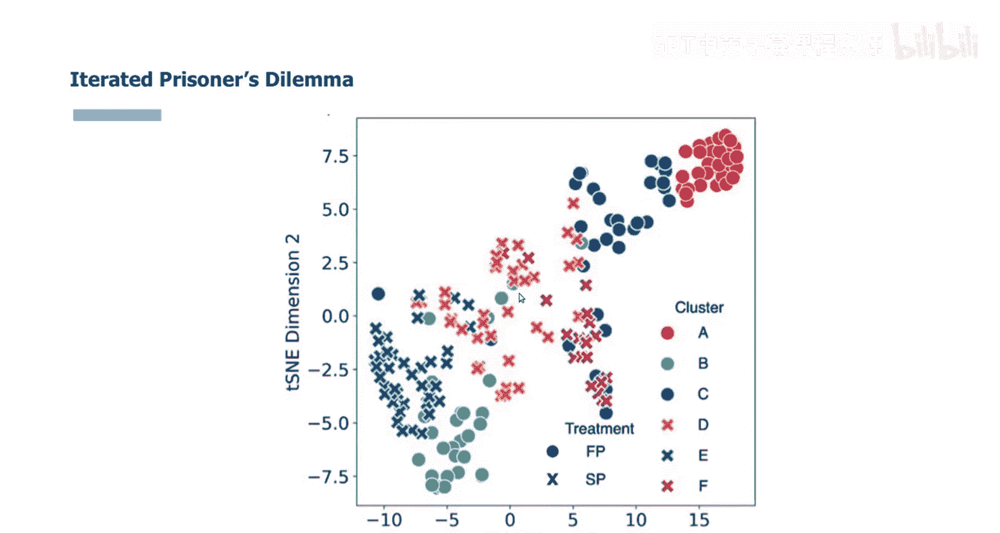

umbers are a little bit modest and then there's an attempt to put air bars on。

 but the thing that I again， you'd emphasize hopefully to see into is that conditioning on CC we're seeing different behaviors。

 conditioning on sayd， we're seeing different behaviors and then for the mixed cases either CD or DCC we're seeing differences in behavior so that's across the clusters and then even to some extent within the subcllus these are a little more uniform except for this case these are almost slightly separated and these are almost almost slightly separated。

 again， somewhat modular that the air bars are know they're a little smaller there on some of them。

 but you pay attention if you're curious of the air bars and the fact again that we've got modest numbers you tend to n equal to or n equal to3 those are fairly modest。

 but the idea again is that we're seeing differences in behavior。

 this is the same thing now for where we've got shuffled this one was fixed this one is shuffled again we're looking in terms of different subcls within these different。

Ones based on our preconditions， again， the fascinating thing is that we're seeing differences in behavior。

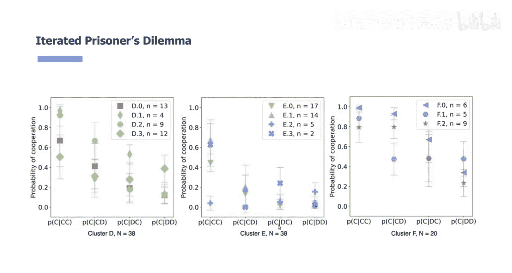

The second paper that I wanted to share and hopefully help you all see a little bit into is the same sort of idea about iterated prisoners dilemma。

 but now what they're asking on is for different kinds of online learning algorithms can we mimic human behavior can we understand in terms of some of these behavior patterns can we see them in terms of some of the algorithms so they in particular don't worry too much about the parameter choices here for the moment。

 they look to say。

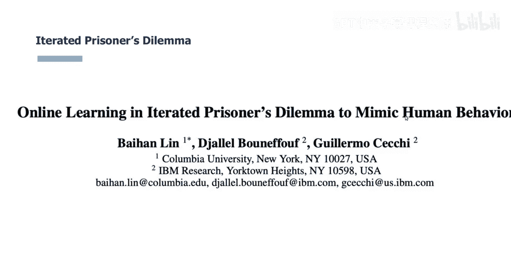

Can we see something like these seven different kinds of behaviors that might signify some sort of breakdown in processing and how do these compare to things like a reinforcement learning nor a multibandit type approach to fitting iterated prisoners dilemma so there's obviously way too much here but I just wanted to give you some feeling for what their results look like。

 so these are different types of algorithms there's Q learning deep Q learning one of the behavior patterns we talked about upper conference bars。

 these are basically all different types of things that could be programmed in for de itated prisoners dilemma and then looking you're going to see that the axes here are the same and all four of these but looking at things for example percentage of cooperation very we're looking at a little bit ago look at the bar here on the side and realized the bar。

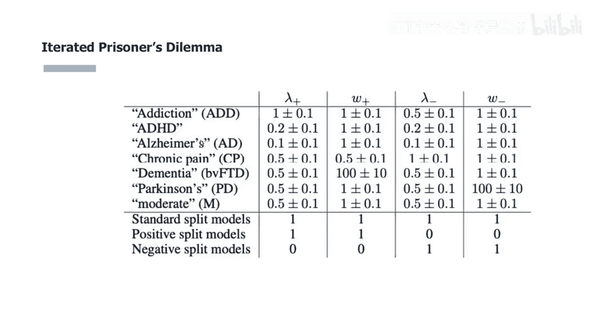

Different for each of these four but these are all pairwise agents。

 so not a multiplayer variant on this game， but looking at percentage of cooperation。

 relative rewards， sum rewards and the normalized reward。

 the cumulative normalized rewards in each of these cases and the thing that's the takeaway that I hope you can all see is that there are differences between the different algorithms somewhat similar to the differences in human behavior each algorithm is reporting a different approach different optimization in playing the iterated percentage of them multiple times and and again I think it's just completely fascinating Here's yet another way of looking at these are the bandits。

 contextual bandits reinforcement learning these were the three main categories of algorithms that we're looking at and then there's different parameters they could put in so for example again going back to this。

 they could put in different parameters in each of these different types of approaches to try and simulate different kinds of human behavior and again what you should see and don't worry too much about all the details。

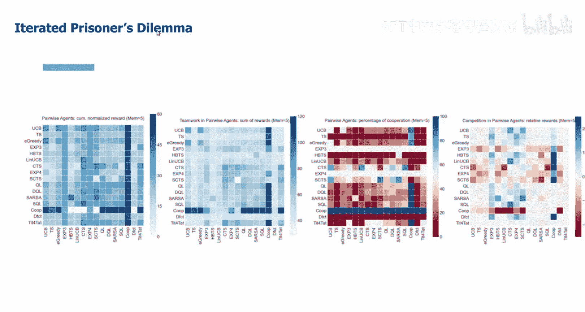

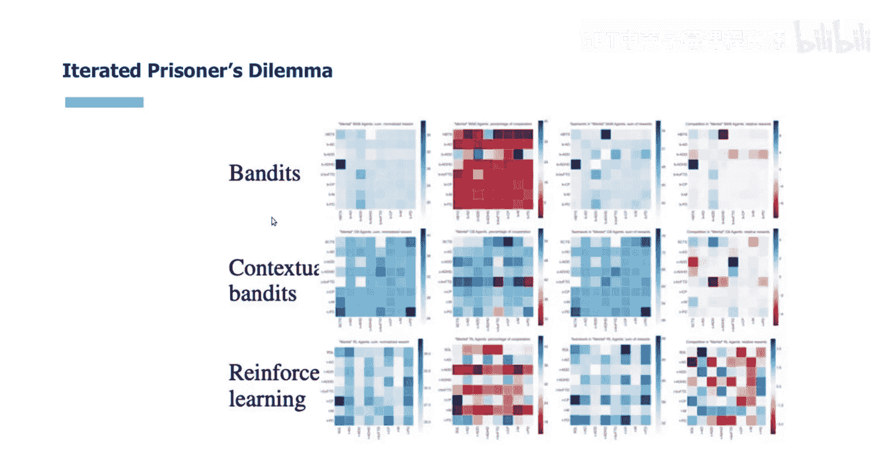

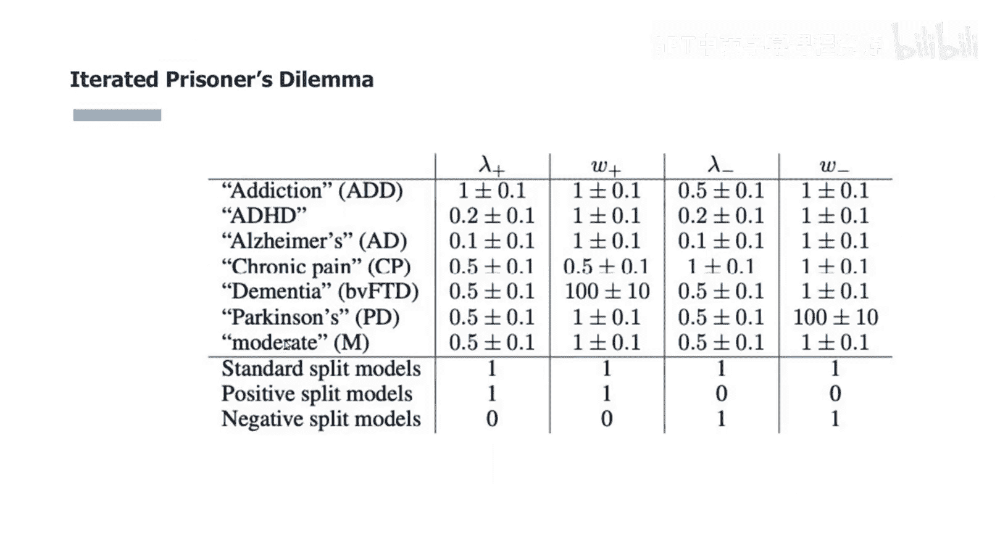

Here is just that there are very big differences and each list of for algorithms in terms of how they would play the game and what they would try and optimize on and what they view as a correct answer。

 So for example in the reinforcement learning algorithm。

 which is basically the markov decision process that we were talking about earlier or MDPs they looked in terms of these doubleQ learning that I mentioned earlier Q learning which also mentioned earlier。

 the SArsRSa， the state action word state action split Q learning and then there's always cooperative COP or DFCT for always defecting and T for ta。

 which we talked about earlier in terms of always follow what the opponent did for the last time and if you compare then this DQl WQ learning versus T for ta in terms of the reward and the percentage of cooperation and you're looking at round So you're looking in terms of where it sort to say was that you can see there's a clear difference between them So again I think completely fascinating that this relatively simple seeming game the had rated prisoners dilemma can lead to some。

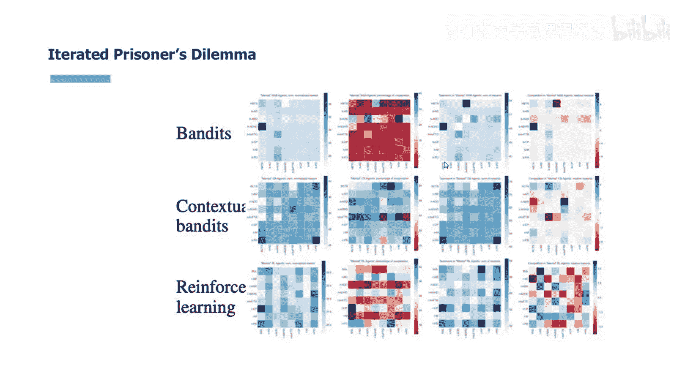

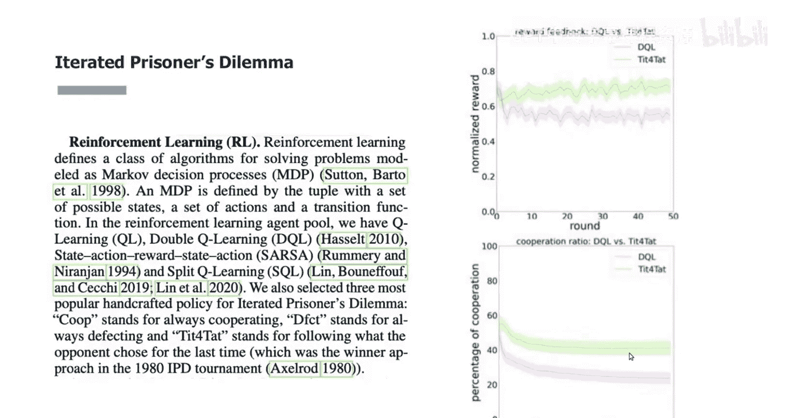

Much diversity so again， in prisoners dilemma in one round you can each cooperate。

 you can each defect if you each cooperate and stay silent， you have a light sentence。

 but the stable point is over here because it's again a form of national equilibriumria you're more likely if you're already over here to not benefit from shifting so if a goes free。

 then we gets three years and vice versa up here。 So this was our basically just the C versus D cooperate versus defect and again completely fascinating that something as simple as this particular game can lead and the rules again in very。

 very simple can lead to such a complex set of behavior patterns and such a complex set of strategies the other thing that I wanted to emphasize is just that when you look at something like this in terms of word and especially the cooperation these have been really interesting models for trying to think about under what conditions do we see the evolution of cooperation do we start to see behavior patterns coming out that are reminiscent。

people working together to do something and so again。

 if we're thinking about solving say a social problem against something like SF Park。

 how do we build by the rules and by the approach some sort of cooperation in other words is there a way to think about getting to win win so that we're doing something like a prisoners's dilemma but in a more complicated setting how do we set bounds again going back to things like Walt。

 how do we set things up in such a way that our behavior now stays within the bounds that we want to design for Okay so I hope that has helped you to see a little bit more into the aated prisoners dilemma again I think of really fascinating game Thank you。

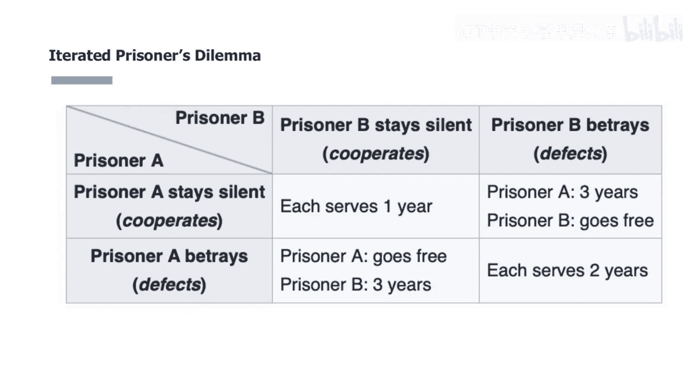