# 数据科学：时间中的决策：6：囚徒困境的计算建模 🧠

在本节课中，我们将探讨迭代囚徒困境的另一个有趣方面。我们将通过两篇研究论文，分析在不同条件下，人类和算法所采取的不同策略。课程将首先介绍一项关于真实人类玩家长期行为的研究，然后探讨机器学习算法如何模拟这些行为模式。

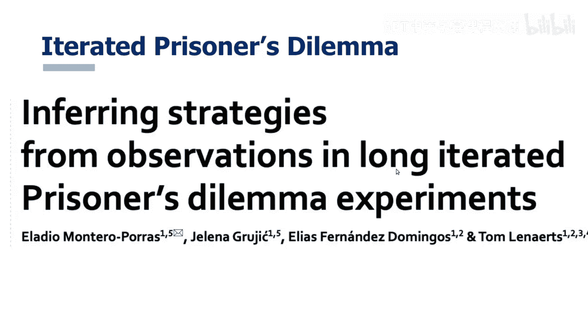

---

## 概述：人类策略的多样性

上一节我们介绍了囚徒困境的基本概念。本节中，我们来看看在长期、多轮的迭代囚徒困境游戏中，真实的人类玩家会发展出哪些策略。一项研究通过将参与者分为“固定搭档”和“随机搭档”两组，并观察他们在大约100轮游戏后的行为模式，揭示了合作策略的复杂性。

以下是实验的核心设置与观察结果：

*   **实验设置**：参与者被分为“固定搭档”或“随机搭档”两组，进行长期（约100轮）的迭代囚徒困境游戏。玩家的决策仅基于过去两轮的历史（CC：双方都合作，CD：己方合作对方背叛，DC：己方背叛对方合作，DD：双方都背叛）。
*   **固定搭档策略**：当玩家与固定搭档对弈时，如果对方在过去两轮都合作（CC），则己方下一轮合作的概率很高。如果对方在过去两轮中至少背叛过一次，己方合作的概率会显著下降。
*   **随机搭档策略**：当搭档被随机打乱后，玩家无法依赖稳定的对手策略。此时，即使在CC（双方都合作）的历史后，玩家下一轮合作的概率也会降低，表现出更快的“怀疑”倾向。

研究还通过聚类分析，识别出了玩家中存在的多种不同行为模式（聚类A到F）。这些模式表明，即使在相同的游戏规则下，不同人群也会发展出显著不同的长期策略。

---

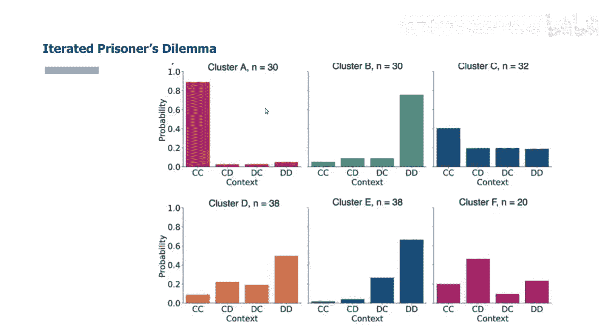

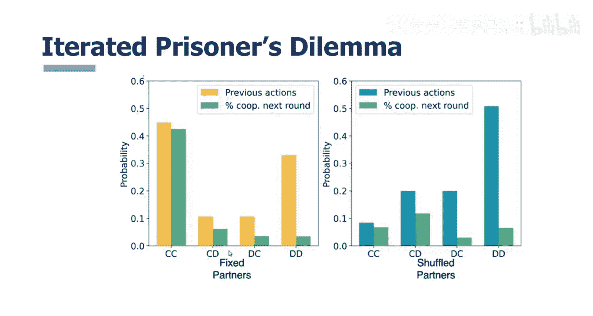

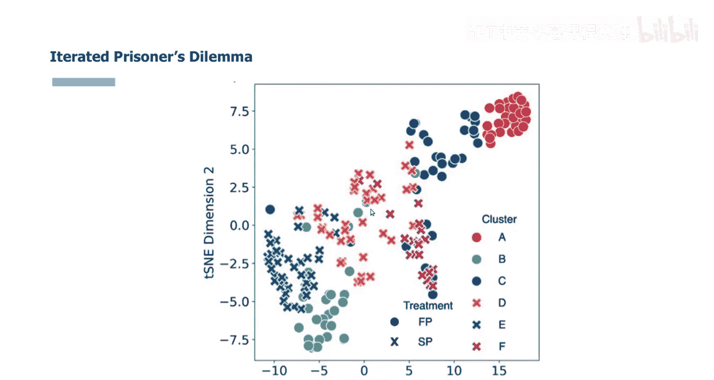

## 从人类行为到算法模拟

了解了人类在迭代囚徒困境中的行为多样性后，我们自然会问：算法能否模拟或理解这些行为？第二篇论文探讨了不同的在线学习算法在玩同一游戏时的表现，并将其与人类行为模式进行比较。

以下是论文中对比的几种主要算法类型及其核心思路：

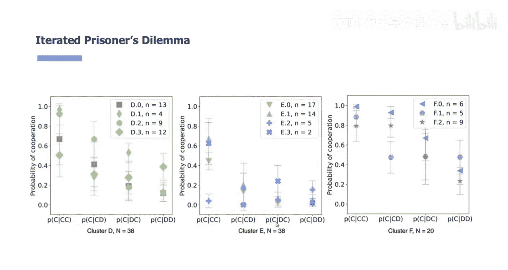

*   **多臂老虎机**：将每次决策视为在不同“手臂”（合作或背叛）中选择，以最大化即时或长期奖励。
*   **上下文老虎机**：在老虎机的基础上，考虑了游戏状态（历史记录）对决策的影响。
*   **强化学习**：基于马尔可夫决策过程，智能体通过与环境互动来学习最优策略。具体算法包括：
    *   **Q学习**：学习一个动作价值函数 `Q(s, a)`，表示在状态 `s` 下采取动作 `a` 的长期期望收益。
    *   **深度Q学习**：使用神经网络来近似复杂的 `Q` 函数。
    *   **SARSA**：另一种基于状态-动作-奖励-状态-动作序列的策略学习算法。
*   **简单策略基线**：
    *   **全合作**：始终选择合作。
    *   **全背叛**：始终选择背叛。
    *   **以牙还牙**：第一轮合作，之后每一轮都模仿对手上一轮的行为。

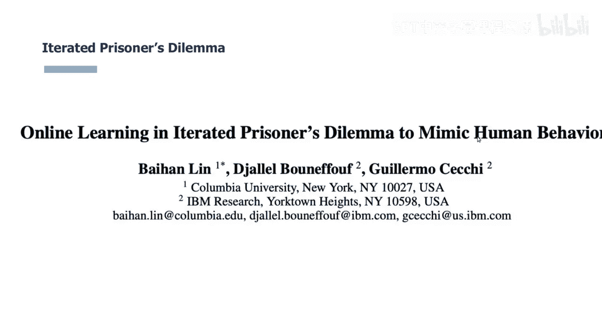

研究发现，不同的算法优化了不同的目标，从而产生了差异化的行为模式。例如，比较深度Q学习和“以牙还牙”策略，在合作率和累积奖励等指标上存在明显区别。这类似于人类玩家中观察到的不同行为聚类。

---

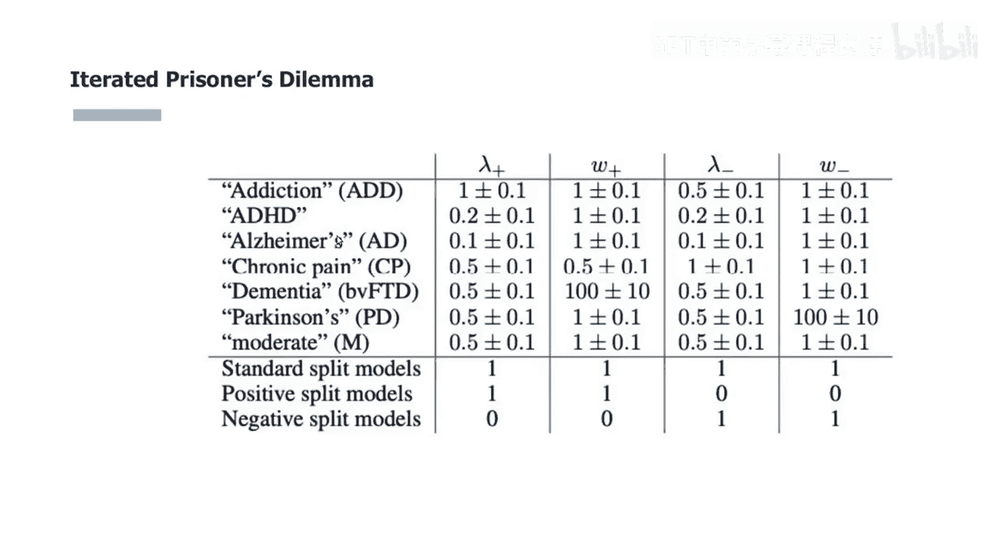

## 核心启示与合作演化

这个看似简单的游戏——囚徒困境，其单轮收益矩阵可以表示为：

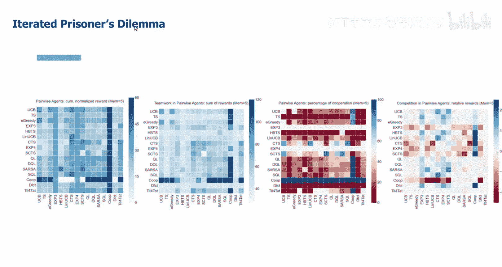

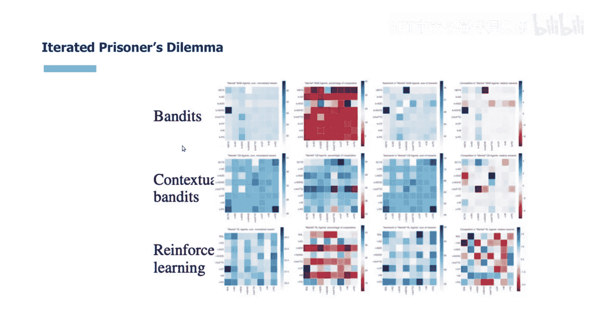

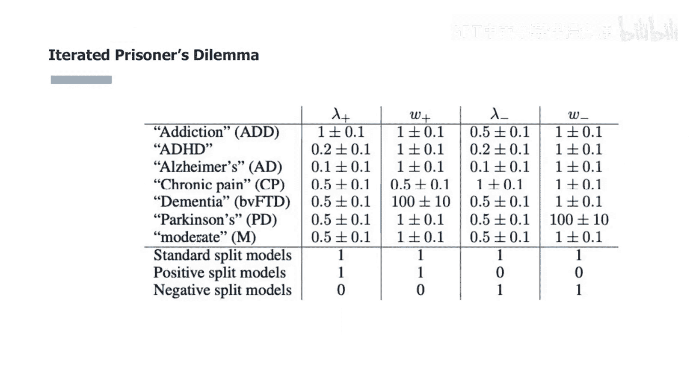

| 玩家A \ 玩家B | 合作 | 背叛 |
| :--- | :--- | :--- |
| **合作** | (-1, -1) | (-3, 0) |
| **背叛** | (0, -3) | (-2, -2) |

（数字代表刑期年数，数值越小越好）

在单次博弈中，双方背叛是唯一的纳什均衡。然而，在迭代游戏中，它却能引发极其复杂多样的策略和行为模式。

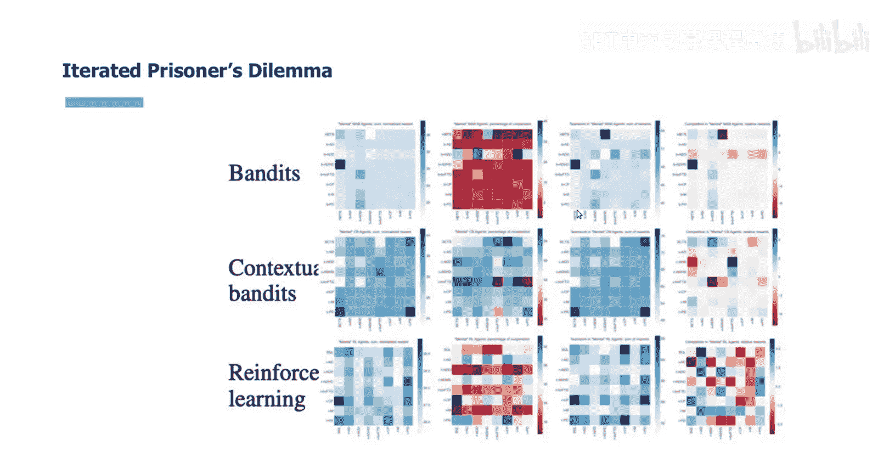

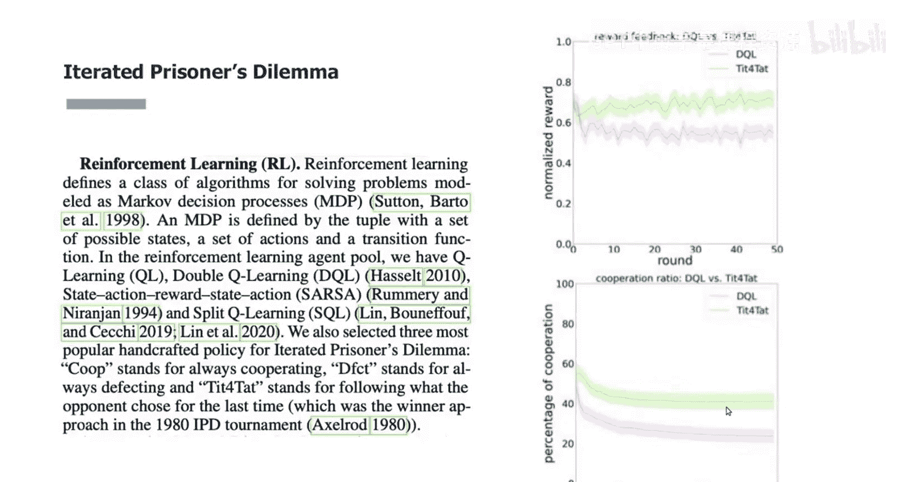

这项研究更深远的意义在于，它成为了思考“合作如何演化”的经典模型。它帮助我们理解，在何种规则和条件下，自私的个体之间能够自发地产生合作行为，从而实现双赢。这为解决更复杂的社会协调问题（例如公共资源管理）提供了思路：我们如何设计规则和互动框架，引导群体行为朝向期望的合作方向发展。

---

## 总结

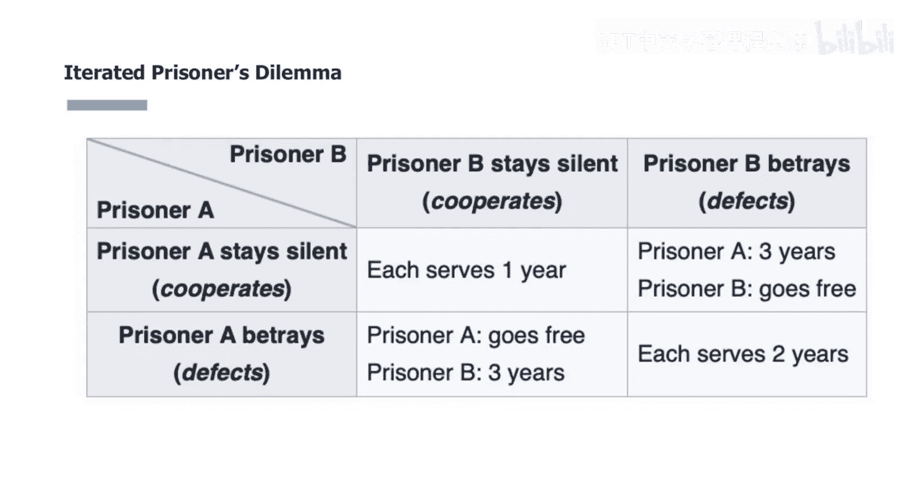

本节课中我们一起学习了迭代囚徒困境在计算建模方面的深入探索。我们首先看到，在长期互动中，人类玩家会根据搭档是否固定而采用截然不同的策略，并形成了多样的行为模式集群。接着，我们了解到各种机器学习算法（如强化学习）在模拟此游戏时，也会因优化目标不同而产生各异的策略，部分反映了人类行为的多样性。最后，我们认识到这个简单模型是研究合作演化与复杂社会行为涌现的强大工具，为设计促进协作的机制提供了理论参考。