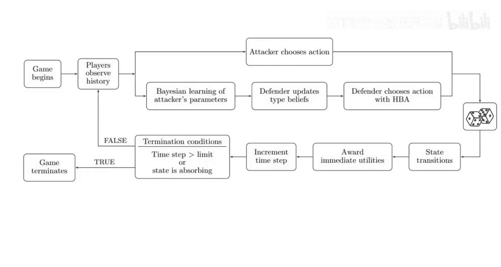
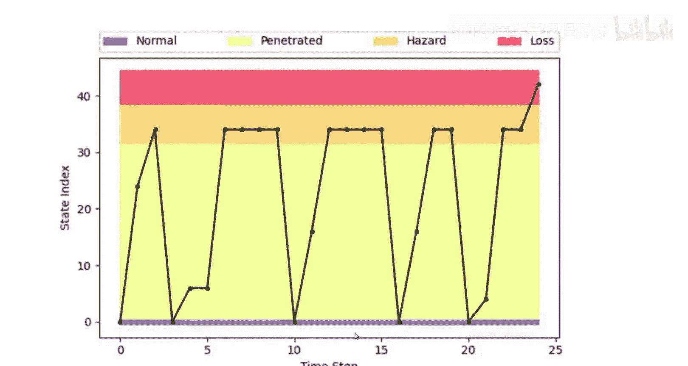
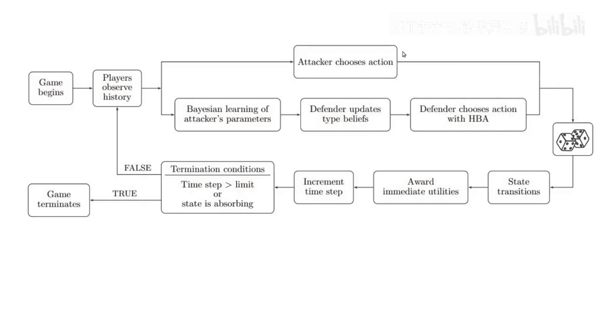
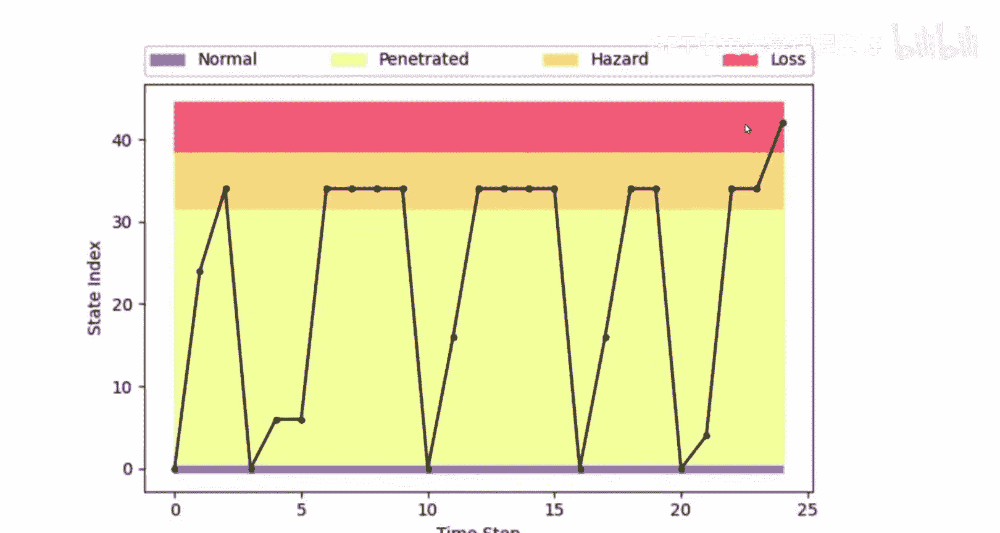
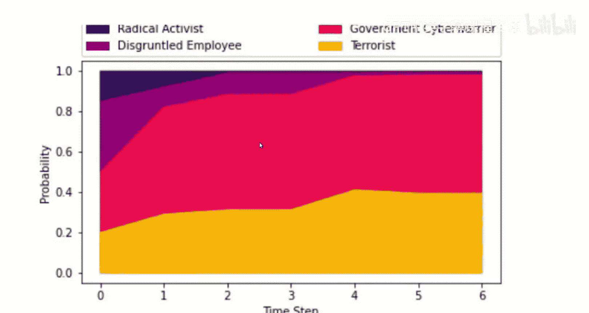
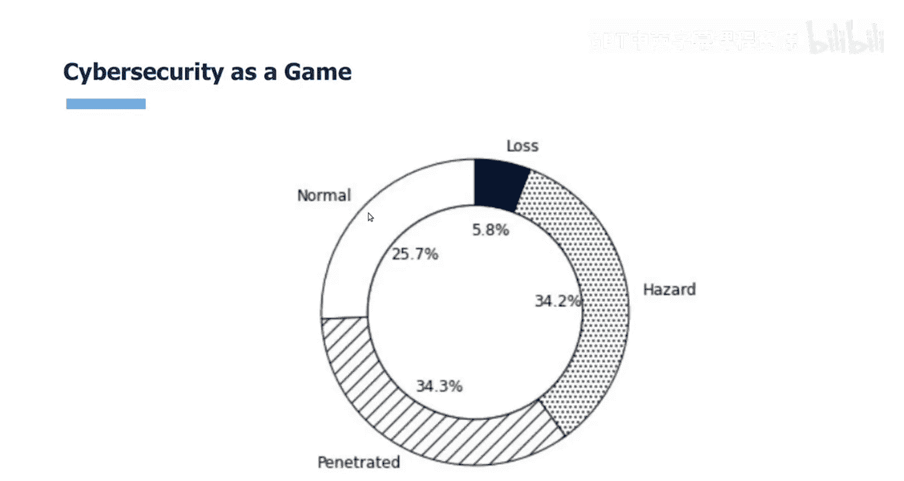

# 约翰霍普金斯大学《数据科学：时间中的决策｜Data Science Decisions in Time》中英字幕 p40 7_网络安全攻击者预测模型.zh_en -BV1NCuzzfEJa_p40-

We'll I' talk about cybersecurity as a game， This is a nice extension where we've been so far。

 it's really trying to think about cybersecurity type settings as attackers and defenders。

 almost like two people being accused of a crime jailed separately and what do you do but in this case in some ways a little more real potentially even a little bit more scary what do you want to do as an attack。

 what do you want to do as a defender and how do you try and optimize as a cybersecurity say person to prevent something of a bad outcome So if we think about this as one of the scarier ones in my mind。

 nuclear power plants that might be attacked， you could imagine having more than one type of person who could be attacking the power plant。

 one might be said is's going to comp another one might be a terrorist and there are different kinds of attacks that they would do and so you would need to fairly quickly if you were in the role of trying to protect you would try and figure out what is motivating the attack。

The probability of the different types obviously is an important one and then you've got to think about your defenses so the different kinds of defenses you would make and so you'll recognize this as each one of these grids is very similar to the prisoner's dilemma where again we had in the case the prisoner's dilemma。

 we had something like both silent both revealing one rebelted one not one reve and one not or so to speak I think we called it betray or not betray you know and here we're somewhat similar we've got to think in terms of our defenses defense1 defense2 attack1 and T2 and you've got to think about the point systems unless they're not identical between the two different types coming in and they're attacking with different probabilities so if you're really thinking in terms of as hypersecurity and this journalists fairly quickly I mean you could think of this as in the paper I'm pulling from on nuclear power plants。

 you could be thinking about that or you could be thinking in terms of something entirely different maybe like an airplane or maybe like。

publicub service utility eitherith way， you could imagine disced employees and terrorists and you've got to think of defenses against them and you've got to think of the attack modes that they would bring in。

 and so this is an important aspect if you're thinking of cybersecurity as a game you've got to make a matrix a little bit like this you can also make a decision tree again these are stepped we've been talking a little bit about these for example。

 with the iterated prisoner dilemma effectively what you want to do is you start with one point and then you think about perbilities of transitioning and what you're thinking about our actions。

 these are these little a's and it's a series of actions at the end you end up with utility functions so these are these little use and what you're ultimately trying to do is understand the likelihood of ending up in a one of these states on the other side so think about in this instance。

 just to try and make it a little more concrete for you imagine you've got different types of attacks and defenses coming in in this case for and this is then goingned into these different states you can see these arcs here and then from these arcs you've got another set。

Of actions that could come out that's going to then transition into another state set of states here and another set of actions。

 This can continue well and then branch on and as the number of states and actions gets higher。

 obviously the ability to make a tree like this and to assign utility functions like this it harder but for many relatively simple games and certain kinds of cybersecurity games。

 you could make these kind of trees and obviously if you could make a tree like this。

 you could start to think about these utility functions very deeply you could think about how to improve your actions。

 you could think about the likelihood of these different branches it gets a very concrete way of thinking about this kind of a staged game So if we think about this cybersecur is a game again in the case of a power plant。

 but it could be generalized to many other sorts of things you can think about different kinds of losses and ideally what you would be doing if you're really trying to be careful about it you also want to put a price tag on each of them the advantage of doing that is that then you can imagine how much money to put in in terms of trying to prevent any one of these particular attack venues from happening they're trying to think through the scale。

loss if it happens so you can decide a probability and a consequence if it happens。

 which is usually a range I mean it's obviously you can think of an up a lower bound on it in the case of a power plant。

 maybe it's power generation or environmental damages， personal injury。

 damage public opinion or equipment damage core damage if it's a nuclear loss of sensitive data these are all potential losses with different price tag and if you're thinking of cybersecur is a game。

 this is one of the things you' need to do is to really think through the scale of the losses and then you've got different threat agents so this is very similar to a diplomacy but we had different strategy types。

 different kinds of players in the case of a power plant or again something similar this is really meant as a placeholder for any sort of cybersecurity type attack you want to be thinking about what kind of agents do you have that are trying potentially to break in or to do something anarchco or civil activist or a competitor。

 some sort of corrupt government official or cyber band or data minor just going to employ that was the we started with or a government cyber warrior maybe a government spy or an internal spy。

irrational individual or legal adversary， maybe a mobster。

 maybe a radical activist or sensationalist terrorist that then we started with or ay for a vendor each of these agents is going to have a different set of skills。

 a different mode of attack， different strategy ultimately for how they're going to be coming in so if you're trying to protect against any one of these you've got to think about what they are and how they're likely to come in it's almost like a role playing game you've got to really think carefully about what each of these people might be bringing in some of them are going to be potentially having some inside or insider information like a former employee。

Some of them could be government sponsored， some of them could be larger criminal activity member。

 some of them could be terrorist and maybe even a state sponsored terrorist， some could be a thief。

 they're going have very different skills out very different approaches and so as a cyber warrior and a game youd have to think where are they coming from。

 what are they doing Here's in the way of thinking about this these are just a small subset of the ones we started with the threat agents。

 their motivations， their limits in terms of what they can do and then you can think about the different types of contributions that obviously just xes at this point on the different kinds of losses and damages and and what they might be doing so it's a way to be thinking very carefully about for each potential strategy that might be taken against particular effects so you can think these people again trying to cause damage to something like a power plantt you can think about the scale of damage each one might be able to do and you can think about whether there's a business advantage or damage。

or embarrassment or technical advantage to what they're trying to do and this goes to trying to think through the motives and the plans of attack that each of these individuals coming from each of these different approaches might come in so again these are the different threat agents again just taking a subset all the ones we started with then thinking about what kind of access they would have and resources they might have what sort of skills they might have or visibility they might have and then trying to put numbers now on the damages and then put an overall risk on so in this kind of game for cybersecurity this would be an important way of thinking about it。

 making a table like this so that again you can try and mitigate the risk as much as possible by thinking about the scale of damages and by thinking about the motivations of each of these different threat agents so obviously again very important if you're playing this kind of a real life game and a cybersecurity type game so here's another way of plotting it here's risk for a fairly large set of those individuals and the scale potentially a risk you can see that at the top we'll call it the top four。

Radical activist is going to employ government cyber warriorrior and terrorist right and we started with the terrorist and this going to employ as to examples know the bottom would be something like anarchist or a moster or a thief still causing a huge amount potentially have damage but less on this log scale than these four at the top and so that would mean you would want to especially be trying to rollplay and think through the potential downside of trying to have an attack venue from any one of these four and how you could prevent that and that would going be part of thinking this as a game and trying to prevent an escalation of state so if you think about it as a game you might have something like a normal state you might have some to penetrated state。

 you're trying to roll it back you might have it go up from penetrated state escalated state again you're trying to get it to roll back or even up to a hazard state and again you're trying to get it to roll back to a normal state what you don't want is to come into this lost state so if you're thinking about this as a game you're thinking about probability of moving into each of these three states and you're trying to。

This kind of a lost state from happening and again this would be thinking of this just like a prisoner's dilemma。

 it or a prisoner's dilemma where you've got stages and if it reaches any of these three stages。

 you're trying to prevent it as much as you can So isns another way of thinking about it the game begins。

 you've got players you're observing the history you're trying to understand what's going on you've got some sort of attacker you as a defender or trying to understand and you can through this to this kind of Bayesian learning method you're trying to understand the attackers parameters。

 their approach and you're trying to update your beliefs based on what you've learned that be part of the Bayesian learning。

 and then I'm not going through that right at the moment。

 but you can use particular methods to try and update your actions to try and pick the best action and so there's a HBA method which is one particular way to try and choose it but the main thing is to realize that you can update depending on your observation and then maybe a role because maybe you've got a role that eye to pick which method you're going to defend on。

because you updated and this would be a form of dynamic strategy where you're trying to probabilistically determine which one is best and then you update whether there are straight transitions which again you're trying to avoid。

 you want it to stay in these three or especially the normal state so then you observe state transitions。

 you forget utilities just like in that decision treee type setting I showed a moment back then you're can commit your time step and then you can decide whether the game terminates or whether it comes back and you keep observing and keep playing。

 so this would be a way and I think anyone who's worked in cyberse type settings or seen some of the effort to try and control and protect against cybertect things has seen stuff like this where you can play these kind of games out and try and decide whether against particular types of dive roles and types of attackers whether location is sufficiently secure that people are willing to take on the risk。

 so this is sort of thing you might imagine。

Happening these are now time stepss， these are stated disease so that we had normal penetrated hazard and loss so these are penetrated hazard loss meaning taking out this escalated one for now。

 So these are the four states and so you're starting with normal and then against one particular type of attacker you can see that this case they able to get up fairly consistently into this hazard realm and then in the game type play they could after a certain number of steps take it into the loss realm。

 which obviously one would want to try and prevent as much as possible Another way of thinking about this which I think is kind of fun is imagine trying to figure out again what type of agent is on the other side。

 so you're playing defense against someone trying to say break into a power plant you might start off assuming that its somewhat equally likely for any one of these four types and as time goes on you're updating your beliefs about what kind of attack is being waged and who's waging it and so you can see by the end here you're thinking it's one of these two on this side。

So much one of these two on this side So you can see these are going down and this is just a type of plot where with these four things that always sums to one。

 and so you're updating your belief at each time step about what kind of attack is going on and obviously that's very important for game play type setting you're trying to figure optimal strategy in your optimal set of actions against a particular attack type you've got to figure out as much as you can about what sort of individual or set of individuals is attacking So here's a kind of summary figuregu to help you think about what's going on。

 So again， we've got our different states here our normal penetrated hazard and loss。

 thinking what's going around a wheel what you're trying to do is make this loss function be as small as possible So in words if you think of all possible states over say the lifetime of the object you want to have that be as small as possible you obviously also want to have the hazard and penetrate it as small as possible and the normal as big as possible So the numbers here could vary a lot depending upon what kind of system you might be。

Protect and seen it as a game， but I think this frame of viewing cybersecurity or almost any sort of an attack and defense sort of thing as a staged game is actually a very fruitful way of thinking about how the methods we've been talking about again going back to Wal and trying to get a plant to say operate in a normal level always producing widget say within a particular realm of what you want them to be。

 this is really a nice extension of these original concepts that we started off our four courses on So again。

 cybersecurity in this instance we're trying to think about the different states and we're trying to prevent it from going into this less states。

 So it's almost like a control chart we're trying to take preventive actions so that we stay as much as possible in the normal realm and don't go into these other states and we do that by observing and by thinking about what are the things that are trying to push it off from this normal state。

 what are the things that are trying to prevent it from continuing on maybe 100% of the time in the normal state。

 what are the risks， what are the things that are not helping us。

In that role of trying to maintain a normal operation。

So okay， with that， we'll pass and down hope you enjoy this one， thank you。

