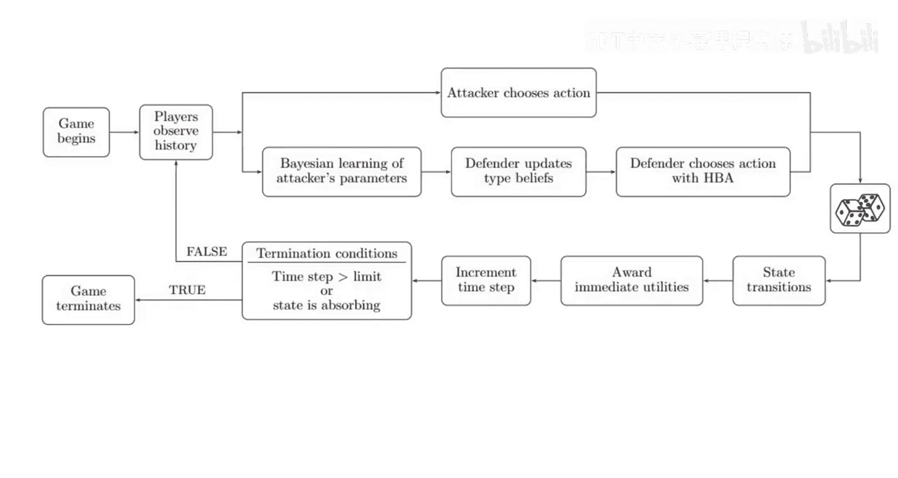
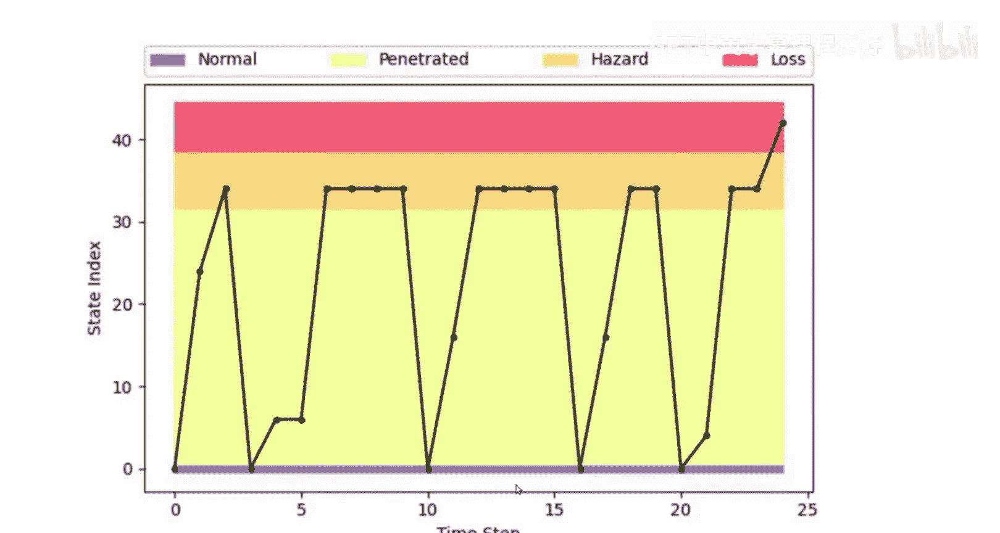
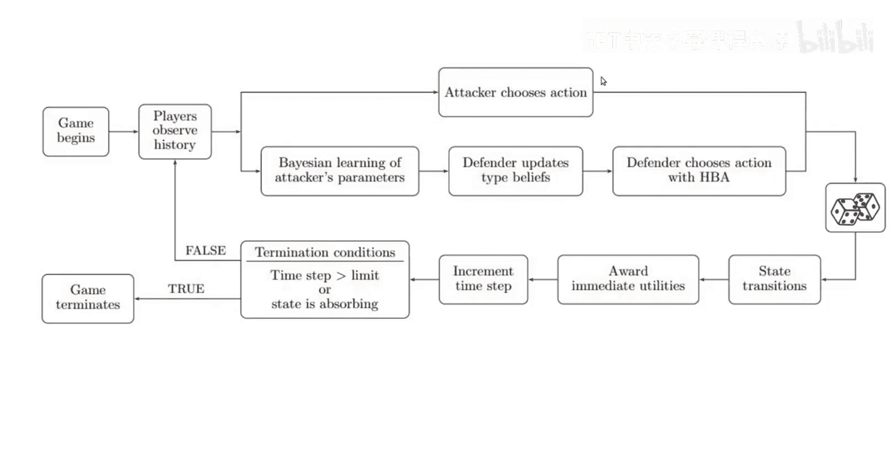
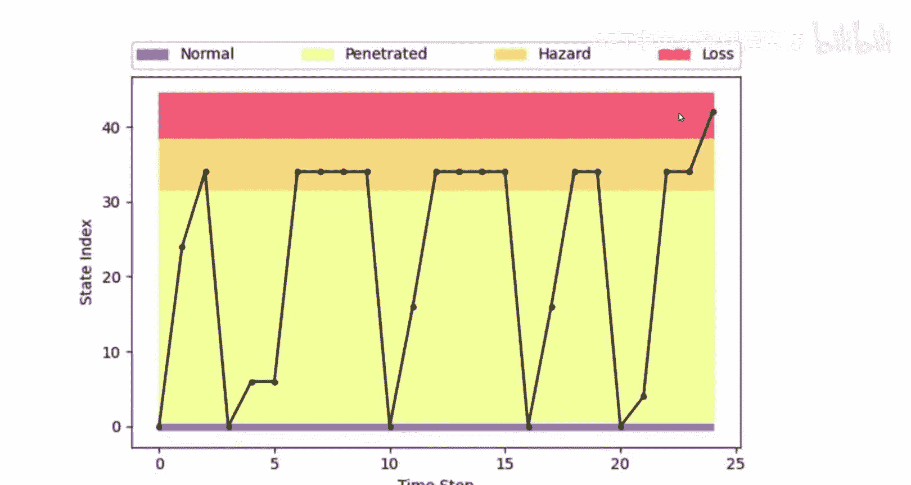
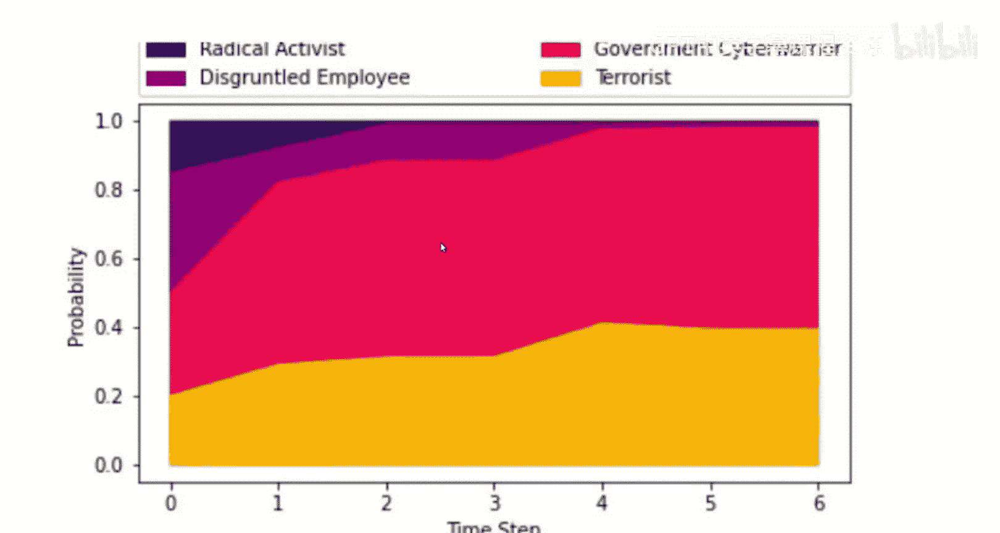
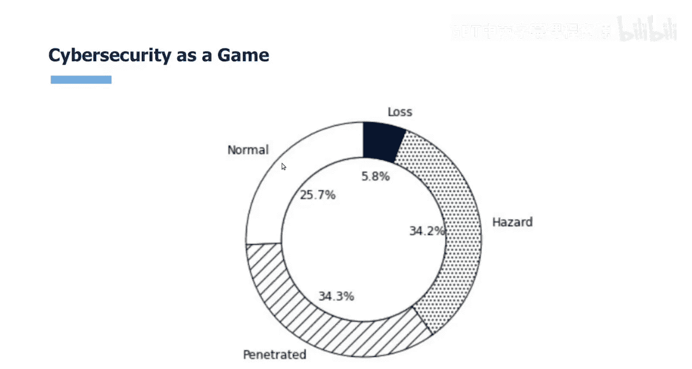

# 数据科学：时间中的决策｜7：网络安全攻击者预测模型 🛡️

在本节课中，我们将学习如何将网络安全问题建模为一个“博弈”过程。我们将探讨攻击者与防御者之间的动态关系，并学习如何构建模型来预测攻击行为、评估风险并制定最优防御策略。

---

## 网络安全作为一场博弈 🎲

上一节我们讨论了博弈论的基本概念。本节中，我们来看看如何将其应用于网络安全领域。核心思想是将网络安全场景视为攻击者和防御者之间的博弈，类似于囚徒困境，但情境更真实，后果可能更严重。防御者的目标是优化策略，以阻止不良结果的发生。

## 构建攻击-防御矩阵 📊

我们可以用一个矩阵来描述这种博弈，这与囚徒困境的收益矩阵类似。在网络安全场景中，我们需要考虑不同的攻击者类型和防御措施。

以下是构建此类矩阵的关键要素：

*   **攻击者类型**：例如，黑客、恐怖分子、内部员工等。不同类型的攻击者有不同的动机和能力。
*   **攻击模式**：攻击者可能采取的不同攻击方式。
*   **防御措施**：防御者可以部署的不同安全策略。
*   **收益系统**：每种“攻击-防御”组合对攻防双方造成的后果（收益或损失）。不同攻击者类型的收益可能不同。

其核心结构可以表示为：
`收益(防御者， 攻击者) = f(防御措施_i， 攻击模式_j， 攻击者类型_k)`

## 利用决策树进行推演 🌳

对于多阶段的复杂博弈，决策树是一个有效的分析工具。它可以帮助我们可视化不同行动序列导致的可能结果。

以下是决策树的基本构成：

1.  **节点**：代表系统状态（例如，正常、被渗透、危险）。
2.  **分支**：代表行动（攻击或防御行动）。
3.  **概率**：每个分支上标注了采取该行动或转移到下一状态的可能性。
4.  **效用函数**：在树的末端叶子节点，标注最终结果的效用值（或损失值）。

通过计算不同路径的期望效用，防御者可以找出最优的行动序列。

## 评估损失与识别威胁代理 💰

若要将网络安全视为一场严谨的博弈，必须量化潜在损失并具体化威胁来源。

首先，需要评估不同攻击可能造成的损失规模，并为其贴上“价格标签”。这有助于决定投入多少资源进行防范。损失类型可能包括：

*   生产中断
*   环境损害
*   人员伤亡
*   公众信任丧失
*   设备损坏
*   敏感数据泄露

其次，需要识别具体的**威胁代理**（即攻击者）。不同的代理拥有不同的动机、技能和资源。例如：

*   **内部员工**：可能拥有内部信息。
*   **恐怖分子**：旨在造成大规模破坏或恐慌。
*   **政府支持的黑客**：拥有强大资源和先进技术。
*   **网络犯罪团伙**：以经济利益为主要目标。
*   **激进活动家**：可能为了宣扬某种理念而攻击。

理解这些代理的特点，是制定针对性防御策略的基础。

## 动态策略与贝叶斯学习 🔄

在实际博弈中，防御者并非一成不变。我们可以通过**贝叶斯学习**方法，动态更新对攻击者的认知，从而调整策略。

这个过程可以概括为：

1.  **观察历史**：防御者观察攻击者的行为。
2.  **更新信念**：根据观察到的行为，利用贝叶斯定理更新对不同攻击者类型及其策略的信念（概率分布）。公式可以简化为：
    `P(攻击者类型 | 观察数据) ∝ P(观察数据 | 攻击者类型) * P(攻击者类型)`
3.  **选择行动**：基于更新后的信念，选择当前最优的防御行动（例如，采用HBA等方法）。
4.  **循环迭代**：继续观察、更新、行动，形成一个动态的防御循环。

## 系统状态与风险控制 📉

我们可以将系统的安全状况定义为几种状态，防御的目标是尽可能使系统保持在“正常”状态。

典型的系统状态包括：

*   **正常状态**：系统安全运行。
*   **被渗透状态**：系统已存在漏洞或被初步侵入。
*   **危险状态**：攻击已造成实质性威胁。
*   **损失状态**：攻击已成功，造成重大损失。

防御者的核心目标是：**最大化处于正常状态的时间，并尽一切可能避免进入损失状态**。这类似于质量控制图的思想，通过预防性措施将系统维持在可控范围内。

---

本节课中，我们一起学习了将网络安全问题建模为博弈的方法。我们从构建基础的攻击-防御矩阵出发，探讨了利用决策树分析多阶段博弈，学习了如何量化损失并识别具体的威胁代理。最后，我们介绍了动态防御策略的核心——贝叶斯学习，以及通过状态管理来控制整体风险。这种将网络安全视为阶段性博弈的框架，是理解和应对复杂网络威胁的一种有力工具。