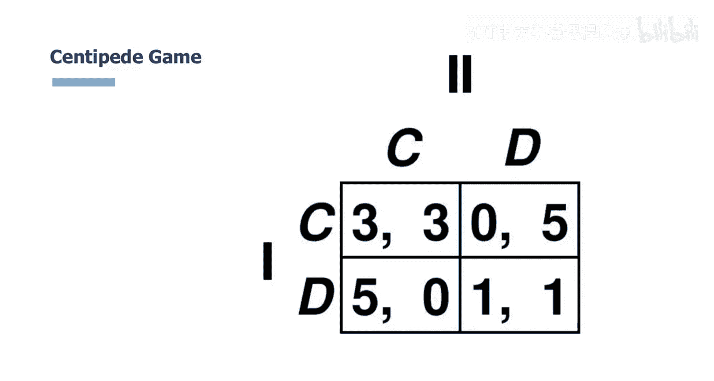

# 约翰霍普金斯大学《数据科学：时间中的决策｜Data Science Decisions in Time》中英字幕 p41 8_逆向归纳法与蜈蚣博弈.zh_en -BV1NCuzzfEJa_p41-

We not talk about a classic way to reason from the end。

 a backward induction method for solving games。 This works very well in many games。

 especially those with complete information where you can write a table and we'll have problems related to this as well。

 another thing connected to this is key level ideas this is another way of rationalizing what your opponent might be doing it's getting at strategies in games So we'll start this comes from Wikipedia with the idea of backward induction So imagine you've got two people that want to see different movies and are also debating whether to go to the movies or stay home So they've got two stages to their game。

 The first stage is one of them say player one we'll pick a movie the moment just assume it's just two movies and then player two seeing what player one is picked we then pick a movie and then based on those decisions stage two is whether to go to the movie or stay home and you can see again this is very similar to the prison's dilemma we've got a table here which says the benefit or decrement to player one。

And then the second number is for player two so player one and player2 multiple stages and we can effectively make a decision like3 based on this and then we can look over here at the end nodes and so we can say for player1 these are all the rewards and that first of pair and in the end here is all the ones for the second player so player1 starts they're picking joke or Terinator player two knowing what player one is picked picks their movie and then that's the stage1 and then in stage two player1 is again picking whether to stay or go home at the different conditions and then player two here at the end as the final decision so player2 could look at these scores in the right column here again their player2 so they're the second number and they could say。

 oh it's better here at the very top if I pick 11 so that would be going and so now I'm going to work backwards from that backward induction so we start here that's player two's decision player1 now can pick go and then that means that it's going to be joke。

And that means it's going to be jokeker all the way back there。

 so that means that a optimal decision has been reached at this particular game by looking at the ending distribution the possibility。

 it's almost like a comeic type algorithm。looking at all the options。 and then you're saying。

 okay based on the scores and obviously you have to know these scores。

 you have to know these tables but knowing the scores and then just picking the optimum in that score。

 you can reason backwards and say all the decisions that had to happen at the beginning to support that。

 So for many games you can do that for many games where you can write these kinds of tables out and reason backwards。

 So this is one for a movie there's a very famous one。

 somewhat similar to the prisoner's dilemma in some ways another one that has potential to apply to a lot of situations really another fascinating game。

 you can think about it as two piles of coins or two piles of something valuable that are put in the table。

 but each player has an option sequentially again to pass or to take So in alternates play between the different players and you can imagine different values here。

 So we're indicating in the second number here which stage of the game it So you see we're going from one to two to three to4 to5 to6 and then we can also。

For each player how much money there is involved and there's many variations on this game with different values in these xes。

 but the play is very simple。 you're either going to take it the first time or take it the second time or the third time or always pass。

 these are effectively just different strategies in the game。

 The fascinating thing is if you do something like this where youre using backwards。

 The way it's usually set up with these rewards it's always going to be the case that fully rationally。

 the very first player systems thatre going to take they're not going to let the game going further。

 But in reality when you test people with this game。 they instead tend to let it go out。

 which is almost a formal cooperation， other words they're more likely to end up further up in this set of moves。

 So here's some examples of different games。 So as I mentioned you can vary the rewards on the bottom。

 there's also a terminal reward which is on the far right here。

 it you can have like a sixt one which all these are or any other set of stages and effectively what you're saying is if you've got all the way to the end。

 that's。How much the first player would earn， that's how much the second player would earn so again。

 going back to the rewards that's the standard way of presenting the information。

 Now of course most people seen this are not going to used to this way looking at it not 10% sure why they call it a centipede game when it's only coming out with legs on one side and on the other but think about it's looking on the side would be my possible on that you've got two legs almost coming out and they're collapse down so you can think that it's almost a centipede where it's kind of looking down looking at it from the side and you can't see the second leg I'm not sure that's the best way to say it that anyway you can see these are all different you know the first column here is the same first column here is the same but here note that it' symmetrical and the first one here it's asymmetrical in the first one and then what you've got is different roots for how the rewards shift through this and so what people have played with psychologically and by testing either person against computer or individual players or even multiplayer type variance。

Under what conditions people are going to let it go up to different levels as you alter again play in this pairwise type game or a multiplayer game you could imagine going out further。

 what kind of decisions do people reach and why do they reach those decisions and so that regard it's another fascinating example of a sequential argument and one could say just like in wild and turnoff type settings in our first two courses could you design this game in such a way that you would be more likely to reach a certain level could you design in such a way that their words are set in such a way that you're more likely to get player one and play two both a agree cooperating to get out to a certain level in the game That's the analogy for trying to keep a sequential game such as be going as opposed to terminating early but in this instance again as' a classic example from game theory rational behavior would say terminate early but you observe empirically people tend to take it out fairly long。

One nuance here is that depending on how you present the information。

 you can get different people going to different length。 So I think that's really not surprising。

 It's only been pointed out somewhat recently， but I think it's only not surprising。

 if you take this kind of a classic way presenting the information potentially people are able to see it but not always And if you try with different variations I'll show you another one in the moment。

 you get different behavior again。 So I think the way you present information could make a difference in terms of whether people white here is the move。

 for white， black here is the pay off for black in some ways the black and white makes it pretty clear the different moves and again at different stages。

 know depending upon which move it is white would win different amounts。

 different termination points， black would win different amounts of different termination points again in the node here。

 whether you're white or black， you get to make the choice。

 whether to terminate the game or whether you keep it moving along here's actually the same game same payoff but present it in a different way and if you present it in this way you'll get different results。

In terms of how long people play so I think all this is essentially saying is that the way you present the game can make a difference。

 even though it's essentially the same game where you're alternating white and black moves。

 but you're presenting your rewards in a different way。

 you can see that it has to be added in you have to think about it sequentially and this one it's not written out for you and that'll change people's behavior it's interesting but not surprising I。

The other thing you can do for the centiped game is to effectively take a survey are people risk taking either self or opponent are they risk averse。

 either self or opponent when they do this empirically they'll often find that they get different clusters so you can think about asking people cognitively what kind of model do they have for this kind of a game or in life in general and how does that come back into their risk taking you can also think about it just in terms of regular game behavior are they competitive or cooperative or neither you'll get different kinds of survey responses and you'll see different behaviors coming out in the game depending upon how they look at it。

Anyway， there's a classic analysis from this group in Japan where they applied what's called level K analysis to look at this。

 and if they had an increasing pi versus a constant pi， they saw a different behavior。

 so pi here just means the reward So if it's increasing or if it's constant you can see if's constant they tended to fall off pretty early。

 if it's increasing and they tend to cooperate for the amount of the reward to go up again similar to the displays these ones back here。

 it's saying that people modulate their behavior based on their understanding in the game and that's interesting already So here's another analysis of this idea of K levels and I think an interesting one。

 this is for four stage and six stage different way of presenting the same idea again we've got different stages here and you can either pass or take depending upon whether you're A or B in terms of the player you can play is either a four stage or six stage game and again this would be the terminal reward and then you can ask what are the strategies that are used and this is。

This idea of K levels comes in so ideally again you can try and model this and this is what this particular paper is about for either the four stage or the six stage game。

 you can compute the cumulative probability and that it's always going to go to one by this way of thinking about it and ask whether it can be fit and what sort of deviations you see from the backward induction the kind of perfect game theoretic result in terms of people's behavior so the best way of thinking about this is in terms of this K level if you're going to approach it this way rule hierarchy and what that means is at the lowest level for either the four stage or the six stage you're going to assume that it's completely random and it's equally likely to take any particular outcome then at the next stage it's based on the previous stage at the next stage of the previous stage the next stage the previous stage etc so you're building a hierarchy which is why they call it this staged rule hierarchy or level set how you want to phrase it there's different ways of adjusting it but again the assumption is that your opponent in terms。

Of the possible actions they might take they're equally likely to take anything at the beginning and then as play evolves and either the four stage or the sixth stage they're evolving from the previous move into the later moves and the interesting thing was that if they fit it that way for each of the two sets of games they got reasonable results this is the data in the model obviously one could argue maybe they didn't very enough the types of people or test over enough people and I could take this with a little bit of a grain of salt but it is interesting that they were able to fit this kind of a model so again it's going back to this idea of a level K analysis of the experimental cent game starting with this group in Japan and continuing with this paper where they noted that for the four and six stage games。

 they were really able to fit pretty well So essentially the bottom line is if you can understand something about what your opponent is doing whether they're going to cooperate or not whether they're going to be a competitive play。

or not you can try to optimize your reward by paying attention to what they're doing and it goes back again to Wal and Choff in our first two classes in the sense that if you pay attention to what people are likely to do。

 you can design a sequential game or a sequential series of decisions again think of S F Park where you can maybe come out with a cooperative good like making parking available for everyone in downtown San Francisco which I think most people would say yeah that's worth having because then people are not spending time circling for parking and stores and restaurants are happy and city earns a little more money so essentially when we and if you can design the game in the right way。

 meaning again come up with the right rules so it don't goes back in some ways to these really prisoner dilemma type things do you cooperate or do defect you both cooperate。

 you both defect one reward asymmetric if one cooperate something one defects and the question again on these kind of game thematic analysis is if I've got a series of stages like in the order of prisoners' dilemma or in the centipfu game。

I may have outcomes that depend on the strategies， the insight of the different players and that needs to be taken account of in designing the game so okay we'll stop here and hope you all enjoyed this thank you。

