# 约翰霍普金斯大学《数据科学：时间中的决策｜Data Science Decisions in Time》中英字幕 p42 9_公共资源稳定性调控.zh_en -BV1NCuzzfEJa_p42-

We to talk about something that really goes back to SFpar and that is how do we imagine stabilizing cooperation。

 how do we imagine setting up our matrix if we're thinking about it as something like iterated prisoners dilemma。

 how do we imagine setting it up in such a way that we can stabilize the commons This generalizes fairly quickly it's not always easy to see how to set this up and in fact there's a lot of work that's being done and I'm going to just try and review some of it do feeling for the challenges in designing a game in order to stabilize for cooperation so we'll start with a really nice review playing Ethan Akin on how to play well he's having fun with this。

 how to play good in the iterated prisoners dilemma here we've got X and Y cooperate or R2 C's D is related to our betray we can imagine a reward for both cooperate and both betray along to speak our diagonal and then we've got our symmetric case with either cooperate or betray or cooperate here in Y。

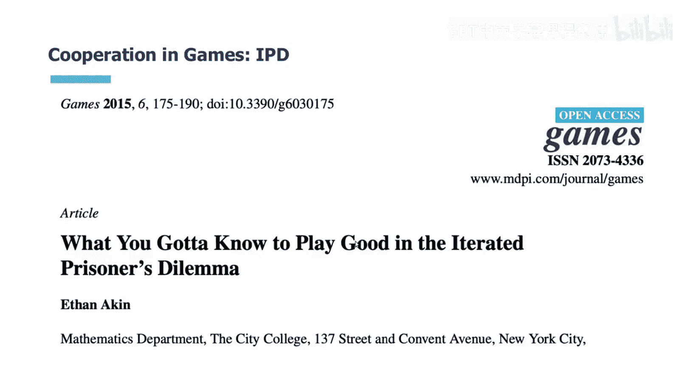

and betray and you can think of this as a form of symmetry and that this is identical in these two lanes。

 so to speak are those two grid points and we've got differences here。

 and as you'll see in a few minutes， we can imagine changing our reward structure here and the argument we're going to be making is how do we go about designing things in such a way and effectively thinking about those others that are playing against us how do we go about designing it in such a way that this cooperate。

 cooperate one is the most common。 and this has been called the t to the comments as you recall from when I first introduce this in iterated prisoners' dilemma。

 this is going to be the stable point this will not be So how do we design it in such a way that this ends up being much more the stable point again。

 not so easy and an interesting question and something I want you all to be thinking about So in this nice review article we can think of these as just being two vectors for the moves So our st&P refer than to the rewards going back to the rewards here and you can。

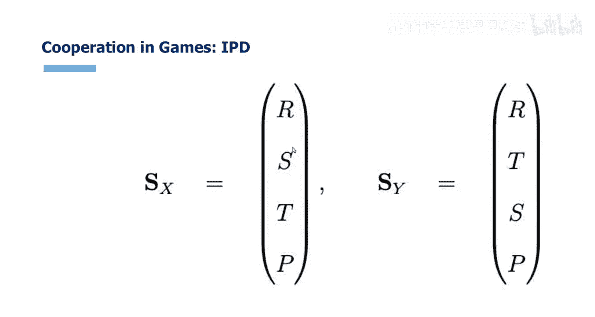

This RS T and P are coming from x's perspective and then s y it's the same except that T and S are flipped but it's the same concept。

 So then we've got our vectors and then we can think about the normal way of defining it where T is bigger than R is bigger than p is bigger than S so again normally S is here。

 you can think of that as being the sucker you can think of this as being the reward for being the betrayal and the r's are fairly modest relative to the T so the argument is that two r as greater than T plus So this is the usual way in which the prisoner's dilemma reward matrix is set up so we can think of vector p P1 through p4 and we can think of these as then referring to something like2 where they're cooperating to they're retrain for this fourth one and then two and three are basically symmetry they're identical So then we can set up a full Mark coian matrix where we're。

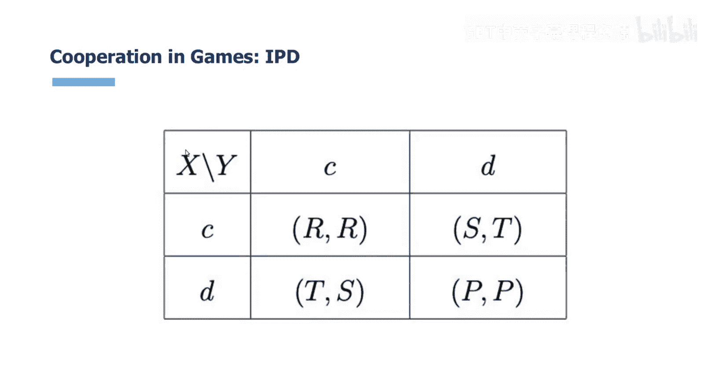

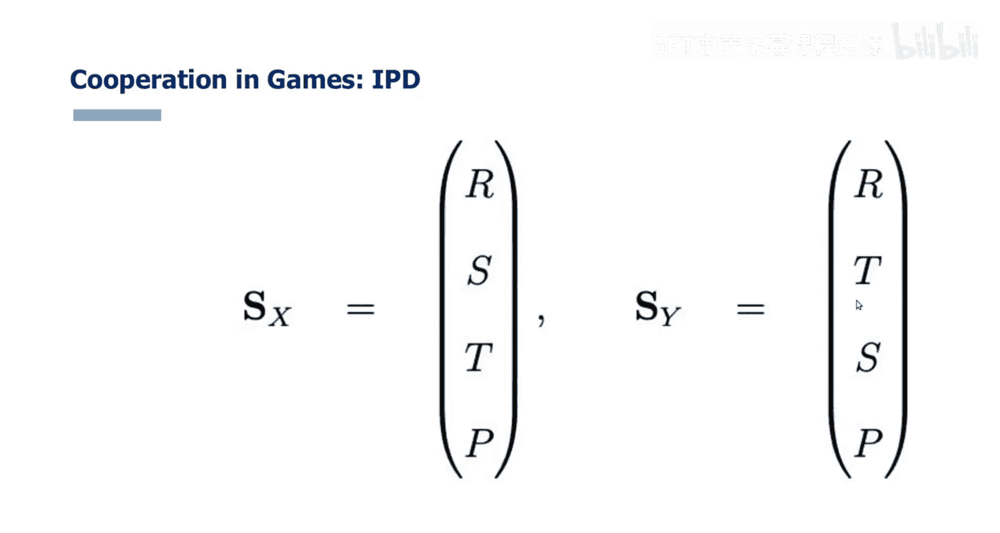

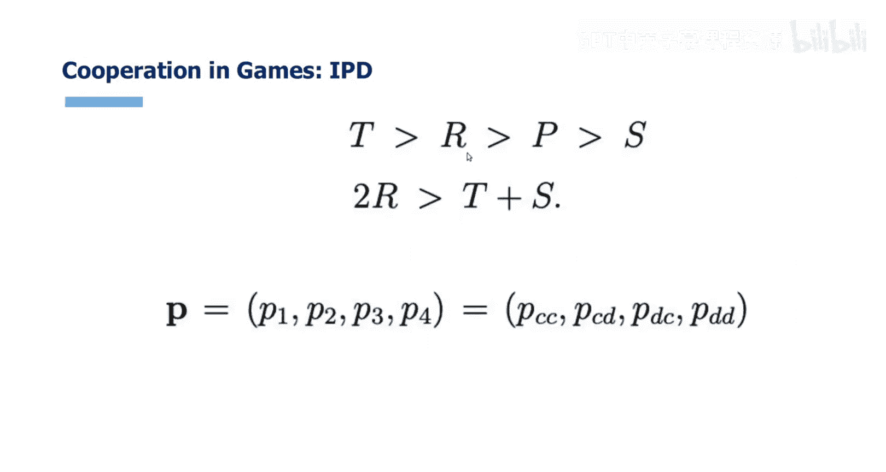

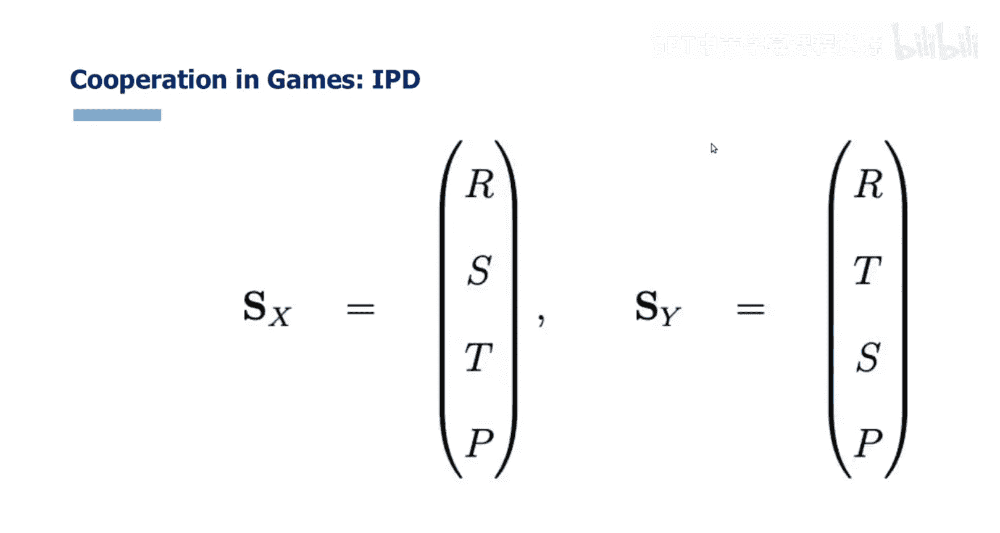

Thinking of a memory one type game we're just thinking about recalling from the previous one。

 we can think about then the probabilities of each of these different events happening。 So P1 Q1。

 this is the probability of moves for P it'd be similar for Q for the other player。

 So in this notation again this P1 is piece ofcc and for Q Q1 would also be a CC or the fourth one would also be a Dt Now you'll notice in this matrix the Qs are flipped here and to respond to the symmetry in order to make things work out well mathematically。

 So don't be confused that's not a mistake on the author's part that's really the way easiest way to write for the math to turn out。

 So you can then think about the probabilities within each of these components for the play。

 And then we can really talk about what's called a long version。

 basically going towards the limit as then goes to infinity of our iterated prisoners dilemma type game and what we're really interested in is what sort of stabilization do we get。

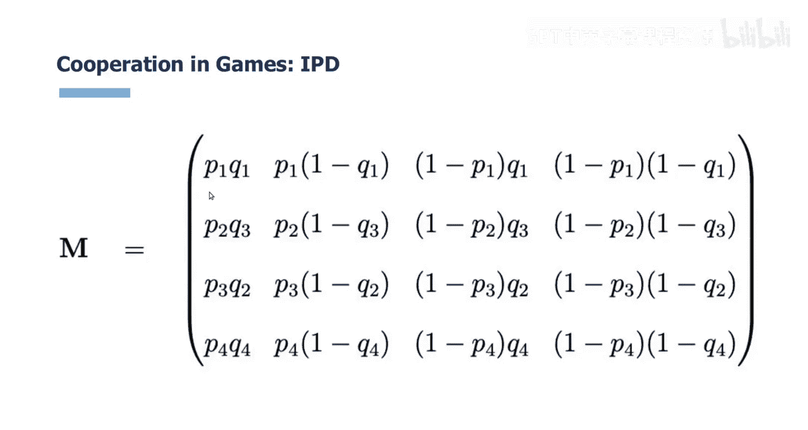

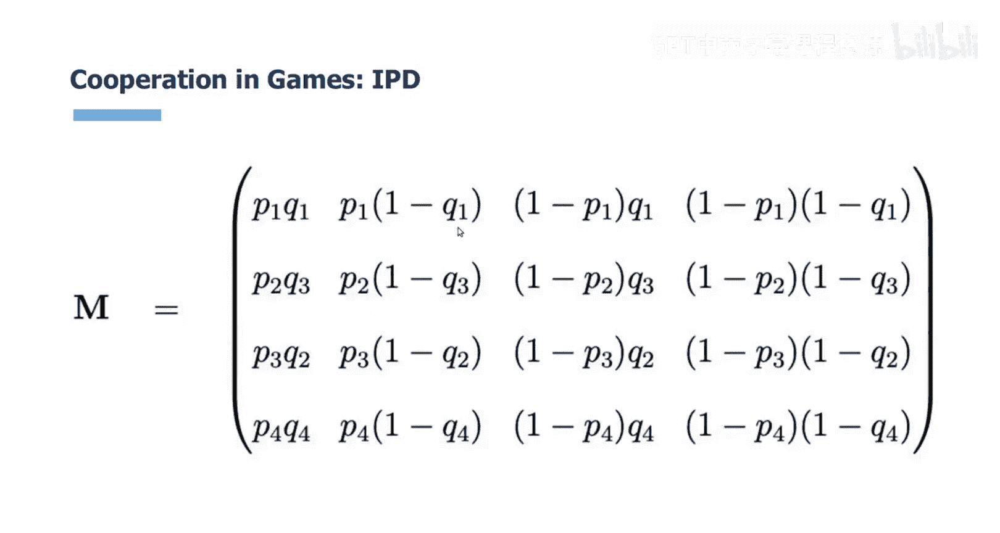

Think of a way so that as we go towards infinities where number go up。

 our average reward stabilizes the CC moves in the words where gameplay rewards the commons。

 So this goes to an interesting paper in some ways this is as much of a thought piece as anything。

 This is from Drew Weenberg and Gusav Kerisco if I say the names correctly Dr at MIT and given some online talks if you're curious to hear him talk about it。

 this in some ways was an empirical model， but it comes out nicely from observations on iterated prisoners dilemma and they focus on a subset of all possible games。

 So imagine a game where you're expecting most people are playing either a form of the equilibrium or one move away from an equilibrium So what you're thinking about as a subset of games where people are more likely to assume that they call it almost like a doom or gloom sort of approach where people are more likely to if you。

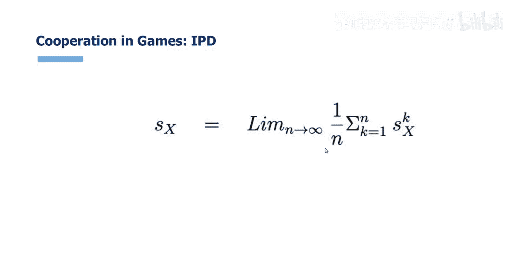

They're going to immediately betray and they're going to stay in that category so you're trying to play something where there's a trigger point where you're assuming something about the play of the other side and they define this delta of SE defining the Eliia I'll explain in a moment what G is but effectively they're defining as well this term delta which you can think about is related to how long you're expecting in the game is going to play so their reward matrix is very similar to what we had before they've got ones here G is the G just head up here and L you'll to be confused with the one is here and again you'll know that there's a symmetry along here and then difference along the diagonal so the question is for different types of iterative person ofmma is what we're varying L and G and what we're trying to predict the behavior that's going to lead tocyclization of CC behavior how would you go about to me so to find one other the parameter this delta RD。

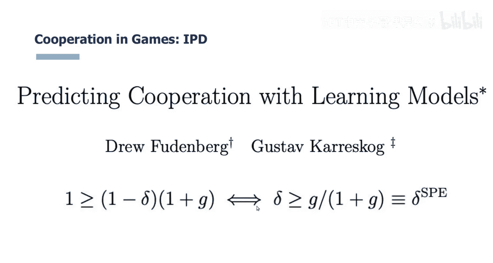

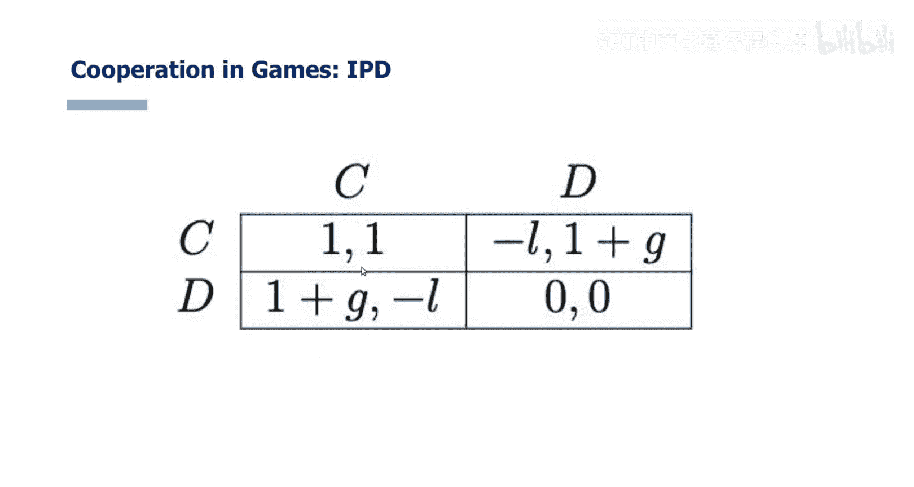

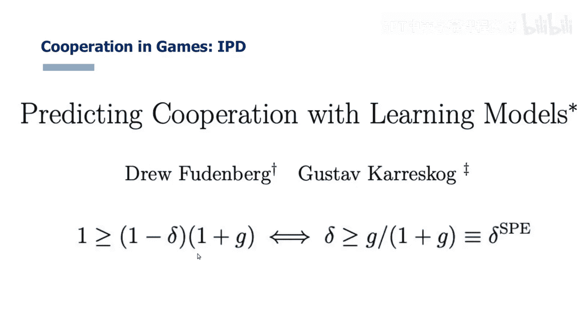

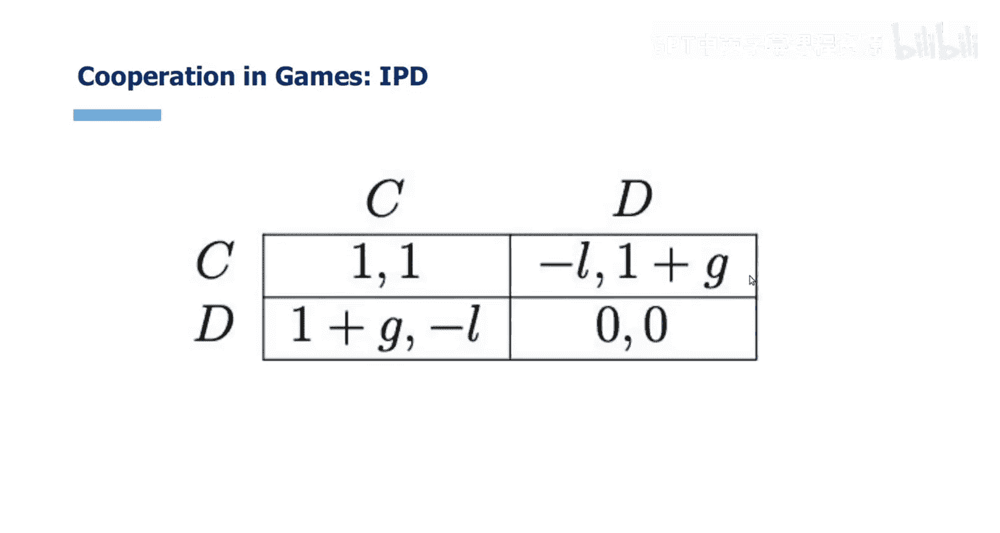

Is really defined as delta minus this delta with Rd and you can see that now we've got an L in it before for this term。

 this SE， there's no L in it for this term we do have an L so these are two parameters that you can think of that are defining ultimately characteristics of the game Don't worry too much about the definitions right now to be aware that we've got something now defined in terms of the way the game is set out so we can think about our initial so this is very similar to the distribution。

 the vectors that I put up in the very first discussion for this one we had be C and all the way CDDC and DD。

 you can think of this as being initial and it's dependent on almost like a linear extrapolation alphacallis beta times delta RD plus a term which is defined down here which is effectively like a learning type term so we've got something that's in terms of our distribution of types of plays we've got something that's only dependent on the matrix which defines。

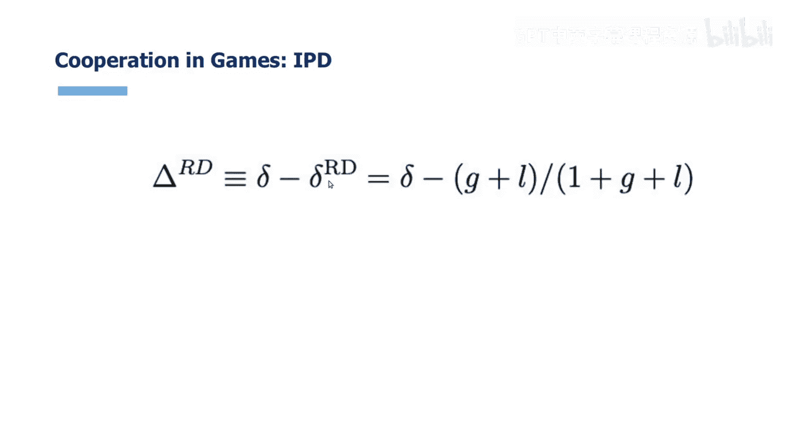

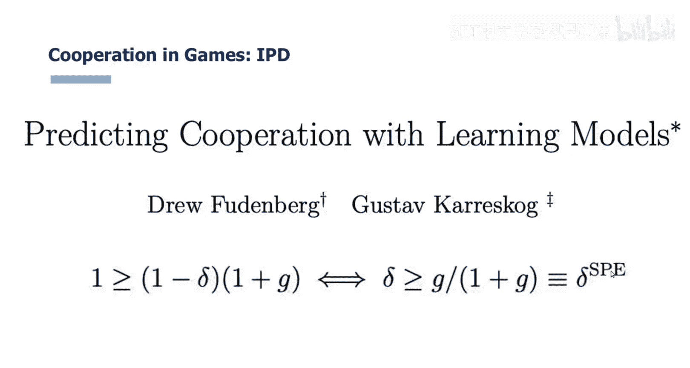

wordsAnd so all that is set by the type of game and then something it's doing in a form of learning。

 not that it's exponential here。 So this is now dependent on previous moves and note that we've got this this term is defined in terms of one step before and so effectively what we're doing is bringing in a form of learning from this E sub I house so。

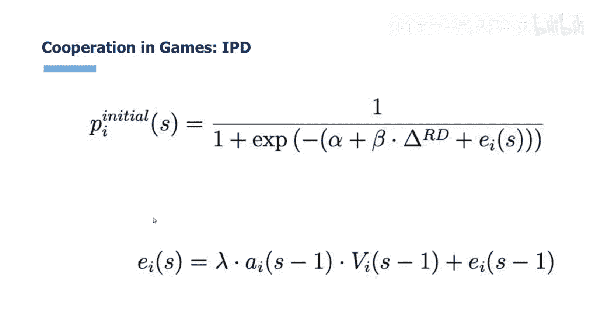

When they do this， first what they do is they say， well of the games we've looked at if it's been playing CC for a long time is it likely to be stabilized and the answer was yes。

 what about CDd versus Dc， what about DD So if it's Dd for example。

 the likelihood of it moving back to some sort of cooperative histories quite low。

 but if I've got some sort of eventual mixed play you may be able to imagine it converting back to a CC type play So this is the average cooperation rate and we're looking at these memory one histories meaning again that the play is dependent only upon the previous play and so when they do these kind of models。

 the argument is that they can fit you see these are ultimately going to be their parameters they can extrapolate to very long play。

 So you think of these is going out towards a stabilization type point。

 this is one out of many type analysis that they did。

 they did five groups and the argument is that they can extrapolate out from this and predict almost like a ceiling at a floor and an average based on the gameplay that they do see and the argument is ultimately you may be able at a similar model like this。

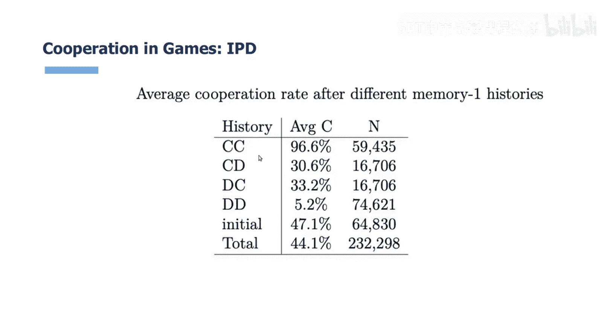

To understand the longtime convergence towards a cooperative play and what I think is intriguing about that is it opens up the strong possibility of being able to design a matrix that's dependent on one point in time so again think back to SF Park design a matrix that at one point in time will have a longtime stability that might be what you would like and that you can design it in order to have something like an advantage to a comments to acc type play now obviously in SF Park we were adjusting the gameplay so to speak。

 these are all based on iterated prisoners dilemma， this IPD again。

 itererate prisoners dilemma where the argument is made that we've stabilized at the beginning so to speak by baking in deciding at the beginning point what the rules of the game were going to be playing and then looking for the average behavior over time but they power up something like this fairly simple model would be really compelling I mean if it generalizes the argument again that you could design design matrix that I is you could design by。

to rule play and understand what the longterm prediction should be out from that so okay I hope this has helped you to get a sense as to how integrated prisoners dilemma could be used as a model for stabilizing the commons a lot of work in this area I've only kind of touched the surface on it but I think it's really fascinating they'll be a little bit more coming up on this as well。

 but I think it's a really fascinating area of game theory and game design related to how you stabilize certain types of outcomes。

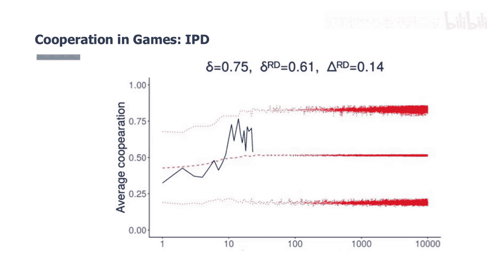

Okay， thank you。