# 数据科学：时间中的决策：9：公共资源稳定性调控 🎮

在本节课中，我们将探讨如何利用博弈论，特别是迭代囚徒困境模型，来设计和稳定公共资源（Commons）中的合作行为。我们将学习如何构建收益矩阵，以引导参与者走向长期合作，并介绍一些相关的数学模型和分析方法。

---

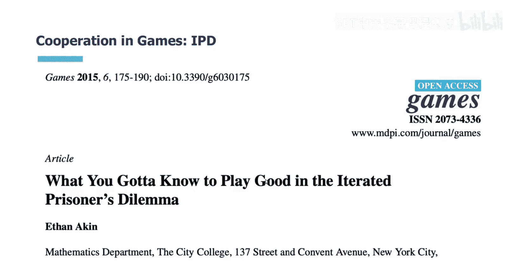

上一节我们介绍了博弈论的基本概念，本节中我们来看看如何具体设计一个博弈来稳定合作。

我们讨论的内容可以追溯到SFpar（一个假设的公共资源管理模型），核心问题是：如何构想并稳定合作？如何设置我们的收益矩阵，如果我们将其视为类似迭代囚徒困境的博弈？如何以某种方式设置它，以便我们能够稳定公共资源？这个问题可以快速推广，但具体设置并不总是容易的，事实上这个领域有很多正在进行的研究。我将尝试回顾其中一部分，让大家感受一下为稳定合作而设计博弈所面临的挑战。

我们将从一篇由Ethan Akin撰写的精彩综述开始，探讨如何在迭代囚徒困境中表现出色。他在这方面很有心得。

以下是迭代囚徒困境的基本收益矩阵设置。我们有两个参与者X和Y，他们可以选择合作（C）或背叛（D）。矩阵中的R、S、T、P是标准符号，代表不同策略组合下的收益。

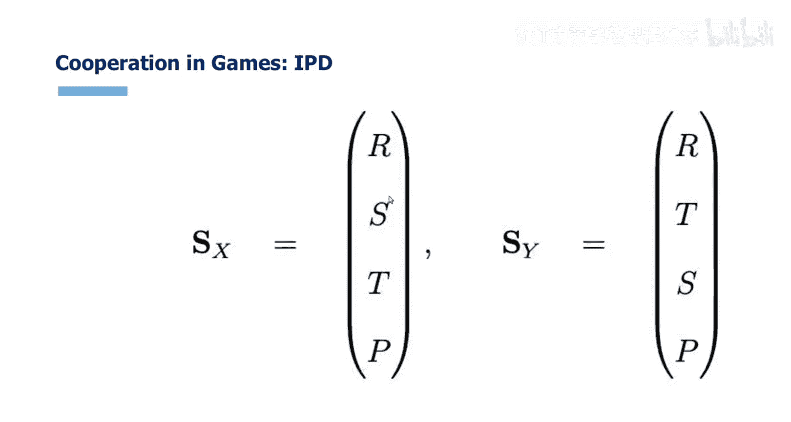

矩阵具有对称性。对角线上的`(C, C)`和`(D, D)`是双方选择相同策略的情况。非对角线上的`(C, D)`和`(D, C)`是双方选择不同策略的情况，这两个格点的收益对于两个参与者来说是对称的（即一方的T对应另一方的S）。

正如稍后将看到的，我们可以想象改变这里的收益结构。我们要论证的核心是：如何设计这个矩阵，有效地考虑与我们博弈的其他参与者，从而使`(C, C)`（双方合作）成为最常出现的结果？在迭代囚徒困境中，`(D, D)`（双方背叛）通常被称为稳定点，而`(C, C)`则不是。那么，我们如何设计才能使`(C, C)`最终成为更稳定的点？这并不容易，是一个有趣的问题，也是我希望大家思考的问题。

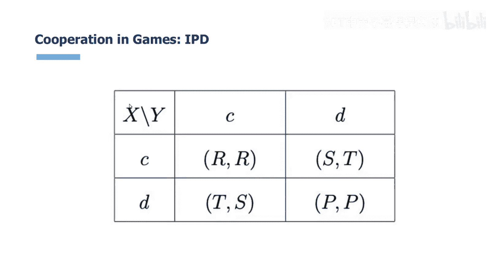

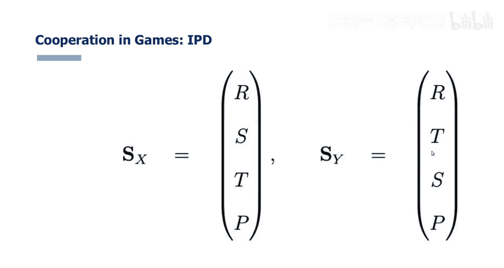

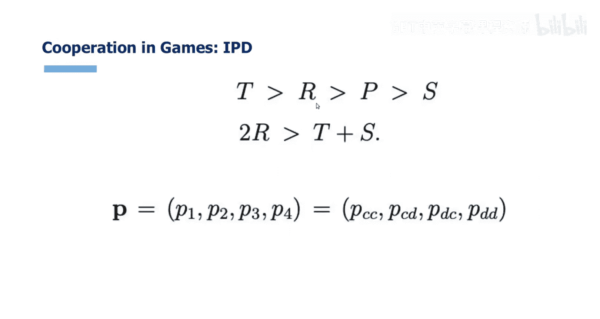

在这篇综述文章中，我们可以将这些收益视为两个向量。R、S、T、P是从参与者X的角度定义的收益，然后对于参与者Y，T和S的角色互换，但概念相同。

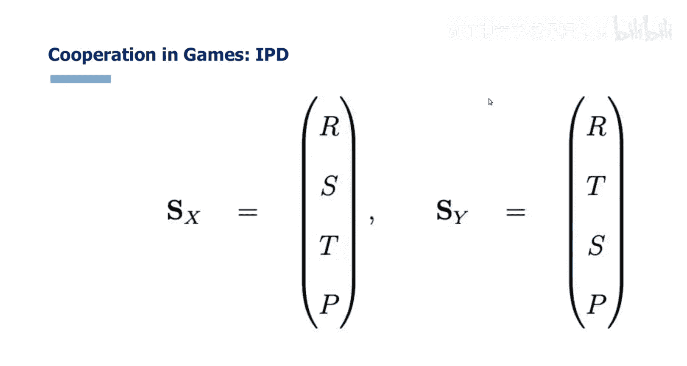

标准的囚徒困境收益排序是：**T > R > P > S**。通常，S被称为“傻瓜的收益”（被背叛的一方），T是“背叛的诱惑”（背叛合作者所得），R是双方合作的奖励，P是双方背叛的惩罚。此外，通常假设 **2R > T + S**，这使得长期合作的总收益优于交替背叛。这是囚徒困境收益矩阵通常的设置方式。

我们可以考虑一个概率向量 **p = (p1, p2, p3, p4)**，它们分别对应四种历史状态（CC, CD, DC, DD）下，参与者在下一轮选择合作的概率。对于另一个参与者Q，也有类似的向量 **q**。

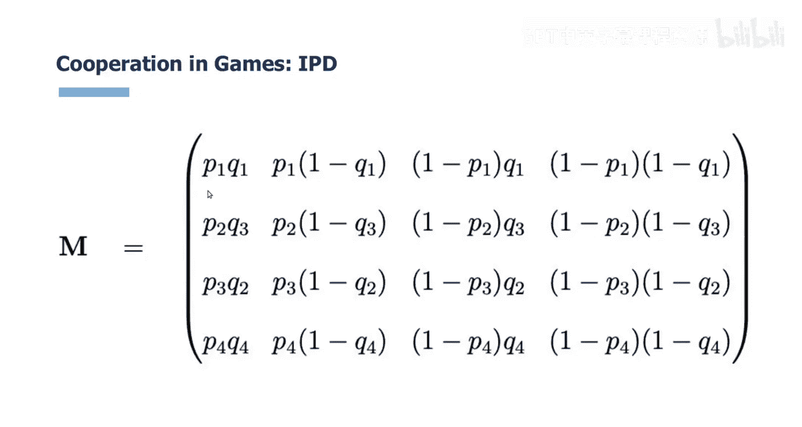

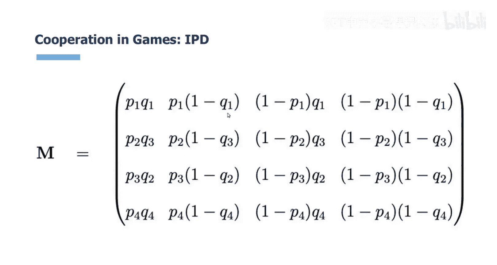

我们可以建立一个完整的马尔可夫链矩阵，考虑一种“记忆为一”（memory-one）类型的博弈，即参与者的决策仅依赖于上一轮的结果。然后我们可以考虑这些不同事件发生的概率。P1是X在上一轮为CC时选择合作的概率，Q1是Y在上一轮为CC时选择合作的概率，以此类推。注意在这个矩阵表示中，为了数学上的简洁，Q的概率向量顺序有所调整，这不是错误。

然后，我们可以讨论博弈的长期行为，即当迭代次数n趋向于无穷大时的极限情况。我们真正感兴趣的是会得到什么样的稳定状态。我们思考的方向是：随着博弈次数增加，平均收益如何稳定下来，从而使CC策略占据主导，即游戏玩法奖励了公共资源合作。

---

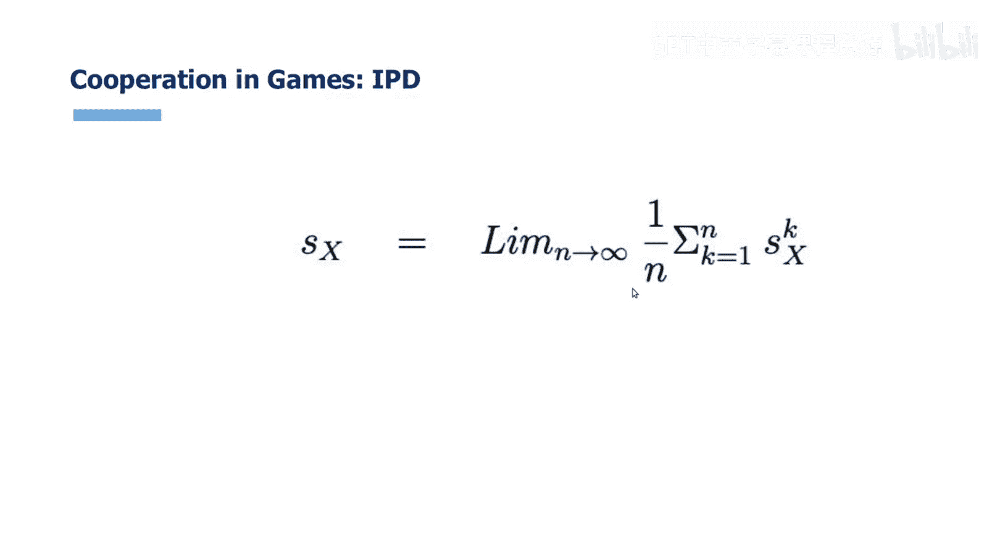

接下来，我们看一篇有趣的论文，它既是实证模型，也源于对迭代囚徒困境的观察。这篇论文来自Drew Fudenberg（MIT）和Gustav K. N.，他们在一些在线演讲中讨论过这个主题。

他们关注所有可能博弈中的一个子集。想象一个游戏，你预期大多数人要么在玩某种均衡策略，要么距离均衡策略只有一步之遥。他们考虑的是参与者更可能采取一种“末日或悲观”方式的博弈子集，即如果对方背叛，他们会立即选择背叛并保持在这种状态。因此，你试图玩一种存在“触发点”的游戏，你对另一方的玩法做出某种假设。

他们定义了一个参数 **δ**，它与博弈的预期长度有关。他们的收益矩阵与我们之前看到的非常相似。

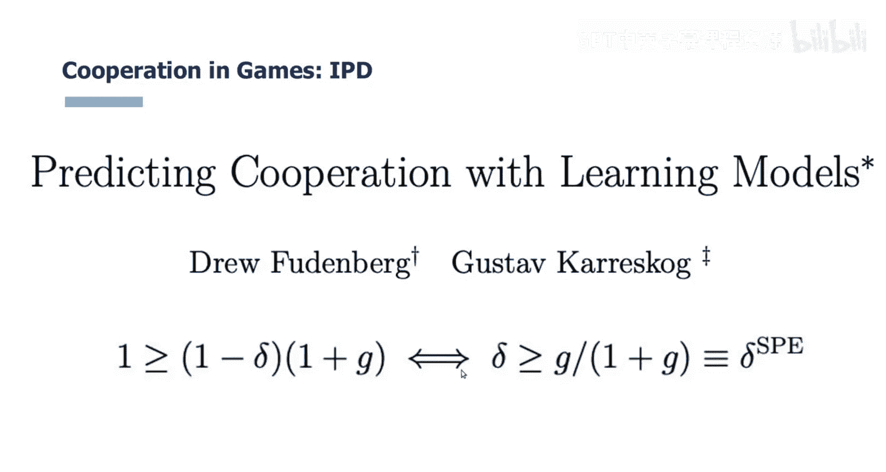

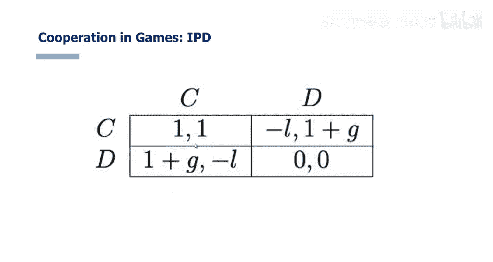
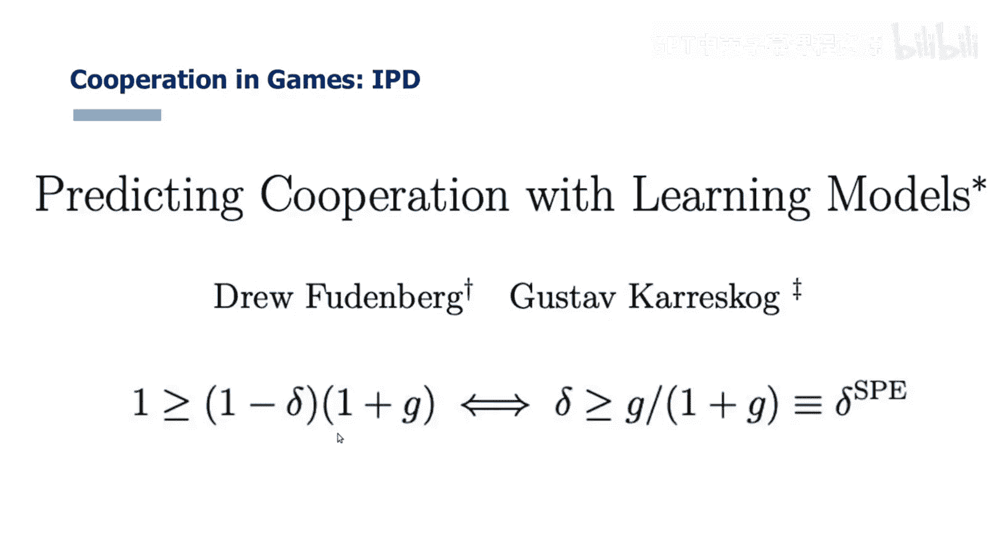
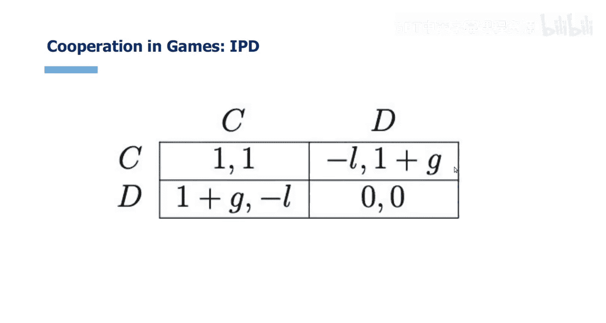

这里，G和L是矩阵中的两个关键参数，G是背叛合作者所得的诱惑（类似T），L是被背叛的损失（类似S）。问题在于：对于不同类型的迭代囚徒困境（通过变化L和G来定义），我们如何预测会导致CC行为稳定的行为？

他们定义了另一个参数 **ΔRD**，其公式为：
**ΔRD = δ - (某个包含L的项)**
δ和这个项共同定义了游戏的特性。现在先不必过于担心具体定义，只需知道我们现在有了基于游戏设置方式定义的参数。

我们可以考虑初始策略分布，这类似于我在最初讨论中提出的向量分布（CC, CD, DC, DD）。这个初始分布依赖于一个线性外推项 **α + β * ΔRD**，再加上一个定义在下方的项，该项类似于一种学习项。

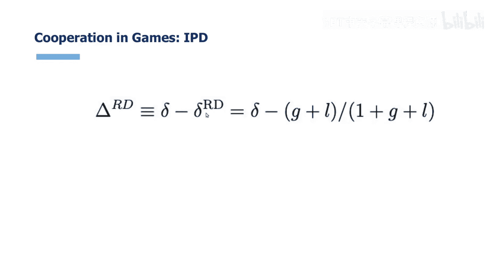

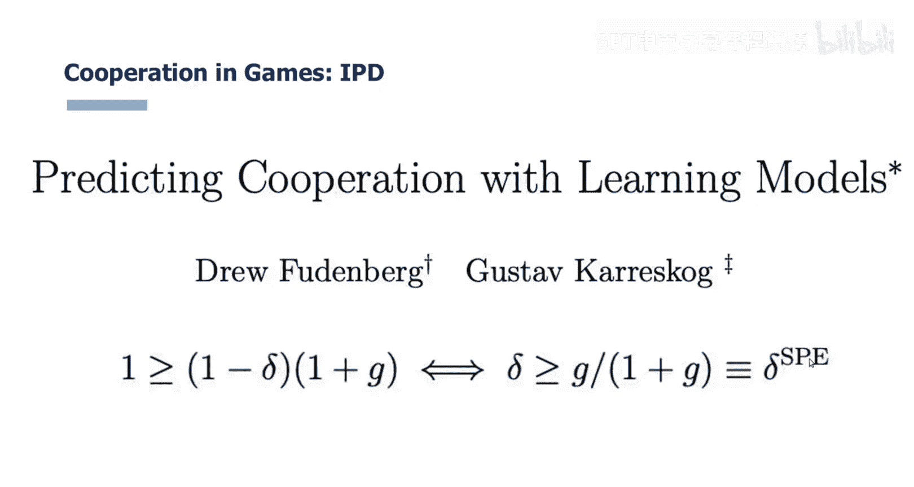

因此，我们的策略分布一部分仅依赖于定义游戏类型的矩阵，另一部分则在进行一种形式的学习（注意这里有指数项）。这个学习项依赖于前一步的结果，因此我们实际上引入了一种从前一轮经验 **E_sub_i** 中学习的形式。

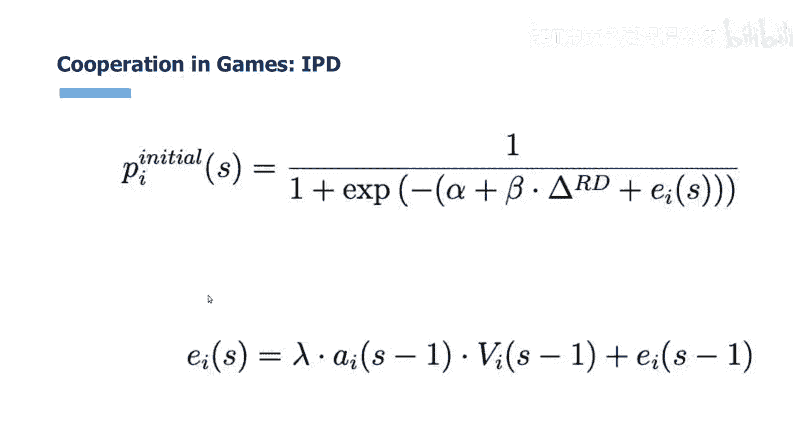

当他们应用这个模型时，首先发现：在他们观察的游戏中，如果长期处于CC状态，它是否可能稳定？答案是肯定的。那么CD vs DC，或者DD状态呢？例如，如果处于DD状态，它转回某种合作历史的可能性相当低。但如果存在某种混合策略，你或许可以想象它转回CC类型的玩法。

下图展示了平均合作率，他们观察的是这些“记忆为一”的历史，意味着玩法仅依赖于上一轮的玩法。

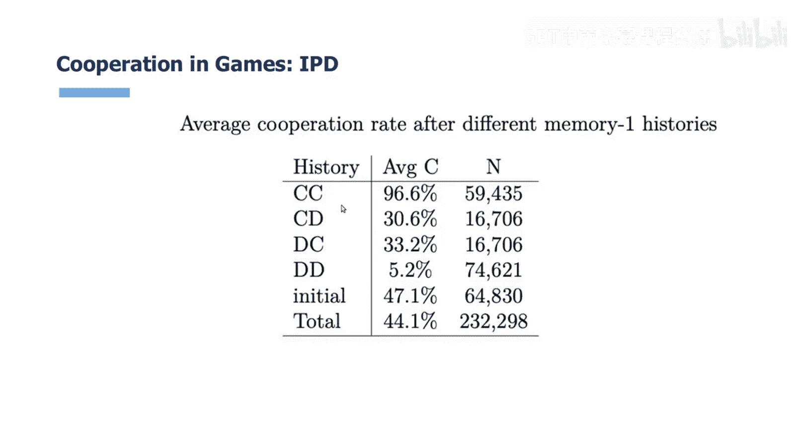

当他们进行这类建模时，论证是他们可以拟合参数（这些最终是他们的模型参数），并外推到非常长期的博弈。你可以将这些点视为趋向一个稳定点。这是他们进行的多组分析之一，他们进行了五组分析。论证是他们可以从此外推，并基于观察到的游戏玩法预测一个上限、下限和平均值。最终的论点是，使用类似的模型，或许可以理解长期收敛于合作玩法的过程。

我认为这 intriguing 的一点是，它开启了强大的可能性：能够设计一个在某一时间点定义的矩阵（回想SFpar，我们在某一时间点设计矩阵），该矩阵将具有长期的稳定性，这可能是你想要的。你可以设计它，以便为公共资源合作（CC型玩法）带来优势。显然，在SFpar中，我们是在调整游戏玩法本身。而这里的所有分析都基于迭代囚徒困境，其论点是我们通过在起点“烘焙”决定游戏规则来稳定局面，然后观察长期的平均行为。

但像这样相当简单的模型如果能够推广，将非常有说服力。这意味着你可以设计一个收益矩阵，并通过规则玩法来设计，从而理解从该设计出发的长期预测应该是什么。

---

本节课中我们一起学习了如何利用迭代囚徒困境作为模型来稳定公共资源。这个领域有很多工作，我只是浅尝辄止，但我认为它非常迷人。后续还会有更多相关内容。我认为这是博弈论和游戏设计中一个非常迷人的领域，关乎如何稳定特定类型的结果。

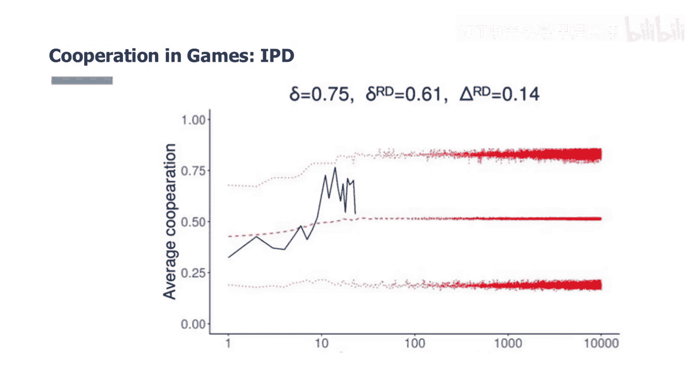

谢谢。