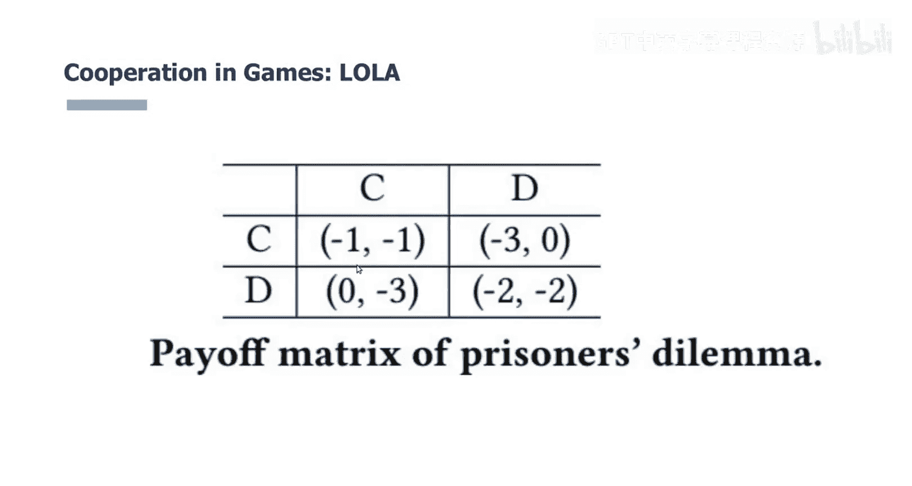
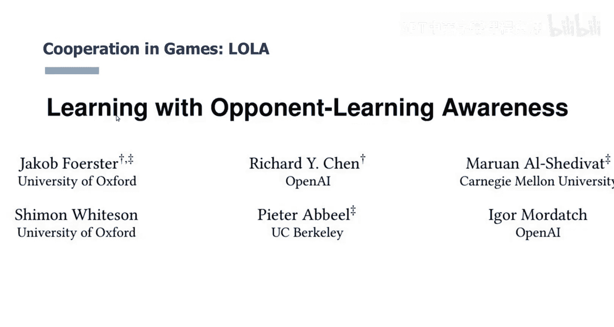
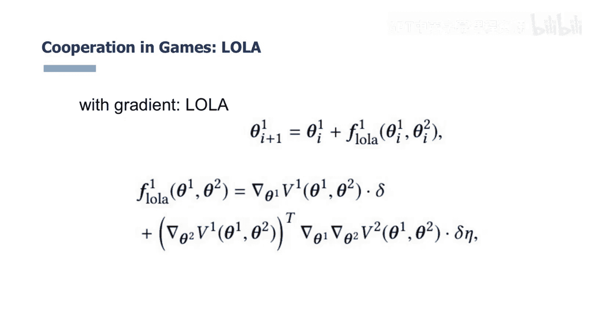
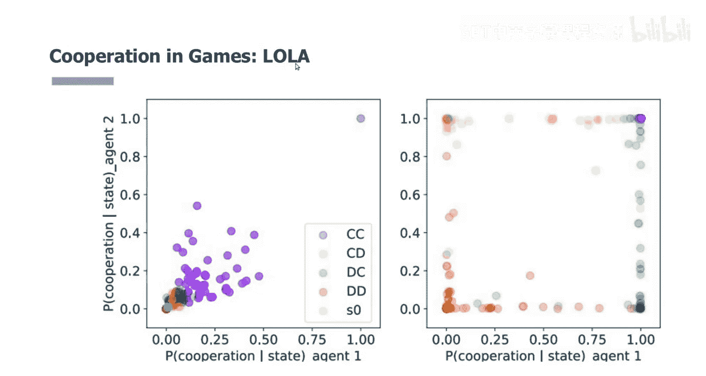
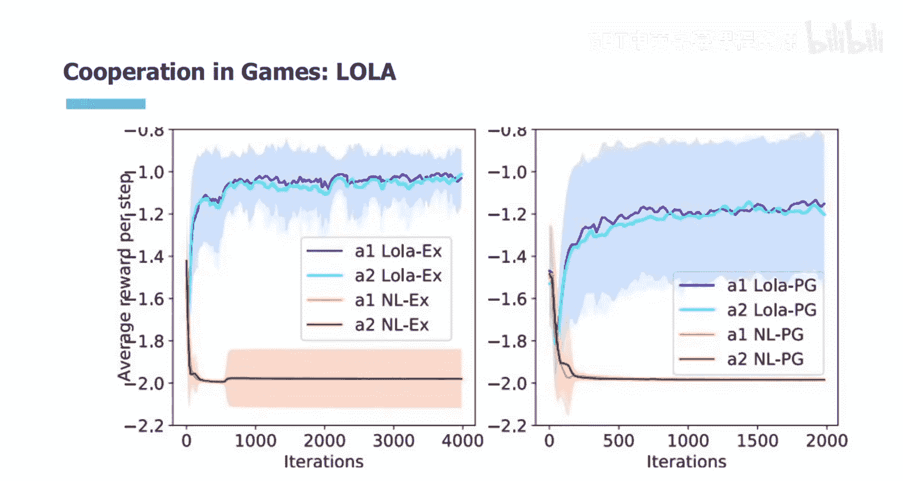
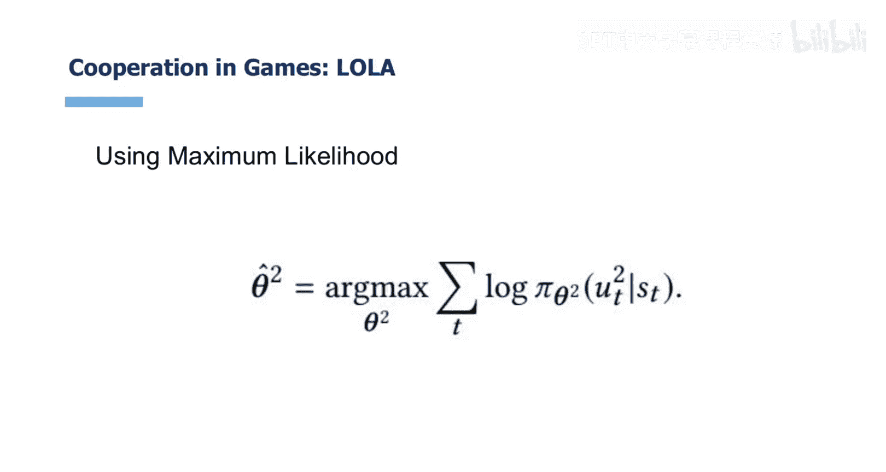
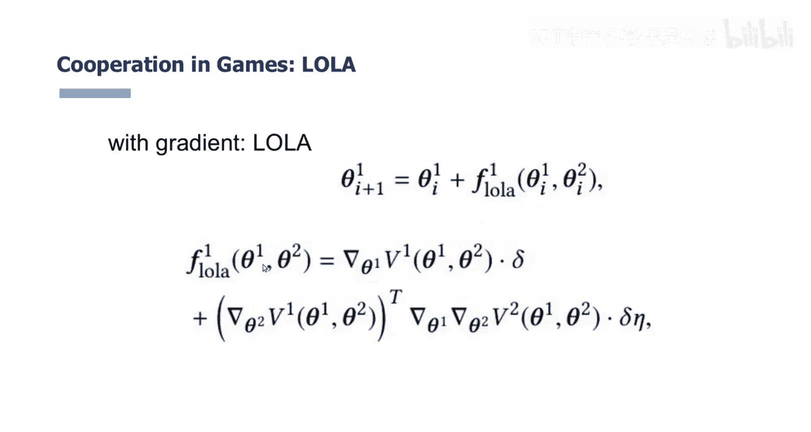
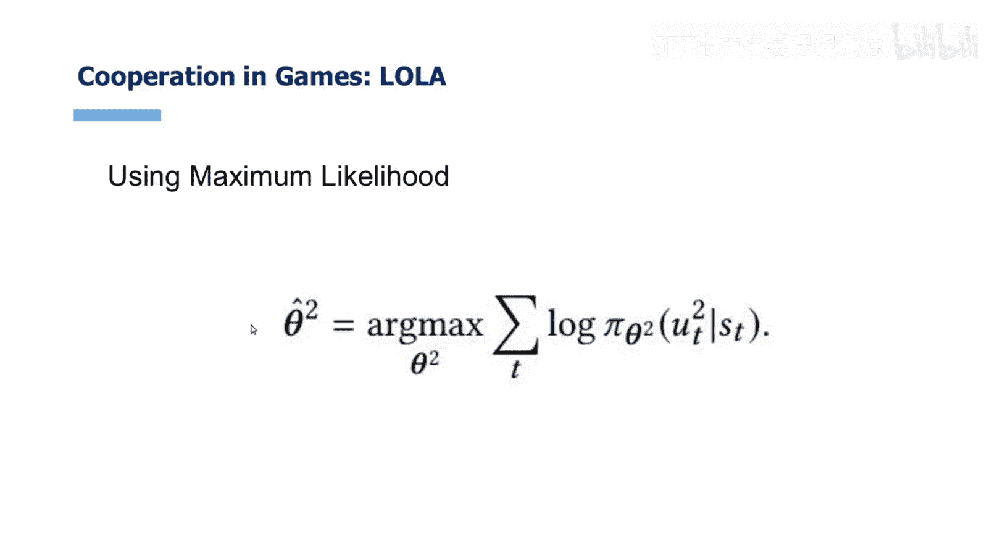
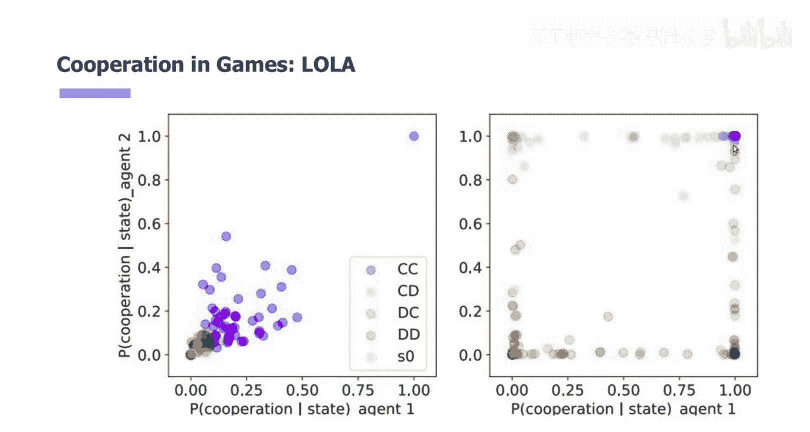

# 约翰霍普金斯大学《数据科学：时间中的决策｜Data Science Decisions in Time》中英字幕 p43 10_合作机制的机器学习方法.zh_en -BV1NCuzzfEJa_p43-

We'll now talk about algorithms for cooperation this really extends things that we were talking about last week I think you'll enjoy this it's coming from a machine learning the idea is for this algorithm called Lola。

 that we can solve prisoner dilemma， we can solve our itator prisoner dilemma in just way where we build in the ability to do cooperation so again what we're talking about is a situation where there is the t the Commons we want to support this CC state but the National equilibriumlibria is that this minus2 minus2 DD state where people have betrayed each other。

 the alternate off diagonal cases are where one has cooperative and the one is betrayed。

That's why again the National Gallyer would be here as opposed to the common one here where we're building in a collective good so the argument again is how do we stabilize this and so this is an interesting one this learning with opponent learning awareness or Lola so Lol learning with opponent learning awareness this is from the set of authors here or these people are fairly well known so some of you listen to this may recognize some of the names here but again this was a learning with opponent learning awareness or Lola naive learner and this way of thinking about things would be updating just based on the value function now you don't always have the value function obviously for a particular game and so theyre we' going to discuss from their paper ways that you can approximate this value function but for the first part in the entrance to their ideas。

 let's just assume that we do have the value function and so it's got connections for those of you that are back and forth。

learningning back into the Marco processes based on decisions and it connects back into our first few weeks of the class as well so the argument we're essentially making is that the value function can be optimized so that for the next step in one or the next step in two you're optimizing over the parameters that are defining your value function so the values of the and you're doing it based on the current value of that value function。

 the current estimate and not necessarily paying attention even though you've got both parameters here。

 you can think about it as for the naive learner paying attention to the local value function for that learner and so then you can do this with a gradient so again for the naive learner you can think of this as being something that at least is in principle accessible and so we can take a gradient on that value function and update and then notice for this one and would be similar the second player in a two-player game。

What we'd be doing is just taking the gradient on that value function with respect to one parameter so in Lola on the other hand。

 we're really are starting to think in terms of both players so again we're looking to see if we can understand how to build in cooperation so some of where we left off last week we're trying to understand what we can about rectifying the strategy of the Commons we're building in a way for behavior to support cooperation so again cooperation in games and think about it again is trying to maintain again almost like world and turnoff trying to maintain a particular distribution so we're trying to model a system where effectively by setting up our parameters and especially setting about gradient on value function we've enabled a system where cooperation is supported so not something interesting so this is for the Lola on one and you've got gradient operating on both one and two so the argument is that by building in a gradient awareness of what the other player。

iss doing and their value function for the other player we've built in an awareness therefore of how to stabilize and cooperate in something like the iterated Christmas dilemma so Dll again that means we're taking the derivative on theta 1 on this value function times the delta plus now transpose just means that we can correctly do this operation so a dell on v1 and we've got a dell on v2 that's theta 2 and that's theta 2 this is again a pairwise function on theta 1 and theta 2 and then we've got a delta eta so this is a double dell so we're doing our second derivative in this operation here so。

An interesting function， even if you're not following every aspect of the math here just be aware that the importance is that we've brought in a function that's not just a derivative like in our situation here where we just have awareness of the parameters affecting one distribution here we've got as something that's doing theta 1 and theta 2 and then a double derivative。

 second derivative and so that endows although with an ability to understand at least in principle。

 assuming you have access to the value function for the joint of both players。

 it endows it with the ability then to understand something about the second player which is an argument for how you can build in cooperation。

As I mentioned with the iterd prisoner' dilemma， we've got that payoff matrix happening and we're looking in terms of the memory one type processes。

 so we're thinking in terms of things that start off cooperating and maybe you've got the situation where you're going to play cooperation into one betrayal and then you move into betrayal or you do did for taut these are known strategies again in this game So these are the asymmetric。

 this is the other symmetric where you've got two betrayals So this is that naive one and this is the one with Lola and note what happens in terms of cooperation on one。

 given the state cooperation two， given the state here it's down in this lower corner。

 I mean for the most part it's fairly small but look over here how much how quickly this is grown up to the top so this is cooperation given the state conditional on the state for one and for two and Lola this CC state is stabilized So once you start to build in cooperation is going to stay cooperating in。

Game running with this algorithm and that's really quite quite nice。

 So here's the same way of looking at it。 So these again， are Lola versus naive learner。

 This is the average word per state， these are different iterations and so you can see it's going up and stabilizing so effectively in the Lola situation we've got some sense of the air bar on both sides they're both stabilized but very different very different levels and so that's really very exciting again because it's implying for both Lola and both players that we're able to stabilize one relative to the other。

 and you can see that it happens really fairly quickly So this again is cooperation in games。

 the argument being that we can understand something about how to cooperate assuming we know something about the value function。

 now in the very last part of the paper they're bringing in the idea that you could potentially from maximum likelihood by observing the data coming from。

The other player， you can optimize the parameters。 other words。

 the suggestions raised is that there should be a way to learn the value function and therefore to do the equivalent of taking these gradients so again。

 think back to this sort of an argument with gradient the argument is that you should be able to understand from the data using maximum likelihood。

 something that would be close to that。 now that's not fully proven in this paper it's just a suggestion that something like this could work。

 but the main thing that comes out the main takeaway is that we can move from something like this in terms of our endpoint space into something like this where we've stabilize the commentss by the appropriate awareness of what both players are doing。

 And I think that's really very very exciting。 So with that I hope I've given you a sense as to how with modern machine learning methods there are also ways to try and design games and I guess case of iterative business dilemma again design and play games that's just a way that the。

Common good is stabilized in other words avoiding the tragedy of the commons。Thank you。

