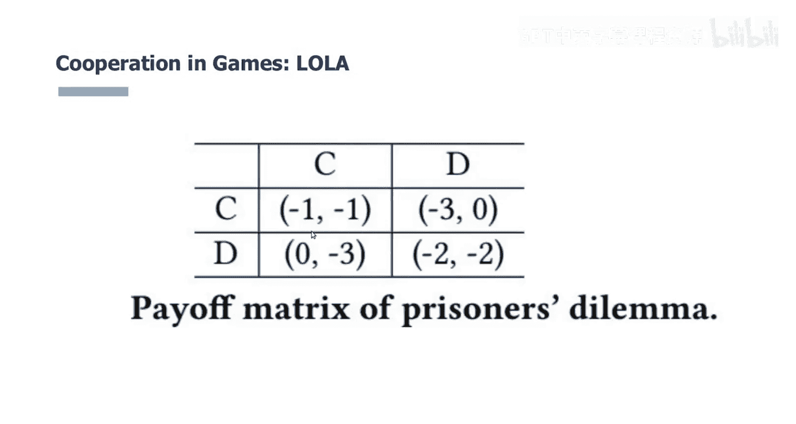
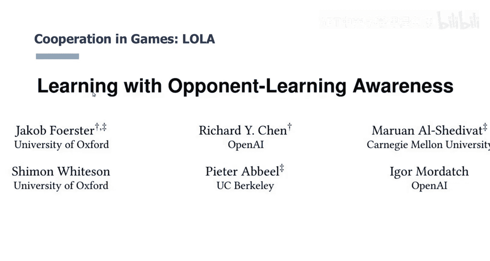
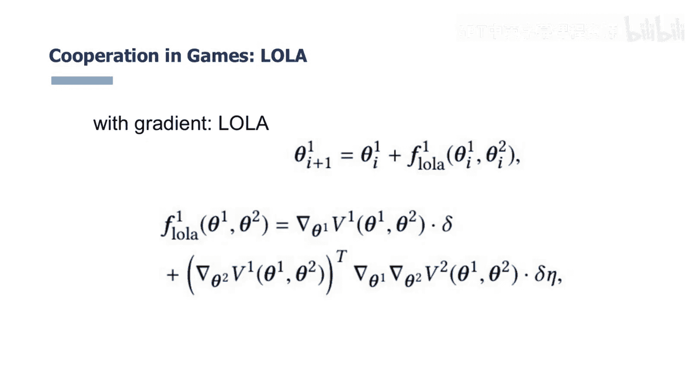
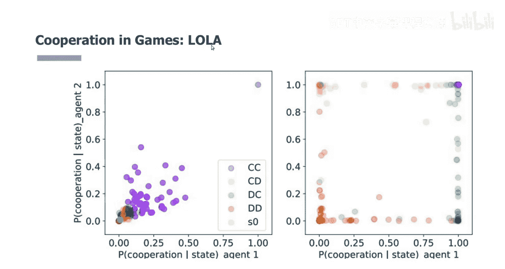
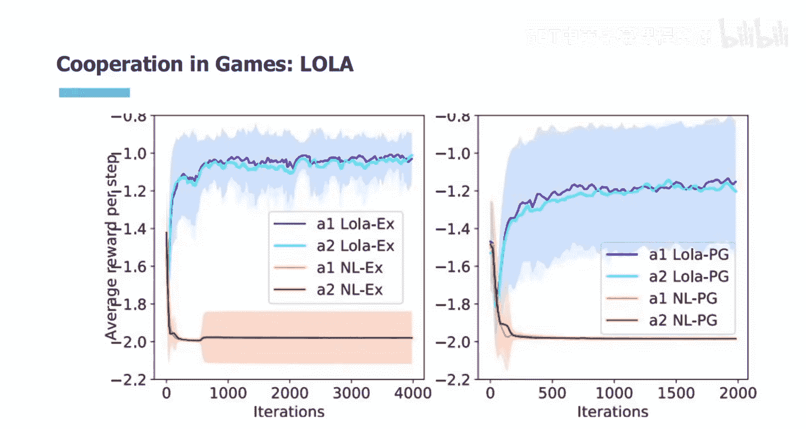
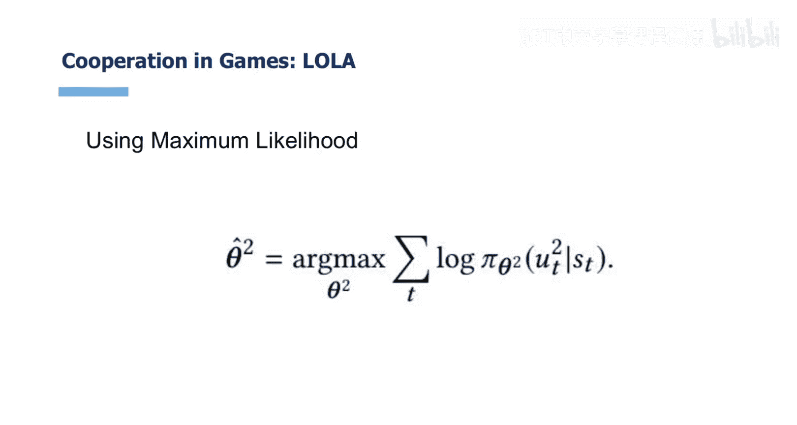
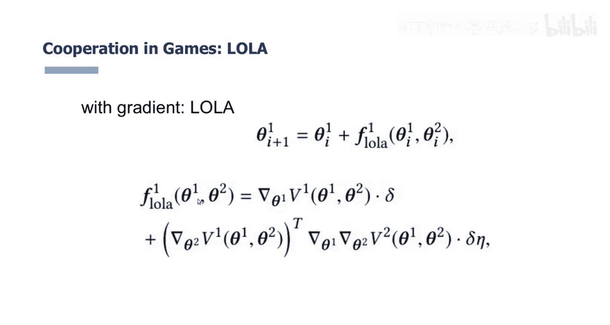
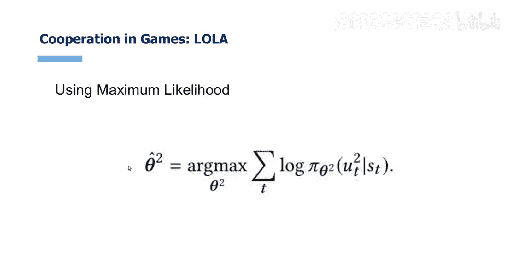
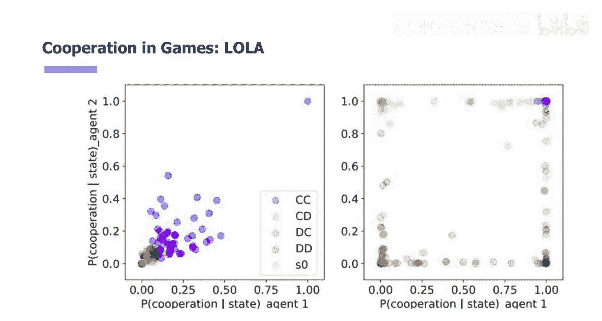

# 数据科学：时间中的决策：10：合作机制的机器学习方法 🧠🤝

在本节课中，我们将学习一种名为LOLA的机器学习算法，它旨在解决博弈中的合作问题，特别是迭代囚徒困境。我们将探讨如何通过算法设计，使系统能够稳定地支持合作，从而避免“公地悲剧”。

上一节我们讨论了博弈中的基本困境，本节中我们来看看如何利用机器学习方法来构建合作机制。

## LOLA算法核心思想

LOLA（Learning with Opponent-Learning Awareness，即具备对手学习意识的机器学习）的核心思想是，在优化自身策略时，不仅考虑自身价值函数，还考虑对手的学习动态。这使其能够预见到自身行为如何影响对手未来的策略，从而引导系统走向互利合作。

## 从朴素学习者到LOLA

以下是两种学习者的更新方式对比：

*   **朴素学习者**：仅根据自身的价值函数进行优化。其参数更新公式为：
    `θ₁ ← θ₁ + η ∇θ₁ V₁(θ₁, θ₂)`
    其中，`η`是学习率，`V₁`是玩家1的价值函数。

*   **LOLA学习者**：在优化时，会考虑自身策略改变对对手价值函数的影响，进而影响对手未来的策略。其参数更新公式更复杂：
    `θ₁ ← θ₁ + η ∇θ₁ [ V₁(θ₁, θ₂ + η ∇θ₂ V₂(θ₁, θ₂) ) ]`
    这个公式包含了对对手策略更新（`η ∇θ₂ V₂`）的预期，并在此基础上计算自身价值函数的梯度。

即使不深究数学细节，关键点在于LOLA引入了对对手学习过程的建模（通过二阶导数项实现），这赋予了算法在原则上理解并影响对手行为的能力，从而为建立合作奠定了基础。

## 在迭代囚徒困境中的应用

在迭代囚徒困境中，我们有一个收益矩阵。LOLA算法被应用于具有“记忆-1”策略的博弈中（即下一轮策略仅取决于上一轮的结果）。

以下是实验结果展示：

*   **稳定合作**：当两个玩家都使用LOLA算法时，系统能够快速稳定在“双方合作”（CC）的状态。这意味着一旦开始合作，就会持续合作下去。
*   **对比显著**：与朴素学习者相比，LOLA能达成并维持高水平的合作收益。数据显示，LOLA玩家的平均每轮收益迅速上升并稳定在高位，而朴素学习者则陷入低收益的“相互背叛”（DD）均衡。

## 价值函数的估计

上述讨论假设我们已知精确的价值函数`V`。在论文的最后部分，作者提出了一个建议：在实际中，可以通过观察对手行为的数据，使用**最大似然估计**等方法来近似学习对手的策略参数和价值函数。这样，即使在未知确切模型的情况下，也有可能实现类似的合作效果。

## 总结与意义

本节课我们一起学习了LOLA这一机器学习方法。其主要启示是，通过在设计算法时**有意识地纳入对对手学习过程的考量**，我们可以将系统从“相互背叛”的纳什均衡，引导至稳定合作的“共同利益”状态。

这非常令人振奋，因为它展示了现代机器学习方法不仅可用于预测或分类，还能主动**设计博弈规则和交互方式**，从而在诸如迭代囚徒困境等场景中，稳定地促进集体利益，避免“公地悲剧”。