# 约翰霍普金斯大学《数据科学：时间中的决策｜Data Science Decisions in Time》中英字幕 p44 11_基于人类行为的监督学习训练（上）.zh_en -BV1NCuzzfEJa_p44-

We'll not talk again about diplomacy。 This is a game I brought up earlier on。

 but now what''re talking about in the context of machine learning。

 the argument being that we can use this as a great model for understanding social dynamics especially sequential social dynamics so diplomacy you might recall was a game that took place before World War1 very complicated game can take a long time to play I really urge all of you to give it a try I think it's a really interesting game seven countries takes place again in this geographical zone to find by Europe you've got armies and navies and moves and you're writing orders and updates happen you all submit at the same time all the seven countries submit at the same time and then you update the orders and you keep playing the paper we're going through in this next bit it was really one of the first success stories that I'm at least aware of for modeling multi-ageent gameplay。

 There were other efforts before this and it's not to say。They were unsuccessful。

 but they really helped prepare the ground for this particular one which I think is the most interesting and there's a couple others that will go over as well。

 but the main thing I want to do and I'm not trying to pick favorites here at all is to just simply argue that this is a really excellent model system for trying to understand sequential social interactions and how really to think about how to design a game that has say particular how comes or complexities in it I should explain no press here。

I's essentially a variant on the diplomacy game where there's a normally a fairly long period where different players can try and through。

Different mechanisms of press， there's two variants on press can try and communicate to other players and do the diplomacy that's really part of the game。

 So in some ways this still implies a fair amount of social interactions。

 but it's all within the gameplay So no press diplomacy means exactly what it sounds like there's no press。

 So essentially I'm going now briefly remind you of the rules and this is also from the paper so you can read more of the if it gets too wordy on the screen for you here。

 but I think it will still help you to see what's going on and how the game is played。

 So diplomacy again， that's our game。 we've got seven European powers。 that's Austria， England。

 France， Germany， Italy， Russia and Turkey and the argument of the game is that they're competing over supply centers in Europe。

 and this is again at the beginning of the 20th century。

 so I think prior to World War I and they're ultimately again competing they're trying to figure out who's going to win now it's an interesting game because there's no chance here there's really a fair amount of strategy it's long-term strategy。

 the moves are restricted。

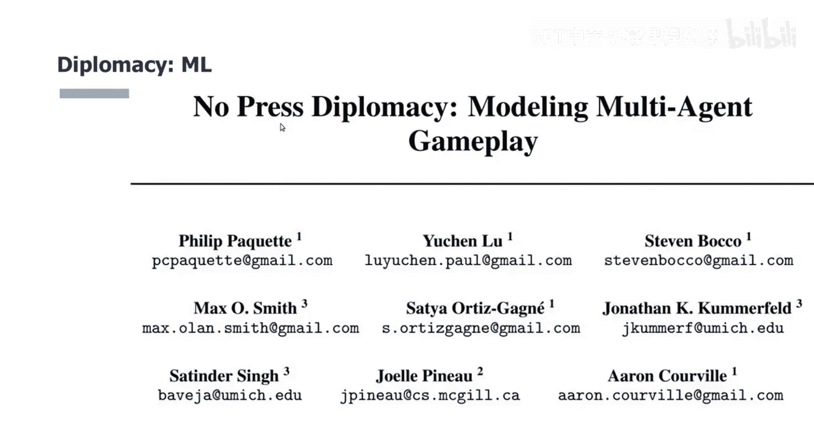

And we'll go over that in a moment， but it makes it very interesting as a model system because it's really not a sastic game。

 It's a game where you're playing simultaneous move updates。

 but you're playing sequentially So there are 34 supply centers in this game they're scattered over 75 provinces So these are the board positions and includes water and a particular power and again there's seven of them you interact within this game by issuing orders to your army and fleet units。

 So think land unit and water unit fleet to think Navy and it's split into years。

 we're starting in 1901。 you've got five phases， a spring movement a spring retreat a fall movement a fall retreat and a winter adjustments。

 So these five phases are part of the game and so of go through this movements I'll now try and give you a sense of each of these so we've got a spring movement and a fall movement what happens in a movement So there are four possible orders during the movement phase you can do a hold or move or support or convoy if you do a hold order it's issued by the unit to defend the province。

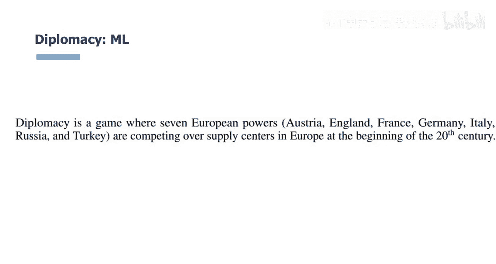

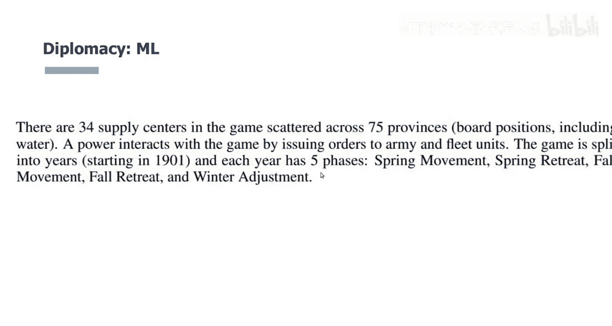

It's occupy so you're staying。 it's a hold order and that's the default。 if no orders are submitted。

 which makes sense。 A move order is used by the unit to attack an adjacent province。

 So think of it exactly what it sounds like you're moving it's a hold and move so you can move to the adjacent land or coastal province so you can think about it in terms of the geography again。

 it's restricted。 you can't just instantaneously move to any place you can move only to the adjacent land or coastal province。

 fleets can move to water or coastal provinces by following a coast so there's restrictions on how you can move very reasonable restrictions for that historical time period so now we did ho and move support is the next one so support orders can be given by any power to increase the attack strength in the moving unit or to increase the defensive strength of a unit that's holding supporting or convoit So support exactly what it sounds like you're adding support to this attack strength of a moving or increase the strength of another unit and support orders are interesting because。

It can be in another country， it can be across the different power so we can support a moving unit if the unit issue in the supporter can reach the destination that supported move and if the sport union is attacked this is part of it as well if the supporting unit is attacked it support is unsuccessful so the argument you want to be thinking about what support orders is you need to be geographically able to provide support and then convoy so you can move over water locations in one phase and attack another province by being convoyed by several fleets and so you need to imagine convoy order by the convoy fleets and a valid path for that convoy to be successful so these are orders that are written these fourpa orders the hold the move。

 the support and the convoy and then you can do retreats this is again part of this sequence again so you know as I mentioned again you've got these movements and you've got spring retreat and fall retreat so we just did the movements and the retreats if the attack。

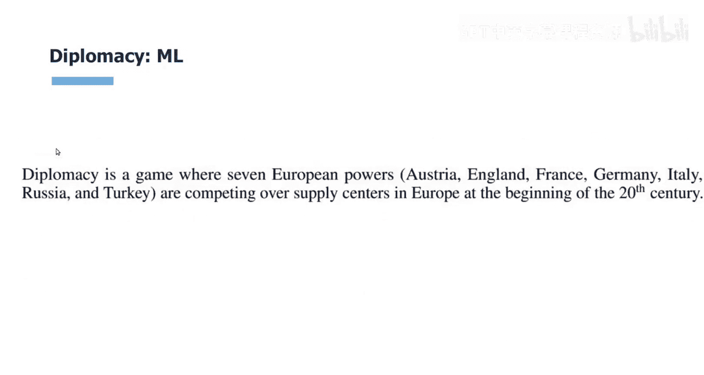

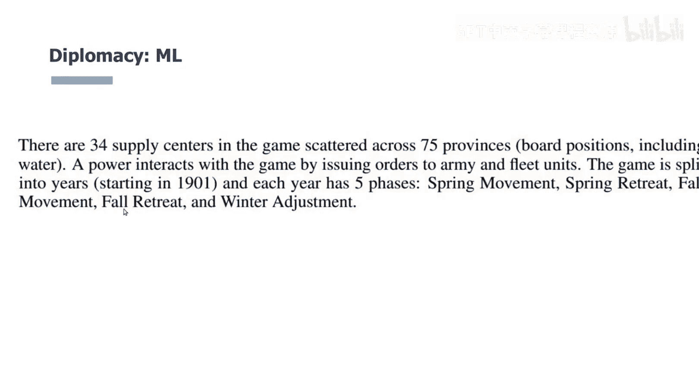

Successful and there's unit in the Concord province that unit is dislodged and's given a chance to retreat and there are two possible orders during the retreat phase。

 a regular retreat and a disband So retreat order is the goal of this move order。

 but it only happens during the treat phase and unit can only retreat to a location that is one occupied。

 unoccupied， adjacent and not a standoff location in which it can't be left vacant because I failed to attack a disband order these are the two retreat and disbands is the second one。

 the disband order indicates that the unit of the specified province should be removed from the board。

RightSo it's taken away from the game and dislodged units it's automatically disbanded if either there are no possible retreat locations or fails to submit a retreat order during the retreat phase or two units retreat to the same location。

 So you can think of this retreat phase as being where you do the accounting describing what's going on。

 So spring movement and fall movement and spring retreat and fall retreat and the next one is the winter adjustment。

 So in the adjustments it happens just once a year as you just saw。 And during that phase。

 the supply centers change ownership。 And again， that's how you're going to win the game。

 if a unit from one power occupies perhaps with the supply center owned by another power。

 So during this adjustment phase， there are three orders， you can either build disband or wave。

 If you've got more units than supply centers， then you need to disband。

 and if the power has more supply centers than units。

 you can build additional units to match the number of supply centers。 So for example。

 unitss can only be built in powers， Or supply center， for example， Berlinan or Kl or。

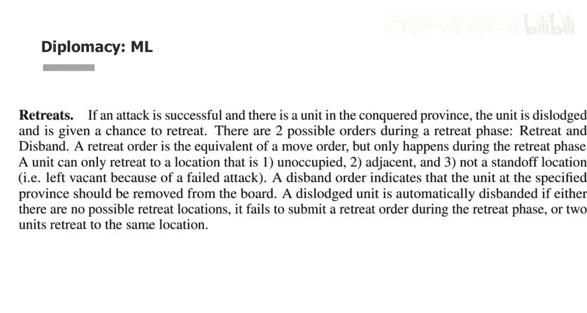

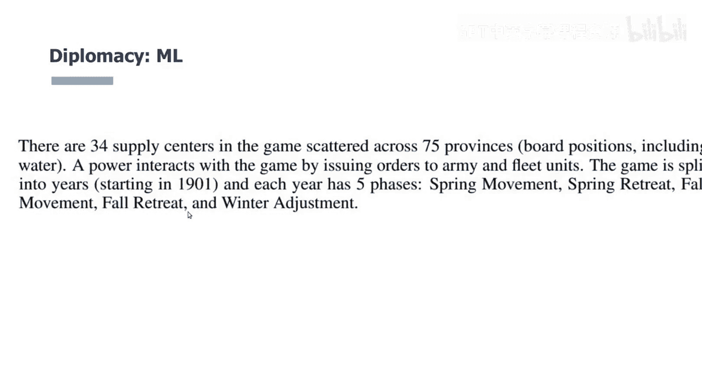

for Germany and that power has to control the chosen province and it must be unoccupied so our power can also decide to waive the builds。

 leaving them with few units then supply centers。 again these are adjustments。

 these are all part of the gameplay got retreats movements so again five phases spring movement and fall movement spring retreat and fall retreat and win adjustments。

 whatever the five phases again there are 34 supply centers 75 provinces So the common talk series really really big and it's what makes it interesting is that you've got so much going on Now as I mentioned this communication in the no press game。

 there are no messages the players can only by using orders as signals And so this is a way for people to still build up alliances because they do it through the orders so people playing the game in this no press variant are still playing diplomacy I mean there's still very strong component in terms of trying to make alliances and whether you should trust or not those alliances but it's not done openly。

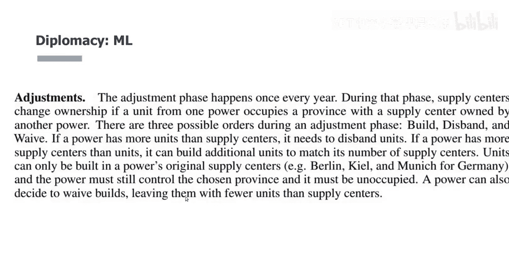

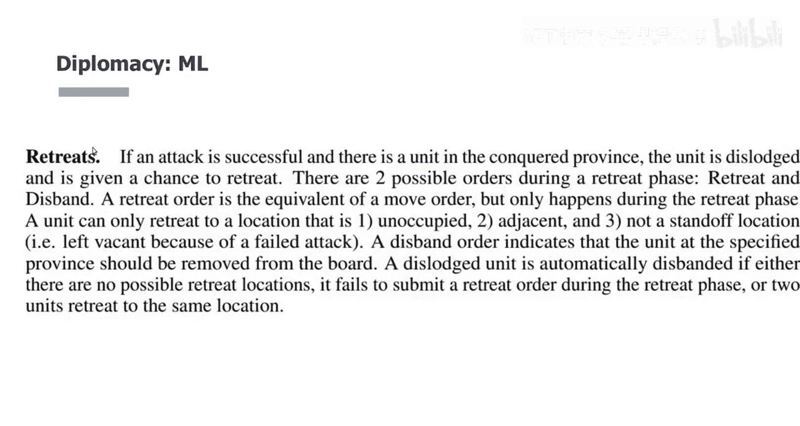

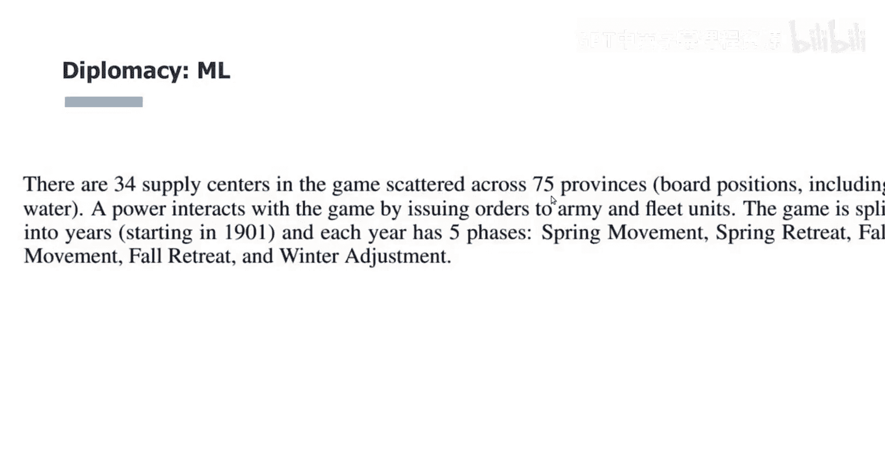

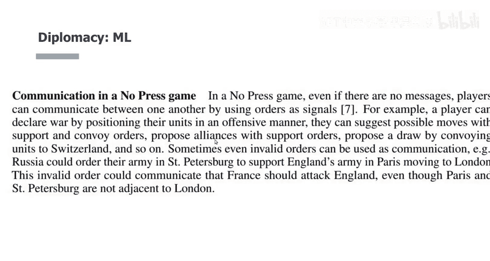

In the same way that you would in inpress。Okay， and then the gay man， as I mentioned。

 is when you reach the majority of the supply centers 18 out of 34。

 there's a scoring system and that scoring system。It's really fairly easy if you've got a draw then you can make a score based on that and these ideas of draws are not all that uncommon in the game these are fairly long and fairly elaborate games but the point is just that there is a very clear scoring system these easiest way to think about it is that you're aiming to get 18 out of 34 supply centers so now the next step is how do we represent this on the computer and how do we think about gameplay with a computer So the way that they did it was to make a current board state and then a previous orders。

 these are essentially just graphical think of them as large vector matrices ultimately these would even be tensors depending upon the type of computations that you want to imagine doing on them but the argument again is that we can represent the current board status in terms of the unit type we've got army fleet on the unit power or seven countries whether it's buildable or removable or dislodged。

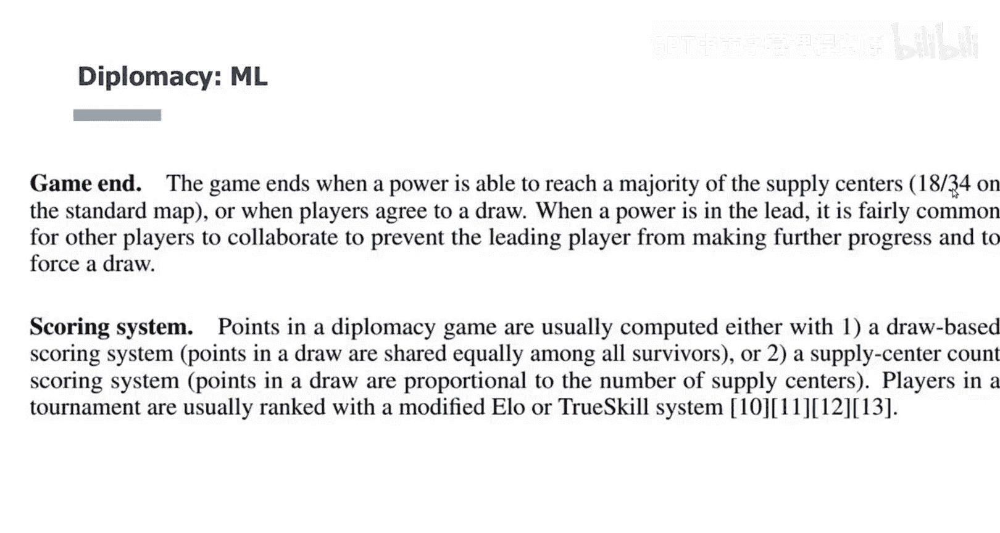

Tpes are dislotched unit power again， there's gonna be seven of them our area type and our supply center。

 So this is the current board zone since everything you would need then to recreate that current port。

 and then here's our previous orders。 So we're thinking about the different types of orders that we talked about So we've got our unit type or order ratio power or order type old move support convoy and none。

 So again all the different order types are power of the source location our power of our destination location。

 our supply center owner again from the seven countries。

 So the whole game is included in these two representations。

 fairly complicated because we've got 75 provinces in sixcos。

 so we've got an 81 dimensional height to each of these so you can see we've got a fair number of columns going across on this one columns going across on this one and then 81 rows and this would be for the current board state and then for previous order。

 So not not trivial to represent what's going on。

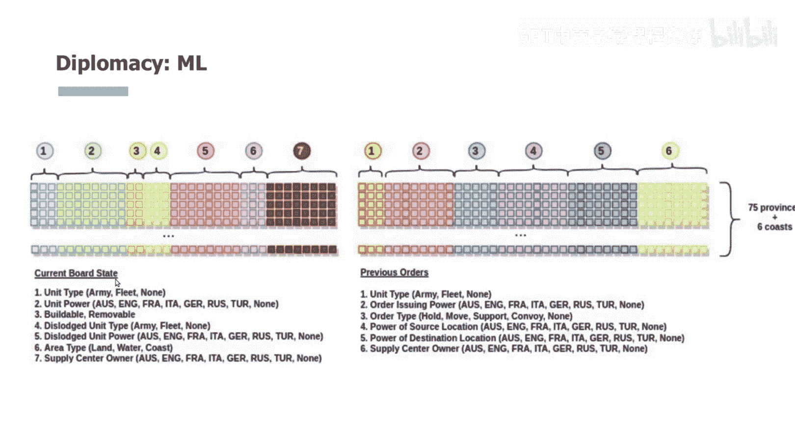