# 数据科学：时间中的决策｜11：基于人类行为的监督学习训练（上）🎮

在本节课中，我们将探讨如何利用一个经典的战略游戏——“外交”（Diplomacy）作为模型系统，来理解序列化的社会动态，并以此为基础进行机器学习建模。我们将详细介绍游戏的规则、核心机制，以及如何将其状态转化为计算机可处理的数据表示。

---

## 游戏背景与核心概念

上一节我们提到了利用游戏建模社会动态的思路。本节中，我们来看看“外交”这个具体的游戏。

“外交”是一款模拟第一次世界大战前欧洲局势的战略游戏。游戏包含七个欧洲强国：奥地利、英国、法国、德国、意大利、俄罗斯和土耳其。它们在欧洲地图上争夺34个补给中心，这些中心分布在75个省份（包括水域）中。游戏没有运气成分，完全依赖于长期策略和玩家间的互动。

游戏的核心机制是通过向陆军和海军舰队单位下达指令来进行。游戏按年份进行，每一年包含五个阶段：
*   春季移动阶段
*   春季撤退阶段
*   秋季移动阶段
*   秋季撤退阶段
*   冬季调整阶段

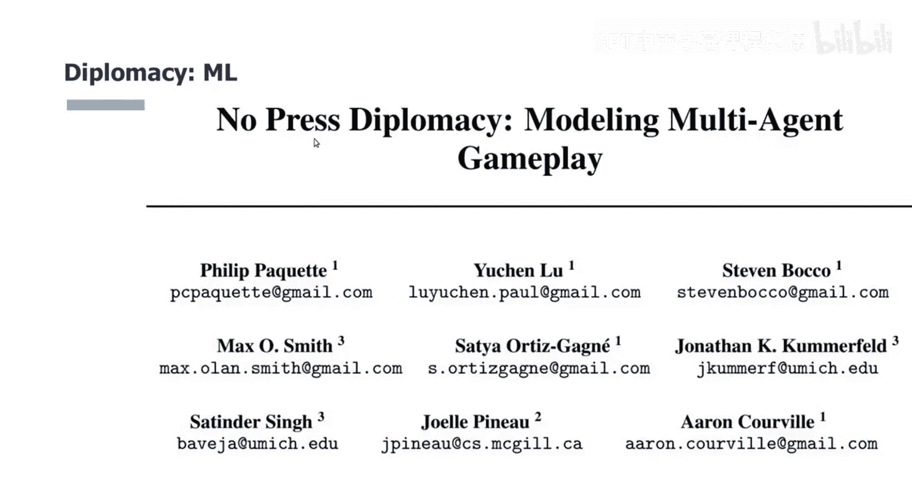

我们将要重点讨论的是“无通讯外交”（No Press Diplomacy）变体。在这个版本中，玩家之间不能直接发送信息进行外交沟通。所有的联盟、信任与背叛信号，都必须通过游戏内下达的指令来传递。这使得它成为一个研究纯策略交互的绝佳模型。

---

## 游戏阶段与指令详解

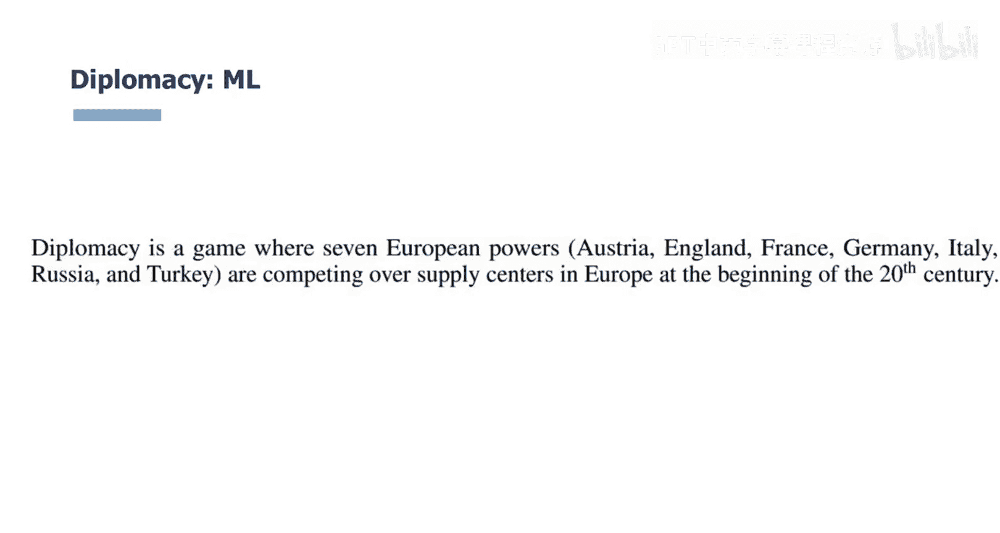

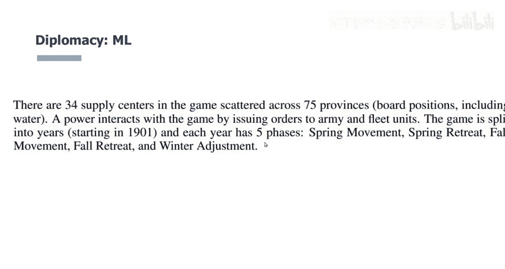

理解了游戏的基本设定后，我们来深入看看每个阶段玩家可以做什么。以下是游戏中可能出现的指令类型。

### 移动阶段指令

在春季和秋季的移动阶段，每个单位可以执行以下四种指令之一：

*   **驻守（Hold）**：单位停留在当前省份进行防御。如果未提交指令，则默认执行此操作。
    *   **代码表示**：`order_type = “HOLD”`
*   **移动（Move）**：单位攻击一个相邻的省份。陆军只能移动到相邻的陆地或沿海省份；舰队可移动到相邻水域或沿海省份，并需遵循海岸线规则。
    *   **代码表示**：`order_type = “MOVE”， destination = [目标省份]`
*   **支援（Support）**：单位可以增强一个正在移动（攻击）或驻守（防御）的友方或**甚至其他玩家**单位的实力。支援单位自身必须未被攻击，且其位置能“触及”被支援行动的目的地。
    *   **代码表示**：`order_type = “SUPPORT”， target_unit = [被支援单位]， target_order = [被支援的指令]`
*   **运输（Convoy）**：舰队可以将一个陆军单位跨水域运输到另一个省份，这通常需要多支舰队组成一条连续的运输路径。
    *   **代码表示**：`order_type = “CONVOY”， convoying_unit = [被运输的陆军单位]， destination = [目标省份]`

### 撤退阶段指令

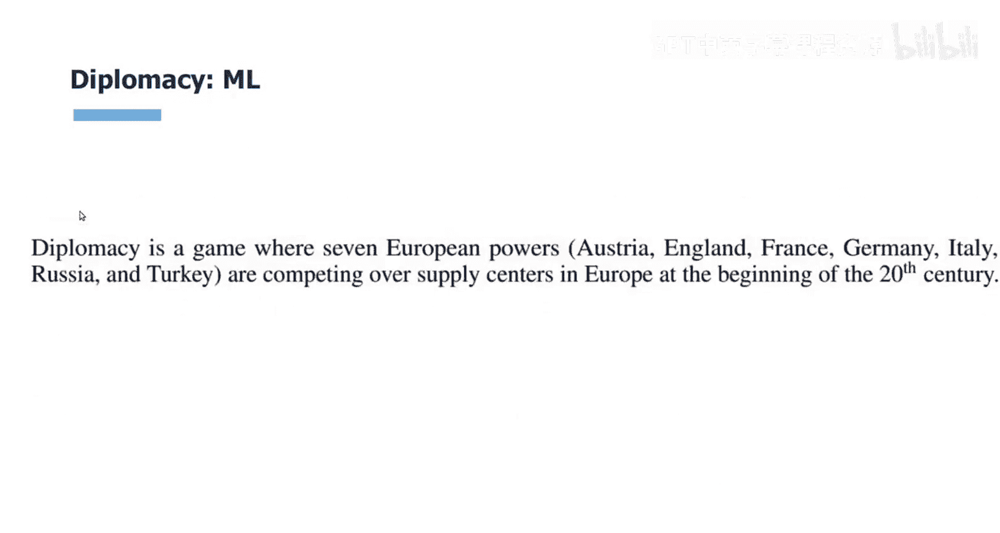

在春季和秋季的撤退阶段，如果一个单位在移动阶段被成功攻击而“被驱逐”（dislodged），它可以尝试撤退。以下是两种可能的指令：

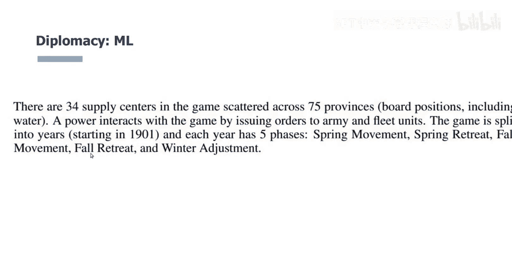

*   **撤退（Retreat）**：被驱逐的单位移动到一个**未被占领、相邻、且非“僵持”状态**的省份。
*   **解散（Disband）**：该单位被直接从地图上移除。如果被驱逐的单位没有可行的撤退地点，或未提交撤退指令，或多个单位撤退到同一地点，则会自动解散。

### 冬季调整阶段指令

每年一次的冬季调整阶段，将根据各势力控制的补给中心数量来调整其军队规模。指令如下：

*   **建造（Build）**：如果某个势力控制的补给中心数量多于其现有单位数量，它可以在其控制的、未被占领的补给中心省份建造新单位（例如，德国可以在柏林建造）。
*   **解散（Disband）**：如果某个势力的单位数量多于其控制的补给中心数量，它必须解散多余的单位。
*   **放弃（Waive）**：势力也可以选择放弃建造权利，保持比补给中心数量少的单位。

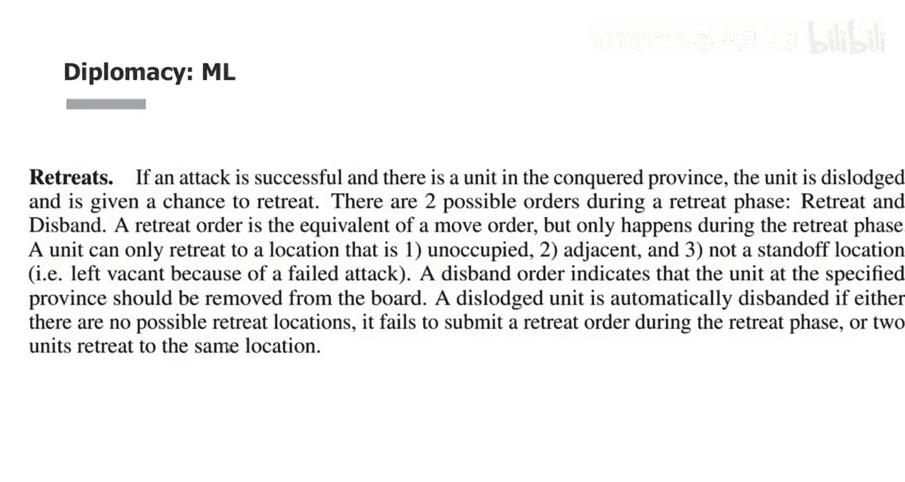

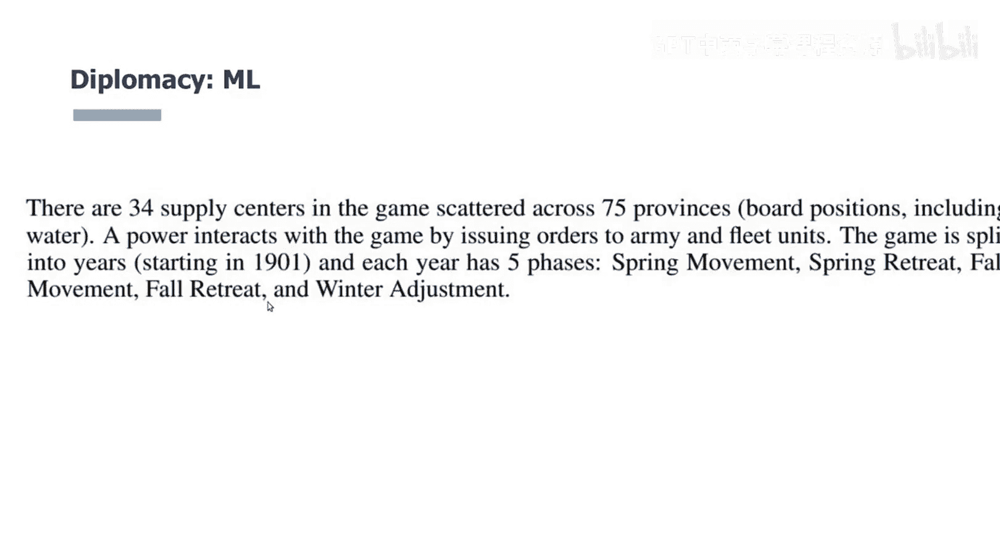

---

## 游戏状态的数据表示

了解了游戏规则后，下一步是如何让计算机理解并处理游戏状态。研究人员将复杂的棋盘状态编码为结构化的数据。

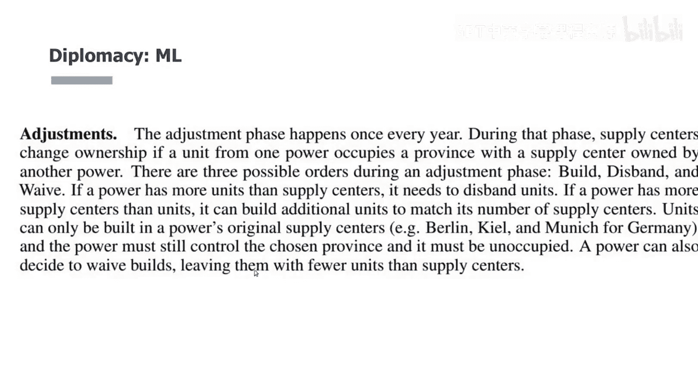

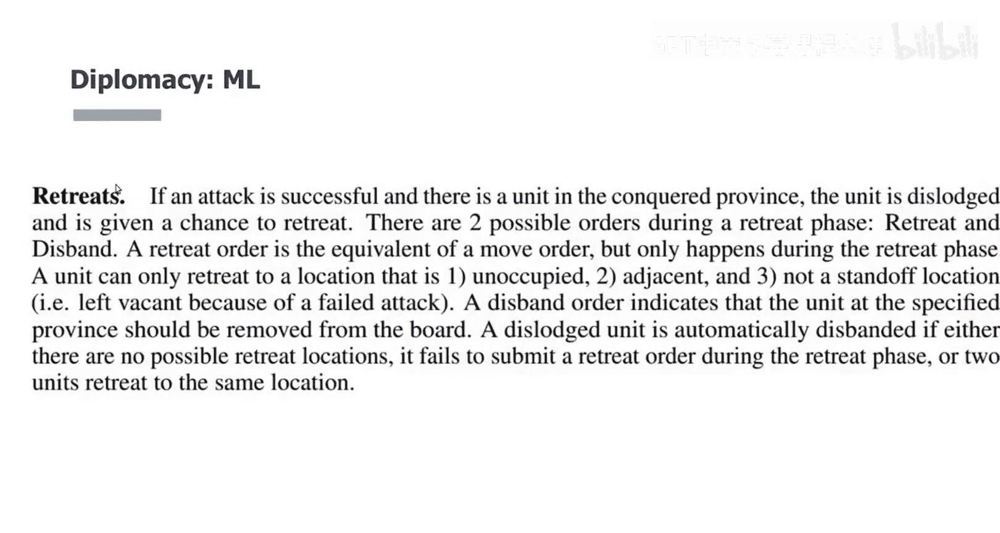

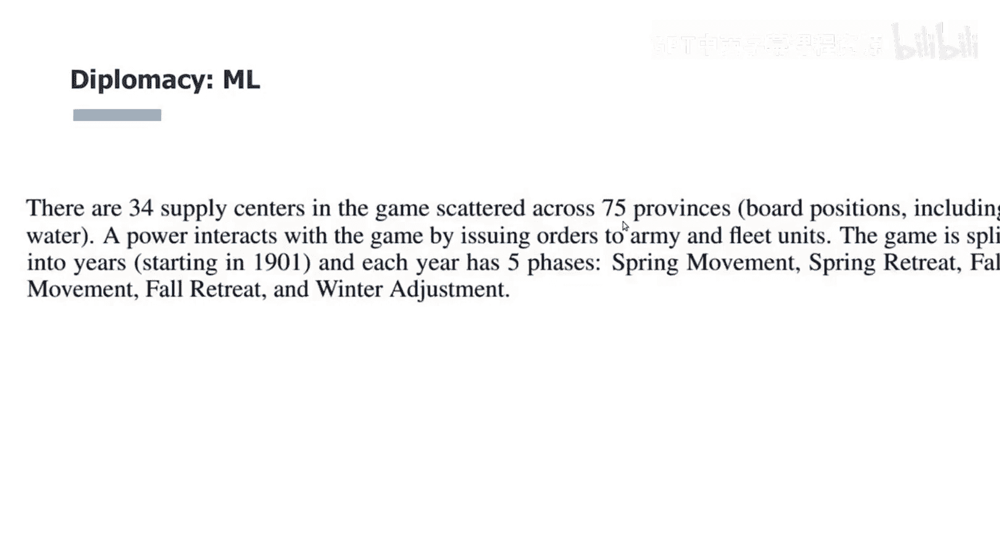

游戏的整体状态可以用两个核心的矩阵（或张量）来表示：

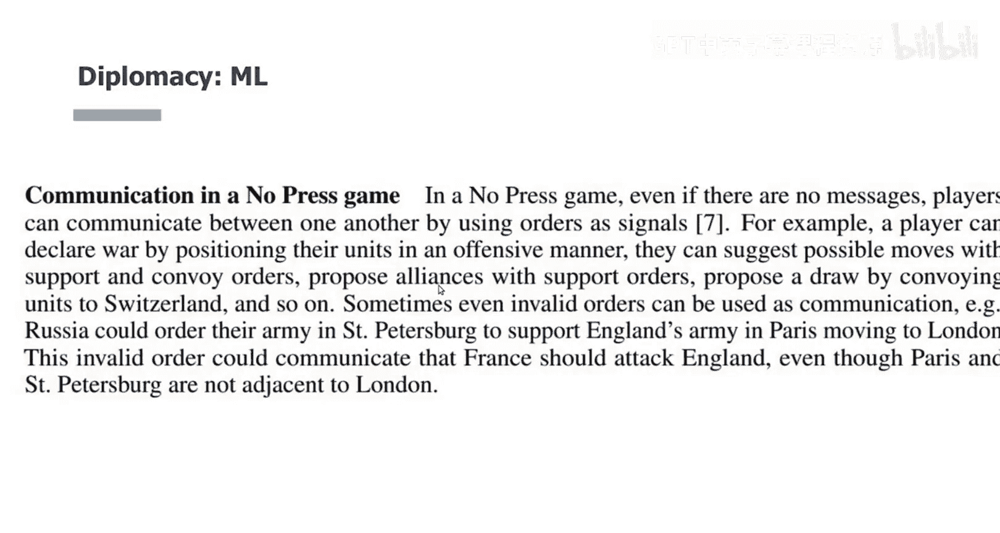

1.  **当前棋盘状态（Current Board State）**：一个81行（对应75个省份+6个特殊区域？）、多列的矩阵，每一行描述一个省份的当前状态。
    *   **包含特征**：单位类型（陆军/舰队/无）、单位所属势力（七国之一）、该省份是否可建造单位、是否可移除单位、是否有被驱逐的单位、被驱逐单位的所属势力、地区类型、补给中心所有者等。

2.  **上一回合指令（Previous Orders）**：同样是一个81行、多列的矩阵，记录上一回合每个省份发出的指令详情。
    *   **包含特征**：发出指令的单位类型、指令类型（驻守/移动/支援/运输/无）、指令发出方势力、指令源省份、指令目标省份、目标省份的补给中心所有者等。

**公式化描述**：
我们可以将t时刻的游戏完全状态 **S_t** 视为由棋盘状态 **B_t** 和上一轮指令历史 **O_{t-1}** 共同定义：
**S_t = (B_t, O_{t-1})**
其中，**B_t** 和 **O_{t-1}** 都是高维的特征矩阵，共同封装了进行决策所需的全部信息。

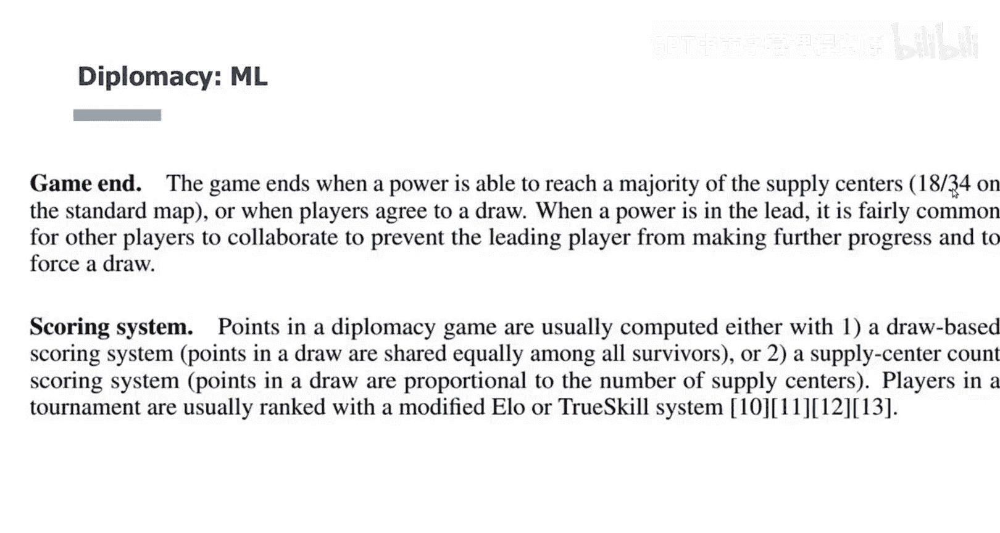

---

## 总结

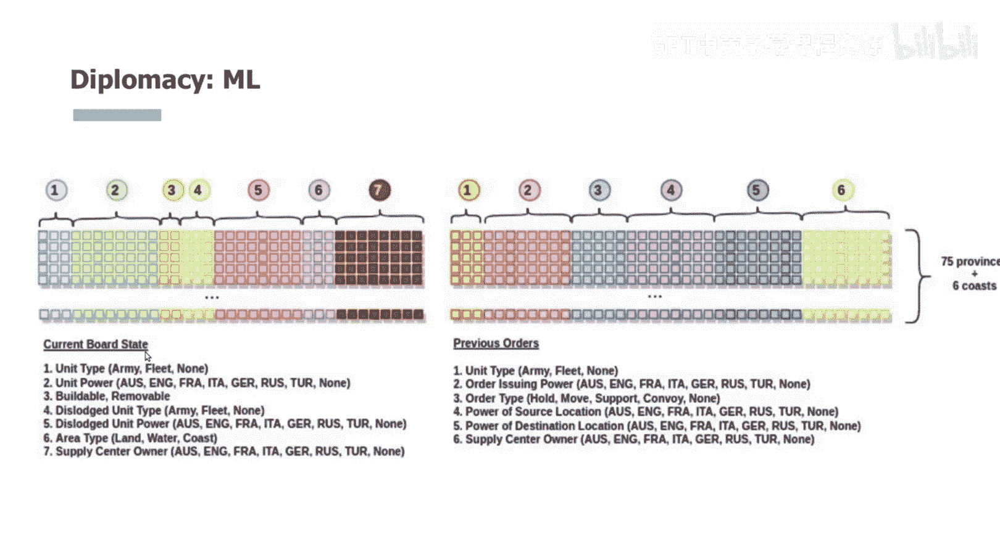

本节课中，我们一起学习了“外交”游戏如何作为一个复杂的序列社会互动模型。我们详细剖析了其“无通讯”变体的规则，包括移动、撤退、调整三个阶段的各种指令。最后，我们探讨了如何将这种丰富的游戏状态编码为结构化的数据表示（当前棋盘状态和上一回合指令），这是后续利用监督学习等方法训练AI模型的基础。下一节，我们将基于这些数据表示，深入探讨如何构建和训练能够模仿人类玩家行为的预测模型。