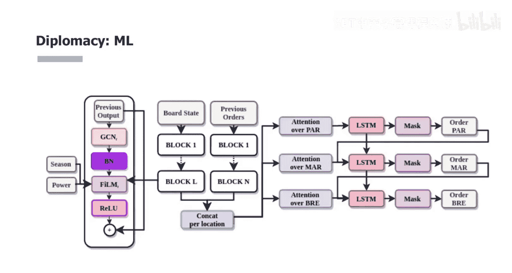
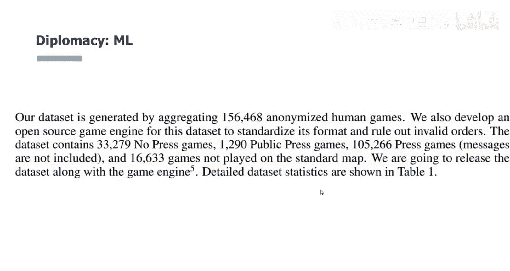
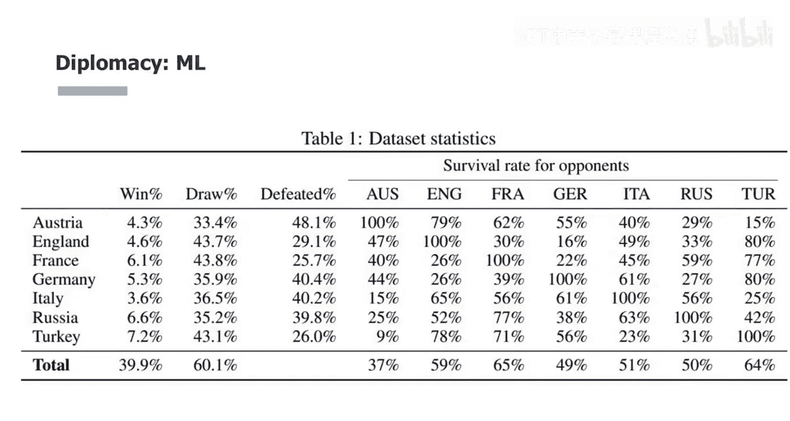
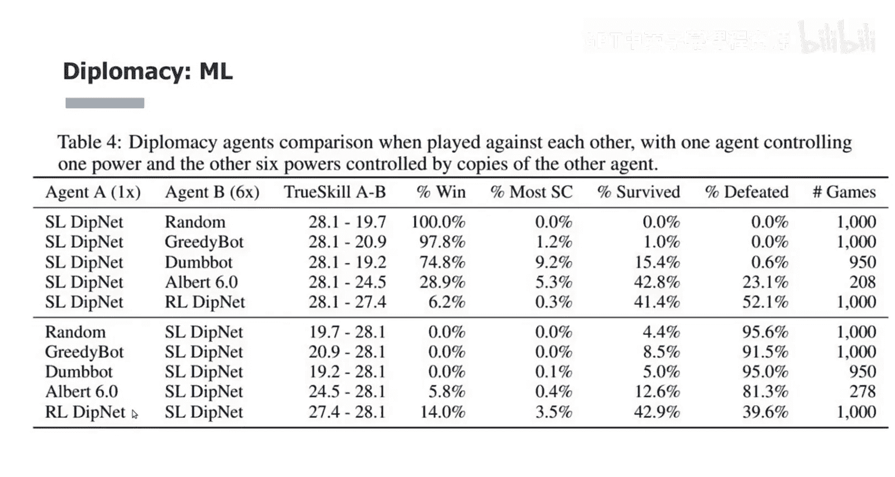
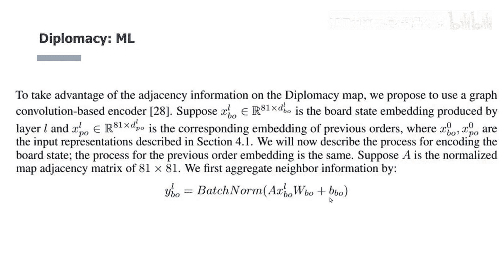
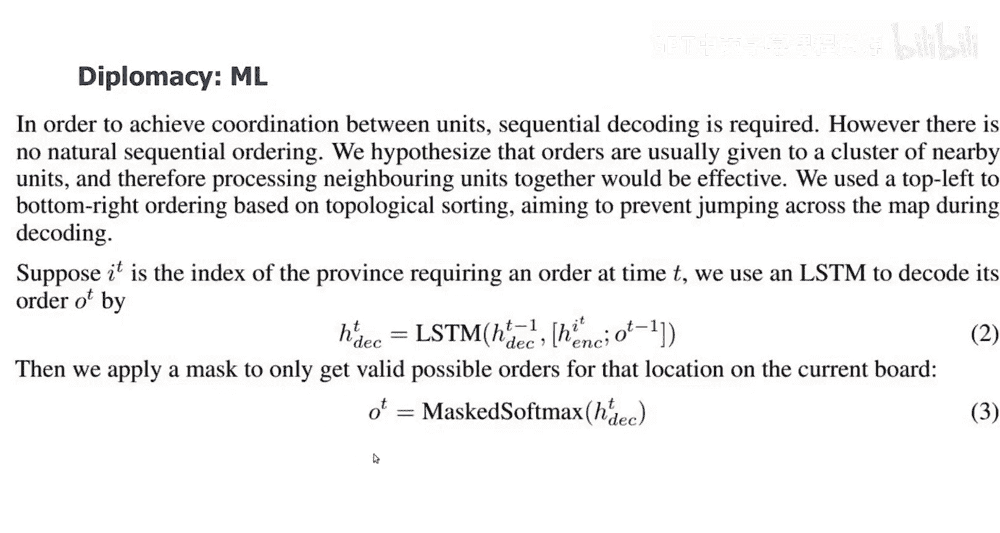
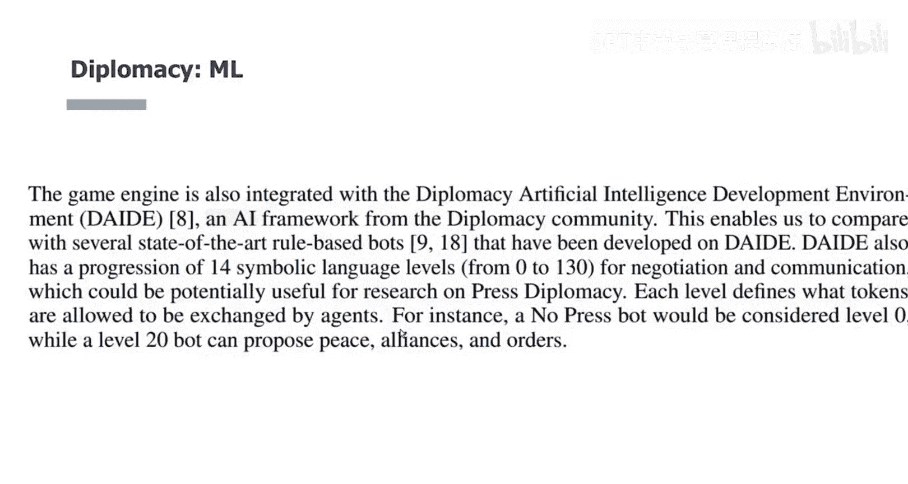

# 约翰霍普金斯大学《数据科学：时间中的决策｜Data Science Decisions in Time》中英字幕 p45 12_基于人类行为的监督学习训练（下）.zh_en -BV1NCuzzfEJa_p45-

Okay so their approach to this again is machine learning， like with anything in machine learning。

 the architecture can be described， but exactly why it works the way it does is a little more awkward because we've got neural networks here so some of you taking the class may be aware of neural nets some of you may if even work with them describing them can be again a little bit complicated but I'm going to try and give you some flavor for how this is done so we've got our seasons in our powers so think of the gameplay and effectively we're going to use this film you'll see at some points I'll return to it。

 we can have the film on or not， you can think of that as another set of operations these are transform operations that can help to improve the efficiency of the neural network and anyway this is a layer of neural nets and then effectively we've got our board state on our previous orders these are the matrices that we're going to be working on and then we're going to be using LSTMs we've also got masks and effectively what we're doing is paying attention over the。

Network and you can think about this ultimately as an architecture that we're going to go backwards and forwards over so we're going to optimize the states and this way of thinking in terms of neural nets is really an entire class and not something we need to go into in great detail for this particular class but for now just realize that we can effectively describe our inputs we can describe ultimately how we're going to optimize over this network in order to define our parameters and therefore to learn how to play the game and then we can evaluate how well we play the game so they learned by having a big good test data set so about 15600468 human games and had to adjust this a little bit because what we really again wanted to do is to look at the no press games so some of these were with public press or with press where they did not include the messages and so you can imagine that this has to be adjusted at least a little bit in order to。

consistent these are the data stats。 So these are seven countries。

 These are the bins and the ds and the defeated plain against these opponents。

 I think it's kind of interesting to glance through it a couple things。

 you can see obviously first off， these diagonal ones here would be self against self。

 And so those should all be 100%。 But if you look at say Austria against each of these opponents。

 it's not uniform。 So Austria say against Turkey and Turkey against Austria。

 those were fairly low numbers。 You can see there's some other numbers that are higher like Austria versus England。

 right it's just interesting to see that in the statistics， these countries are different。

 and that's got some history behind it。 that's just kind of interesting。

 it's what makes the game realistic and historically interesting and that that's the case。

 so now they compared their results again， I didn't go through every detail in fact。

 fairly briefly and really almost superficially I went through the details on that or that。

 But they did a variant on the learning where it was learning from these。

Projectory sets。 So they have these statistics。 They also did。Reinforcement learning。

 their code is called Dipnet， so diplomacy network。

 they compared them against some existing previous routes for learning diplomacy。

 Albert is probably one of the most famous of the previous efforts and what they're basically arguing is if they play their agent this is A one times so that's one country agent B six times so they are the other agents that are playing in the game they arguing that their learning environment based again on the human players of diplomacy net did very。

 very well against all of these so against random they won 100% of the time。

 but even against these others even against Albert which is really kind of the standard of the art from when they first put this paper together。

 they did really， really quite well。 The reinforcement learning variant again， learned first from。

learning from the supervised learning against the data set and then selfplay for the reinforcement learning。

 which is a standard way to try and improve game performance。

 but in this case their argument is that the supervised learning actually based on the data set did better on average than the reinforcement learning that was kind of an interesting conclusion。

So anyway， this is their main takeaway that they were able to train it and then it was able to do quite well。

 and now let me try and give you some feeling for how a little more how their internet did it so this was a graph convolutionbased encoder and the argument is that we want to take those81 dimensions and encode so we've got this x B0 to the L that's our board state at a particular level L so think of these as different architectural layers and again this is embedding or a mapping and the way you want to think about this is that effectively we're doing an encoding encoding。

 which is a fairly common neural network approach So it's convolution based because we're thinking about it in terms of the geography in terms of what's going on within the system so that we've got B0 and p0 and these are these input representations I think of that' the board and the planning and again those are the two things that we need to fully describe the game everything can be recreated from。

Those states。 So now again， we've got this adjacency matrix of 81 by 81 and we're going to make this y on B0。

 So this batch norm on that you can think of it is almost like a effean linear transform effan again meaning linear。

 meaning that we can transform this through these series of operations on those input states and again。

 we can describe where they came from and then the batch norm is on the last dimension。

 So effectively just describing the architecture。 I mentioned film if we've got time I'll go through that a little bit more later on but effectively think of this as another series of transforms that can be done to improve the ability for the learning within the game。

 So as they saying it' effective method for fusing these multimodal information and domains and then effectively we can do this batch normalization conditioning in the ps P and the current system again spring。

 fall and winter so we're updating， think of this as updating and your learning encoding。

And learning the features that are most important and the weights on those features that are most important for being a good player in the game so we've got a linear transform this gam and the beta from R and then we've got additional multiplication and then we add a value and residential connections so effectively what we've got is a series of transforms that are going on within within the system within these blocks within the system and then we do getnation at the end and then we've got our embedding for the final and we've got some hyperparameters for example this capital L being 16 don't worry too much about all these details that you've not comfortable with this the argument again that I want to help you see into is simply you can make a very very good machine learning model for playing diplomacy。

So now in order to help this coordination between units， you've got a sequential decoding。

 so it's an encoding and a decoding， there's no natural sequential ordering。

 I mean we've got updates different stages of the game。

 but essentially what you' want to be thinking about is that there's a way to do this using these LSTMs so that what we've got is a decoding now and then we can apply a mask to get the orders out and we've got a recipe for playing the game。

So the game mentioned here as well was interacting with I'm going to bounceun it as Di。

 but it really it's this diplomacy AI development environment and that comes from the diplomacy community。

 you can look this up online if you're curious。Potentially one of the places again where almost like archives for ch or go。

 it's a way to potentially build more and more awareness of what's going on in diplomacy and why it's an interesting challenge to try and understand more about the game So with that I think we'll pause I think this ended up being kind of a longish video I apologize for some of you who may have been longer than you expected。

 but I think it's an interesting game and again it's fascinating that we've now got the ability to do machine learning within this game。

 so again， I urge all of you to give it a try， play the game， get sense as to how it works。

 it's much more interesting， I think in its real life applications than something like it business dilemma or games that are fairly simple in terms of their structure and it's not to denigrate those other games。

 but it's just that diplomacy has some real complexity to it and I think that makes it really interesting as a model system for these kind of sequential social interactions and imagining how to optimize so with that we'll pause Thank you。

