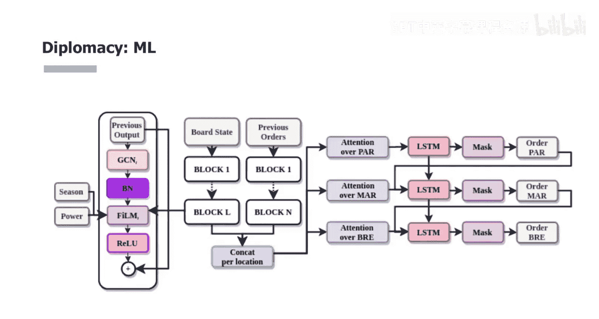
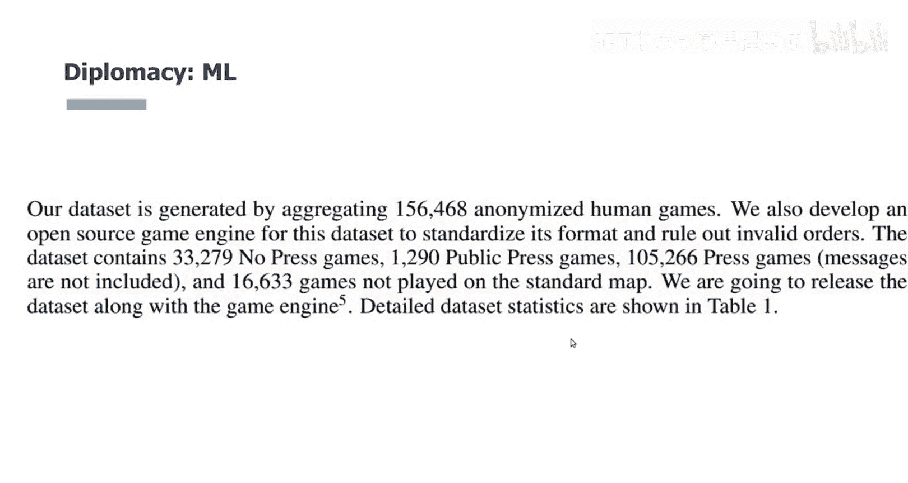
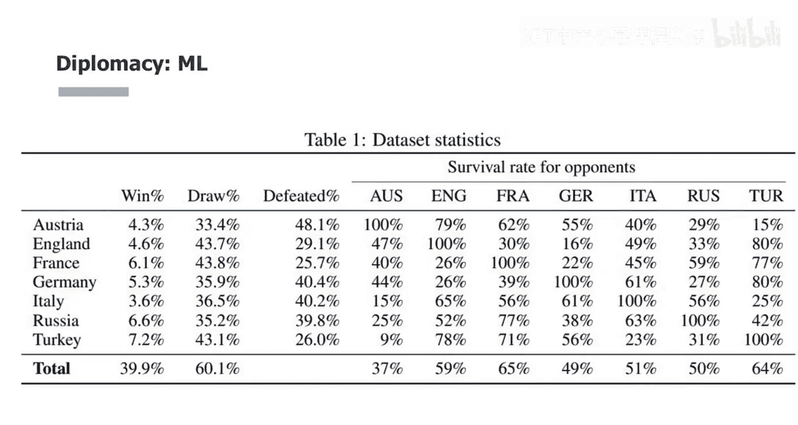
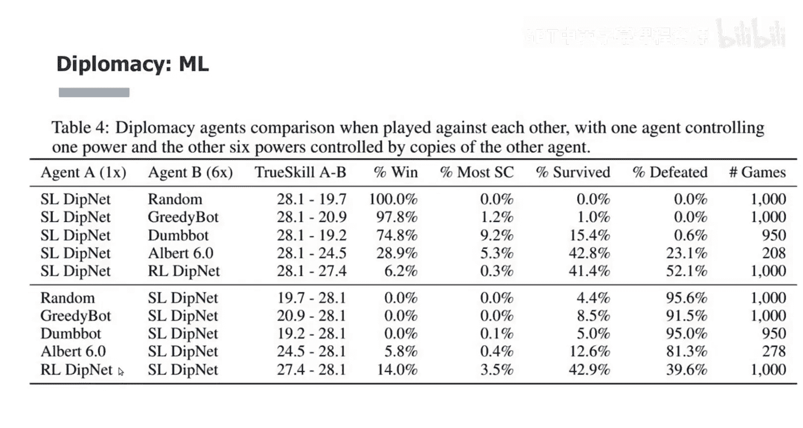
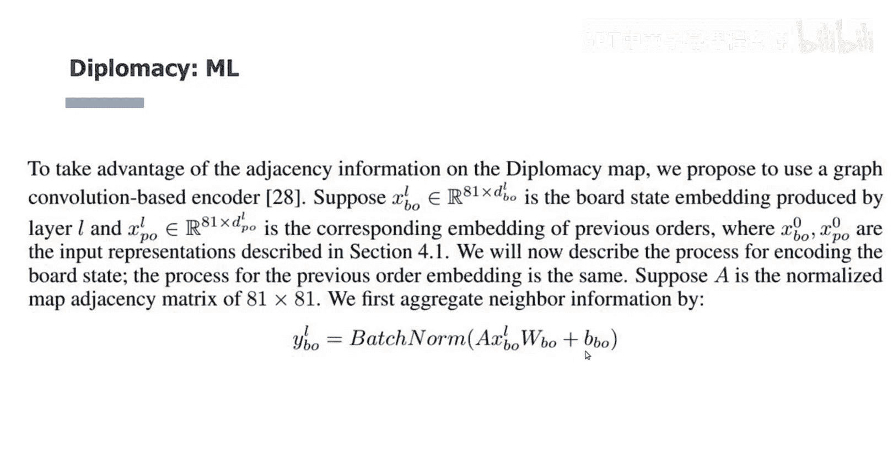
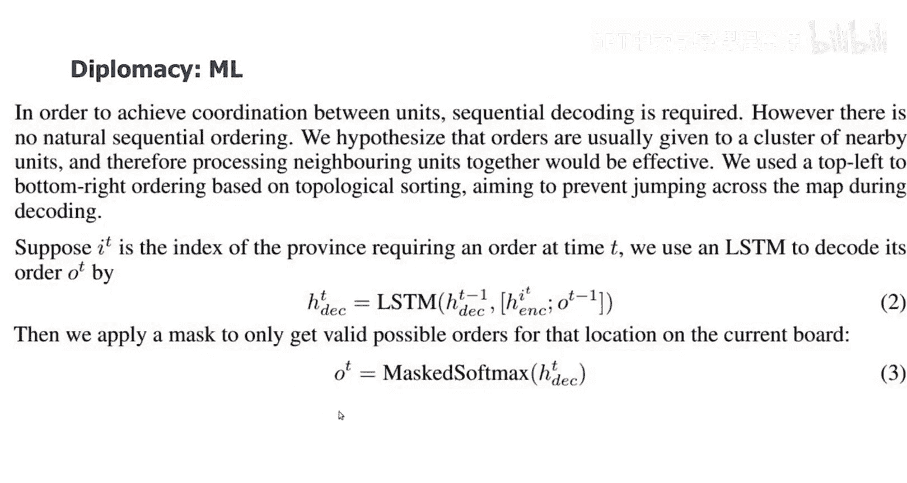
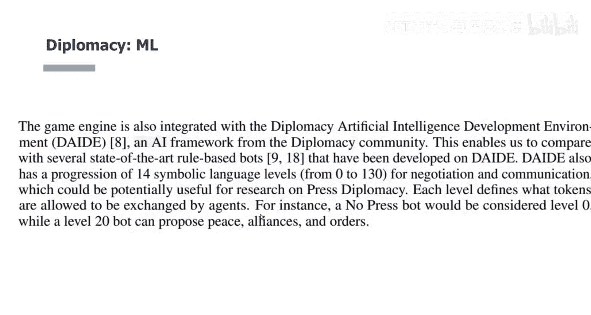

# 数据科学：时间中的决策｜12：基于人类行为的监督学习训练（下）🤖

在本节课中，我们将继续探讨如何利用人类游戏数据训练一个能够玩《外交》游戏的AI代理。我们将深入了解其背后的机器学习架构、训练过程以及最终的性能评估。

上一节我们介绍了利用人类游戏数据进行监督学习的基本思路，本节中我们来看看具体的模型架构和训练细节。

## 模型架构概述 🏗️

他们的方法本质上是机器学习。与所有机器学习问题一样，其架构可以被描述，但要精确解释其为何如此工作则更为复杂，因为这里涉及了神经网络。课程中的部分同学可能了解神经网络，部分同学甚至使用过它们，但描述它们可能有些复杂。我将尝试让大家了解这是如何实现的。

我们拥有游戏中的季节和阶段。考虑游戏过程，我们将使用这段影片（我稍后会再次提及）。我们可以选择开启或关闭影片，你可以将其视为另一组操作。这些是转换操作，有助于提高神经网络的效率。无论如何，这是一层神经网络。

接着，我们拥有棋盘状态和之前的指令。这些是我们要处理的矩阵。然后，我们将使用长短期记忆网络。我们还使用了掩码，本质上，我们所做的是在整个网络中进行“注意力”机制。你可以将其最终视为一个我们将反复迭代的架构。我们将优化状态。

这种基于神经网络的思考方式本身是一门完整的课程，我们无需在本课程中深入细节。目前只需理解，我们可以有效地描述输入，描述我们如何优化这个网络以定义参数，从而学习如何玩游戏，然后评估我们玩得有多好。

## 训练数据与统计 📊

他们通过一个大型优质测试数据集进行学习，该数据集包含约15600468场人类游戏。他们对此进行了一些调整，因为我们真正想做的是研究“无通讯”游戏。其中一些游戏包含公开通讯或包含未收录消息的通讯。可以想象，这至少需要进行一些调整以保持一致性。

以下是数据统计。这是七个国家。这些是对抗这些对手的箱线图和战败比例。

浏览这些数据会发现一些有趣的现象。首先，这里的对角线是自我对抗，因此应该都是100%。但如果你观察奥地利对抗每个对手的数据，它并不均匀。例如，奥地利对抗土耳其，以及土耳其对抗奥地利，这些数字相当低。你可以看到其他一些数字更高，比如奥地利对抗英格兰。从统计数据中看到这些国家存在差异是很有趣的，这背后有其历史原因。正是这一点使得游戏具有现实性和历史趣味性。

## 性能对比与结论 ⚔️

现在，他们再次比较了结果。事实上，我并没有深入每个细节，而是相当简略甚至表面地介绍了那些细节。但他们尝试了一种学习变体，即从这些轨迹集中学习。他们拥有这些统计数据。他们还进行了强化学习。

他们的代码称为Dipnet（外交网络）。他们将其与一些先前学习《外交》的现有方法进行了比较。Albert可能是先前最著名的成果之一。他们的基本论点是，如果让他们的智能体（A）扮演一个国家一次，而其他智能体（B）扮演其余六个国家六次，那么基于人类玩家数据训练的学习环境（Diplomacy Net）对抗所有这些方法都表现得非常出色。

对抗随机智能体时，他们100%获胜。即使对抗其他方法，包括Albert（在他们撰写这篇论文时，这确实是当时的最高水平），他们也表现得非常出色。强化学习变体首先从监督学习（基于数据集）中学习，然后通过自我对弈进行强化学习，这是提升游戏性能的标准方法。但在本例中，他们的结论是，基于数据集的监督学习平均表现优于强化学习，这是一个有趣的发现。

总之，这是他们的主要结论：他们能够成功训练模型，并且模型表现相当出色。

## 深入模型架构：图卷积编码器 🔍

现在，让我尝试让大家更深入地了解他们的网络是如何工作的。这是一个基于图卷积的编码器。其核心思想是，我们希望获取那81个维度并进行编码。我们拥有从x B0到L的表示，这是我们在特定层级L的棋盘状态。可以将这些视为不同的架构层，这同样是一种嵌入或映射。理解这种方式的关键在于，我们实际上在进行编码，这是一种相当常见的神经网络方法。

它基于卷积，因为我们是根据地理关系和系统内发生的情况来思考的。因此，我们拥有B0和p0，这些是输入表示。可以将其视为棋盘和计划，这两者是我们完整描述游戏所需的一切，所有信息都可以从这些状态中重建。

现在，我们有一个81x81的邻接矩阵，并将在其上应用y on B0。这里的批归一化，你可以将其视为几乎像一个仿射线性变换。“仿射”再次意味着线性，意味着我们可以通过这些输入状态上的一系列操作来转换它。我们可以描述它们的来源，然后批归一化作用于最后一个维度。本质上，这只是对架构的描述。

我提到了FiLM（特征线性调制），如果有时间，我稍后会再详细说明。但本质上，可以将其视为另一系列转换，用于提高游戏内的学习能力。正如他们所说，这是融合这些多模态信息和领域的有效方法。然后，我们可以根据ps P和当前系统（春季、秋季、冬季）进行这种批归一化条件处理。可以将其视为更新，更新你的学习编码，并学习对于成为游戏中的优秀玩家最重要的特征以及这些特征的权重。

我们有一个线性变换（参数为γ和β，来自实数集R），然后进行额外的乘法运算，接着加上一个值并进行残差连接。本质上，我们所拥有的是系统内、这些模块内进行的一系列转换。最后，我们进行聚合，得到最终的嵌入表示。我们还有一些超参数，例如这里的L为16。如果你对这些细节不熟悉，不必过于担心。我想帮助大家理解的核心论点是：你可以为玩《外交》游戏构建一个非常出色的机器学习模型。

## 顺序解码与协调 🤝

为了帮助单位之间的协调，他们使用了顺序解码。这是一个编码和解码的过程。游戏中没有天然的顺序排序，尽管我们有游戏的不同更新阶段。但本质上，你需要思考的是，有一种方法可以使用这些LSTM来实现这一点。因此，我们现在进行解码，然后可以应用掩码来输出指令，从而得到玩游戏的“配方”。

这里提到的游戏环境是与Diplomacy AI开发环境交互的（我将其简称为Di）。它确实来自《外交》社区。如果你好奇，可以在线查找。这可能是又一个类似于国际象棋或围棋档案库的地方，是潜在地建立对《外交》游戏及其为何是一个有趣挑战的更多认识的途径。

## 总结与鼓励 🎯

本节课中，我们一起学习了如何利用大规模人类游戏数据，通过监督学习训练一个复杂的《外交》游戏AI。我们探讨了其背后的图卷积神经网络架构，了解了编码与解码过程如何帮助模型理解游戏状态并生成有效指令。通过对比实验，我们看到基于人类行为数据的监督学习模型表现优异，甚至超过了后续的强化学习变体。

《外交》游戏因其在顺序社交互动中的真实复杂性，成为了一个极具价值的模型系统。我再次鼓励大家尝试玩这个游戏，感受其运作方式。我认为它在现实生活应用中的趣味性远胜于商业困境博弈或其他结构简单的游戏。这并非贬低其他游戏，只是《外交》具有真正的复杂性，这使其作为研究这类顺序社交互动以及思考如何优化的模型系统变得非常有趣。

就此，我们暂停。感谢观看。