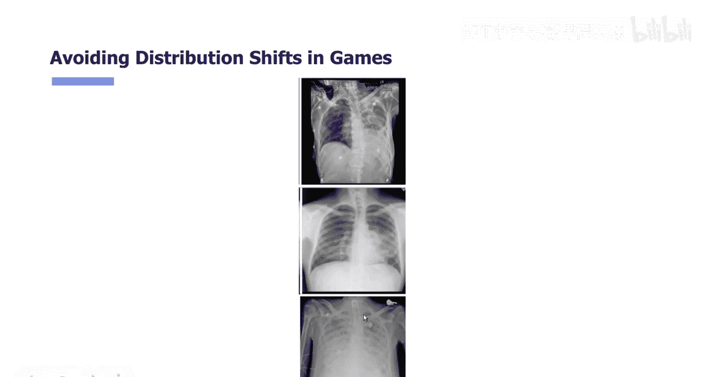
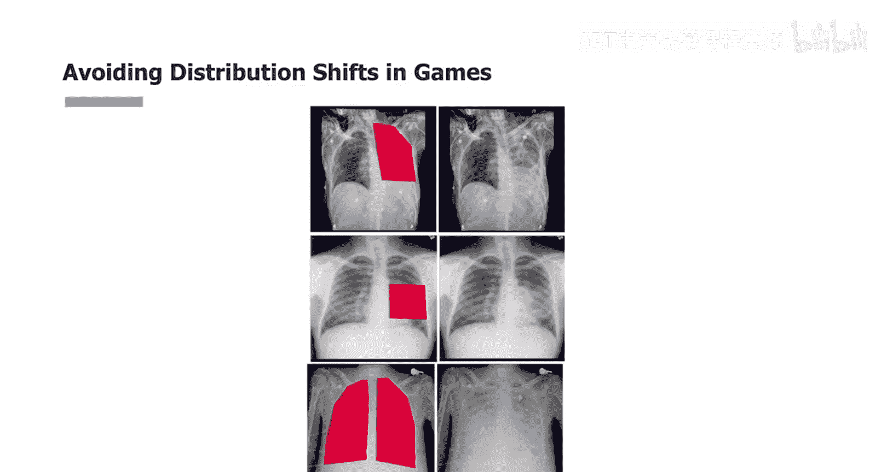
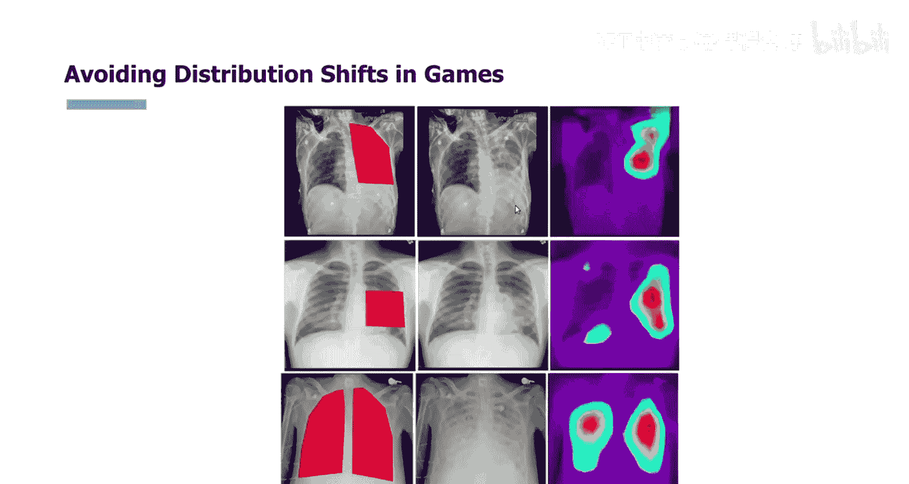
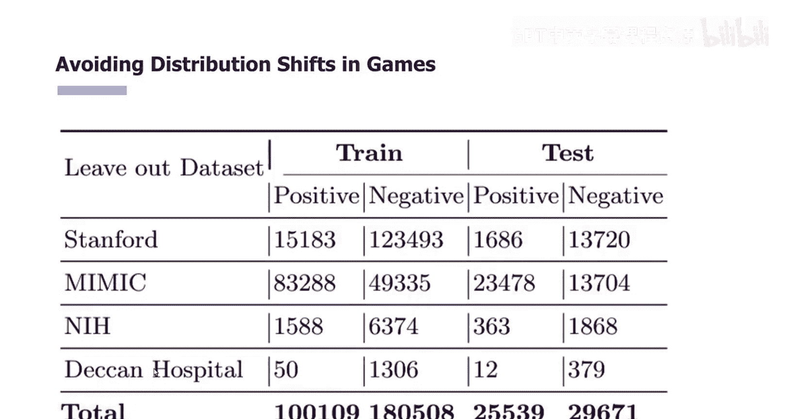
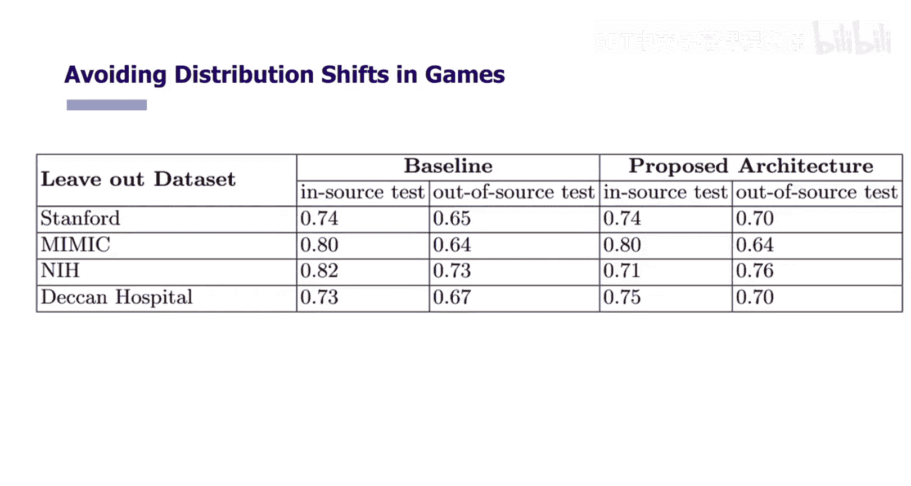

# 约翰霍普金斯大学《数据科学：时间中的决策｜Data Science Decisions in Time》中英字幕 p46 13_极小极大博弈下的放射影像解析.zh_en -BV1NCuzzfEJa_p46-

Well I'll talk about another contribution from Wong and this connects back with the very beginnings of our making decisions in time specialization and this has to do with what's called minimax theory。

 a part of game theory part of almost the lure of making things work but now we're going to be talking about it in the context of machine learning and avoid distribution shifts and what I want to do is introduce an interesting problem first and then we'll go through wall's paper and then we'll do a little bit of return into more directly in the machine learning imagine you're a radiologist and you've got different kinds of x-rays。

 you're trying to decide whether someone has no moonia or not， very topical， very important。

 sort of thing you'd almost think could start to be really turned into something that machine learning and algorithms could pick out。

 but it's actually quite challenging there's a lot of noise in these images there's a lot of background characteristics It's not always so easy to look at these and confidently say what's going on even the radiologists。

Don't always agree anyway there are now publicly available online images for testing almost like Google with the efforts to differentiate thesetype pictures of dogs and cats in early days of machine learning Can you catalog these。

 Can you cleanly classify them into different states trained radiologists would draw something like these shapes or regions that they would consider problematic in these lungs and they would use that then as part of their techis for what's going on。

machine learning and especially adversarial machine learning。

 which we're talking about in this context for minim theory can come up with reasonable estimates。

 you can see that the bounding regions here are really very similar to that defined by the radiologists you might say the biggest thing heres this is more like half the lung this is like the full lung this one is almost pretty much the full lung and this is not maybe quite the full lung but in this one it's somehow seen differences between the two whereas the radiologist I think is largely saying that they're similar。

But anyway， the point is you can get better at this and you've got to make sure that you're going to avoid something where it's reasonable on the training set。

 but not at all reasonable beyond the training set。

 there was how do you generalize how do you make sure that you're not trained on noise。

 and that's a classic problem in machine learning。 it'll also set up some of the things we'll be doing in our very last course in our specialization on causality because these ideas of how to avoid brittleness in these images。

 how to make sure that things generalize well， really also ties into causality。

 but essentially the question is how do you make sure that you don't generalize in the wrong way that given these images that it's not simply fine within the training set and then just completely disaster in production or other training sets What this particular group did and I'll put their paper in a moment willll be part of your reading was typically make a game out of it。

 So they've got a classifier and excriminator you'll see this is just going to be classic。

Many Max typeagon going back to Wald we've got our resnet so image feature extractor here think of this if you've not had a lot of machine learning as just simply like a black box that at the end is able to extract features now how well it's able to extract features as a function how well you've trained it how many images you've given how well it's able to minimize and next reading descent are similar and find the best sort of features from that。

 These features are then put in two different types of machine learning continuation so one is a classifier and that's going to be arguments for the parameterization theta sub C The other one is discriminator we're going to take that as arguments the sub D we end up then with two functions F sub C and D so capital D here for discriminator F sub C here at little C is for classifier they're both functions of the features set that we've got and then another set of parameters given the classifier and given the discriminator so we really have three set。

Of parameters on E on C and on D for our extractor or classifier and our discriminator。

 These are just simply layers。 don't worry too much about the architectural details here。

 but you can think of these as just the transforms almost like the Wiznet here that are enabling classification and enabling discrimination So this was the group that worked on this from IBM in San Jose and restrants of technology and what they were looking at was to improve generalization across these chests x rays。

 So again， exactly what I was just describing and trying to make it as robust as possible and came from their paper。

 So the argument is that ultimately what we need is to think about an expectation overall loss function and you're going to recognize this in a moment。

 at least I hope you will or sort getting feeling for it anyway as it's a classic example really of a trying to do two optimizations but an opposite directions。

 So here we've got our extractions and then our classifier and a discriminationriminator。

can make a loss function and a companion loss function so now we've got two different expectations over our different distributions again ones s sub C ones for a classifier ones capital D again going back just to make sure everyone's seen it for the discriminator and these two functions then we need to optimize on we want to be finding the best likelihood functions that describe what's going on and all this ultimate means is that we've got two competing likelihood functions minus lambda and else S else sub P with our theta sub B's in common and then theta sub C and theta sub D hat theta sub D hat。

 we're going to argue is argument min on this likelihood function and this is a classic max type setting in other words we've got something where we're trying to do two different kinds of optimizations that you might argue our competitive that are pulling in different directions and so this is classic game theorytype setting and the argument as well is it。

Makes it more robust by training it。 Now， this idea has been used in many groups。

 I don't necessarily mean to。Try to suggest and hopefully I'm not giving you that impression that there's only one way to do this。

 there's a lot of research trying to construct these as games or trying to think in general about how to make these sorts of image recognition things more robust and of these kind of out of distribution shifts and the main argument again being that potentially anyway you can find a structural set of set of features that are more robust and more foundational and again that some ways will be reminiscent of causality is well coming up but from right now what you want to be thinking about is just that we've set up competition and in some ways this is a little bit like a single player game working against nature。

 So nature research turning things that players trying to optimize it's also a little bit like the classifier and the discriminator working at odd against each other they're both trying to optimize so as I mentioned therere publicly data sets。

 these are the three that they pulled from they had a local data they to train and test and the argument is that they could in fact trained quite well。

On these， and they do in fact make it more robust by taking it across these three publicly available and then adding the fourth。

 Saian， because each location potentially could be handling their radiological images in slightly different ways。

Essentially， and this is really part of the main thing that they're getting at is they did insource test and outos source test both in a baseline from comparison and within the proposed architecture。

 the argument they're making is that if you see how this shifts quite dramatically from insource outos source on the baseline you can see that there's quite a bit of change whereas in the proposed architecture you can see there's much less of a change so the main conclusion from the authors and one that I would agree with and I think it's a nice one is that。

Theyve set this up as a game and by setting it up as a game and following really ideas going back to Wald again that they were able to make a more robust。

Recognition device that we werere able to set this up in such a way that the potential for looking at these images and seeing what's going on was dramatically increased so with that we'll pause on this and I hope I've introduced you to the idea in our fifth week of our third class and in that context giving you a sense of how these games that we started things off with journalistized very nicely into things that are extremely important and that for any of you listening to the class may be important in your day-to- day work environments so with that。

 as I said， we'll pause here and thank you。

