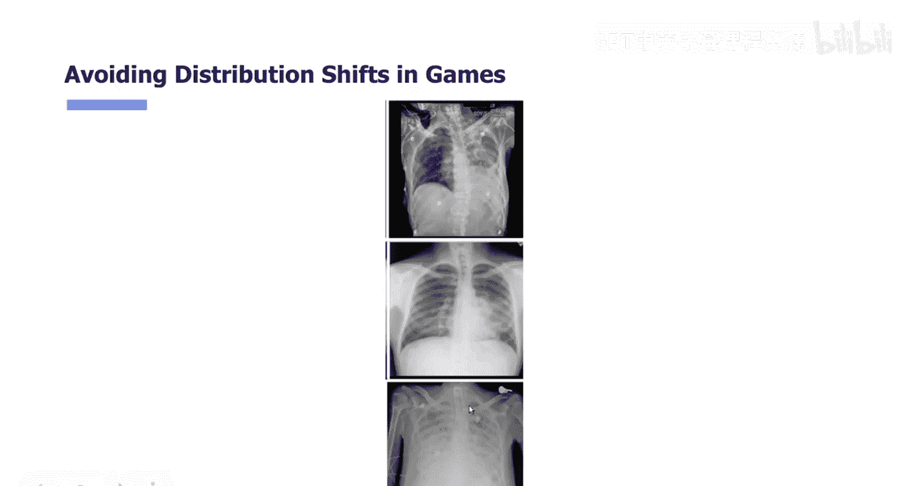
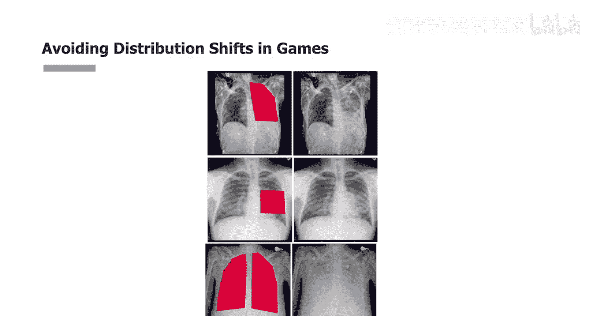
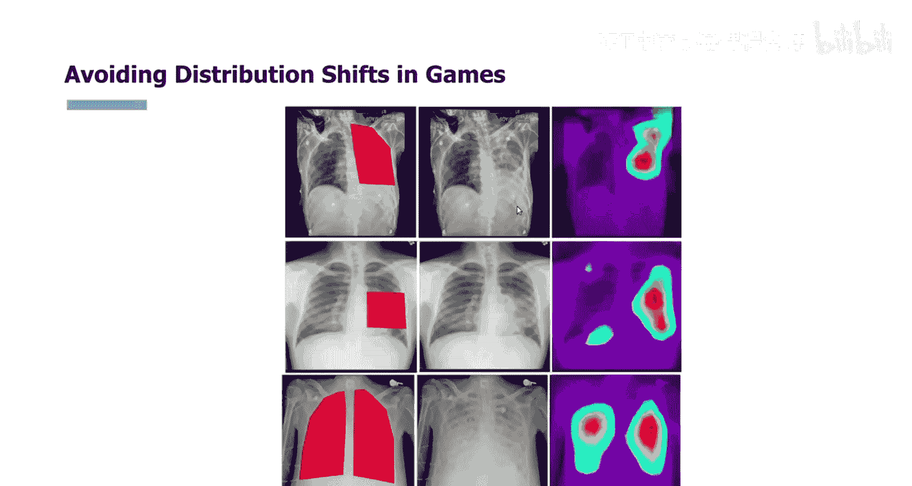
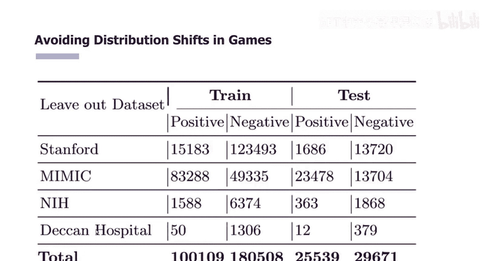
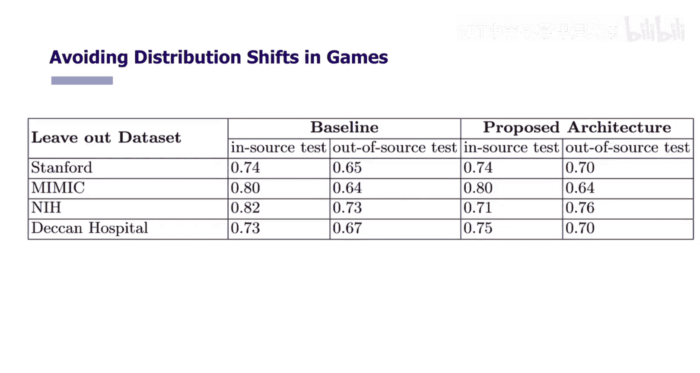

# 数据科学：时间中的决策｜3.5：极小极大博弈下的放射影像解析 📊

在本节课中，我们将学习如何将博弈论中的极小极大理论应用于机器学习领域，特别是用于提升放射影像（如X光片）分类模型的鲁棒性，以应对数据分布变化带来的挑战。我们将通过一篇研究论文，了解如何通过构建一个“分类器”与“判别器”相互博弈的框架，来获得更稳定、泛化能力更强的模型。

上一节我们探讨了决策理论的基础，本节中我们来看看如何将这些理论应用于一个实际的、高风险的机器学习问题：医学影像诊断。

---

想象你是一名放射科医生，需要根据X光片判断患者是否患有肺炎。这是一个非常重要且具有现实意义的问题。你可能会认为，这正适合由机器学习和算法来自动识别。然而，这实际上极具挑战性。这些图像中存在大量噪声和背景特征，有时即使对于放射科医生而言，要自信地做出诊断也非易事，不同医生之间也可能存在分歧。

如今，网络上已有公开的影像数据集用于测试，就像机器学习早期用于区分猫狗图片的数据集一样。我们的目标是能够清晰地将这些影像分类到不同的状态（如“健康”或“肺炎”）。经验丰富的放射科医生会在肺部标出他们认为有问题的区域（如下图中的形状），并以此作为诊断依据。

*放射科医生标注的疑似区域*

机器学习，特别是我们将在极小极大理论背景下讨论的对抗性机器学习，可以给出合理的估计。你可以看到，机器学习模型标出的边界区域（如下图）与放射科医生定义的区域非常相似。

*机器学习模型识别的区域*

关键在于，你必须确保模型不仅在训练集上表现良好，在训练集之外的数据上也要保持合理。这就是一个经典的机器学习问题：如何泛化？如何确保你没有在训练噪声？这个问题也为我们专项课程最后一门关于因果性的课程做了铺垫，因为如何避免模型在这些图像上的“脆弱性”，如何确保良好的泛化能力，确实与因果性概念紧密相连。

本质上，核心问题是：如何确保模型不会以错误的方式泛化？即避免模型在训练集上表现完美，但在实际生产环境或其他测试集上却完全失败。

---

接下来，我们将介绍一个研究团队（来自IBM等机构）为解决此问题所采用的方法，他们的论文也是你的阅读材料之一。他们的典型做法是将其构建成一个“游戏”。

以下是他们提出的模型架构图：

这是一个经典的极小极大博弈架构。让我们分解来看：
*   **图像特征提取器（如ResNet）**：你可以将其视为一个黑箱，其最终目的是从输入图像中提取有用的特征。其提取能力的好坏取决于训练程度、图像数量以及优化算法（如随机梯度下降）寻找最佳特征的能力。
*   **分类器（Classifier）**：以提取的特征为输入，其参数记为 **θ_c**。它的目标是正确分类图像（例如，判断是否有肺炎）。
*   **判别器（Discriminator）**：同样以提取的特征为输入，其参数记为 **θ_d**。它的目标是判断输入的图像特征来源于哪个特定的数据源或分布（例如，来自哪家医院）。

因此，我们共有三组参数：**θ_E**（提取器）、**θ_C**（分类器）和 **θ_D**（判别器）。你可以将这些部分简单地理解为实现不同变换（分类和判别）的网络层。

该团队的目标是提高胸部X光片分类模型在不同数据集间的泛化能力，使其尽可能鲁棒。

---

他们的核心论证是，最终我们需要考虑一个总体损失函数的期望值。你很快就会认出，这实质上是一个试图在两个相反方向上进行优化的经典案例。

我们为分类器和判别器分别定义损失函数：
*   **L_C**：分类器的损失函数，我们希望最小化它以提高分类准确率。
*   **L_D**：判别器的损失函数，我们也希望最小化它以提高判别数据来源的能力。

然而，关键点在于，**特征提取器（θ_E）是两者共享的**。这就形成了一个博弈局面：
1.  分类器希望提取的特征**与数据来源无关**，只专注于疾病本身，这样它的判断才不会因为图像来自不同医院（分布不同）而受影响。
2.  判别器则希望提取的特征**能够充分反映数据来源的差异**，这样它才能准确判别。

因此，我们需要同时优化两个目标，但它们通过共享的特征提取器相互竞争。这引出了一个极小极大优化问题：

**min_{θ_E, θ_C} max_{θ_D} [ L_C(θ_E, θ_C) - λ * L_D(θ_E, θ_D) ]**

其中 **λ** 是一个权衡参数。

**公式解读**：
*   **内层 max_{θ_D}**：判别器努力最大化自己区分数据来源的能力（即最小化 **L_D** 等价于最大化其负值）。
*   **外层 min_{θ_E, θ_C}**：分类器和特征提取器则努力最小化分类错误，同时**对抗**判别器的最大化努力（因此减去 **λ * L_D**）。

通过这种对抗性训练，特征提取器被迫学习那些对分类任务有用、但又对数据来源变化不敏感的“鲁棒性”特征。这有些像单玩家与“自然”（数据分布变化）对抗的游戏，也像是分类器和判别器这两个玩家在进行对抗性优化。

---

该研究使用了三个公开的胸部X光数据集进行训练和测试，并引入第四个数据集（CheXpert）作为额外的外部验证。每个数据来源（不同医院或机构）处理放射影像的方式可能略有不同，从而导致数据分布差异。

他们的主要实验结果如下图所示：

该图比较了基线模型和提出的对抗性训练模型在“源内”（训练分布内）和“源外”（新分布）测试集上的性能变化（AUC值）。
*   **基线模型**：从源内到源外，性能下降非常明显（箭头变化大）。
*   **提出的模型**：从源内到源外，性能下降幅度要小得多（箭头变化平缓）。

这表明，通过对抗性训练构建的模型，其泛化能力和对分布变化的鲁棒性得到了显著提升。

---

作者得出的主要结论，也是一个非常有力的观点是：通过将问题设置为一个极小极大博弈，并遵循Wald等人的思想，他们成功构建了一个更鲁棒的识别系统。这种方式极大地提高了审视这些医学影像并做出准确判断的潜力。

本节课中，我们一起学习了如何将起源于博弈论的极小极大理论，优雅地应用于解决机器学习中的实际难题——医学影像诊断的鲁棒性。我们看到了通过构建分类器与判别器的对抗游戏，可以迫使模型学习更本质、更稳定的特征，从而更好地应对训练数据与真实世界数据之间的分布差异。这对于任何在日常工作中可能接触机器学习应用的学员来说，都是一个非常重要的概念。