# 约翰霍普金斯大学《数据科学：时间中的决策｜Data Science Decisions in Time》中英字幕 p47 14_极小极大理论.zh_en -BV1NCuzzfEJa_p47-

So as I mentioned， Walt was really a major contributor in many ways。

 we started off our whole making decision time specialization with Wald's work on sequential sampling ideas now in our third specialization and'm talking about turn off sum in the second course we're now returning to min Max ideas。

 Of course this is our fifth week this is the end of this week but I also felt that this was the right time to bring this in this idea of the min max theory so you can see this in this Wikipedia image it's kind of a classic way of thinking about I've got two functional spaces x and Y you can think of these is almost like two regions that I can imagine sampling or working in and I want to do a max in1 and a min and the other and so you can see that effectively we've got one point that we've maxed on and in the point that we've min on So if you think of this whole surface as being described by x squared minus y squared then effectively in Y you can think that we're at a minimum in X you can think that。

maximum and so that saddle point， that region right there is the min max value that optimizes on that surface。

 So as a nutshell and maybe to help I hope some of you see into it。

 you can be thinking about any sort of a function space and min max means exactly something like this。

 defining the right region or set of points that is effectively an optimal both the max and the min operations。

 and another way of thinking about this also from the Wikipedia is something fairly simple in terms of decisions。

 So imagine I've got decisions in these columns or I mean sorry decisions in these rows and facts in these columns。

 So it's either sunny or it's rainy。 So facts you know you can't change it so to speak。

 but you're making decisions in this context whether you're bring in umbrella or not bringing an umbrella。

 don't bring an umbrella。 And then you've got a reward function that describes no umbrella and sun。

 you know you're happy， No umbrella and rain you're not very happy。 So these describes your。

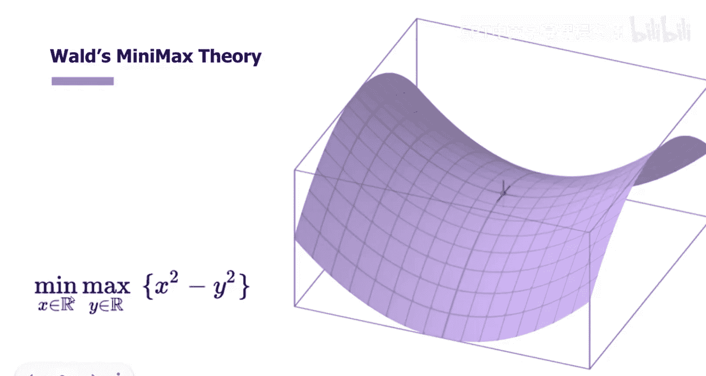

Utility function or your return from that decision。

 and it's going to be part of underlying the decision space。

 the function that describes the utility from making your different decisions。

 and then we've got the umbrella with sun or the umbrella with rain and。

You can see that in each case there is a distribution in principle， this is discrete。

 but you could imagine something similar for a continuous set of events that could happen and a continuous set of decisions that might happen but you could imagine any way a function in these two variables and in these two variables or put another way in the column space and in the row space similar to x and y and you're trying to optimize for within that So for example in this case we can define our worst payoff it's minus9 and minus5 clearly the rain here and then the best of the worst payoffs that's clearly the minus5 So the optimization here would be the bringing the umbrella so this is an example again of trying to find now in a discrete context in max。

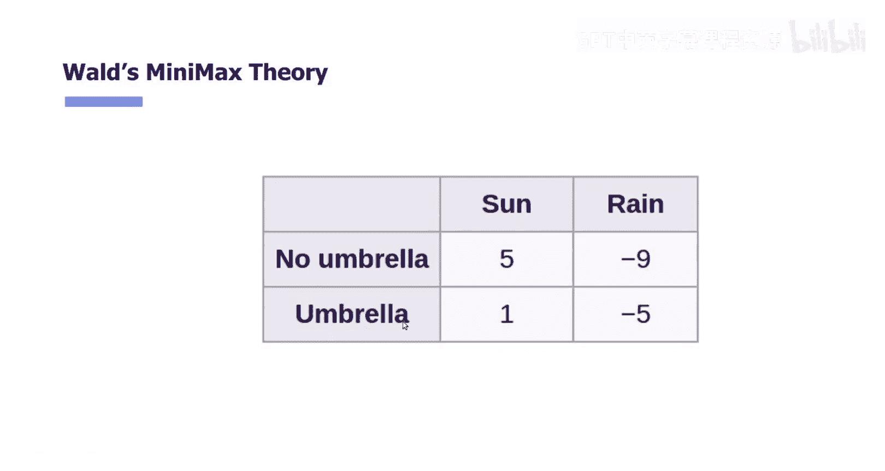

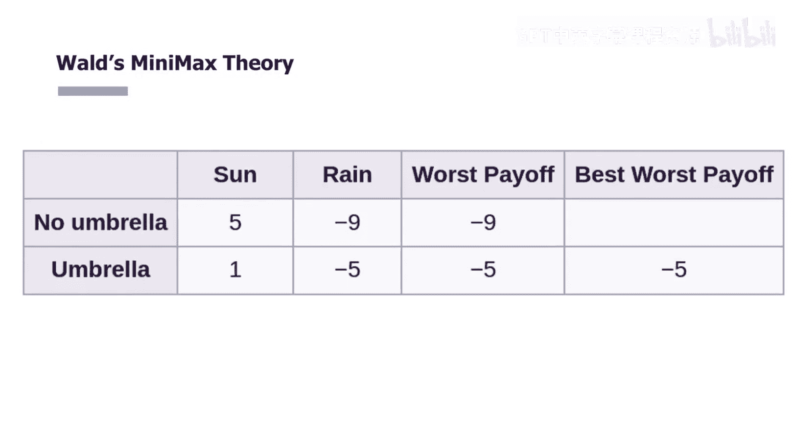

You know， solution to this joint problem。 So phrase another way。

 this comes from a review paper on world's work in this area。

 affect what we've got as a function in D and S D is from our decision space and S is from the space we might think of nature。

 like whether it's signing or reing think of this the event space in the original formulation from well you can think of these as continuous in same machine learning or conceptual space like the rain and the umbrella。

 you can think of these as being discrete you've got some function anyway way of DNS S is being pulled from that sample space D is being pulled from the decision space。

 we're minimizing in one and maximizing any。 So we want to find R W star。

 which is our best choice so to speak of decisions given the decisions and given the。

Setets of observations that ultimately decide， help us decide what is best so you can think about this as we need to sample here and we need to sample here in order to define and again it depends on our utility function in terms of what we think is most important to us but enabled to define W star we've got to do a min and a max so S of D then is the set of feasible states。

 especially with that decision because it may be a branching structure。

 so not everything is reachable depending upon how we go about thinking about the connections between the decisions and the events that we see and essentially our F here then。

 which is the function in DNS is this reward function what I've been also calling the utility function but essentially it's the function you have to decide for how these parameters are going to be optimized and so it's easy to write something like this it's not only so easy to find these to describe this function once you've got it。

 it's also not so easy to do the imization the maximization but even just setting up these problems。

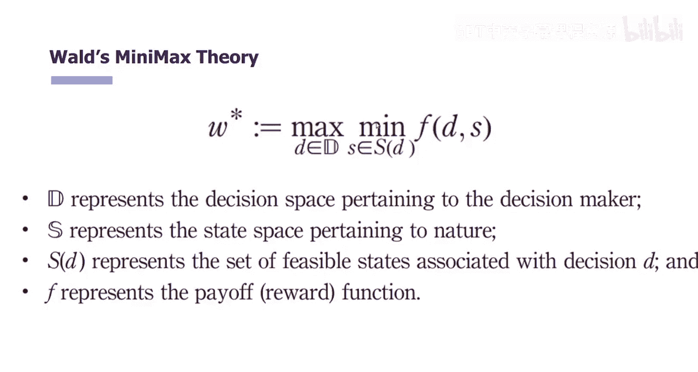

can be a fair amount of work So in the general flavor of the game then and the connection back term main topic in our third course here is to think of this in terms of three stages So in the first act。

 you're say the decision maker you select some initial decision and then in response to that decision in act2 you've got nature selecting the worst state it's being adversarial towards you in the state of outcome spaces that can happen from that that's related to that decision and then you're going to call that say as hat of D and then in the next one。

 you say are given a reward from D and from that response back and then you iterate on this so you can think of this as ultimately be something where now you make another decision and and you keep iterating and ultimately you can think of this as almost like a Mar decision process or try to find the best set of policies meaning the best set of decisions that supports for a given payout function or utility function the best route ahead。

 Now you can play these kind of games in a deterministic。

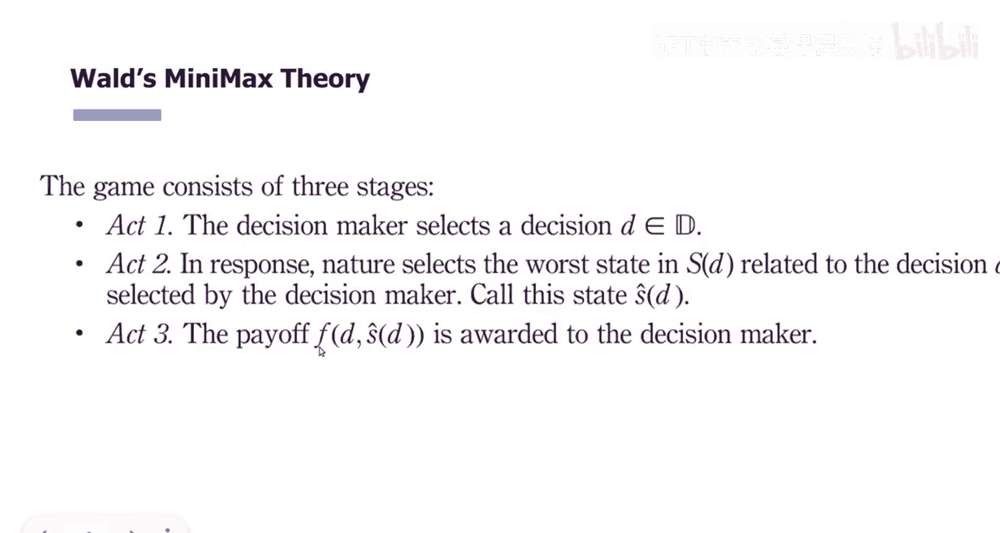

In a stochastic way， meaning a probabilistic type way for the sorts of things that we're thinking about。

 I think this way of thinking about it is a continuous function。

 ultimately in a stochastic space is the must rewarding。

 but you should realize that this is the field a lot of work。

 And if you do read in it you don't want to pay attention to whether they're describing something that's detertriministic something that's discrete or continuous or whether it's stochastic all of those are different ways that use the same concepts of a max and so this is the main paper and this will be in your media for this week So from 1945 again w you know major another major contribution and the idea again is minimizing the maximum risk and what he means by that is that we've got a set of events that we've collected so capital E for events here X1 to X think of those as observations describing something say in the real world we've got a function then of our parameters and then we've got a weighted set that's what the capital W means a weighted set this。

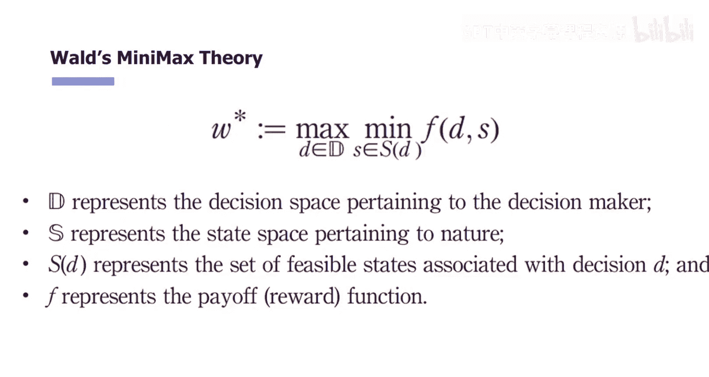

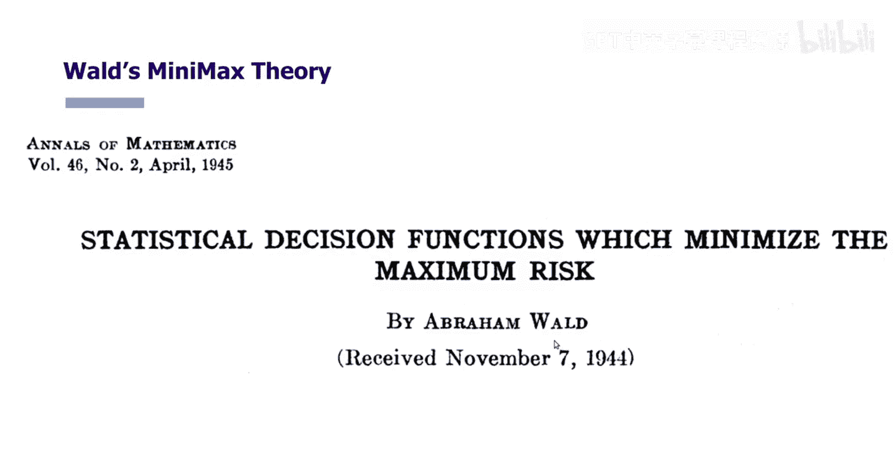

Again to these parameters and our events which are described but these are effectively these events and then we're doing an integral over the entire what's called the CDf again。

 the cumul distribution function for our event space So we're integrating over all the candidate events that are consistent with that and ultimately what that means is in his view is really things like this theorem and one more that are going to put up that what you're trying to look for is G of theta which is the least favorable distribution of theta in words you want this little r of g。

 which again is parameters theta being less than or equal to R sub g for all points theta in capital omega。

 So again theta is related to your parameterization and while's way of thinking about it that describes the distribution functions that you're pulling the events from So you're trying to discriminate which parameterization again controlled by theta is the one that you're effectively going to select back or vote for。

 And so again that goes into the decision theory aspects of that So the way to phrase。

This is there in 5。1 if theta v is an estimate which minimizes this average risk relative to the least favorable distribution G of theta。

 then our theta on that defense base also minis the maximum risk so in other words what we're getting at is we think of this as being a risk and then we're doing in this is minimizing the average risk and then we got a maximization from that so of the words we're minimizing the maximum risk by doing this and again this was an extremely influential paper。

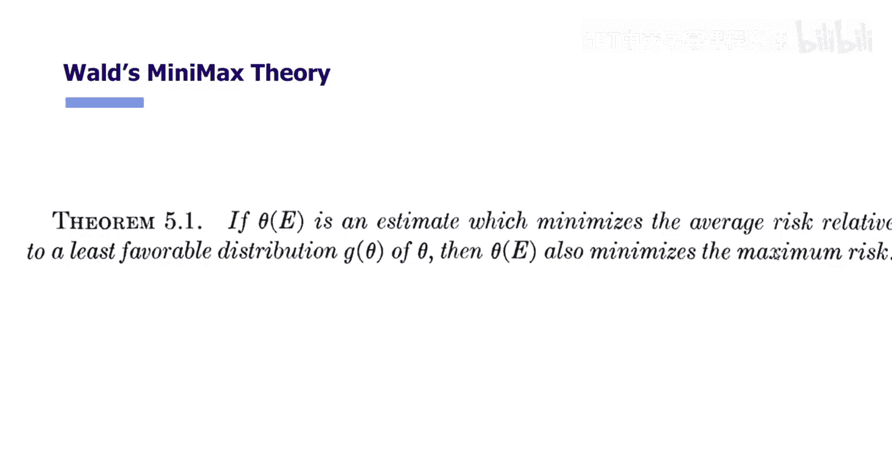

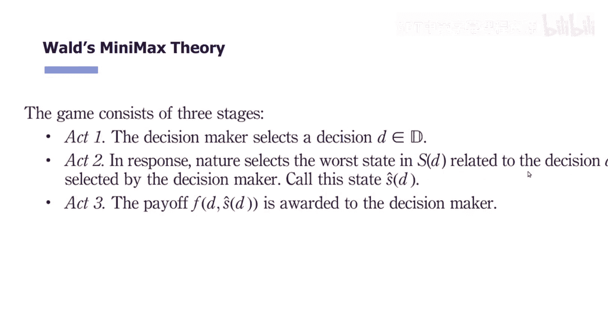

Hopefully giving you some sense of where it came from and what it led to probably a little more strong than than what it led to than the sense of where it came from。

 but essentially this is coming from inference and ideas from statistics that well contributed to it led to the work that we're talking about in the machine learning context but also a lot of work and decision theory and generalizations in statisticalal decision making or inference in this setting so I think this is really about where I want to stop on this hopefully again I've given you a sense as to what's involved in this minim theory and it's really an interesting place to do some more meetings I hope you'll enjoy that so with that we'll stop Thank you。

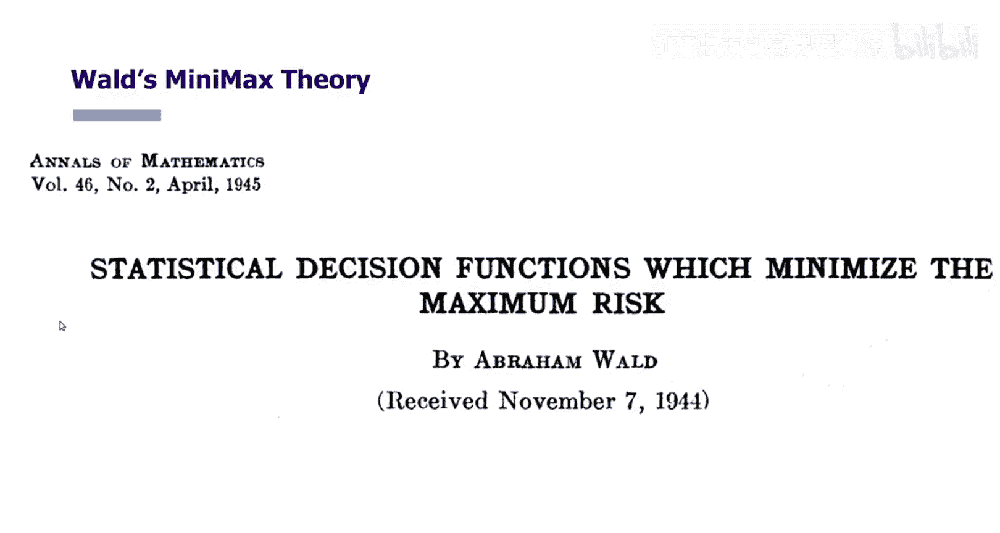

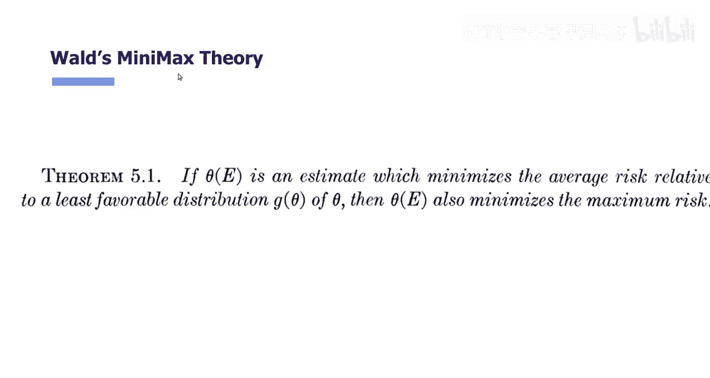