# 数据科学：时间中的决策｜3.5：极小极大理论 🎯

在本节课中，我们将学习决策理论中的一个核心概念——极小极大理论。该理论由亚伯拉罕·瓦尔德提出，旨在处理不确定性下的决策问题，通过最小化最大可能损失来寻找最优策略。

---

## 理论起源与背景

上一节我们介绍了序列分析等概念。本节中，我们来看看瓦尔德在决策理论领域的另一项重大贡献——极小极大理论。瓦尔德的工作是我们整个“时间中的决策”专项课程的基础，在第三个专项课程的第二门课中，我们再次回归到这个核心思想上。

## 直观理解：鞍点与决策矩阵

极小极大理论的核心思想是在两个空间（例如决策空间和自然状态空间）中同时进行优化：在一个空间上求最大值，在另一个空间上求最小值。

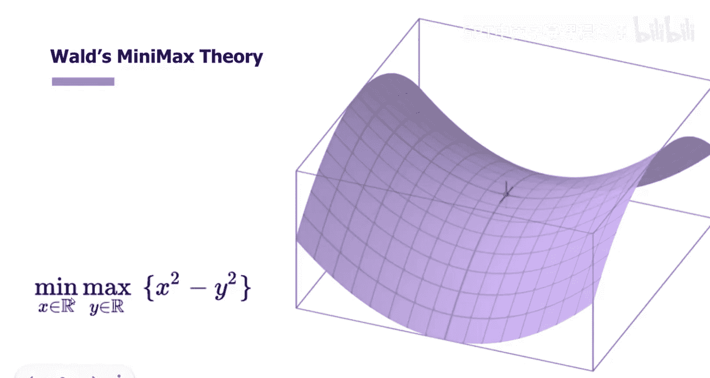

### 几何视角：鞍点

想象一个由函数 **f(x, y) = x² - y²** 描述的曲面。在Y方向上，我们寻找最小值；在X方向上，我们寻找最大值。那个同时满足“在X方向是极大值点，在Y方向是极小值点”的位置，就是**鞍点**，也就是我们寻找的极小极大值点。

### 决策视角：收益矩阵

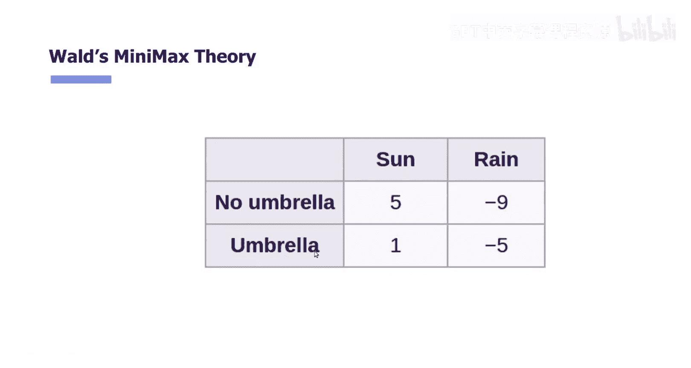

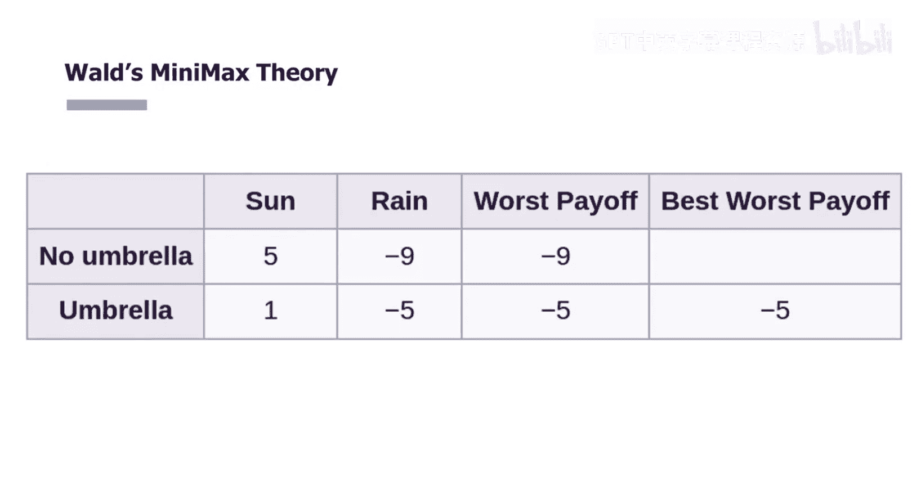

另一种理解方式是通过一个简单的决策矩阵。假设我们需要决定是否带伞，而自然状态可能是晴天或雨天。

以下是不同决策在不同自然状态下的收益（效用）：

| 决策 / 状态 | 晴天 (Sunny) | 雨天 (Rainy) |
| :--- | :---: | :---: |
| **不带伞 (No Umbrella)** | 10 | -9 |
| **带伞 (Bring Umbrella)** | 5 | -5 |

在这个离散的例子中：
1.  我们首先找出每个决策的**最差收益**（即最小收益）：
    *   不带伞：`min(10, -9) = -9`
    *   带伞：`min(5, -5) = -5`
2.  然后，我们选择这些“最差收益”中**最好的一个**（即最大化最小收益）：
    *   `max(-9, -5) = -5`

因此，按照极小极大准则，最优决策是**带伞**，因为它保证了在最坏情况（下雨）下，我们的损失最小。

## 形式化定义与一般框架

将上述思想形式化，我们有一个依赖于两个变量的函数：**决策 D** 和 **自然状态 S**。我们的目标是解决以下优化问题：

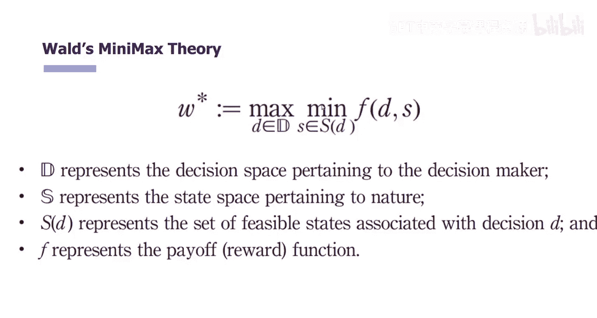

**R_W^* = min_D [ max_S F(D, S) ]**

其中：
*   **D** 来自决策空间。
*   **S** 来自自然状态空间（或“事件”空间）。
*   **F(D, S)** 是收益函数或效用函数，衡量在状态S下采取决策D的结果。

我们的目标是找到一个决策 **D***，使得在最不利的自然状态 **S** 下，我们能获得最好的可能结果。

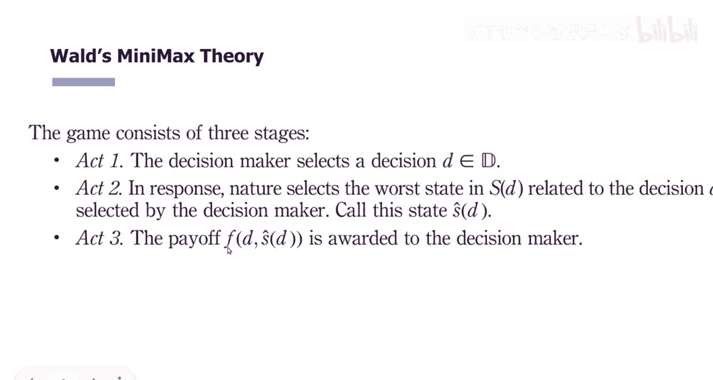

## 动态交互过程

极小极大问题可以看作一个三阶段的动态博弈过程：
1.  **第一阶段（决策）**：决策者选择一个初始决策 **D**。
2.  **第二阶段（自然响应）**：自然（或对手）针对决策 **D**，选择一个最不利的状态 **Ŝ(D)**，以最大化决策者的损失（即最小化其收益）。
3.  **第三阶段（评估与迭代）**：计算收益 **F(D, Ŝ(D))**。决策者根据此反馈，调整策略，进入下一轮迭代，寻找更优的决策 **D**。

这个过程可以持续进行，最终目标是找到一组最优的决策策略，类似于在马尔可夫决策过程中寻找最优策略。

## 瓦尔德的理论贡献

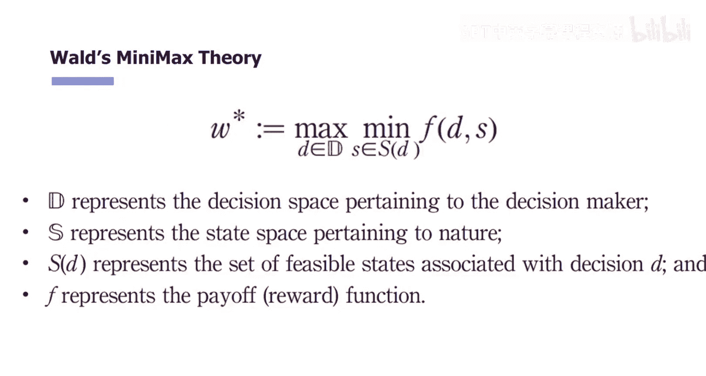

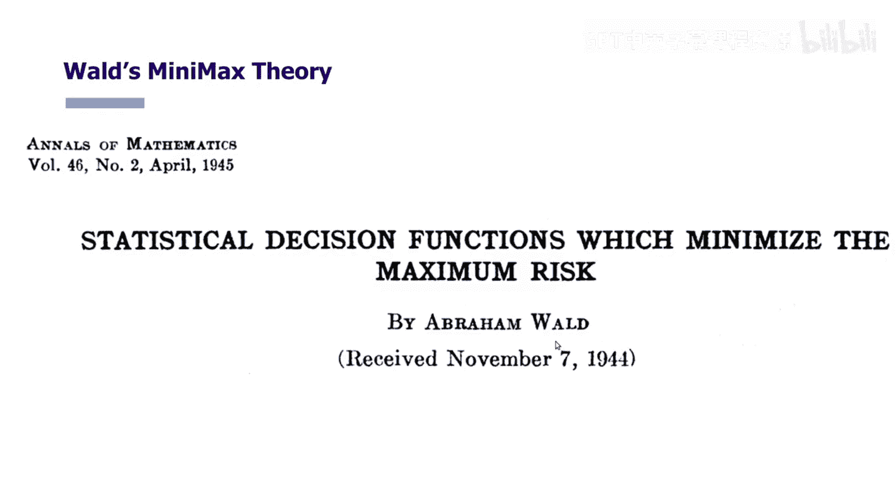

瓦尔德在1945年的论文中，将这一思想置于严格的统计决策框架下。他引入了**风险函数**和**最不利先验分布**的概念。

核心定理可以简述为：如果一个估计量 **θ*** 在**最不利的先验分布 G(θ)** 下能最小化**平均风险**，那么这个估计量 **θ*** 同样能最小化**最大风险**。

用公式表示，即寻找分布 **G(θ)**，使得：

**r_g ≤ R_g(θ)** 对于所有 **θ ∈ Ω** 成立。

其中：
*   **r_g** 是在分布 **G** 下的贝叶斯风险。
*   **R_g(θ)** 是参数为 **θ** 时的风险函数。
*   **Ω** 是参数空间。

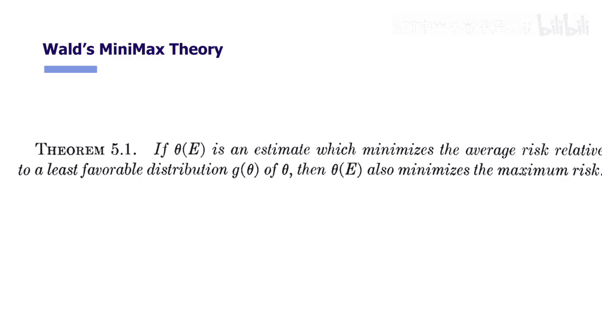

这一定理为在不确定性下进行稳健决策提供了坚实的理论基础。

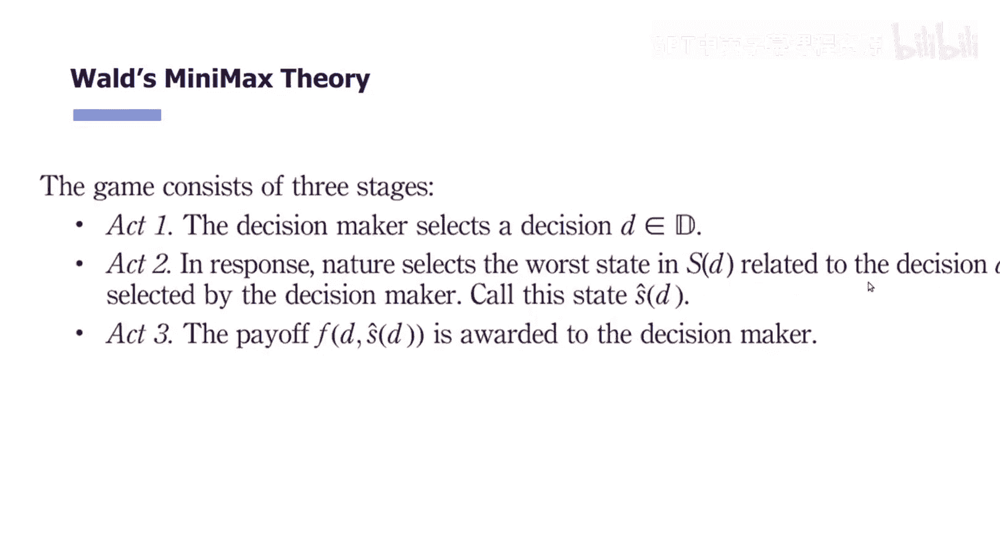

---

## 总结

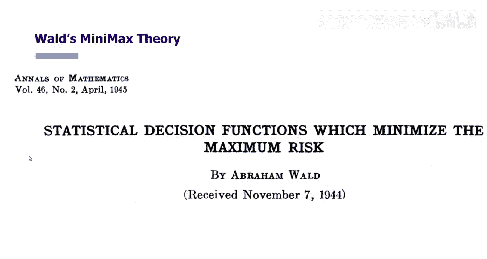

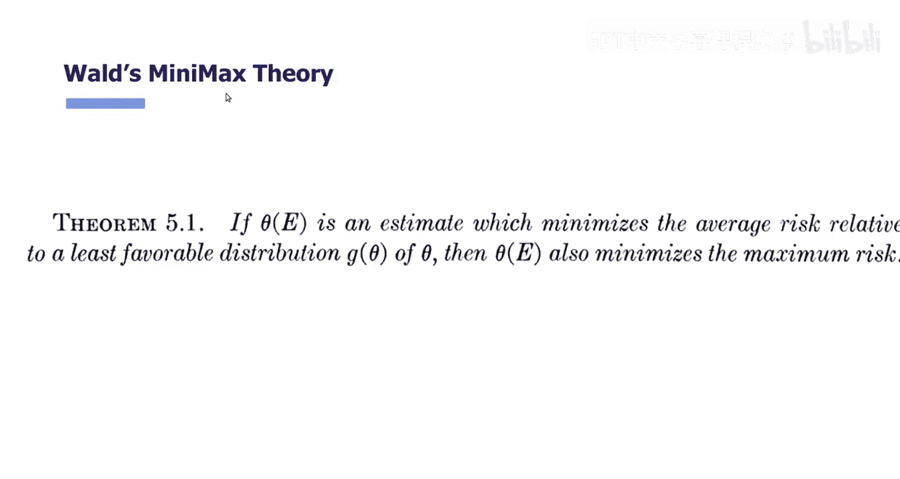

本节课中我们一起学习了**极小极大理论**。我们从直观的鞍点和决策矩阵入手，理解了其“最小化最大损失”的核心思想。随后，我们探讨了该理论的形式化定义，并将其理解为一个动态的决策者与自然之间的博弈过程。最后，我们回顾了瓦尔德如何将这一概念融入统计决策理论框架，通过引入最不利先验分布，使极小极大准则成为一个严谨的优化工具。这一理论是连接经典统计推断与现代机器学习中稳健优化和对抗性学习的重要桥梁。