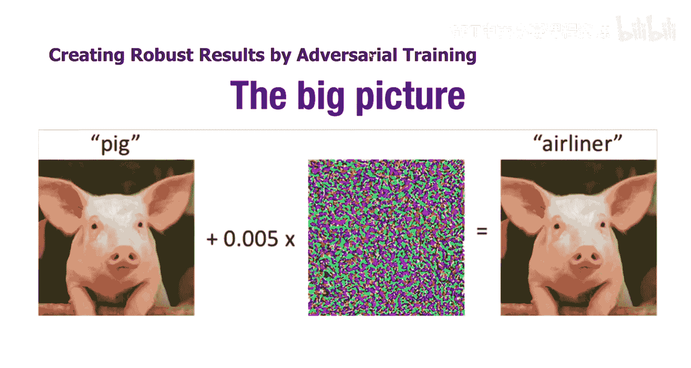
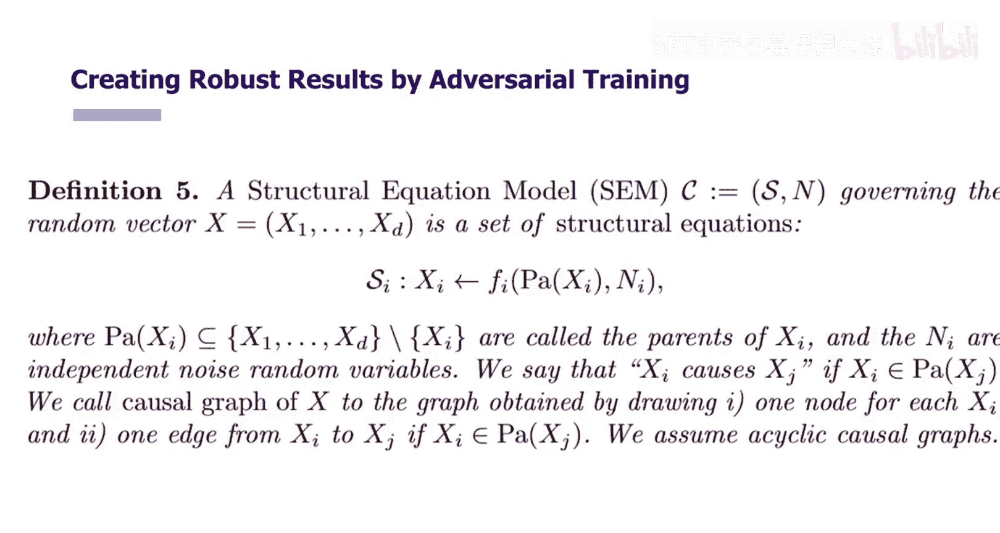

# 约翰霍普金斯大学《数据科学：时间中的决策｜Data Science Decisions in Time》中英字幕 p48 15_鲁棒对抗训练方法.zh_en -BV1NCuzzfEJa_p48-

Well now move on to think about this even more strongly in the machine learning context again。

 this really builds from Walt's work。 The context again is adversarial training to try and prevent something from being brittle and this was nicely illustrated in N's tutorial session from 2018 where if you took an image of a pig and added right con noise。

 not just random noise right con noise back on noise that to a human looks like it's noteven present。

 What had been working as a perfectly excellent classifier for pigs now unfortunately labels as an airliner。

 The joke that was made with this， which I thought was quite nicely put together。

 was to argue that this was to make a way to make pigs fly because you've translated to pig into an airline。

 but it's a bit scary because all you've done here is to add nearly hidden noise。

 I mean noise to a human is indisccrimable from the main signal and yet you've completely changed the label the classifier is gone so。

Very brittle。 And how do we improve that。 Well， this is the idea of adversarial training。

 and it's the idea really， again， going back to well of in max type theory。

 So essentially what you're doing。

again coming from the NIps workshop is you've got a loss function and you're going to add in this delta so you've got x and Y again it's a surface with two major components and wt's paper you could think of these as being related to decisions and data and that's again the initial context but you can think about these as being any two features that you could set up something where you're trying to define a max a min and then you've got your parameters theta So little delta is from big delta we're doing an expectation over x and Y we're minimizing in theta so really you can think about it again is that I've got theta as being just like in wall the distributions parameters that I'm thinking about and x and Y as being the space in which I'm pulling events from and ws formulation this was like the evidence So effectively what we're doing again is maximizing something and minimizing something and how do we go about setting it up in order to create something So again from the Nipps we're thinking in terms of an inter maximization。

Atom miniization， they put three methods here， two methods here and the arguments they're making is that for the inner。

 maybe do local search or common for optimization or context relaxation for the outer。

 maybe you think adversarial training or prove the robust training。

 The argument that I'm trying to reach for here is not that I'm going to tell you one of these is definitely better than another。

 but this is an active area research， I mean this was a 2018 Europes workshop and very wide audience that was reached and they weren't necessarily recommending one thing or another。

 but just trying to point out you can definitely improve things with adversarial training and as a way of illustrating that if I got an image here you can I'm surell see very clearly what's happening in the image that if you do gradientding on a standard model that's been trained to recognize images like this。

 you can't really make out very much。 But if you look in this one where we took the robust model where they took the robust model a lot of the main features are there。

 So you can think about this it was a way to make your ability to。

Decide things based on the features much more robust because effectively what you've done is to catalog out or feature out the things that help you generalize most strongly into other areas。

 So this really leads to the paper that I'll be adding to your reading this for this week。

 which is this paper on variant risk minimization that was part of Martin heres thesis work and there's been a lot of attention paid to this。

 there's other ones again as well， but it's a nice step as well into our very last specialization because this has connections into causality and I think in a nice way。

 So this is an example that they did in their paper imagine x1 is a Gaussian。

 So mean is0 variance to sigma squared。 a regular Gaussian for x1 Now y has x1 plus another Gaussian again。

 with zero and variant sigma squared。 So x2 is now Y this one plus another Gaussian with mean0 and standard deviation or variance of1。

 So the question is now。ul you understand what's going on and within that kind of a system and that's an example but it leads in general to things like this first figure in their paper where effectively you have to worry about whether your surfaces are smooth in this example with the Gaussians it's already fairly well defined and easier to think about but if you start to generalize this your penalties and therefore the function surfaces you can end up with things that are discontinuous and so this would great problems so mathematically thinking about how well we formulated it and as well how youve formulate it for machine learning we need to be in a setting where the functions are welldeed so that we can define cleanly what's going on so we've got a way of thinking about it in terms of these IRM representations and what they did and this is I hope reminiscent of the very first paper for this week's material you can think about it as just like two terms and you can see a lambda on this term so you've got our gor type function composition operator。

And then this capital D in its three values， and so effectively。

 our IRM then is going to be effective with like a linear combination of these sum here。

Lambda here and what this creates then is a connection into structural equation models and structural equation models is kind of a bridge into causality and into graphical models which is again we'll be in our last class in the specialization So you can think about this is that we've got a structural equation model that covers this random vector that should be reminding a little bit of w。

 we've got a set x1 to x D that we've sampled from we've got a set of structural equations。

 this capital P means parents on x sub I See've got a function of the parents and then n sub I and that's going into this s sub I that's a sampling over x。

 So parents are again defined here。 parents of x sub I it's a subset of this leaving out the x sub I and that's the parents and these n sub I are just independent noise random variable So that's the other pair。

 So the question is that we want to argue and understand whether x sub I causes x sub J。

 and then we're going to define causal graphs related to that。 So。

And the assumption is these are acycliccoal graphs so what I'm lean out to is that this approach defined from invari risk organizationization is another way to start to think about causal systems and to start thinking about connections and destruction equation models and that's a really nice way of thinking about the benefits that of adversarial training is that we're effectively then finding the true connections。

 the causal like connections between our features and so then equivalently we could say that our decision space has been made much more robust because as opposed to doing in a completely potentially even scly noise influence set where we've tried to maybe filter a little bit of the noise out we're really thinking in a reduced representation that's much more causal in other words the connections between the features are described through acyclicco graph that lets us think about these connections more robustly and so again this is a benefit potentially a adversarial training so okay I hope I've given you some feeling for this。

A lot cure there'll be more in the beginning， but I think you'll find that there's some， again。

 really nice connections between these ways of thinking from inflation games into ways to set up minims and from that bridge into causal type systems。

So okay， with that， we'll pause， Thank you。