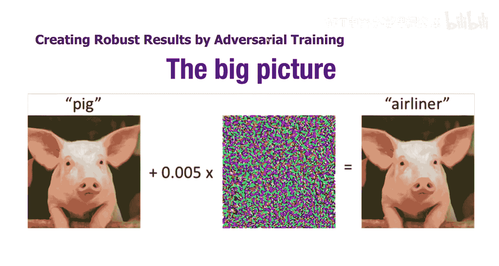
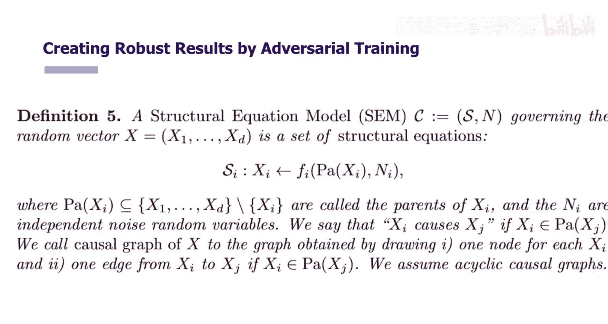

# 数据科学：时间中的决策｜Data Science Decisions in Time：15：鲁棒对抗训练方法 🛡️

在本节课中，我们将探讨机器学习中的鲁棒性问题，并学习一种名为“对抗训练”的强大方法，它可以帮助模型在面对微小、精心设计的干扰时，依然保持稳定和准确的判断。

---

上一节我们讨论了模型可能存在的脆弱性。本节中，我们将深入探讨如何通过对抗训练来增强模型的鲁棒性。



这个概念的背景源于Walt的工作，核心思想是通过对抗训练来防止模型变得“脆弱”。一个生动的例子来自2018年NIPS会议的教程：一张猪的图片，如果加上精心构造的噪声（对人类视觉而言几乎无法察觉），原本能完美识别猪的分类器，就会错误地将其标记为“客机”。这个例子幽默地展示了如何“让猪飞起来”，但也令人担忧，因为微小的、几乎不可见的干扰就能完全颠覆模型的判断。

这说明模型非常脆弱。那么我们如何改进呢？答案就是对抗训练。其核心理念再次回到了极小极大理论。

本质上，我们所做的是从一个损失函数出发，并引入一个扰动项 δ。公式表示如下：


这里，x 和 Y 构成了一个包含两个主要组分的空间（在Walt的论文中，可理解为与决策和数据相关），θ 是我们的模型参数。小写的 δ 来自一个可能的扰动集合 Δ。我们对 x 和 Y 求期望，并对参数 θ 进行最小化。可以这样理解：θ 类似于Walt理论中的分布参数，而 x 和 Y 是我们从中抽取事件的空间。这本质上是在进行某种形式的极大极小优化。

---

从NIPS研讨会的思路出发，我们考虑一个内层最大化、外层最小化的框架。

以下是他们提出的方法思路：
*   **对于内层优化**：可以考虑使用局部搜索、凸优化或上下文松弛等方法。
*   **对于外层优化**：可以考虑对抗训练或可证明的鲁棒训练。

这里我想强调的观点并非断定哪种方法绝对更优，而是指出这是一个活跃的研究领域。2018年的研讨会面向广大受众，并未明确推荐某一种方法，但一致认为对抗训练确实能有效提升模型性能。

为了说明这一点，请看一个图像识别的例子：在一个标准模型上计算梯度，得到的图像特征模糊不清；而在一个经过鲁棒训练的模型上计算梯度，其主要特征则清晰可见。这表明，对抗训练能让模型基于特征进行决策的能力更加鲁棒，因为它有效地提炼并突出了那些最能帮助模型泛化到其他情境的核心特征。

---

这自然引出了本周的推荐阅读论文——关于“不变风险最小化”的论文，这是Martin Arjovsky论文工作的一部分，受到了广泛关注。这也是一个很好的过渡，因为它与我们最后一个专题“因果关系”紧密相连。

以下是论文中的一个示例：
*   假设 **x1** 服从高斯分布，均值为0，方差为 σ²。
*   **y** 由 x1 加上另一个均值为0、方差为 σ² 的高斯噪声构成。
*   **x2** 则由 y 加上一个均值为0、方差为1的高斯噪声构成。

问题是，在这个系统中，你能否理解发生了什么？这个具体例子引出了更一般的思考，就像他们论文中的第一张图所示：我们必须担心函数曲面是否平滑。在高斯例子中，问题定义清晰且易于思考；但如果将其泛化，惩罚项和函数曲面可能变得不连续，从而带来巨大问题。

因此，从数学和机器学习的角度，我们需要确保问题定义良好，函数性质清晰，以便明确定义所发生的一切。IRM方法提供了一种基于表示的思考方式。

IRM的公式可以看作是两个项的组合，其中包含一个权重 λ：

```
IRM 目标函数 ≈ 标准经验风险项 + λ * 表示惩罚项
```

这里，Φ 表示特征提取器，D 代表来自不同环境的数据分布。这建立了与结构方程模型的联系，而结构方程模型是通向因果关系和图模型的桥梁，这将是我们最后一个专题的内容。

我们可以这样理解结构方程模型：它描述了一个随机向量（会让人联想到W），我们从中采样得到一组变量 {x1, ..., xD}。对于每个变量 xi，存在一个结构方程，它是其父变量集合 Pa(xi) 的函数，再加上一个独立的噪声变量 ni。父变量被定义为除 xi 本身外的一个子集。我们通过判断 xi 是否导致 xj 来定义因果图，并通常假设这些图是无环的。

因此，不变风险最小化所定义的方法是另一种思考因果系统、建立与结构方程模型联系的途径。这很好地体现了对抗训练的益处：我们实际上是在寻找特征之间真实的、因果式的联系。

等价地说，我们的决策空间因此变得更加鲁棒。与在可能充满噪声影响的环境中进行过滤不同，我们是在一个更精简的、更具因果性的表示中进行思考。换句话说，特征之间的联系通过无环图来描述，这让我们能更稳健地思考这些联系。这再次证明了对抗训练的潜在优势。

---

本节课中，我们一起学习了对抗训练如何解决机器学习模型的脆弱性问题。我们从生动的例子入手，理解了其背后的极小极大优化思想，并介绍了实现框架。最后，我们探讨了对抗训练与不变风险最小化、结构方程模型乃至因果关系之间的深刻联系，展示了这种方法如何帮助模型捕捉更本质、更稳健的特征关联。

希望这节课能让你对对抗训练有所体会。虽然涉及较多概念，但你会发现，从极小极大博弈的思考方式，到建立与因果系统的桥梁，这些思路之间存在着非常美妙的联系。




本节课到此结束，谢谢。