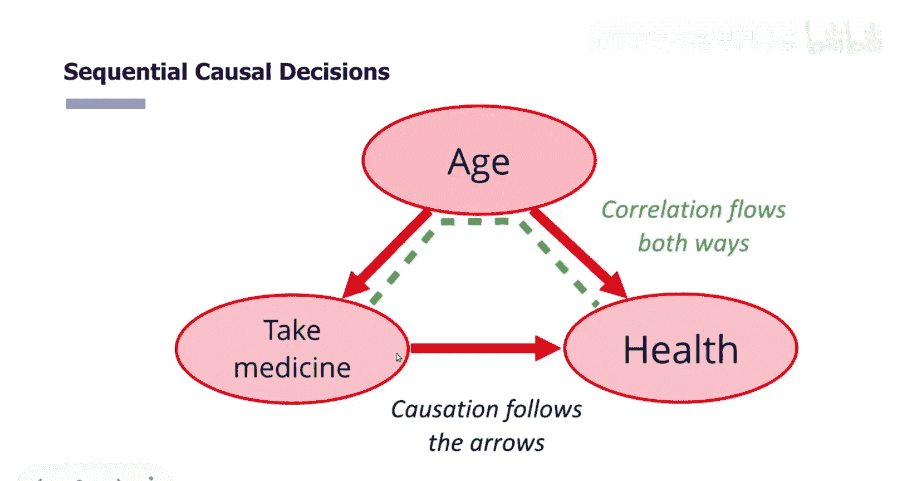
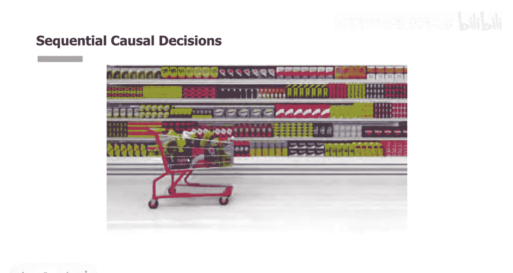
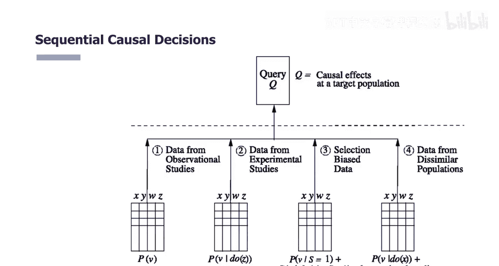
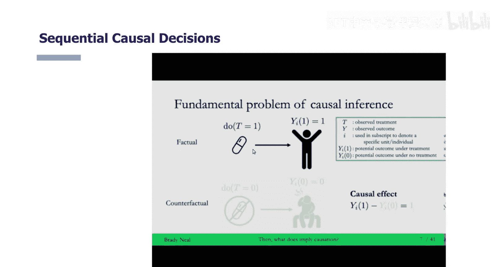
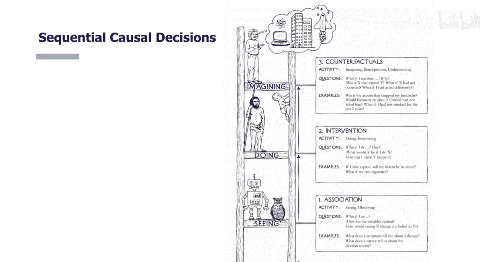

# 约翰霍普金斯大学《数据科学：时间中的决策｜Data Science Decisions in Time》中英字幕 p49 0_珀尔的因果阶梯.zh_en -BV1NCuzzfEJa_p49-

We'll not' talk about causal decision making。 I'm want to arguing you can put this into a sequential frame。

 So it really is part of our making decisions in time。

 We're trying to use causal information to think about decisions in a staged way and this goes back well。

 goes back to turn off it's the essence of what we've been talking about in our specialization。

 So by way of introduction， think about this kind of causal diagram here。

 And this is an example of a causal graph Z here is connected to both X and Y。

 And so I've really got an issue of confounding and that's something that comes up over and over again in this last stage of our specialization。

 given we've got say observations。 we could have some sort of a common cause or we could have confounding where things go together。

 Another way of looking at this is something that tries to make a little more concrete。

 something that I've got both age and whether I take medicine have an impact on health。

 If I'm only observing health。 I need to know something about these other factors that are coming into it。

So causation could follow these arrows here， but correlation could flow in multiple ways throughout this。

 so effectively when we're thinking about sequential causal decisions。

 we've got to be thinking about what flows in a particular direction causally versus what's linked through some sort of association and that when we make our decisions when we trying to optimize our decisions we are trying to take advantage of these boed arrows。

 we're trying to take advantage of what is linked causally So we'll be talking a lot this week about a simple example。

 relatively simple simple， but actually quite complex， if you really start thinking about it。

 which is if you're in a store grocery store and you as a consumer are trying to pick items from the shelves。

 how does the store go about setting the prices on these items to influence your shopping。

 So in other words， it's a real brick and mortar context for what happens online as well。

 how does one go about defining what's the best price point for different types of items in a store in order to。

its what potentially ends up inside your shopping cart。

 So phrased another way you're filling your shopping cart。

 you've got different items that are going in。 How many items do you buy and of what type and how do you go about doing that？

 a lot of stores do dynamically adjust their prices just like in online setting and they're trying to optimize setting them based on some sort of heuristics or maybe even just simple what they've got in terms of they can put on the shelves。

 but they're trying to influence what goes into the cart just as much as the person wheeling the cart is trying to make a decision to optimize their spend on their groceries。

 So the way of thinking about this really goes to to J Pearls seminal work in this area is the differences between associations kind of a scene interventions or kind of doing and ultimately counterfactuals type of imagining and this will be the basis for everything we'll be talking about in this last of our specialization as do J Pearl's work in causality And so in his way of thinking about it the。

asations， you're just seeing something that's correlated and you're not so much involved with trying to understand what's causally linked in an intervention type setting you're actually doing something。

 What would happen if I do， how would I go about doing you're kind of the next level up in terms of thinking about the data and thinking about how that data is tied together and the top level and this kind of a ladder is really the counterfactual imagining what if I had done and why and this could be spun out a little bit more I'll return to this at the very end of this introduction but the same sort of thing the seeing the doing and the imagining this comes from J Pearl's work again and this first one is just purely association seeing and changing what if I do what if I see these kinds of questions the interventions that were much more what if I do I've actually got to do calculus as to J would describe it and I'm actually asking if I do something。

 what will happen know if I take aspirin well my the headache be cured what if we ban cigarettes。嗯。

Counterfactuals an even deeper level of understanding into the data because what if I had done type questions。

 Why did something happen， if what if the aspirin was it the aspirin that that stop my headache What if Kennedy would Kennedy still be alive possible to not kill them。

 What if I had not smoked for the last two years。 These are examples of counterfactuals things that are not necessarily in the data。

 but that we can still ask， so it's reasoning within the context of causal decision making and we can stage this we can think about decisions made over time。

 So an example of something that's a challenge is I might have a very large data I'm trying to do queries against that data。

 I could query at it from observational studies so this has become kind of the most straightforward way of thinking about pulling from some sort of a sQLorganized table。

 I could pull from it， But imagining that I've got some sort of a new calculus on it。

 lets me pull from。More reasoned way I've assigned potentially individuals to particular treatments and we'll go over more of that throughout this last specialization course。

 but effectively I'm conditioning on particular treatments that have been assigned so my probability of particular types of things being pulled conditioning on particular types of treatments it's effectively a more involved a more complete way of thinking about the data but I could also have bias data。

 How do I control for that and now I'm asking to do calculus but within the context of bias in another way of looking at this I may even have dissimilar populations so in some ways this also goes to fairness。

 some of you may have thought about machine learning and fairness。

 This is the same sort of thing can I imagine and understand from just my observational studies at the start but ultimately with some sort of treatment options Can I understand what could happen within bias datata or dissimilar populations and correct for that bias and correct for those dissimilar populations so that I'm getting a true understanding。

Of causal effects at the target level。 That's really the goal of everything we're talking about。

 Another way of looking at this would be something within the context of the Du calculus。

 Do I sign a treatment of taking the pill versus not what happens to the outcomes。

 what sort of causal effects come out from that In other words when we start talking and thinking about personalized medicine We're really trying to argue what happens if I take a particular medicine is it likely that I canble directly into a cure from that do I understand it it's today pearls again causal ladder So phrased in more direct way。

 What I be healthy I take vitamin C It's an assignment treatment option， So either zero or one。

 that's R C1 here versus C0 and the question is do I take it or not and what sort of outcomes do I get from that Now these are not straightforward They're straightforward to ask the question not only so straightforward to see into the data to understand what's going on So this is because again we've often got a。

of hidden factors that could go in。 So for example， for smoking。

 one reason it was hard to prove that lung cancer was caused by smoking is that we kind of a lot of intermediate steps。

 So for example， Tr found in the lungs was that directly from the smoking the hidden factors here can be fairly numerous and understanding how these things are linked together so that you can do do type calculus you can understand the nature of cause and effect is still a very very significant challenge So what we started off this week with a really interesting。

 I think paper inspired by conometric type research Susan Athe and David Bla l this work there's code available for this as well as data sets and it's basically the shopper example I just put up in a store the prices in its set say the night before in this case。

 the data theyve changed pricing every Tuesday night for the store they had data from And the question is was could they understand consumer choice could they understand the best way to ultimately set the prices within the store So it sets sequentially what's a week and you could imagine this happening。

A year。 and the question is， can you understand the best way to do it， So， for example。

 on a shopping cart。You might have baby items， dog items， seasonal fruits， taco ingredients。

 some of these things are clearly linked。 if you're getting one baby item。

 you're likely to get others， similar for dog items， youve got one you're likely to get others。

 So there's a type of linkage here between the items and they maybe your price sensitive or not and understanding that kind of price sensitivity taco ingredients again。

 same sort of thing Can you understand these kind of linked list type of items and can you understand the price points。

 the price sensitivity that drives the consumer choices in this。

 So this is an example of what's called a conometrics or thinking in an economic context。

 but it's also very much an issue of causal machine learning or causal decision making。

 So here's an example in their table in their paper nonthink ahead versus think ahead Think ahead means that you're reasoning ahead So you've got different stages they've got diapers in their cart or hot dogs or hot dog buns and then check out and effectively what you're asking。

 especially in this think ahead type price point type setting is can you understand what's driving。

These boldlike decisions to add items in。 and you can see that in this think ahead。

 these probabilities have gone up relative to the nonthink ahead for the bold。

 the argument being once someone is added diapers in。

 what's the likelihood they'll add hot dogs in once they have at a hot dogs in。

 what's the likelihood that they're going to add hot dog monthss and then we go into the checkout。

 So the question is can you predict these kind of series of stages。

 this series of decisions that are being made about what goes into the cart and can you backing out not only just the think ahead。

 but can you think about the price points from the store perspective to enable a more likely series of outcomes in the cart。

 And again， these are challenging problems， we'll just be giving you a rough sense of this I hope some insights into this as we go through this last course in our specialization。

 So again， the way you want to think about this is we're climbing the ladder today throws causal ladder moving from associations。

 which just seeing into interventions， which is the do calculus。

 where we're actually assigning treatment and then。

Going into imagining with counterfactuals what would happen if what have I had done different ways and again。

 the ideal way of thinking about this is we're trying to climb this ladder in order to make better sequential decisions in order to understand more about what goes in something like a shopping cart or personalized medicine so okay。

 I hope this has helped and we'll stop here。

