# 约翰霍普金斯大学《数据科学：时间中的决策｜Data Science Decisions in Time》中英字幕 p50 1_时序医疗决策概述.zh_en -BV1NCuzzfEJa_p50-

When I talk about sequential counsel decisions and really healthcare in time。

 this comes from a very nice tutorial or really overview from the Vanchar group and they're addressing I think some really quite reasonable thinking in terms of how to handle patient to and how to make decisions in time for healthcare so the argument and these are again figures from their paper the argument is that you have patients coming at you in time and you're trying to make decisions you can imagine individualized type treatment decisions or average over a population type treatment decisions obviously in the longterm picture you're hoping to optimize for individual treatment most of the time especially from things like clinical trials。

 you often only have an average treatment effect you've got something that on the aggregate over a whole group of many potentially different patients with different characteristics you can suggest something but again as this figure indicates you may。

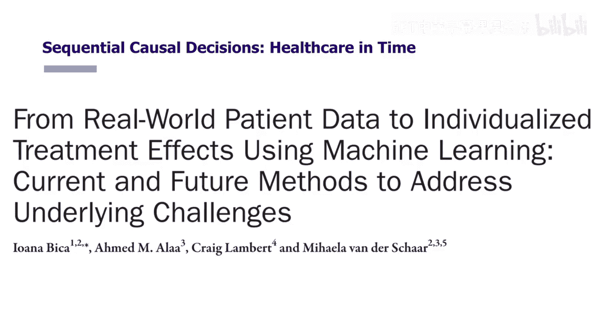

Something that has something like this average treatment effect what you really want to know is what this curve looks like for each individual。

 So if you look at a particular individual you'd like to be to say you know how much could I optimize their treatment in other words it going to make an optimal decision and an individual level and because we're thinking about causal decisions you know the real problem and I've already alluded to this in the introduction to this week the real problem is that you can only make one decision and your history。

 especially if you're looking individualized is relatively weak so figuring out an optimal especially again in a causal type setting an optimal individual treatment is a real challenge so the way of thinking about or one way of thinking about it is to think about the types of patient data you've got coming in and what sorts of decisions you're going to be making so。

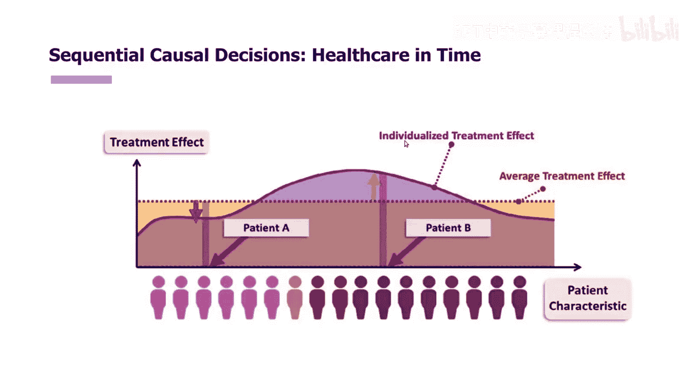

You obviously have a lot of clinical data， at least in principle available3H again。

 a lot of this because of HIPAA requirements in the US are going to be really difficult to get at。

 but at least in principle there's a lot of clinical data that's available in electronic health records so these are things like the age。

 the gender， any comorbidities， genetic information， laboratory measurements， vital signs。

 symptoms the BMI again some indication of their weight and height in BMI and therefore clinically whether they're overweight or not。

 types of treatments， you could think in terms of binary treatment or categorical treatment or multiple treatments or single treatment combined a lot of this in terms of this kind of entry level thinking might be things like which drug to assign and a what dosage so again binary particular drug treat or not treat and then you're thinking about what level on that drug then then in terms of patient outcomes we're thinking in terms of single outcome you as probably easiest。

R probability the most likely or multiple outcomes maybe we're thinking about probability recovery and associated side effects on the treatment so you can think of this again in terms of either an average treatment effect or an individual treatment effect so our treatment decisions come down things like an optimal single treatment or combination of treatments or optimal dosage by trading off some added benefit of treatments and side effects so again a lot of these are things that are really difficult even though we've got a fair amount of data to make an informed decision on and yet we want ideally to do something that's a bit better for the individual and as much as possible to be adjustable over time so our electronic health records again can in principle provide a lot of material for machine learning models these machine learning medicine principle could learn true causal model for the patients again I think we're a long way from this being an everyday reality but this course and our approach to making decisions in time is very much saying this well。

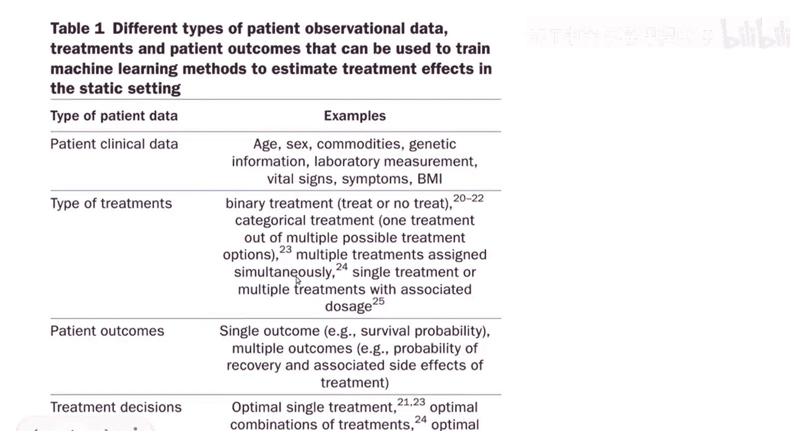

Happ at some point， in the words is we get more and more data and better better at understanding how to make these kind of models。

 I think we can make a prediction， strong prediction that this way of thinking about how to make a causal structure is going to become more and more common so imagine you've got a breast cancer patient you've got some sort of diagnosis data meaning you've can got maybe something like the tumor size and the age the number positive nodes。

 the surgery type that you're considering or that it's already happened some sort of genetic indicator and then you're going to try and predict what you should do next so this could be something about whether to do chemotherapy or not your binary choice is between no treatment or chemotherapy you can have a causal effect for that treatment again you can only do one of these so your actual data is going to be based on one so to speak and your estimate of the effect is often challenging because of this idea of only being able to do one。

 although you can imagine something over time， not maybe so easily with chemotherapy and no treatment but where you alternate and try and see what happens or you try to optimize over time at particular。

But again in this case， the next question is chemotherapy dosage， again。

 if it's a clinical setting where you're thinking about prescriptions。

 you could think of this being some sort of therapy that you're putting in and maybe you could then vary the dosage over time and maybe you could even play with different dosages of a particular compound。

 but again， the real thing to start I hope cementing in for all of you listening is it's a binary treatment。

 either no treatment or treatment。

AndSo then what you want to be thinking about is I've got a set of candidates treatments and you can think of them as a set of different outcomes from these and effectively what you're doing and when you look at the causal effects again。

 the dashed lines here， information where you don't have and the ones that are。

Writen out here are the ones that you actually see so your treatment or not is that binary variable is zero a one going all the way down here and then you get an outcome and so you're only going to be able to see one or the other。

 so the argument is that you can fit this over the set of individuals that you've got maybe in a clinical trial or maybe in the EHR and effectively again。

 the idea would be that we're looking for this sort of a causal effect between no treatment and treatment and you want to average maybe conditional on the type of treatment or you want to think about ways that you can get at this idea of when something is missing。

 so to speak when you only get one outcome can you infer something about that situation that's not been assigned and you can think about doing this in two different ways one way is this kind of a single output model with the treatment is input feature another one is two separate super models so that again these zero ones or whether to treat or not。

 so for example， in the case of the chemotherapy for the cancer patient。

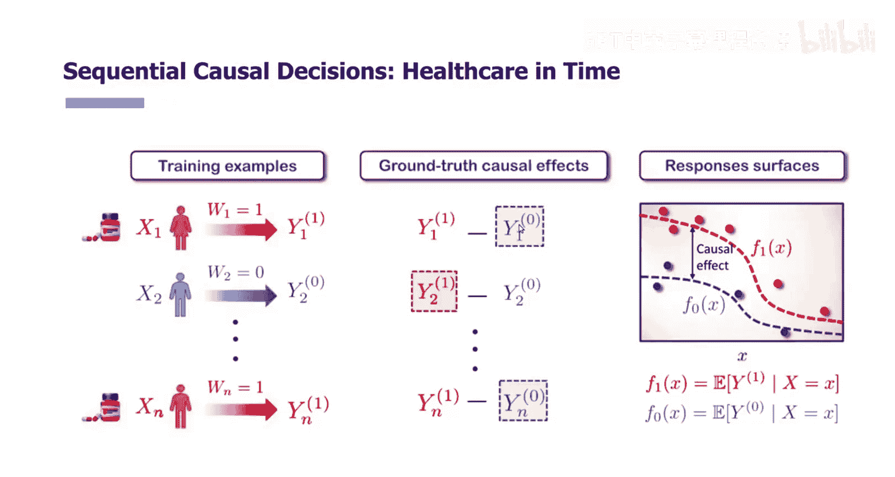

You know do I do it or do I not do it and so we could treat it here where we've got a treatment indicator that's that W and so we can think of this in this product space and we've got treated versus control or you can do it is two separate again zero1 meaning treated or not and then we've got outcomes and again the argument would be ultimately we would like to make this individual it's already hard over a set So we'll be doing some of these methods but again this a survey or tutorial type paper and I think it's really nice that they're giving a of some of the different software that people have been using the types of machine learning models then that are being used in that and some of these again we'll pull I think we my planning for the sections well have bars and causal forest for example as part of the environments they'll get some sense of as we go through this but these are nice because they're regression trees or random forest but you can also think about Gaussian processes are different types of neural networks that are involved in learning these kinds of models so again trying to understand and interpret。

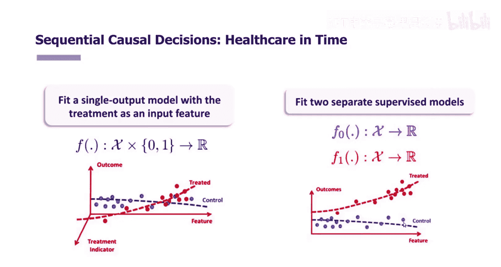

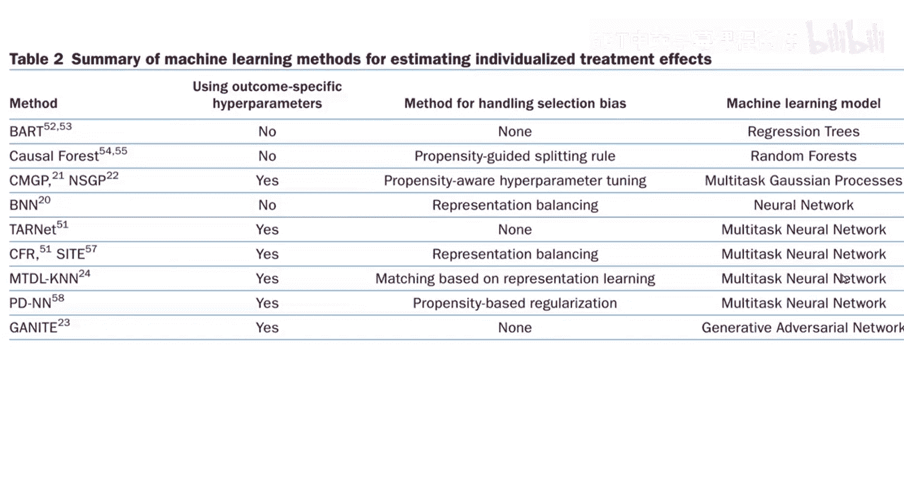

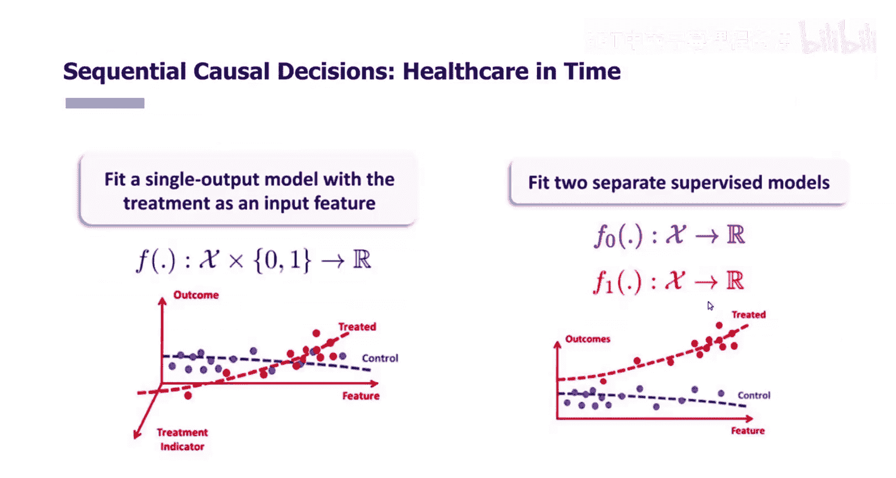

These kinds of surfaces is what you're really trying to do so the idea again is that we've got some sort of best care patient they're coming in。

 we've got our diagnosis， we've got some sort of longitinal information again you can think of these as being at time points that are not equally spaced but they are occurring on their trajectory over time and you're trying to compute a five yearear survival type curve at least in principle again with electronic health records we've got some ability to take in a lot of information and we can try and predict something so imagine then for this individual patient we've got their past history。

Ideally， then we can handle this kind offactual again， we can only assign it one way。

 but we're trying to do a what f type prediction as to what would have happened if we picked the other path so then what we're going to do is optimize to get the best outcomes some maybe we're trying to choose between chemotherapy and radiotherapy or treatment and no treatment a 01 binary type but you can think of this being multicategorical as well So here's some examples of papers that have played within this using different methods sometimes the time is discrete or continuous we'll again be covering some of these and there's other ones out in a very much growing literature on how to do something about predicting these particular routes。

 but again the argument in all of these is that we're trying to understand within the best possible way of thinking about it from our training examples and from our X1 to XN or different ways of coming in and our random assignments ideally for treatment or not we get some idea as to。

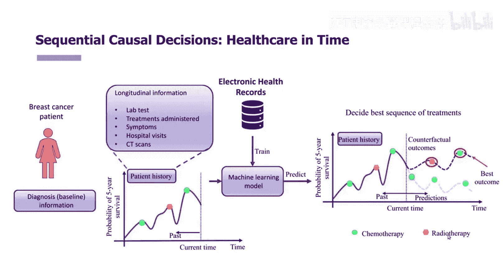

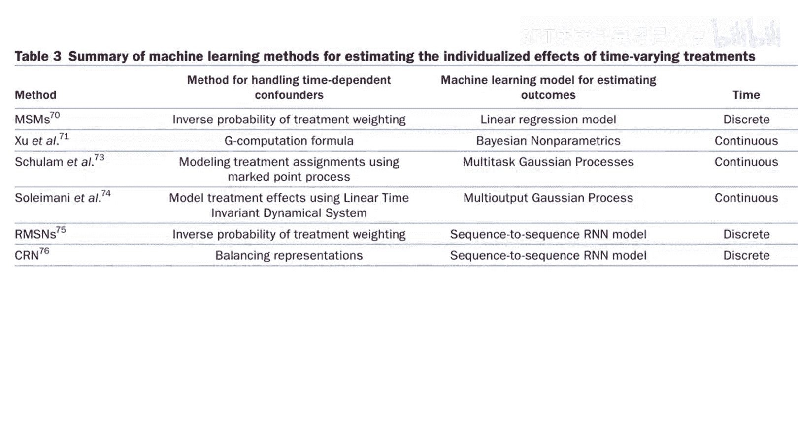

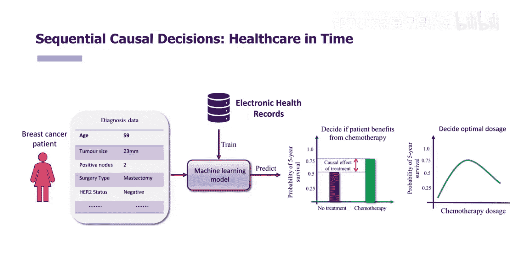

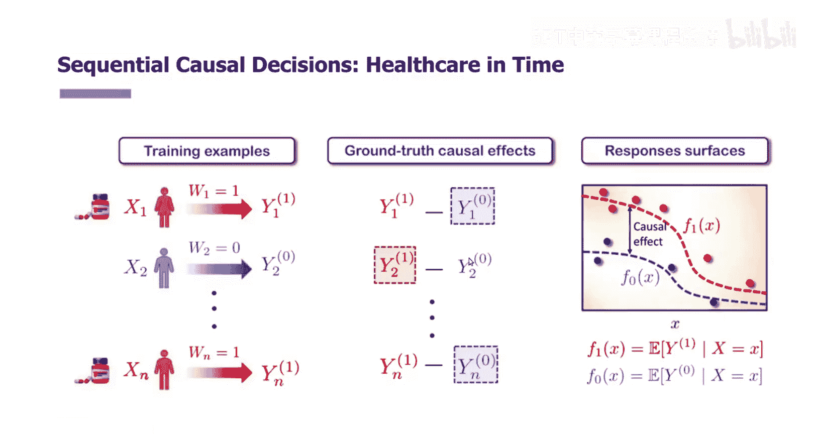

The different surfaces here and so again we can fit that in two different ways。

 we can use different models and we want to optimize over that so I hope with that i've given you a sense of how to do these kinds of causal models for healthcare and again that we more on that as we continue to go through our last course together Thank you。

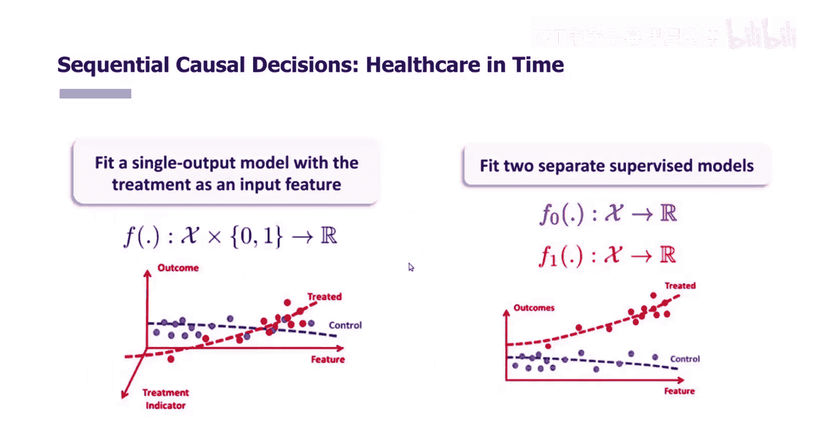