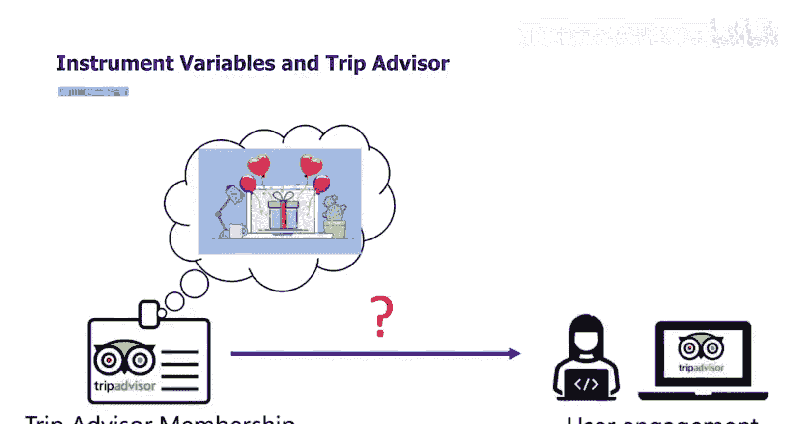
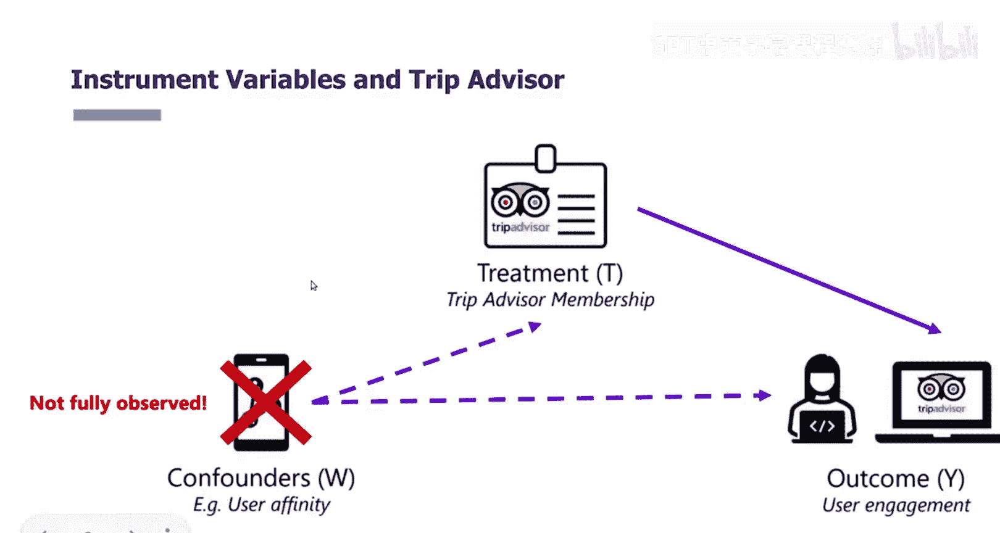
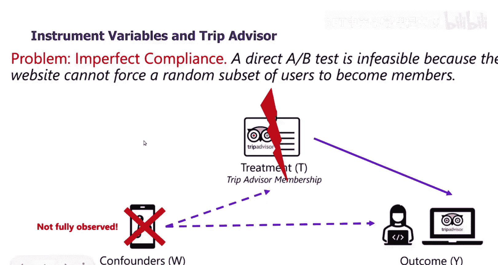
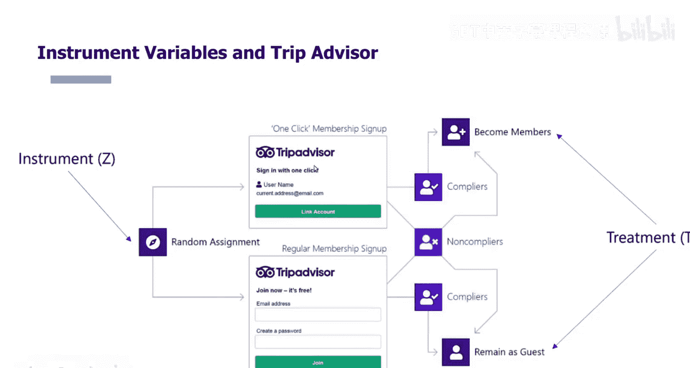
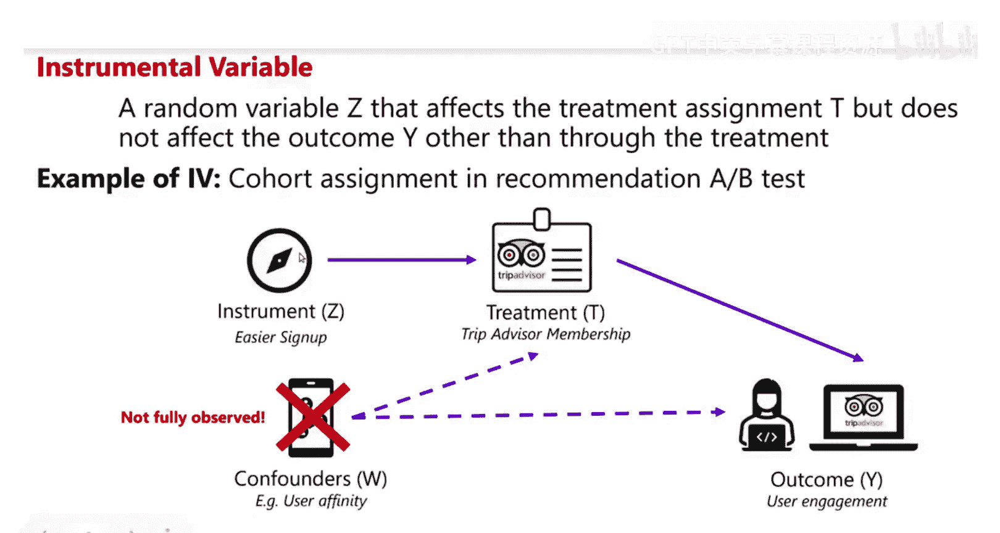
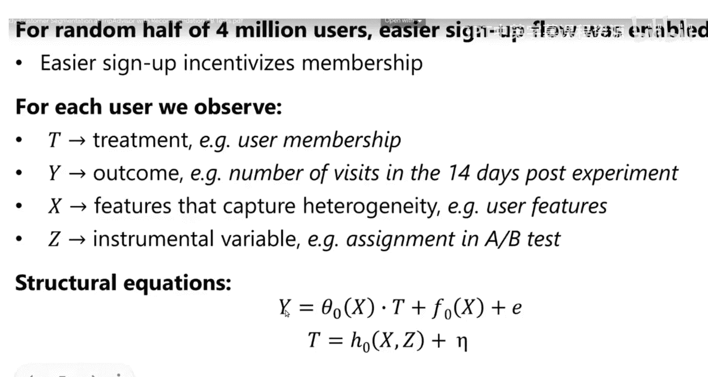
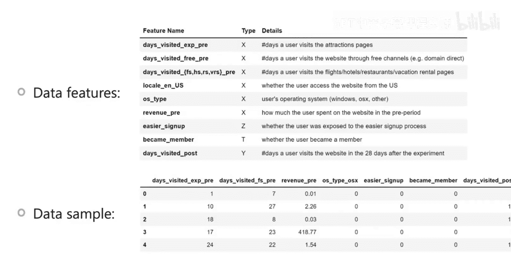
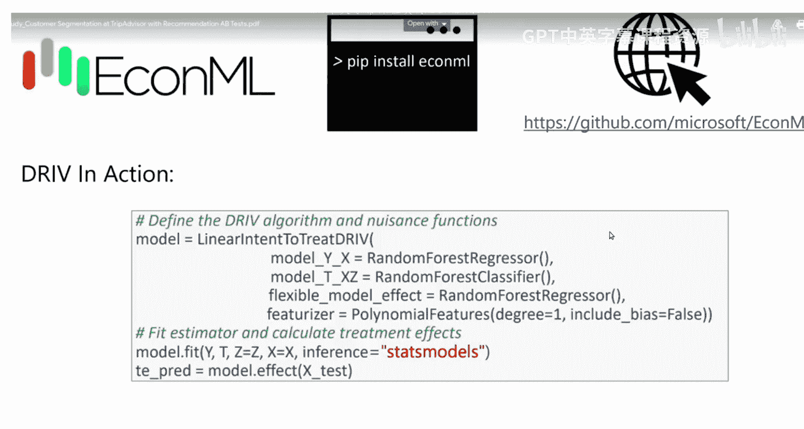
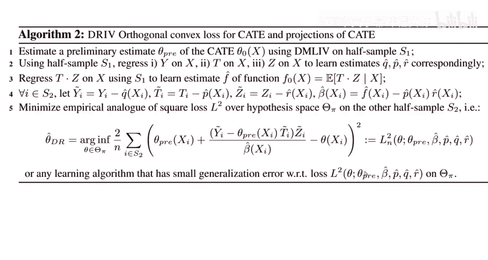
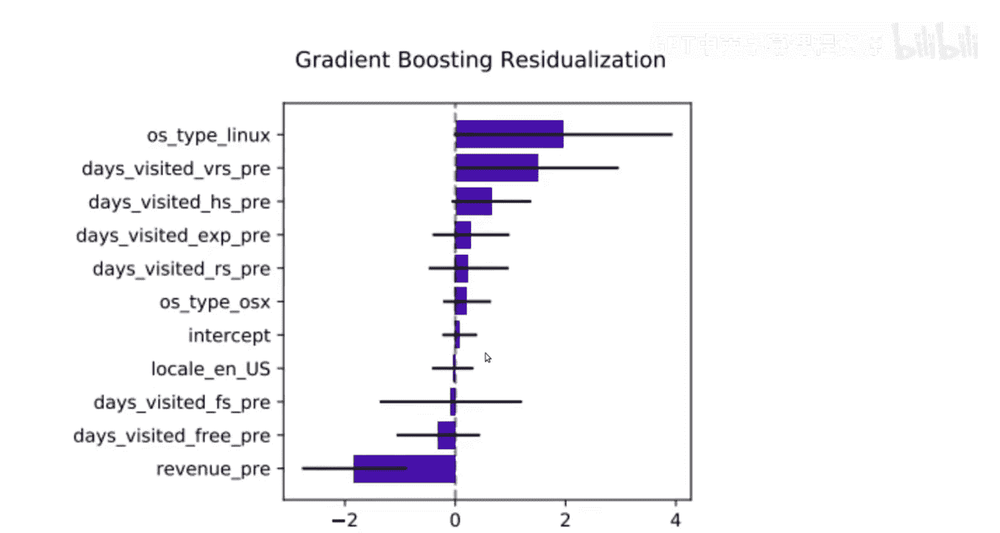

# 约翰霍普金斯大学《数据科学：时间中的决策｜Data Science Decisions in Time》中英字幕 p51 2_使用EconML进行因果A-B测试.zh_en -BV1NCuzzfEJa_p51-

Well I'll talk about a very interesting case study using instant variables and asking an AB testing for Tripavisor data。

This is ultimately going to lead to software which I encourage all of you to explore and learn a little bit more about So Triadvisor had a question that comes up very frequently。

 which is does their membership program make any difference on user engagement so this is a form of AB testing the question you're being asked and again it generalizes it very quickly is between two different types of treatments A versus B is one better than another and in particular in this fourth course we're asking causally can you infer and understand why one particular approach might be better than another in other words can you rationalize it。

 can you explain it and this is obviously a very difficult question but it leads to a really interesting set of approaches and we'll be exploring this throughout our fourth class together where we trying and understand how to set up a causal way of thinking so that in principle when you offer a particular say treatment or approach again this could be treatment in a clinical medicine type setting or treatment in AB testing type setting。

When you offer something， can you constantly understand the potential outcome from that treatment Now a big issue and you've got a sense of this。

 I hope from the introduction to this fourth class is confounders。

 and again confounders means things that have an impact on the outcome but may not be directly measured may be hidden may be present but only partially observed。

 all of these in this instance our insert variables application we're talking about now really in the category of not being fully observed and so again these confounders can be really difficult if we've got a tripador membership maybe there's something like user affinity。

 which also has an impact on the outcome， which is our change in user engagement and note the abbreviations here。

 treatment is T。 so that's what we're going to be ultimately wanting to randomize that's where the instrument variable will come in and then our outcomes Y are increase in user engagement to the treatment again。

 you can think of this clinically， you can think of this many different ways。 it happens to be a。

But the question we're directly asking is， is there a causal connect from a particular choice of treatment into an outcome。

 Confounderers are W。 that's the one that for now， we're going to argue or not fully observed。

 But again， this is the major kcha in all of the causal methods is what to do with compoundunderers and how to handle them。

So here's the problem as well。 you can have imperfect compliance so you recommend a treatment and you're not always going to get everyone responding or compliance is an issue。

 meaning again that they've done something like in this case a Tripaadvisor membership So if you wanted to do a direct A test you can't force this random sub of users to become members So this is an issue for this particular one but it again generalizes if this was a clinical type of thing you may ask people to take a particular medication。

 not everyone's going to take that medication So how do you handle that when you've got imperfect compliance that's the other thing that we're talking about in this part of the class。

Again， a very general problem， similar to confounders。

 it makes the issues with understanding a causal outcome challenging。

The solution here is to use an instrument variable。

 You can think of this as a way to randomly assign your membership。

 So what they're asking an A testing thing here is whetherre making membership sign up easier makes a difference some compliance So here's like a onecl membership sign up。

 Here's a regular membership sign up。 You can see they've asked in this instance now to enter more information versus this one where it's just simply link account And the question。

 again， a A testing or a causal setting， if you randomly assign to one of the other these。

 can you understand causally what's making someone in terms of their outcome variable increased again why this increased user engagement can you understand by this kind of an instrument variable and the random assignments that's applying to the set of people that you're trying to understand。

 Does that make them a better complier。 So here's different complianceliers we've got non-compliers So these are people that responding to the treatment。

 The question is becoming a member remaining as a guest。

Do we see something in terms of the treatment impacts again assigned randomly through instrument that lets us discriminate whether one treatment approach a versus B is better。

 So again， just a really underlined because I think it can be a point of confusion this instrument variable is just a random variable Z again not the notation capital Z itll ultimately in this context be binary。

 but it could be really anything that affects the treatment assignment So again like an A test it's binary it's a01 but it could be really anything they you're using to assign what treatment and the argument is that the why the outcome is not influenced by this instrument variable。

 in other words y is independent of this instrument variable of the random variable Z that's being used to assign the treatment So here's an example of our instrument variable So IV is for instrument variable not like IV if you're thinking it at all clinically。

 you might think of an intervenous type setting but this is instrument variable IV So our。

the recommendation for AB testing again is we've got some treatment。

 Our instrument is asking whether it's an easier sign up or not。

 We're comparing easier sign up versus a regular signup。

 The question is with that treatment including our non-compliance leads to a better user engagement And again。

 we've got our confounders。 This could have an impact and that's in the dash chair on our outcome For now we're going to argue that they're not fully observed and we can still do something here because of our random assignment with our instrument variable。

 They've got in this instance， a really nice goodsized data not everyone has this many users。

 they're going to take a random half of four million users。

 they're going to make an easier sign-up flow that's enabled and the question then is whether that easier signup makes membership easier for them。

 incentivizes it。 So again that's a form of AB testing for each of those users that can observe the treatment So again。

 that's user membership This again is going to variables will randomly give different treatments。

 Why is the outcome so。

The number of visits in the 14 days post experiment， obviously。

 you've got to quantify what you mean by increased engagement。

 So this is gonna be simply the number of visits in the 14 days post the experiment。

 a very reasonable outcome。 You could argue maybe should 7 days or 21 days。

 It really doesn't matter too much as long as you're consistent。

 Two weeks is I I think they're reasonable in assigning that。

 But you could certainly redo this with different numbers of days here。

Then X is the features that capture the heterogeneity so the user features think of these as the covariates so in a purely statistical setting or hypothesis testing setting。

 these would be things that you might think of clinically like things like gender age things that you can think of as relatively static in this instances you might think about things like what platform do they come in on these are features that are captured again in the heterogeneity in the user so think of these as just user features that you have some understanding and then Z again is our instrument variable this is way that we're assigning in the AP test so then we're assuming an outcome y which is some function of x again that's the feature set that we've got for the users times the treatment so again it's binary0 and T and then some other function of our feature space plus some sort of error our treatment is given by some function on x and Z that makes sense because again we've got our instrument variables in maybe a perfect in variable。

So speak we're not even caring about X you can think a treatment is just being assigned by the insert variable directly。

 and then again we've got a form of noise Eta and E are effectively we'll call it everything else that's not being controlled through this So ultimately we're trying to model whether our outcome can be predicted and the way of thinking about this by this state or not X times treatment again can think of treatment is just be like an AB test type setting ton some function of x plus error can we how well is y defined by that that's the equation that we're trying to ask So to give you a sense of the data features and the data sample to give you a sense as to what their data look like again。

 this is tripadvisor very common sort of data we' you can think of these as being our X variables our covariates are things that we know something about the features with So the number of days the visitor visits the attraction page days visited X experiment pre for experiment pre free pre the number days the visitor visits the website。

fre channels， maybe domain direct the days visited so this is visits flights， hotels， restaurants。

 vacation rental pages。 So these are these abbreviations here So think of this is again flights hotels restaurants and then vacation rental pages so these are the four different types of pages and again these are part of the features that we're going to be able to discriminate on locale。

 whether the user enters the website from the U operating system type which I mentioned a minute ago like Windows OSx going from or1 however you want to pronounce it whether're coming from app or Windows or some other maybe like a Linux or some other operating system revenue pre how much the user spent on the website in this pre period and these are all again covariates。

 things that you could use to discriminate different types of users again our insert variable Z whether these user was exposed to the user your sign up process again a or B binary become a member our treatment so this is whether you became a member。

And that's the sort of thing that we're hoping in terms of why the number of days the user visits the website again before it was 14 days it could be 28 days it's whatever you want。

 but the day visited post and again you could vary this number here as you see between the two the numbers were slightly different then we've got our data sample and this is just to show you know for these variables and again these are largely addressed in our covariates you can see what they look like in the data and again this is one of these things where they've got a really big data set because it's all collected via modern technology and scales out to very。

 very large numbers of people so。

The code that I mentioned at the beginning， and I'd really urge all of you to pay some attention to this。

 I think it's really quite fun。 Microsoft has been one of the major developers has been really the major developer I should say behind it it's made in such a way that it's easy for people to play with。

 So there's several variants， but this econ Ml is the one we're talking about now you'll see as we go further into our fourth class。

 there's some other ones off of these Microsoft Github pages that are tied into this。

 but it enables you to do these kind of causal models fairly straightforward。

 So there are particular model is called DIV essentially you just make a model。

 Linear intended treat。 DRV， their particular model。I mentioned earlier， random forest type things。

 We've got random forest regressor and classifier。 So we make a model for y based on x for G based on x and z。

 we've a flexible model effect。 So we've got our regressor， our regressor classifier。

 And then we make our featureturizer。 And then we just fit the model。 So the models now fit again。

 our outcomes， our treatment， our instrument variable， our covariates。

 we're going to use this inference the stats models。

 and then we've got an prediction effect coming out from that。 So actually very easy to use。

 which is why we would urge urge all of you to。Go ahead and do it like a Pi install on this or bring it down from their Gitthub repo for whatever system you've got and play with it as part of your work in our fourth class together。

 So the paper behind this， which will also be part of your reading this week is a combined effort from Microsoft research I see the names here and from Triadvisor and again I alluded to this in the beginning that really built from the Triadvisor data and again all these people from Microsoft contributed to it and again itll be part of your reading it was machine learning estimation of heterogeneous treatment effects with instruments again Z was our instrument variable in this one I'm going to try and give you a sense for their algorithm again。

 there's a fair amount more in their paper and be part of your reading but this DRIV is an orthogonal convex loss for conditionally average treatment effect and projections so conditionally average treatment effect There's five steps here trying and give you some sense the first step in their algorithm as we estimate this preliminary estimate the su so again theta is part of their outcome variable it's trying to make a model for this。

understandstand how well it does against what actually happen。 So condition which treatment effect。

 they do not on x again， x is our covariates using。

 and this is this model that they've previously defined an algorithm1 on the half sample S1 then we use half sample。

 we regress Y on x and then T on x and then Z on x this is part of the model Then I just showed you in code we were making an estimators Q hat P R hat。

 then we regress this T dot C remember that was part of our final model on x using S1 so this was our half sample to learn our estimate f hat on this function again。

 we need not on x is part of our predictor for y so it's an expectation on t dot Z conditioning on x again x is our descriptor or because there's be covariates on our set of individuals then for all I from S2 again we had half sample S1。

S2 we've got Y sququile and this is this estimator difference。 our treatment again。

 we've got estimators， our treatment difference。 and then Z hatt， again。

 that's our instrument variable。 and then beta hat。

 you can think of this as being related to for F the difference using P hat and our hat and then all they're doing is just doing a minimization on this empirical analog of at least squared loss。

 So of you that had a lot of machine learning。 you need some sort of loss function and that's all that we're doing they're doing in this last be here。

 we've got an hypothesis space。 it's another way of raising it it's like an hypothesis test using a least squares loss estimator So we've got our half samples S2 and we just do our infinitefinm on our hypothesis space to random our sum effectively what we're asking is whether estimator relative to this function theta p and T that's our term that we had before with our instrument variables whether this function ultimately like a least squares loss makes sense and you can do that with many different learning。

Arithms。 you can think of this as as a loss again that we're minimizing。

 So then to give you some feeling for their results。

 I think the results in this instance are interesting but less critical than the method。

 What they find is the operating system pipe made a big impact than days visited pre was the next big then days visit these are these four different types remember that they had looked at Soification rentals maybe restaurants to give you another example and then we've got other ones going down here's revenue pre。

 which was not a strong predictor So interesting to get some sense。

 and again this is really the method is what's important is to argue that we can get a causal understanding of how the system is put together so we'll pause at this point and I hope this has helped you to begin to see a little further into making decisions in time with causal methods okay thank you。

