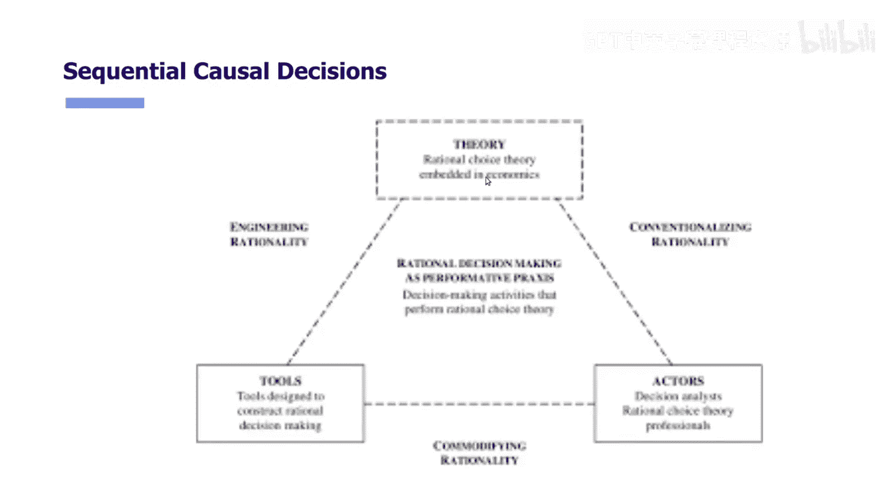
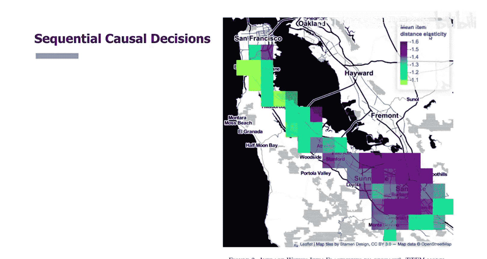
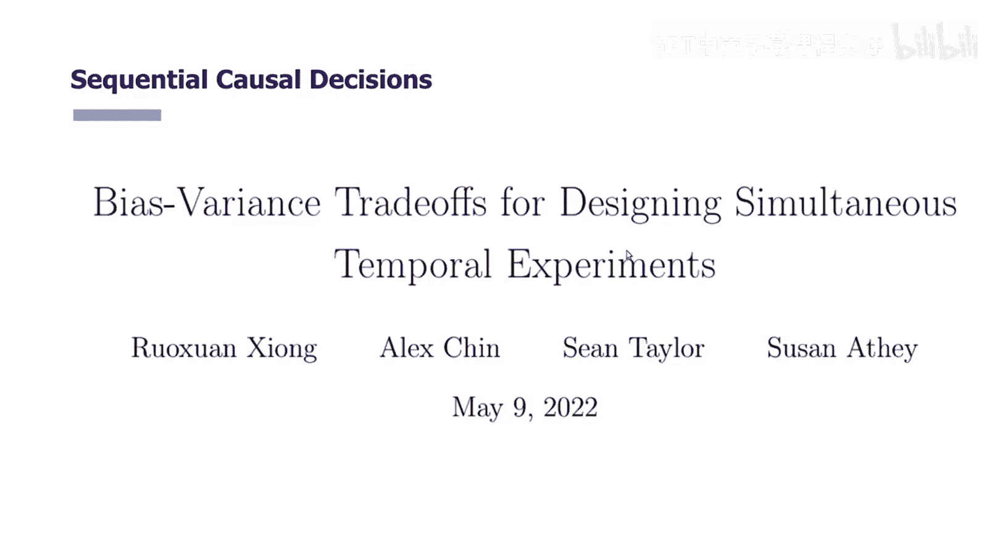
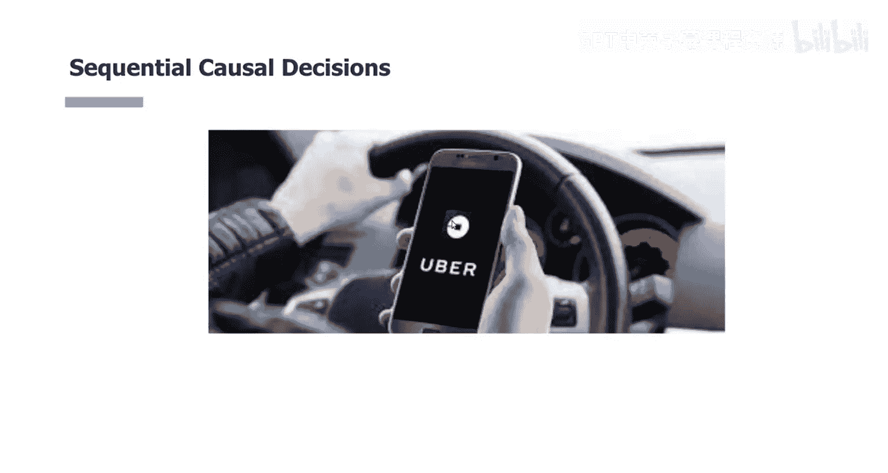
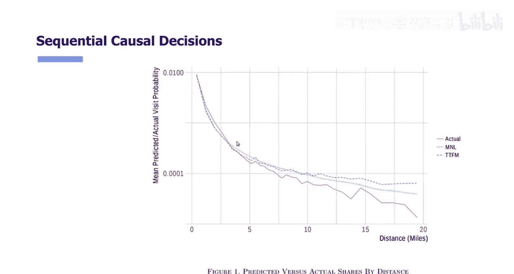
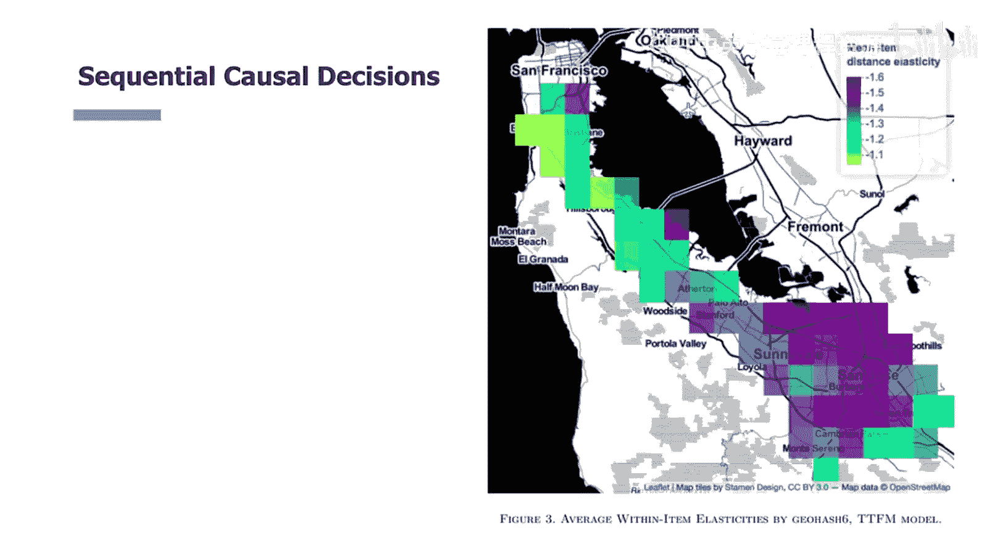

# 约翰霍普金斯大学《数据科学：时间中的决策｜Data Science Decisions in Time》中英字幕 p52 3_地理位置如何影响决策.zh_en -BV1NCuzzfEJa_p52-

In our second week we'll now talk about geographic decisions these are so sequential The questions's being addressed now is what happens when we add in both a geographic type of description as well as a temporal type of description this largely comes from work that Susan Athe and David La and colleagues have done the first thing they were looking at here which I thought was really quite interesting was restaurants where they had ideas of travel time and cost and food type this was all in the Bay Area as you'll see in a moment the question I they generalizes very nicely there's many many things that have a spatial component as well as a temporal component and so being able to deal with both in a modeling context is really important so they had a big data set here that came from anonymized geolocation data so then they could ask for lunchtime restaurants that make a difference how far was it from work。

 what type of food it was how expensive it was when it was open it ultimately goes to whether you can rationally decide where best to put at particular。

restaurantestaurant of a particular type and this goes to something and I apologize its a little fuzzy but goes to something in what's called rational choice theory and economics。

 it's very common to think about consumer preferences and alluded to this a little bit last week but I just kind of want to remind now this is a fairly old theory in economics and yet I think it's become very much inli and by the amount of data that's coming online from electronic reference points for example these cell phones that reporting geolocation data and modern machine learning methods so this goes to really new tools that are becoming available and also new types of approaches in terms of controls and actors so that one can imagine in terms of ability to control things as we're going be talking about a little bit later on in this set of slides we can potentially adjust again this goes to making rational decisions in general but imagines that we can make our actions much more quickly so effectively what we've got。

New tools we've got new types of actors and so rational choice theories become much richer。

 much potentially involved than it was in some of the earlier economics literature so this is one of their figures figure3 from their paper and I'll be going where this a little bit more detail as well and also concluding with it but the idea here is they can term elasticity for a particular location for particular restaurants based again on distance and price from the location so and type of restaurant from the location so you can see that it's varying from 1。

1 to 1。6 and magnitude this is now a slope the way I like to think about elasticity。

 some of you may like to think it this way as well is almost like an electronics where I've got a current voltage type curve in other words I can think about resistance or conductance and I'm taking a ratio between one to the other if that helps you please think of it that way but it doesn't if I confuse you then don't worry about it but the argument you're making is effective with a slope you're trying to。

stand in a elasticity measure， how much we change price or if you change distance or if you change some variable。

 how much does that change demand， and that's the fundamental concept of elasticity so essentially what they had is a bunch of geolocated cell phones that are effectively anonymously reporting their location they would know prior to lunch hour where someone was then they could track which restaurant they went to within a reasonable location so you see again。

 this bay area as I should have emphasized once again were looking just along this southern part of the bay so going towards San Jose from south San Francisco these are all restaurants along the way geolocated so they could make sure that they were going in fact to restaurant location and。

And they look up things like the yp if you see whether that had an impact on where people went for lunch。

 the argument being that can you anticipate demand。

 can you predict the main factors that drive choice for a particular restaurant this because to all sorts of interesting literature on consumer choice and behavior and ultimately whether you can predict enough about consumer behavior to make rational decisions which again is our light motif for our specialization So in this way of thinking about it you can make a utility function for the consumer choice for which restaurant that are going to go to for lunch。

 P， you can think of that as again coming from yelp or other measures。

 maybe even just crowd maybe reputation amongst other people at work customer preference。

 maybe they've got a preference for Thai or Japanese relative to others distance effect whether it's nearby or further away so again elasticity you're going expect it to be less popular if it's further away。

 less likely to go there， less utility， if it's further away timeframe effect， a time of。

or seasonality in terms of time of year and then of course there's an nice term so you're trying to fit this model within the data and so you're trying to understand what's going on so here's an example for different price points to different mid price points Western versus Asian cuisine and then cheap treats more fast food so again going to different food types and different price points。

 and the argument is that from this data you can start to make a prediction as to again by fitting it and therefore making causal ultimately that would be the goal again。

 you can do what if types think so going back to Jdeo Pearl's ladder we're going from purely looking at the data to beyond association and beyond even a do calculus where we're doing the experiment and doing different treatments and much more into the counterfactuals。

 what if what if I put a different restaurant in a particular location at a different price point。

 what kind of demand would I expect to see how many customers would I expect to see are。

Really fascinating questions and again in the context of lunchtime food。

 I think it's something everyone can engage with without many concernss that might come up from being say clinical data or other sorts of things that potentially have a lot more emotional baggage。

 lunch， time， restaurant choices， I think everyone can sympathize with what is potentially going on in there where you're choosing by price or by cuisine type or by distance。

 those are reasonable metrics we're trying to think how one might do it。

The other example we'll be going through this week is this more recent paper largely again from Susan Atthe's group on a Bipherite straightoffs for designing simultaneous temporal experiments the question here is thingss that you might imagine related to elasticity again of interest to things like Uber but other places as well looking at elasticity again。

 but now in terms of purchase probability， brand choice probability。

 purchase quality and you can think of that in the context of something like Uber。

 I've got a geographic set of cars， consumers may have a preference for maybe particular types of cars。

 particular locations， maybe they need Uber eats or something similar anyway you're imagining different sorts of experiments that could be run out over time and so。

That's essentially what they're looking at。 And now I'll try and give you some feeling for it。

 So WL1，2 and3， these are different treatment choices。 And then they have an effect on demand。

 And then we've got some sort of confounder that comes in that's having an impact on that as well。

 The question ultimately goes to can I temporarily assign treatments in such a way that I optimize and can I do this in such way that each of these treatments can be moving forward in time almost independently of other treatments。

 You can imagine multiple actor so to speak changing these treatments， having an impact on demand。

 Can I deconvolve that in some way。 can I understand the impact of these different treatment options on the demand。

 especially in the presence of confounders So that'll be more coming up on that。

 but I think it's a really fascinating question， but really going back again to try and help you see into the scientific demand because I want to make sure everyone sees it I imagine I've got some sort of price。

 I've got some sort of quantity bought at a particular price。This idea of rise over run。

 which I was alluded to earlier， is essentially what we mean when we talk about something that has elasticity。

 So if I change price， how much do I change the quantity that's being associated with that。

 And so you can think of that as being the slope and estimate of that and so I can take elasticity along that curve where I can take it as a line along there it depends on how quickly this particular curve is changing but you can think of elastic and it's being related to rise over run along this kind of a curve。

 So we go back to our entrance point where we're thinking about restaurants and how they' doing it。

 you can see there's a form of elasticity with distance and the predicted visits and so we're effectively saying as you get further away of makes sense。

 I'd say it's very very common sense。 their main model is this Ttfm right here。

 the dash blue line and effectively what we're saying is that as you go further away。

 your probability of going to the restaurant falls dramatically。01 and 300。0001 so 10 to 30s。

So a fairly dramatic fall off going， say， from five miles to 10 miles。

 or maybe even two and a half miles to five miles is a better way to look at it。

 So what that means is you can make a prediction then based on the crowd density one's own for how much。

P elasticity so to speak you're going have as a function of distance and that's a really interesting thing to be able to comment on how much to you predict your demand will fall for customers being pulled from increasing distances from the restaurant So it ultimately goes to this figure that I start with and little going be ending with which is these elasticity measures for different locations So you're basically saying the demand elastic demand is different in this southern region relative to this region appear closer to the San Francisco area and this is going to then be a function of the density of restaurants in those zones but especially also the price points and the workers' preferences within these zones and finally than the crowd preferences how much reputation there is maybe particular office parks all like to go to similar restaurants for example So there's a lot of interesting things that could be thought about and still more coming ahead this week。

 but the essence of what we're after again is going get。

And elasticity within these zones come to understand how the demand for these different restaurants changes during the day due to restaurant type price and due to popularity so again fascinating questions and I hope you'll enjoy this this week。

 thank you。

