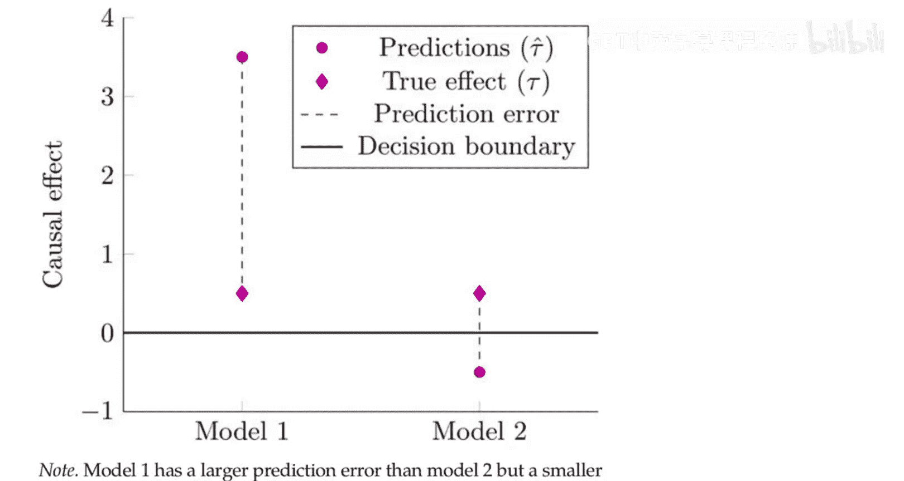
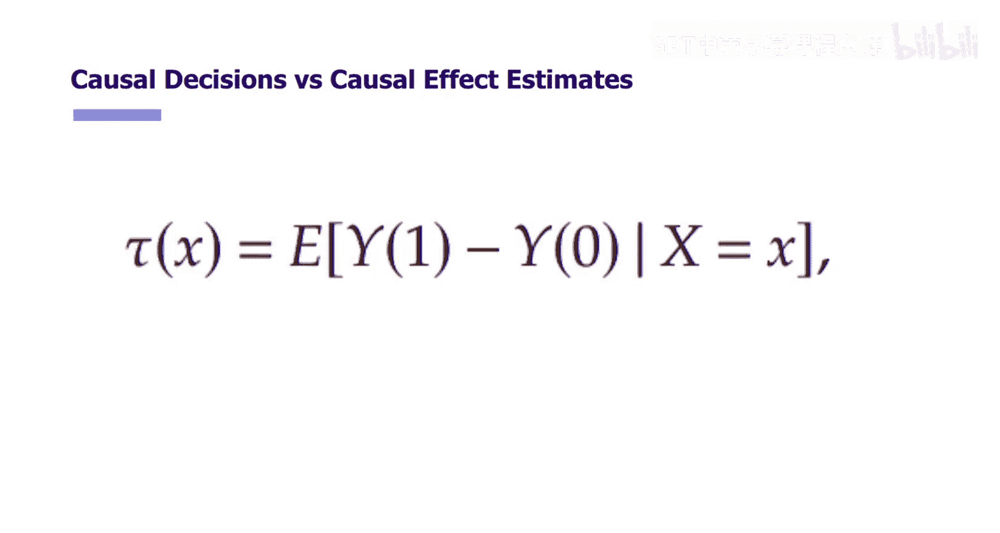
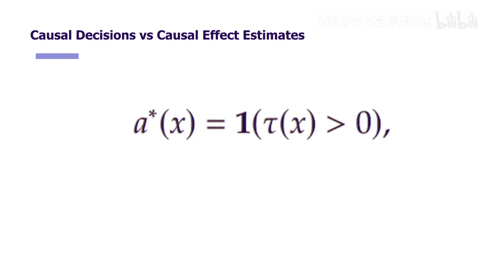
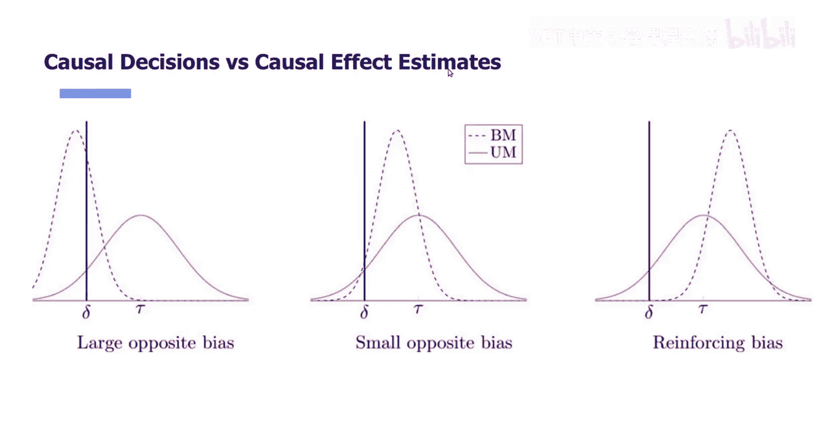
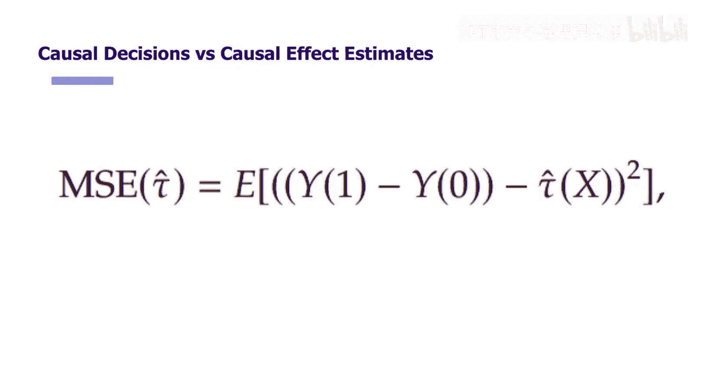
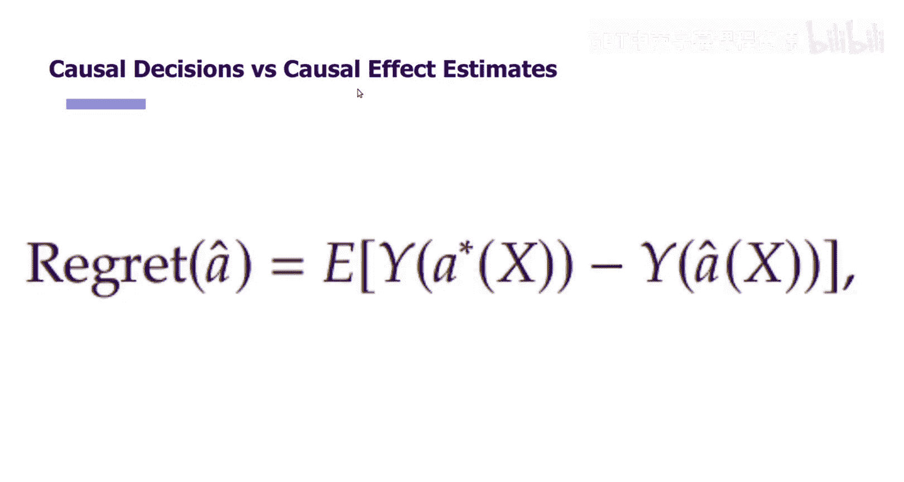
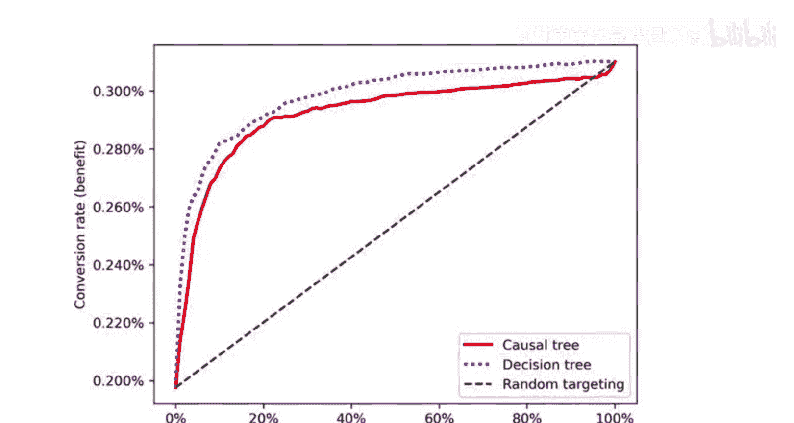

# 约翰霍普金斯大学《数据科学：时间中的决策｜Data Science Decisions in Time》中英字幕 p53 4_这是一个决策需求还是一种估计.zh_en -BV1NCuzzfEJa_p53-

When I talk about the distinction between causal decisions and causal effect estimation。

 this is really analogous to a decision boundary set by classification versus something defined by regression or phrased even more simply the difference between classification and regression and I think you can see it very clearly in this figure we have two different models here。

 Model 1 and model 2 you've got a true effect here in the blue diamonds and then we've got predictions that are coming from the different models。

 The causal effect boundary here of 0 is where it would be above that where it's worth making a treatment decision to treat below that the opposite and neutral at zero。

 and so Model1 here is going to be a better model for predicting because you can see it's always above the line。

 it's always above the zero， whereas Model 2 in this instance crosses that line it stddles that line So even though Model2 might be by some practitioners seem。

Seeing to be better because it's got a smaller error Model1 might be better for treatment decisions。

 and so if we think of the classification type analogy as being how to make the best decision。

 so causal decisions or classification then classificationifying which ones to treat as in Model1 here is actually better than trying to do a regression which might lead to a smaller prediction error but poor classification。

 so in other words the decision boundary and in other words what you want to be doing with it could make a difference in terms of what you'd want to do classification type model and expect maybe even accept it be better word a larger prediction error versus a regression type where you're looking for a much better tighter prediction over a wider range of data。

 but your classification type result may not be quite as good in the rigid decision on who to treat may not be quite as good。

 and so this journalists fairly quickly good classification regression are known to be distinct。

Methods good for one not necessarily good for the other， so it's something very much to keep in mind。

This way of thinking about things comes from modeling the difference that expect a difference between the treatment options in a causal effect type estimation you're frequently tasked again a regression type thing with trying to understand how X now again you can only see one of the two effects you think it as a binary1 and0 you're either treating or not treating if you think of1 and0 you've got an expectation conditional in all the covariates a particular values of x and so this kind of causal effect estimate is the main thing that one's trying to do in many causal models is to estimate for these kind of one of settings for these settings where we don't know what's going on and again this is really a form of regression。

On the other hand， what we're often trying to do is to make a best action。

 a best decision relative to some threshold， so imagine again that we want to go above zero for our treatment。

 our decision to treat would be optimized by treating everyone where in that same frame where we're still thinking in terms of regression type fit where we knew our taux was greater than zero。

 we would want to make an optimal action that was always one well maybe to see this better without being quite so concerned about knowing tau directly but simply by optimizing on a star other words's defining a optimal action and therefore deciding when best to do a particular treatment it may be best to be that as classification and another way of seeing this is to imagine different biased models relative to unbiased models so the unbiased model is seen here we've got three different ones and then we've got three different types of biased models showing with these dashed lines and。

This is a large opposite bias。 This a small， opposite bias。 This is a reinforcing bias。 Again。

 our decision boundary is this vertical line。 So similar to what we were just dealing with。

 if I've got a biased model that is far to the left of that then working from the regression type model for classification would be clearly be better if on the other hand。

 they're roughly the same in terms of the man area say in the untreated versus the treated。

 then it wouldn't make much difference， which to pick on the other hand。

 if there's a large biased shift to the right， it may in fact。

 be better to work again with a bias model rather than non-biased model。

 and I should to add that I'll put the paper up in the readings。

 but this all comes from a paper directly on this about causal decisions versus causal effect estimates。

 and so what we're going over is something you'll be doing some more reading on to help reinforce what we're going over here。

 So phrased another way then we want to be thinking in terms of our mean square error an expectation on our treatment versus non-treatment relative to our model this is a machine learning way of thinking about。

Estimate that we're trying to do really a regression type estimate。

 And this is then be like a least squares estimator once again。

 can we optimize this in an expectation type setting？

 Another way of thinking about is like in a multibandit setting。

 explore exploit type setting where we're trying to define the best actions。

 Think of that as a star relative model a hat in an expectation and then thinking about it in terms of regret。

 So this really is the paper itself outlines provides a very fertile ground for new research because the question again is whether we're thinking in terms of causal decisions or we're thinking in terms of causal effect estimates And again。

 the idea is that it makes quite big difference in terms of what you're trying to do。

 And in this last example， the argument that I think quite strongly being put forward is that it may in some settings be just as good deal with systems where you're not so worried about confounding you're just looking for that optimal action。

 So you can compare here， a decision tree in this dashed blue versus a causal tree and both of them in this。

Type of diagram when we're thinking about a conversion rate in the words like a benefit come up with very。

 very similar benefits and one based on say bias data that's been collected。

 data that's been collected maybe for other purposes and now being reused to try and figure out optimal actions it may be much easier to define things for classification in that setting than to define something for regression so a lot of food for thought in this I hope this has helped you to see into the nuances of classification regression as well as to think about the nuances of different types of models again optimal actions think really about multi bandit things and really trying to figure out to treat or not to treat under which covariates which you define it and the other kind of more strictly causal type model was more regression type model and again requirements there on the data are much much deeper so very interesting I think paper for。

for thought。 So okay， with that， we'll pause and thank you。

